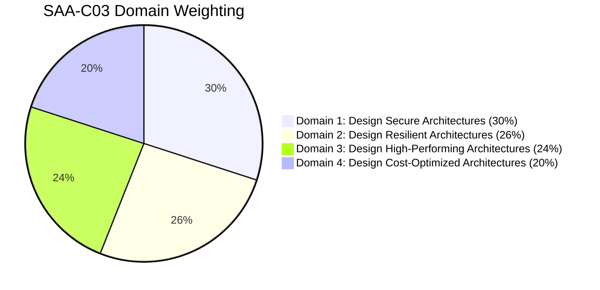

# 📝 AWS SAA-C03 Real Mock Exam Hub
### 100% Real Exam Simulation Tests with In-Depth Burmese Explanations

AWS Certified Solutions Architect – Associate (SAA-C03) စာမေးပွဲကို ပထမအကြိမ်တွင်ပင် High Score ဖြင့် ဖြေဆိုအောင်မြင်စေရန် တကယ့် Real Exam Standard အတိုင်း မေးခွန်း ၆၅ ခုပါဝင်သော Full Mock Exam Tests များကို အသေးစိတ် မြန်မာဘာသာ ရှင်းလင်းချက်၊ မှန်/မှား ခွဲခြမ်းစိတ်ဖြာချက်များနှင့်တကွ စနစ်တကျ ပြုစုထားသော Hub ဖြစ်ပါသည်။

---

## 🎯 AWS SAA-C03 Exam Structure & Overview

| Item | Details |
| :--- | :--- |
| **Exam Code** | SAA-C03 (AWS Certified Solutions Architect - Associate) |
| **Total Questions** | **65 Questions** (50 Scored + 15 Unscored Experimental) |
| **Duration** | **130 Minutes** (2 Hours 10 Minutes) |
| **Passing Score** | **720 / 1000** (Scaled Score) |
| **Question Types** | Multiple Choice (1 Correct Answer) & Multiple Response (2-3 Correct Answers) |
| **Language Format** | မေးခွန်းနှင့် Options များ = **Real Exam English** ၊ ရှင်းလင်းချက် = **စေ့စပ်သေချာသော မြန်မာဘာသာ** |

---

## 📊 Exam Domain Weights (SAA-C03 Blueprint)

1. **Domain 1: Design Secure Architectures (30%)**
   - IAM, AWS KMS, AWS Secrets Manager, S3 Object Lock, S3 Bucket Policies, VPC Endpoints, AWS WAF, Shield, Security Groups, NACLs.
2. **Domain 2: Design Resilient Architectures (26%)**
   - Multi-AZ Deployments, Auto Scaling Groups, Elastic Load Balancers (ALB/NLB), Route 53 Routing Policies, Aurora Global Database, SQS Decoupling, Disaster Recovery (RPO/RTO).
3. **Domain 3: Design High-Performing Architectures (24%)**
   - High Throughput Compute, FSx for Lustre, ElastiCache (Redis/Memcached), DynamoDB DAX, CloudFront Caching, Global Accelerator, Read Replicas, S3 Transfer Acceleration.
4. **Domain 4: Design Cost-Optimized Architectures (20%)**
   - S3 Lifecycle Rules & Intelligent-Tiering, EC2 Spot Instances & Savings Plans, Aurora Serverless, Target Tracking Scaling, AWS Organizations & Resource Access Manager (RAM).

---

## 📚 Mock Exam Practice Tests Index

| Test | Title | Question Count | Core Focus Areas | Direct Link |
| :---: | :--- | :---: | :--- | :--- |
| **Test 01** | **SAA-C03 Full Mock Exam 01** | **65 Questions** | Auto Scaling, S3 Security & WORM, Aurora Global, VPC Endpoints, CloudFront, FSx, IAM Federation | [**Start Test 1 (Q01–Q65) →**](/aws-mock-exam/01_test_01_65_questions/) |
| **Test 02** | **SAA-C03 Full Mock Exam 02** | **65 Questions** | STS AssumeRole, DynamoDB Provisioned, RDS Proxy, Control Tower, Network Firewall, Route 53 Routing | [**Start Test 2 (Q01–Q65) →**](/aws-mock-exam/02_test_02_65_questions/) |

---

## 💡 How to Use These Mock Exams for Maximum Results

1. **ပထမအကြိမ် ကိုယ်တိုင်ဖတ်ပြီး အဖြေရွေးပါ:**
   - မေးခွန်းတစ်ခုချင်းစီ၏ English Scenario ကို အရင်ဖတ်ပါ။
   - မေးခွန်း၏ **Key Requirement** (ဥပမာ: "most cost-effective", "least operational overhead", "prevent accidental deletion", "RPO < 1s") ကို Highlight လုပ်ပါ။
2. **Correct Answer ကို မကြည့်မီ အဖြေထုတ်ပါ:**
   - အဖြေမှန်ကို စိတ်ထဲတွင် သို့မဟုတ် စာရွက်ပေါ်တွင် မှတ်သားထားပါ။
3. **မြန်မာဘာသာ ရှင်းလင်းချက်ကို အသေးစိတ်ဖတ်ပါ:**
   - အဖြေမှန် ရွေးချယ်မှု ဘာကြောင့် မှန်ရသလဲ?
   - ကျန် Option များ (A, B, C, D) သည် အဘယ်ကြောင့် မှားယွင်းရသလဲ?
   - **Real Exam Tip** များမှ အဓိက Keyword Pairings များကို အလွတ်မှတ်သားပါ။
4. **Weak Domains များကို ပြန်လည် Revisit လုပ်ပါ:**
   - မိမိမှားသော မေးခွန်းများ၏ AWS Service အပိုင်း (ဥပမာ: FSx, DynamoDB Sharding, S3 Object Lock) ကို [All in One Feature of SAA](/aws-saa/00_overview/) တွင် ပြန်လည်လေ့လာပါ။
