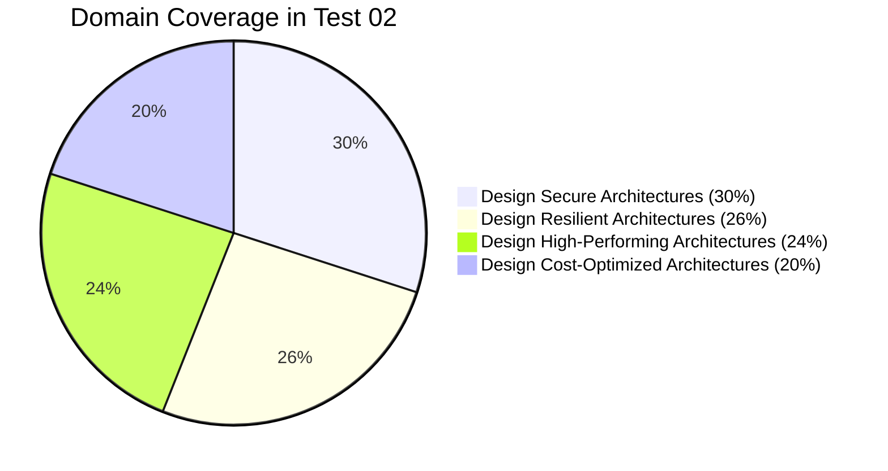

# 📝 AWS SAA-C03 Mock Exam — Test 02
### Interactive Real Exam Simulation (65 Questions) with Spoiler-Free UI & In-Depth Explanations

  

    <h3 style="margin: 0; font-size: 1.15rem; color: var(--klook-orange);">🎯 SAA-C03 Practice Exam Simulation</h3>
    Real Exam Standard
  

  

    ဤ Mock Exam သည် စာမေးပွဲ စစ်စစ်တွင် တွေ့ကြုံရမည့် မေးခွန်းပုံစံအတိုင်း ပြုစုထားပါသည်။ အဖြေများကို စတင်ဖတ်ရှုချိန်တွင် ဖုံးအုပ်ထားသဖြင့် (Spoiler-Free) ကိုယ်တိုင် အရင်ရွေးချယ်ပြီးမှ အဖြေနှင့် မြန်မာဘာသာ ရှင်းလင်းချက်ကို ဖွင့်ဖတ်နိုင်ပါသည်။
  

  

    

      
65

      
Questions

    

    

      
130m

      
Target Time

    

    

      
720 / 1000

      
Passing Score

    

    

      
≥ 47 / 65

      
Passing Target

    

  

  

    

      🧭 Quick Question Navigator (မေးခွန်းသို့ အမြန်သွားရန်)
    

    

      <button type="button" class="exam-btn" onclick="document.querySelectorAll('details.exam-answer-details').forEach(d => d.open = true)">🔓 Show All Answers</button>
      <button type="button" class="exam-btn" onclick="document.querySelectorAll('details.exam-answer-details').forEach(d => d.open = false)">🔒 Hide All Answers</button>
    

  

  

    <a href="#q01" class="exam-grid-link">Q01</a>
    <a href="#q02" class="exam-grid-link">Q02</a>
    <a href="#q03" class="exam-grid-link">Q03</a>
    <a href="#q04" class="exam-grid-link">Q04</a>
    <a href="#q05" class="exam-grid-link">Q05</a>
    <a href="#q06" class="exam-grid-link">Q06</a>
    <a href="#q07" class="exam-grid-link">Q07</a>
    <a href="#q08" class="exam-grid-link">Q08</a>
    <a href="#q09" class="exam-grid-link">Q09</a>
    <a href="#q10" class="exam-grid-link">Q10</a>
    <a href="#q11" class="exam-grid-link">Q11</a>
    <a href="#q12" class="exam-grid-link">Q12</a>
    <a href="#q13" class="exam-grid-link">Q13</a>
    <a href="#q14" class="exam-grid-link">Q14</a>
    <a href="#q15" class="exam-grid-link">Q15</a>
    <a href="#q16" class="exam-grid-link">Q16</a>
    <a href="#q17" class="exam-grid-link">Q17</a>
    <a href="#q18" class="exam-grid-link">Q18</a>
    <a href="#q19" class="exam-grid-link">Q19</a>
    <a href="#q20" class="exam-grid-link">Q20</a>
    <a href="#q21" class="exam-grid-link">Q21</a>
    <a href="#q22" class="exam-grid-link">Q22</a>
    <a href="#q23" class="exam-grid-link">Q23</a>
    <a href="#q24" class="exam-grid-link">Q24</a>
    <a href="#q25" class="exam-grid-link">Q25</a>
    <a href="#q26" class="exam-grid-link">Q26</a>
    <a href="#q27" class="exam-grid-link">Q27</a>
    <a href="#q28" class="exam-grid-link">Q28</a>
    <a href="#q29" class="exam-grid-link">Q29</a>
    <a href="#q30" class="exam-grid-link">Q30</a>
    <a href="#q31" class="exam-grid-link">Q31</a>
    <a href="#q32" class="exam-grid-link">Q32</a>
    <a href="#q33" class="exam-grid-link">Q33</a>
    <a href="#q34" class="exam-grid-link">Q34</a>
    <a href="#q35" class="exam-grid-link">Q35</a>
    <a href="#q36" class="exam-grid-link">Q36</a>
    <a href="#q37" class="exam-grid-link">Q37</a>
    <a href="#q38" class="exam-grid-link">Q38</a>
    <a href="#q39" class="exam-grid-link">Q39</a>
    <a href="#q40" class="exam-grid-link">Q40</a>
    <a href="#q41" class="exam-grid-link">Q41</a>
    <a href="#q42" class="exam-grid-link">Q42</a>
    <a href="#q43" class="exam-grid-link">Q43</a>
    <a href="#q44" class="exam-grid-link">Q44</a>
    <a href="#q45" class="exam-grid-link">Q45</a>
    <a href="#q46" class="exam-grid-link">Q46</a>
    <a href="#q47" class="exam-grid-link">Q47</a>
    <a href="#q48" class="exam-grid-link">Q48</a>
    <a href="#q49" class="exam-grid-link">Q49</a>
    <a href="#q50" class="exam-grid-link">Q50</a>
    <a href="#q51" class="exam-grid-link">Q51</a>
    <a href="#q52" class="exam-grid-link">Q52</a>
    <a href="#q53" class="exam-grid-link">Q53</a>
    <a href="#q54" class="exam-grid-link">Q54</a>
    <a href="#q55" class="exam-grid-link">Q55</a>
    <a href="#q56" class="exam-grid-link">Q56</a>
    <a href="#q57" class="exam-grid-link">Q57</a>
    <a href="#q58" class="exam-grid-link">Q58</a>
    <a href="#q59" class="exam-grid-link">Q59</a>
    <a href="#q60" class="exam-grid-link">Q60</a>
    <a href="#q61" class="exam-grid-link">Q61</a>
    <a href="#q62" class="exam-grid-link">Q62</a>
    <a href="#q63" class="exam-grid-link">Q63</a>
    <a href="#q64" class="exam-grid-link">Q64</a>
    <a href="#q65" class="exam-grid-link">Q65</a>
  

---

  

    Q01
    

      Domain 4: Cost-Optimized Architectures
      Multi-Select (Select 2)
    

  

**A digital media company shares static content to its premium users around the world and also to their partners who syndicate their media files. The company is looking for ways to reduce its server costs and securely deliver their data to their customers globally with low latency.**

**Which combination of services should be used to provide the MOST suitable and cost-effective architecture? (Select TWO.)**

  
**A)** Amazon S3

  
**B)** Amazon CloudFront

  
**C)** AWS Global Accelerator

  
**D)** Amazon API Gateway

  
**E)** AWS Direct Connect

  💡 Click to Reveal Answer & In-Depth Burmese Explanation (အဖြေနှင့် ရှင်းလင်းချက် ကြည့်ရန်)
  ▼

**✅ Correct Answer: A, B**

### မြန်မာဘာသာ အသေးစိတ် ရှင်းလင်းချက်

**A) Amazon S3 & B) Amazon CloudFront → ✅ မှန်ပါသည်**
> - **Amazon S3** သည် static content (images, videos, documents) များကို 99.999999999% (11 9s) durability ဖြင့် စရိတ်သက်သာစွာ သိမ်းဆည်းရန် အကောင်းဆုံး object storage ဖြစ်ပါသည်။
> - **Amazon CloudFront** သည် ကမ္ဘာတစ်ဝန်းရှိ Edge Locations များတွင် content များကို cache လုပ်ပေးပြီး low latency ဖြင့် ဖြန့်ဝေပေးပါသည်။ CloudFront ကို S3 အရှေ့တွင် ခံသုံးခြင်းဖြင့် S3 မှ ထွက်သော data transfer out costs ကို သက်သာစေသည့်အပြင် Origin Access Control (OAC) / Signed URLs / Signed Cookies များကို သုံး၍ premium users များနှင့် partners များကိုသာ လုံခြုံစွာ access ပေးနိုင်ပါသည်။

**C) AWS Global Accelerator → ❌ မှားပါသည်**
> Global Accelerator သည် static content များကို cache မလုပ်ပေးပါ။ ၎င်းသည် anycast static IP addresses များကို သုံး၍ TCP/UDP traffic များကို AWS global backbone network မှတစ်ဆင့် dynamic application endpoints များဆီသို့ route လုပ်ပေးရန်သာ ဖြစ်ပြီး static media files များအတွက် cost-effective မဖြစ်ပါ။

**D) Amazon API Gateway → ❌ မှားပါသည်**
> API Gateway သည် REST/HTTP/WebSocket APIs များကို စီမံခန့်ခွဲရန် ဖြစ်ပြီး static media files (video/audio files) များကို global delivery ပြုလုပ်ရန် မရည်ရွယ်ပါ။

**E) AWS Direct Connect → ❌ မှားပါသည်**
> Direct Connect သည် on-premises data center နှင့် AWS VPC ကြား dedicated private fiber connection ချိတ်ဆက်ခြင်းဖြစ်ပြီး ကမ္ဘာတစ်ဝန်းရှိ users/partners များထံသို့ media files ဖြန့်ဝေရန် မသက်ဆိုင်ပါ။

**💡 Real Exam Tip:**
- **"Static content globally + Low latency + Cost-effective + Secure delivery"** → **Amazon S3 + Amazon CloudFront**

---

  

    Q02
    

      Domain 1: Secure Architectures
      Single Choice (Select 1)
    

  

**An Intelligence Agency developed a missile tracking application that is hosted on both development and production AWS accounts. The Intelligence agency’s junior developer only has access to the development account. The developer has received security clearance to access the agency’s production account but the access is only temporary and only write access to Amazon EC2 and Amazon S3 is allowed.**

**Which of the following allows the developer to issue short-lived access tokens that act as temporary security credentials to allow access to AWS resources?**

  
**A)** AWS Security Token Service (AWS STS)

  
**B)** Amazon Cognito Identity Pools

  
**C)** AWS Key Management Service (AWS KMS)

  
**D)** IAM User Access Keys with an inline permission boundary

  💡 Click to Reveal Answer & In-Depth Burmese Explanation (အဖြေနှင့် ရှင်းလင်းချက် ကြည့်ရန်)
  ▼

**✅ Correct Answer: A**

### မြန်မာဘာသာ အသေးစိတ် ရှင်းလင်းချက်

**A) AWS Security Token Service (AWS STS) → ✅ မှန်ပါသည်**
> **AWS STS** သည် AWS resources များကို ယာယီ access ရယူနိုင်ရန် short-lived credentials (access key ID, secret access key, session token) များကို ထုတ်ပေးသော web service ဖြစ်ပါသည်။ Cross-account access အတွက် Production account တွင် IAM Role တစ်ခု (EC2 နှင့် S3 write access policy ပါဝင်သော role) ဆောက်ပြီး Dev account ရှိ developer အား `sts:AssumeRole` API call ခေါ်ယူခွင့် ပေးခြင်းဖြင့် သတ်မှတ်ထားသော အချိန်ကာလ (ဥပမာ ၁ နာရီ) အတွက်သာ တရားဝင်သော temporary security credentials ကို ရရှိစေပါသည်။

**B) Amazon Cognito Identity Pools → ❌ မှားပါသည်**
> Cognito Identity Pools သည် mobile သို့မဟုတ် web application အသုံးပြုသူများ (external users) အား AWS resources သို့ temporary access ပေးရန် သုံးခြင်းဖြစ်ပြီး internal developer ၏ cross-account IAM role assumption အတွက် မသုံးပါ။

**C) AWS Key Management Service (AWS KMS) → ❌ မှားပါသည်**
> AWS KMS သည် data encryption keys များကို ဖန်တီး/စီမံရန်ဖြစ်ပြီး security access tokens ထုတ်ပေးခြင်းနှင့် မသက်ဆိုင်ပါ။

**D) IAM User Access Keys with an inline permission boundary → ❌ မှားပါသည်**
> IAM User Access Keys များသည် long-term credentials ဖြစ်ပြီး short-lived (ယာယီ) မဟုတ်ပါ။ Permission boundaries သည် permissions ကို ကန့်သတ်နိုင်သော်လည်း temporary credentials ထုတ်မပေးနိုင်ပါ။

**💡 Real Exam Tip:**
- **"Cross-account temporary access / Short-lived access tokens / Temporary security credentials"** → **AWS STS (AssumeRole)**

---

  

    Q03
    

      Domain 3: High-Performing Architectures
      Single Choice (Select 1)
    

  

**A solutions architect is instructed to host a website that consists of HTML, CSS, and some Javascript files. The web pages will display several high-resolution images. The website should have optimal loading times and be able to respond to high request rates.**

**Which of the following architectures can provide the most cost-effective and fastest loading experience?**

  
**A)** Host the website on Amazon S3 with static website hosting enabled, and configure an Amazon CloudFront distribution to cache and serve the content globally

  
**B)** Deploy the website on an Auto Scaling group of Amazon EC2 instances behind an Application Load Balancer

  
**C)** Store the HTML, CSS, and JS files in Amazon EFS, and mount the filesystem to an Amazon ECS cluster running AWS Fargate tasks

  
**D)** Host the website on an Amazon S3 bucket and use AWS Global Accelerator to route web traffic directly to the bucket

  💡 Click to Reveal Answer & In-Depth Burmese Explanation (အဖြေနှင့် ရှင်းလင်းချက် ကြည့်ရန်)
  ▼

**✅ Correct Answer: A**

### မြန်မာဘာသာ အသေးစိတ် ရှင်းလင်းချက်

**A) Amazon S3 static website hosting + Amazon CloudFront → ✅ မှန်ပါသည်**
> HTML, CSS, JavaScript နှင့် high-resolution images များသည် static files များ ဖြစ်သောကြောင့် **Amazon S3** တွင် သိမ်းဆည်းပြီး အရှေ့တွင် **Amazon CloudFront** ခံထားခြင်းသည် အကောင်းဆုံး architecture ဖြစ်ပါသည်။ CloudFront သည် ကမ္ဘာတစ်ဝန်းရှိ edge locations များတွင် high-resolution images များကို cache လုပ်ပေးထားသောကြောင့် အမြန်ဆုံး load time ကို ရရှိစေပြီး high request rates များကို serverless ပုံစံဖြင့် လွယ်ကူစွာ ကိုင်တွယ်နိုင်ပါသည်။ Server (EC2/Fargate) maintain လုပ်ရန် မလိုသောကြောင့် operational overhead အနည်းဆုံးနှင့် cost-effective အဖြစ်ဆုံး ဖြစ်ပါသည်။

**B) Auto Scaling group of EC2 behind ALB → ❌ မှားပါသည်**
> Static content များအတွက် EC2 instances များကို အမြဲ run ထားရသဖြင့် server maintenance, patching နှင့် computing cost များ မလိုအပ်ဘဲ ကုန်ကျပါသည်။

**C) Amazon EFS mounted to ECS Fargate → ❌ မှားပါသည်**
> Static website အတွက် EFS နှင့် ECS Fargate ကို သုံးခြင်းသည် over-engineered ဖြစ်ပြီး ကုန်ကျစရိတ် အလွန်မြင့်မားပါသည်။

**D) Amazon S3 with AWS Global Accelerator → ❌ မှားပါသည်**
> AWS Global Accelerator သည် content များကို edge location များတွင် cache မလုပ်ပေးနိုင်ပါ။ ထို့အပြင် S3 static website endpoints များကို Global Accelerator ၏ endpoint အဖြစ် တိုက်ရိုက် သတ်မှတ်၍ မရပါ။

**💡 Real Exam Tip:**
- **"Static website (HTML/CSS/JS/Images) + Fast loading + High request rate + Most cost-effective"** → **S3 + CloudFront**

---

  

    Q04
    

      Domain 3: High-Performing Architectures
      Single Choice (Select 1)
    

  

**A music publishing company is building a multitier web application that requires a key-value store with provisioned capacity mode that will save the document models. Each model is composed of band ID, album ID, song ID, composer ID, lyrics, and other data. The web tier will be hosted in an Amazon ECS cluster with AWS Fargate launch type.**

**Which of the following is the MOST suitable setup for the database tier?**

  
**A)** Amazon DynamoDB with provisioned capacity mode

  
**B)** Amazon Aurora Serverless v2

  
**C)** Amazon DocumentDB (with MongoDB compatibility)

  
**D)** Amazon RDS for PostgreSQL

  💡 Click to Reveal Answer & In-Depth Burmese Explanation (အဖြေနှင့် ရှင်းလင်းချက် ကြည့်ရန်)
  ▼

**✅ Correct Answer: A**

### မြန်မာဘာသာ အသေးစိတ် ရှင်းလင်းချက်

**A) Amazon DynamoDB with provisioned capacity mode → ✅ မှန်ပါသည်**
> မေးခွန်း၏ အဓိက သော့ချက်မှာ **"key-value store with provisioned capacity mode that will save the document models"** ဖြစ်ပါသည်။ **Amazon DynamoDB** သည် fully managed NoSQL database ဖြစ်ပြီး key-value store ပုံစံရော JSON/document models များကိုပါ natively support လုပ်ပါသည်။ ထို့အပြင် DynamoDB တွင် **Provisioned Capacity Mode** (RCU/WCU သတ်မှတ်ခြင်း) ပါဝင်သောကြောင့် predictable traffic ရှိသော application များအတွက် ကုန်ကျစရိတ်ကို တိကျစွာ ထိန်းချုပ်နိုင်ပါသည်။

**B) Amazon Aurora Serverless v2 → ❌ မှားပါသည်**
> Aurora သည် relational database (SQL) ဖြစ်ပြီး key-value store မဟုတ်ပါ။ ထို့အပြင် provisioned RCU/WCU mode မဟုတ်ဘဲ ACU (Aurora Capacity Units) ဖြင့် scale လုပ်ပါသည်။

**C) Amazon DocumentDB → ❌ မှားပါသည်**
> DocumentDB သည် document-oriented database ဖြစ်သော်လည်း cluster instances များဖြင့် run ရပြီး DynamoDB ကဲ့သို့ "key-value store with provisioned capacity mode" မဟုတ်ပါ။

**D) Amazon RDS for PostgreSQL → ❌ မှားပါသည်**
> RDS for PostgreSQL သည် relational database ဖြစ်ပြီး NoSQL key-value store မဟုတ်ပါ။

**💡 Real Exam Tip:**
- **"Key-value store + Document model + Provisioned capacity mode"** → **Amazon DynamoDB**

---

  

    Q05
    

      Domain 2: Resilient Architectures
      Single Choice (Select 1)
    

  

**A company hosts its web application on a set of Amazon EC2 instances in an Auto Scaling group behind an Application Load Balancer (ALB). The application has an embedded NoSQL database. As the application receives more traffic, the application becomes overloaded mainly due to database requests. The management wants to ensure that the database is eventually consistent and highly available.**

**Which of the following options can meet the company requirements with the least operational overhead?**

  
**A)** Migrate the embedded NoSQL database to an Amazon DynamoDB table

  
**B)** Deploy a MongoDB cluster on Amazon EC2 instances across multiple Availability Zones

  
**C)** Migrate the database to Amazon Aurora Multi-Master

  
**D)** Install Apache Cassandra on an Amazon EMR cluster

  💡 Click to Reveal Answer & In-Depth Burmese Explanation (အဖြေနှင့် ရှင်းလင်းချက် ကြည့်ရန်)
  ▼

**✅ Correct Answer: A**

### မြန်မာဘာသာ အသေးစိတ် ရှင်းလင်းချက်

**A) Migrate the embedded NoSQL database to Amazon DynamoDB → ✅ မှန်ပါသည်**
> Embedded NoSQL database သည် EC2 instance တစ်ခုချင်းစီတွင် တွဲလျက် run နေသောကြောင့် traffic တက်လာချိန်တွင် EC2 CPU/Memory နှင့် disk I/O ကို ကုန်ခမ်းစေပြီး scaling လုပ်ရခက်ခဲစေပါသည်။ **Amazon DynamoDB** သို့ ပြောင်းရွှေ့ခြင်းဖြင့် fully managed NoSQL serverless database ဖြစ်သွားပြီး အလိုအလျောက် high availability (3 AZs replication) နှင့် default အားဖြင့် **Eventually Consistent Reads** ကို ပံ့ပိုးပေးပါသည်။ Server provisioning, patching သို့မဟုတ် cluster management လုပ်ရန် မလိုသောကြောင့် operational overhead အနည်းဆုံး ဖြစ်ပါသည်။

**B) Deploy a MongoDB cluster on Amazon EC2 across multi-AZ → ❌ မှားပါသည်**
> EC2 ပေါ်တွင် MongoDB ကို ကိုယ်တိုင် install လုပ်ပြီး cluster setup လုပ်ခြင်းသည် OS patching, backups, sharding နှင့် high availability configuration များကို manual လုပ်ရသဖြင့် operational overhead အလွန်များပြားပါသည်။

**C) Migrate to Amazon Aurora Multi-Master → ❌ မှားပါသည်**
> Aurora Multi-Master သည် Relational (SQL) database ဖြစ်ပြီး NoSQL data model နှင့် မကိုက်ညီပါ။ ထို့အပြင် DynamoDB ထက် operational setup ပိုများပါသည်။

**D) Install Apache Cassandra on Amazon EMR → ❌ မှားပါသည်**
> EMR ပေါ်တွင် Cassandra cluster run ခြင်းသည် high overhead ရှိပြီး web application ၏ primary transactional database အဖြစ် အသုံးပြုရန် မသင့်တော်ပါ။

**💡 Real Exam Tip:**
- **"Embedded NoSQL database overloaded + High availability + Eventually consistent + Least operational overhead"** → **Amazon DynamoDB**

---

  

    Q06
    

      Domain 2: Resilient Architectures
      Multi-Select (Select 2)
    

  

**A media company has two VPCs: VPC-1 and VPC-2 with peering connection between each other. VPC-1 only contains private subnets, while VPC-2 only contains public subnets. The company uses a single AWS Direct Connect connection and a virtual interface to connect its on-premises network with VPC-1.**

**Which of the following options increases the fault tolerance of the connection to VPC-1? (Select TWO.)**

  
**A)** Establish a second AWS Direct Connect connection from a different Direct Connect location

  
**B)** Set up an AWS Site-to-Site VPN over the internet to VPC-1 as a backup connection

  
**C)** Add a second peering connection between VPC-1 and VPC-2

  
**D)** Configure AWS Transit Gateway and delete the Direct Connect connection

  
**E)** Create an internet gateway in VPC-1 and configure NAT gateways in VPC-2

  💡 Click to Reveal Answer & In-Depth Burmese Explanation (အဖြေနှင့် ရှင်းလင်းချက် ကြည့်ရန်)
  ▼

**✅ Correct Answer: A, B**

### မြန်မာဘာသာ အသေးစိတ် ရှင်းလင်းချက်

**A) Establish a second AWS Direct Connect connection from a different location → ✅ မှန်ပါသည်**
> Direct Connect connection တစ်ခုတည်းသာ ရှိခြင်းသည် single point of failure (SPOF) ဖြစ်စေပါသည်။ အခြား မတူညီသော Direct Connect location တစ်ခုမှ နောက်ထပ် Direct Connect connection တစ်ခု ထပ်မံချိတ်ဆက်ခြင်းသည် dual-link high resilience / maximum fault tolerance ကို ရရှိစေပါသည်။

**B) Set up an AWS Site-to-Site VPN over the internet as a backup → ✅ မှန်ပါသည်**
> Primary Direct Connect connection ပြတ်တောက်သွားပါက အလိုအလျောက် failover လုပ်နိုင်ရန်အတွက် **AWS Site-to-Site VPN** ကို backup connection အဖြစ် IPsec tunnel ထောင်ထားခြင်းသည် cost-effective ဖြစ်ပြီး fault tolerance ကို သိသာစွာ တိုးတက်စေသော standard AWS best practice ဖြစ်ပါသည်။

**C) Add a second peering connection between VPC-1 and VPC-2 → ❌ မှားပါသည်**
> VPC Peering သည် VPC နှစ်ခုကြားတွင် peering connection တစ်ခုသာ ထားရှိနိုင်ပြီး VPC peering သည် on-premises နှင့် VPC-1 ချိတ်ဆက်မှု fault tolerance နှင့် မသက်ဆိုင်ပါ။

**D) Delete the Direct Connect connection → ❌ မှားပါသည်**
> ရှိပြီးသား Direct Connect ကို ဖျက်ပစ်ခြင်းသည် dedicated low-latency bandwidth ကို ဆုံးရှုံးစေပါသည်။

**E) Create an internet gateway in VPC-1 → ❌ မှားပါသည်**
> VPC-1 တွင် IGW ဆောက်ခြင်းသည် on-premises Direct Connect fault tolerance ကို မတိုးတက်စေသည့်အပြင် VPC-1 ၏ private subnets သဘောသဘာဝကို ပျက်ပြားစေပါသည်။

**💡 Real Exam Tip:**
- **"Direct Connect Fault Tolerance / Backup / High Availability"** → **Second Direct Connect connection** AND/OR **AWS Site-to-Site VPN as backup**

---

  

    Q07
    

      Domain 1: Secure Architectures
      Single Choice (Select 1)
    

  

**A company owns a photo-sharing app that stores user uploads on Amazon S3. There has been an increase in the number of explicit and offensive images being reported. The company currently relies on human efforts to moderate content, and it wants to streamline this process by using Artificial Intelligence to only flag images for review. For added security, any communication with its resources on its Amazon VPC must not traverse the public Internet.**

**How can this task be accomplished with the LEAST amount of effort?**

  
**A)** Use Amazon Rekognition to detect inappropriate content, and configure an Interface VPC Endpoint (AWS PrivateLink) for Amazon Rekognition

  
**B)** Build a custom convolutional neural network (CNN) model using Amazon SageMaker and deploy it on an EC2 instance inside the private subnet

  
**C)** Use Amazon Comprehend with a Gateway VPC Endpoint to analyze image metadata

  
**D)** Create an AWS Lambda function that downloads the images from S3 and calls an external open-source image moderation API over a NAT Gateway

  💡 Click to Reveal Answer & In-Depth Burmese Explanation (အဖြေနှင့် ရှင်းလင်းချက် ကြည့်ရန်)
  ▼

**✅ Correct Answer: A**

### မြန်မာဘာသာ အသေးစိတ် ရှင်းလင်းချက်

**A) Use Amazon Rekognition + Interface VPC Endpoint (PrivateLink) → ✅ မှန်ပါသည်**
> **Amazon Rekognition** တွင် built-in **Content Moderation API** ပါရှိပြီး explicit, suggestive သို့မဟုတ် offensive images များကို pre-trained AI ဖြင့် အလိုအလျောက် detect လုပ်ပြီး confidence score ဖြင့် flag လုပ်ပေးနိုင်သောကြောင့် custom model တည်ဆောက်စရာမလိုဘဲ least effort ဖြစ်ပါသည်။ ထို့အပြင် **Interface VPC Endpoint (AWS PrivateLink)** ကို အသုံးပြုခြင်းဖြင့် VPC အတွင်းရှိ compute resources များသည် public internet သို့ မထွက်ဘဲ AWS internal network မှတစ်ဆင့် Rekognition service ကို လုံခြုံစွာ ခေါ်ယူအသုံးပြုနိုင်ပါသည်။

**B) Build a custom CNN model on Amazon SageMaker → ❌ မှားပါသည်**
> Custom model ကို ကိုယ်တိုင် data gathering, training, tuning နှင့် deployment ပြုလုပ်ရသဖြင့် operational effort အလွန်ကြီးမားပါသည်။ Pre-trained Rekognition ရှိနေသဖြင့် မလိုအပ်ပါ။

**C) Use Amazon Comprehend with Gateway VPC Endpoint → ❌ မှားပါသည်**
> Amazon Comprehend သည် Text/NLP analysis service ဖြစ်ပြီး images များကို detect မလုပ်နိုင်ပါ။ ထို့အပြင် Gateway VPC Endpoint သည် S3 နှင့် DynamoDB အတွက်သာ ရှိပြီး Rekognition သို့မဟုတ် Comprehend အတွက် မရှိပါ။

**D) Call external open-source API over NAT Gateway → ❌ မှားပါသည်**
> NAT Gateway မှတစ်ဆင့် public internet သို့ ထွက်ရသောကြောင့် "must not traverse the public internet" ဆိုသည့် requirement ကို ချိုးဖောက်ပါသည်။

**💡 Real Exam Tip:**
- **"Image moderation / Flag explicit photos with AI"** → **Amazon Rekognition**
- **"Access AWS services without traversing public internet"** → **Interface VPC Endpoint (AWS PrivateLink)**

---

  

    Q08
    

      Domain 1: Secure Architectures
      Single Choice (Select 1)
    

  

**An application is hosted in AWS Fargate and uses RDS database in Multi-AZ Deployments configuration with several Read Replicas. A Solutions Architect was instructed to ensure that all of their database credentials, API keys, and other secrets are encrypted and rotated on a regular basis to improve data security. The application should also use the latest version of the encrypted credentials when connecting to the RDS database.**

**Which of the following is the MOST appropriate solution to secure the credentials?**

  
**A)** Store the credentials in AWS Secrets Manager and configure automatic secret rotation using an AWS Lambda function

  
**B)** Store the credentials in AWS Systems Manager Parameter Store as standard parameters and set up a cron job on an EC2 instance to rotate them

  
**C)** Encrypt the credentials with AWS KMS and store them directly inside the container environment variables in the ECS task definition

  
**D)** Store credentials in an Amazon S3 bucket with default encryption and use an S3 Event Notification to trigger rotation

  💡 Click to Reveal Answer & In-Depth Burmese Explanation (အဖြေနှင့် ရှင်းလင်းချက် ကြည့်ရန်)
  ▼

**✅ Correct Answer: A**

### မြန်မာဘာသာ အသေးစိတ် ရှင်းလင်းချက်

**A) Store in AWS Secrets Manager + automatic rotation → ✅ မှန်ပါသည်**
> **AWS Secrets Manager** သည် database credentials, API keys နှင့် secrets များကို AWS KMS key ဖြင့် encrypt လုပ်၍ သိမ်းဆည်းရန် သီးသန့်တည်ဆောက်ထားသော service ဖြစ်ပါသည်။ ၎င်းတွင် Amazon RDS databases များအတွက် **built-in automatic rotation** (pre-built Lambda function ဖြင့် credentials ကို RDS ပေါ်တွင်ရော Secrets Manager တွင်ပါ အလိုအလျောက် rotate ပေးခြင်း) ပါဝင်ပါသည်။ Application သည် AWS SDK မှတစ်ဆင့် secret name ကို ခေါ်ယူလိုက်ရုံဖြင့် အမြဲတမ်း latest version of credentials ကို ရရှိစေပါသည်။

**B) SSM Parameter Store standard parameters + EC2 cron job → ❌ မှားပါသည်**
> Standard parameters များသည် encrypted မဖြစ်ပါ (SecureString သုံးရပါမည်)။ ထို့အပြင် Secrets Manager ကဲ့သို့ RDS built-in automatic rotation feature မပါရှိဘဲ EC2 cron job ဖြင့် manual rotate လုပ်ရသဖြင့် overhead များပါသည်။

**C) Store in ECS task definition environment variables → ❌ မှားပါသည်**
> Task definition တွင် hardcode/env var ထည့်ထားပါက rotation ဖြစ်ပေါ်တိုင်း task definition version အသစ်တင်ပြီး tasks များကို restart ပြုလုပ်ရမည်ဖြစ်သဖြင့် seamless rotation မဖြစ်နိုင်ပါ။

**D) Store in Amazon S3 bucket → ❌ မှားပါသည်**
> S3 သည် secrets management service မဟုတ်ဘဲ versioning နှင့် secure rotation logic ကို ကိုယ်တိုင်ရေးရသဖြင့် operational overhead အလွန်များပါသည်။

**💡 Real Exam Tip:**
- **"Database credentials / API keys + Encrypted + Automatic regular rotation + RDS integration"** → **AWS Secrets Manager**

---

  

    Q09
    

      Domain 2: Resilient Architectures
      Single Choice (Select 1)
    

  

**A company has an on-premises MySQL database that needs to be replicated in Amazon S3 as CSV files. The database will eventually be launched on an Amazon Aurora Serverless cluster and accessed through an Amazon RDS Proxy endpoint to allow the web applications to pool and share database connections. Once data has been fully copied, the ongoing changes to the on-premises database should be continually streamed into the S3 bucket. The company wants a solution that can be implemented with little management overhead yet still highly secure.**

**Which ingestion pattern should a solutions architect take?**

  
**A)** Use AWS Database Migration Service (AWS DMS) to perform a full load plus ongoing change data capture (CDC) into the Amazon S3 target

  
**B)** Write a custom Python script using mysqldump to export CSV files to S3, scheduled with cron

  
**C)** Use AWS Glue Elastic Views to mirror the MySQL tables to Amazon S3

  
**D)** Configure Amazon Kinesis Data Firehose to connect directly to MySQL binary logs and deliver to S3

  💡 Click to Reveal Answer & In-Depth Burmese Explanation (အဖြေနှင့် ရှင်းလင်းချက် ကြည့်ရန်)
  ▼

**✅ Correct Answer: A**

### မြန်မာဘာသာ အသေးစိတ် ရှင်းလင်းချက်

**A) AWS Database Migration Service (AWS DMS) with full load + CDC → ✅ မှန်ပါသည်**
> **AWS DMS** သည် relational databases (MySQL) မှ data များကို target datastores (Amazon S3) သို့ ပြောင်းရွှေ့ရန်အတွက် အကောင်းဆုံး fully managed service ဖြစ်ပါသည်။ DMS တွင် **Full load + Change Data Capture (CDC)** feature ပါရှိသောကြောင့် ကနဦး database တစ်ခုလုံးကို S3 သို့ CSV files အဖြစ် copy ကူးပေးနိုင်ပြီး၊ ၎င်းနောက် on-premises MySQL ၏ binary logs (binlogs) ကို ဖတ်ကာ ဖြစ်ပေါ်သမျှ ongoing changes များကို S3 သို့ အချိန်နှင့်တစ်ပြေးညီ continually stream လုပ်ပေးနိုင်ပါသည်။ Management overhead အနည်းဆုံးနှင့် highly secure ဖြစ်ပါသည်။

**B) Custom Python script with mysqldump → ❌ မှားပါသည်**
> Custom script ရေးခြင်းသည် ongoing real-time replication (CDC) အတွက် error handling, schema tracking နှင့် reliability ထိန်းသိမ်းရန် manual overhead အလွန်များပြားပါသည်။

**C) AWS Glue Elastic Views → ❌ မှားပါသည်**
> AWS Glue Elastic Views သည် on-premises MySQL binlog replication ကို S3 CSV streaming အဖြစ် တိုက်ရိုက်လုပ်ဆောင်ရန် ရည်ရွယ်ထားသော service မဟုတ်ပါ။

**D) Kinesis Data Firehose connecting directly to MySQL binlog → ❌ မှားပါသည်**
> Kinesis Data Firehose သည် relational database binlog သို့ တိုက်ရိုက် natively ချိတ်ဆက်ပြီး CDC ဖတ်ယူနိုင်ခြင်း မရှိပါ။

**💡 Real Exam Tip:**
- **"Database replication to S3 + Full load + Ongoing changes / Continually streamed / CDC"** → **AWS DMS (Database Migration Service)**

---

  

    Q10
    

      Domain 2: Resilient Architectures
      Multi-Select (Select 2)
    

  

**A company has a top priority requirement to monitor certain database metrics and send email notifications to the Operations team if any issues occur.**

**Which combination of AWS services can accomplish this requirement? (Select TWO.)**

  
**A)** Amazon CloudWatch

  
**B)** Amazon Simple Notification Service (Amazon SNS)

  
**C)** Amazon Simple Queue Service (Amazon SQS)

  
**D)** AWS CloudTrail

  
**E)** Amazon Simple Email Service (Amazon SES)

  💡 Click to Reveal Answer & In-Depth Burmese Explanation (အဖြေနှင့် ရှင်းလင်းချက် ကြည့်ရန်)
  ▼

**✅ Correct Answer: A, B**

### မြန်မာဘာသာ အသေးစိတ် ရှင်းလင်းချက်

**A) Amazon CloudWatch & B) Amazon SNS → ✅ မှန်ပါသည်**
> - **Amazon CloudWatch** သည် AWS resources များ (ဥပမာ RDS Database CPU, FreeableMemory, ReadLatency) ၏ metrics များကို အချိန်နှင့်တစ်ပြေးညီ စောင့်ကြည့်ပြီး metric သည် သတ်မှတ်ထားသော threshold ထက် ကျော်လွန်ပါက **CloudWatch Alarm** ကို trigger လုပ်ပေးပါသည်။
> - **Amazon SNS** သည် publish-subscribe messaging service ဖြစ်ပြီး CloudWatch Alarm trigger ဖြစ်သည့်အခါ Alarm action အနေဖြင့် SNS topic သို့ message ပေးပို့ကာ Ops team ၏ email addresses များထံသို့ အလိုအလျောက် **Email notification** ပေးပို့ပေးနိုင်ပါသည်။

**C) Amazon SQS → ❌ မှားပါသည်**
> SQS သည် message queueing service ဖြစ်ပြီး human email notification ပေးပို့ခြင်း မပြုလုပ်နိုင်ပါ။

**D) AWS CloudTrail → ❌ မှားပါသည်**
> CloudTrail သည် API call auditing (ဘယ်သူ ဘာလုပ်သွားလဲ tracking) အတွက်ဖြစ်ပြီး real-time database performance metrics (CPU, Memory) စောင့်ကြည့်ရန် မဟုတ်ပါ။

**E) Amazon SES → ❌ မှားပါသည်**
> SES သည် bulk marketing သို့မဟုတ် transactional email platform ဖြစ်သော်လည်း CloudWatch Alarms မှ တိုက်ရိုက် native integration ဖြင့် alarm notification ပို့ရန် standard pattern မဟုတ်ပါ (CloudWatch Alarms natively trigger SNS topics)။

**💡 Real Exam Tip:**
- **"Monitor metrics + Send email notification on alarm"** → **Amazon CloudWatch + Amazon SNS**

---

  

    Q11
    

      Domain 1: Secure Architectures
      Single Choice (Select 1)
    

  

**A GraphQL API is hosted in an Amazon EKS cluster with AWS Fargate launch type and deployed using AWS SAM. The API is connected to an Amazon DynamoDB table with DynamoDB Accelerator (DAX) as its data store. Both resources are hosted in the us-east-1 region.**

**The AWS IAM authenticator for Kubernetes is integrated into the EKS cluster for role-based access control (RBAC) and cluster authentication. A solutions architect must improve network security by preventing database calls from traversing the public internet. An automated cross-account backup for the DynamoDB table is also required for long-term retention.**

**Which of the following should the solutions architect implement to meet the requirement?**

  
**A)** Create a Gateway VPC Endpoint for Amazon DynamoDB in the VPC, and use AWS Backup to schedule automated cross-account backups

  
**B)** Configure an Internet Gateway with a NAT Gateway and set up a Lambda function to export DynamoDB tables to S3 in another account

  
**C)** Set up a VPC Peering connection to DynamoDB and use DynamoDB on-demand backup with manual cross-account copy

  
**D)** Deploy an Interface VPC Endpoint for DAX and write a custom script running in an EC2 instance to backup DAX clusters

  💡 Click to Reveal Answer & In-Depth Burmese Explanation (အဖြေနှင့် ရှင်းလင်းချက် ကြည့်ရန်)
  ▼

**✅ Correct Answer: A**

### မြန်မာဘာသာ အသေးစိတ် ရှင်းလင်းချက်

**A) Gateway VPC Endpoint for DynamoDB + AWS Backup → ✅ မှန်ပါသည်**
> - **Gateway VPC Endpoint** သည် VPC အတွင်းရှိ EKS Fargate pods များမှ DynamoDB သို့ သွားသော traffic များကို public internet သို့ မထွက်စေဘဲ AWS internal private network မှတစ်ဆင့်သာ တိုက်ရိုက် ဆက်သွယ်စေပြီး data transfer cost လည်း အခမဲ့ ဖြစ်ပါသည်။
> - **AWS Backup** သည် centralized backup service ဖြစ်ပြီး DynamoDB tables များကို automated scheduled backup ပြုလုပ်ပေးနိုင်သည့်အပြင် AWS Organizations နှင့် ချိတ်ဆက်ကာ **Cross-Account Backup** feature ဖြင့် secondary account ထဲသို့ backups များကို လုံခြုံစွာ copy ကူးယူ သိမ်းဆည်းပေးနိုင်ပါသည်။

**B) NAT Gateway + Lambda export → ❌ မှားပါသည်**
> NAT Gateway သုံးပါက traffic သည် public internet မှတစ်ဆင့် သွားနေရဆဲ ဖြစ်ပြီး "preventing database calls from traversing public internet" requirement နှင့် မကိုက်ညီပါ။

**C) VPC Peering to DynamoDB → ❌ မှားပါသည်**
> DynamoDB သည် public AWS service ဖြစ်ပြီး VPC မဟုတ်သဖြင့် VPC Peering ချိတ်ဆက်၍ မရပါ။

**D) Interface VPC Endpoint for DAX + custom backup script → ❌ မှားပါသည်**
> DAX သည် in-memory cache ဖြစ်ပြီး DAX ကို backup လုပ်ရန် မလိုပါ (မူရင်း DynamoDB table ကို backup လုပ်ရပါမည်)။ Custom script သည် operational overhead များပါသည်။

**💡 Real Exam Tip:**
- **"DynamoDB private access from VPC"** → **Gateway VPC Endpoint for DynamoDB**
- **"Automated cross-account backup for DynamoDB / AWS services"** → **AWS Backup**

---

  

    Q12
    

      Domain 2: Resilient Architectures
      Single Choice (Select 1)
    

  

**A media company is setting up an Amazon ECS batch architecture for its image processing application. It will be hosted in an ECS Cluster with two ECS tasks that will handle image uploads from users and image processing. The first ECS task will process the user requests, store the image in an Amazon S3 input bucket, and push a message to a queue. The second task reads from the queue, parses the message containing the object name, and then downloads the object. Once the image is processed and transformed, it will upload the object to the S3 output bucket. To complete the architecture, the Solutions Architect must create a queue and the necessary IAM permissions for the ECS tasks.**

**Which of the following should the Architect do next?**

  
**A)** Create an Amazon SQS queue. Assign an IAM Task Role to the first ECS task with permissions to put objects in the S3 input bucket and send messages to SQS. Assign an IAM Task Role to the second ECS task with permissions to receive/delete messages from SQS, get objects from the input bucket, and put objects in the output bucket.

  
**B)** Create an Amazon SNS topic. Attach an IAM Execution Role to the ECS container instances granting admin access to S3 and SNS.

  
**C)** Create an Amazon MQ broker. Embed AWS credentials inside the Docker container image of both ECS tasks.

  
**D)** Create an Amazon Kinesis Data Firehose delivery stream and configure S3 bucket policies to allow public write access.

  💡 Click to Reveal Answer & In-Depth Burmese Explanation (အဖြေနှင့် ရှင်းလင်းချက် ကြည့်ရန်)
  ▼

**✅ Correct Answer: A**

### မြန်မာဘာသာ အသေးစိတ် ရှင်းလင်းချက်

**A) Create SQS queue + Assign least-privilege IAM Task Roles to each task → ✅ မှန်ပါသည်**
> - Task နှစ်ခုကြား decoupling လုပ်ရန် asynchronous batch queue အဖြစ် **Amazon SQS** သည် အသင့်တော်ဆုံး ဖြစ်ပါသည်။
> - ECS တွင် container များ AWS services (S3, SQS) သို့ access ရယူရန် **IAM Task Role** ကို အသုံးပြုရပါမည် (Task Execution Role သည် ECR image pull ခြင်းနှင့် CloudWatch logs ရေးရန်သာ ဖြစ်သည်)။
> - Least-privilege အရ:
>   - First task: `s3:PutObject` (input bucket) + `sqs:SendMessage`
>   - Second task: `sqs:ReceiveMessage`, `sqs:DeleteMessage` + `s3:GetObject` (input bucket) + `s3:PutObject` (output bucket)။

**B) Create SNS topic + Task Execution Role with Admin access → ❌ မှားပါသည်**
> Worker architecture တွင် queueing (pull-based) လိုအပ်သဖြင့် SNS (push-based pub/sub) ထက် SQS က သင့်တော်ပါသည်။ ထို့အပြင် Admin access ပေးခြင်းသည် least-privilege principle ကို ချိုးဖောက်ပါသည်။

**C) Embed credentials inside Docker container image → ❌ မှားပါသည်**
> Docker image အတွင်း AWS access keys များကို hardcode ထည့်သွင်းခြင်းသည် ကြီးမားသော security anti-pattern ဖြစ်ပြီး credentials leak ဖြစ်နိုင်ပါသည်။

**D) Kinesis Firehose + Public write access on S3 → ❌ မှားပါသည်**
> S3 bucket ကို public write ပေးခြင်းသည် data breach ဖြစ်စေသော အန္တရာယ်ကြီးမားသည့် လုပ်ရပ်ဖြစ်ပါသည်။

**💡 Real Exam Tip:**
- **"ECS containers accessing AWS services (S3, SQS, DynamoDB)"** → **IAM Task Role** (not Task Execution Role, not EC2 Instance Role)

---

  

    Q13
    

      Domain 1: Secure Architectures
      Single Choice (Select 1)
    

  

**A company is running a multi-tier web application farm in a virtual private cloud (VPC) that is not connected to their corporate network. They are connecting to the VPC over the Internet to manage the fleet of Amazon EC2 instances running in both the public and private subnets. The Solutions Architect has added a bastion host with Microsoft Remote Desktop Protocol (RDP) access to the application instance security groups, but the company wants to further limit administrative access to all of the instances in the VPC.**

**Which of the following bastion host deployment options will meet this requirement?**

  
**A)** Deploy a bastion host in the public subnet with a security group that allows inbound RDP traffic only from the company’s specific public corporate IP CIDR block, and configure private instances' security groups to only allow inbound RDP traffic originating from the bastion host's security group.

  
**B)** Deploy the bastion host in a private subnet with an Elastic IP address and open RDP port 3389 to 0.0.0.0/0.

  
**C)** Place the bastion host behind an Application Load Balancer in the public subnet with an open listener on port 3389.

  
**D)** Attach an Internet Gateway directly to each private instance and configure Windows Firewall rules.

  💡 Click to Reveal Answer & In-Depth Burmese Explanation (အဖြေနှင့် ရှင်းလင်းချက် ကြည့်ရန်)
  ▼

**✅ Correct Answer: A**

### မြန်မာဘာသာ အသေးစိတ် ရှင်းလင်းချက်

**A) Bastion host in public subnet with corporate IP whitelist + SG referencing → ✅ မှန်ပါသည်**
> Security best practice အရ:
> 1. Bastion host ကို public subnet တွင် ထားရှိပြီး ၎င်း၏ Security Group တွင် **Inbound RDP (port 3389)** ကို ကုမ္ပဏီ၏ တရားဝင် **corporate public IP CIDR** တစ်ခုတည်းမှသာ ခွင့်ပြုရပါမည် (0.0.0.0/0 လုံးဝ မဖွင့်ရပါ)။
> 2. Private/App subnet ရှိ EC2 instances များ၏ Security Group တွင် RDP traffic ကို **Bastion Host ၏ Security Group ID** မှသာ လာခွင့်ပြုရပါမည် (Security Group Reference)။ ဤနည်းဖြင့် bastion host မှလွဲ၍ အခြား မည်သည့်နေရာမှ instances များကို admin access ရယူနိုင်မည် မဟုတ်ပါ။

**B) Bastion host in private subnet with Elastic IP open to 0.0.0.0/0 → ❌ မှားပါသည်**
> Private subnet သည် internet gateway သို့ direct route မရှိသဖြင့် Elastic IP တပ်ဆင်သော်လည်း internet မှ တိုက်ရိုက် access မရနိုင်ပါ။ ထို့အပြင် 0.0.0.0/0 (world) သို့ ဖွင့်ပေးခြင်းသည် security risk အလွန်ကြီးမားပါသည်။

**C) Bastion behind ALB with port 3389 → ❌ မှားပါသည်**
> ALB သည် Layer 7 load balancer ဖြစ်ပြီး HTTP/HTTPS/gRPC ကိုသာ support လုပ်ပါသည်။ RDP (TCP port 3389) ကို forward မလုပ်နိုင်ပါ (NLB လိုအပ်ပါသည်)။

**D) Attach Internet Gateway to private instances → ❌ မှားပါသည်**
> Private instances များကို internet သို့ တိုက်ရိုက် exposure ပြုလုပ်ခြင်းသည် security ကို ဆိုးရွားစွာ ထိခိုက်စေပါသည်။

**💡 Real Exam Tip:**
- **"Bastion Host Architecture"** → **Public Subnet + Whitelist Admin Corporate IP on Bastion SG + Target Instances allow inbound only from Bastion SG ID**

---

  

    Q14
    

      Domain 3: High-Performing Architectures
      Single Choice (Select 1)
    

  

**A global company has deployed numerous AWS Outposts servers in various remote locations worldwide. These servers frequently need to download software updates consisting of multiple files from an S3 bucket in the us-west-2 region. The company is experiencing significant delays in distributing these updates across all servers.**

**What solution would most effectively reduce the deployment latency while minimizing operational overhead?**

  
**A)** Deploy an Amazon CloudFront distribution with the Amazon S3 bucket configured as the origin

  
**B)** Replicate the S3 bucket to every AWS region using S3 Cross-Region Replication (CRR)

  
**C)** Deploy an Amazon EC2 proxy fleet in every AWS region to cache the software updates

  
**D)** Set up AWS Direct Connect dedicated lines to all AWS Outposts remote locations

  💡 Click to Reveal Answer & In-Depth Burmese Explanation (အဖြေနှင့် ရှင်းလင်းချက် ကြည့်ရန်)
  ▼

**✅ Correct Answer: A**

### မြန်မာဘာသာ အသေးစိတ် ရှင်းလင်းချက်

**A) Amazon CloudFront distribution with S3 as origin → ✅ မှန်ပါသည်**
> ကမ္ဘာတစ်ဝန်းရှိ AWS Outposts servers များသည် us-west-2 ရှိ S3 bucket တစ်ခုတည်းမှ files များကို internet မှတစ်ဆင့် ဆွဲယူနေရသဖြင့် latency မြင့်မားနေခြင်း ဖြစ်ပါသည်။ **Amazon CloudFront** ကို S3 bucket ၏ အရှေ့တွင် တပ်ဆင်လိုက်ပါက ကမ္ဘာအနှံ့ရှိ CloudFront Edge Locations များတွင် update files များကို cache လုပ်ပေးထားမည်ဖြစ်သောကြောင့် Outposts servers များသည် အနီးဆုံး Edge Location မှ အလွန်မြန်ဆန်သော speed (low latency) ဖြင့် download ဆွဲယူနိုင်မည် ဖြစ်ပါသည်။ Serverless ဖြစ်သဖြင့် operational overhead အနည်းဆုံး ဖြစ်ပါသည်။

**B) S3 Cross-Region Replication (CRR) to every region → ❌ မှားပါသည်**
> AWS Regions ၃၀ ကျော်လုံးသို့ S3 buckets များ ဆောက်ပြီး CRR ပတ် run ခြင်းသည် storage cost အဆမတန် ကုန်ကျပြီး bucket များစွာ စီမံခန့်ခွဲရသဖြင့် operational overhead အလွန်များပါသည်။

**C) Deploy EC2 proxy fleet in every region → ❌ မှားပါသည်**
> EC2 instances များကို region တိုင်းတွင် deploy လုပ်ပြီး reverse proxy/cache maintain လုပ်ခြင်းသည် configuration, patching နှင့် auto scaling overhead များပြားလှပါသည်။

**D) Set up AWS Direct Connect to all locations → ❌ မှားပါသည်**
> Remote locations များစွာသို့ Direct Connect တပ်ဆင်ခြင်းသည် လပေါင်းများစွာ ကြာမြင့်နိုင်ပြီး ကုန်ကျစရိတ် အလွန်ကြီးမားပါသည်။

**💡 Real Exam Tip:**
- **"Worldwide distribution of files from S3 + High latency delay + Minimize operational overhead"** → **Amazon CloudFront**

---

  

    Q15
    

      Domain 1: Secure Architectures
      Single Choice (Select 1)
    

  

**A company has multiple VPCs with IPv6 enabled for its suite of web applications. The Solutions Architect attempted to deploy a new Amazon EC2 instance but encountered an error indicating that there were no available IP addresses on the subnet. The VPC has a combination of IPv4 and IPv6 CIDR blocks, but the IPv4 CIDR blocks are nearing exhaustion. The architect needs a solution that will resolve this issue while allowing future scalability.**

**How should the Solutions Architect resolve this problem?**

  
**A)** Associate a secondary IPv4 CIDR block with the VPC, and create a new subnet using the new CIDR block

  
**B)** Modify the existing subnet's CIDR block mask to expand its range

  
**C)** Delete the IPv6 CIDR block and reallocate a larger IPv4 block

  
**D)** Create an Egress-Only Internet Gateway to expand IPv4 addresses

  💡 Click to Reveal Answer & In-Depth Burmese Explanation (အဖြေနှင့် ရှင်းလင်းချက် ကြည့်ရန်)
  ▼

**✅ Correct Answer: A**

### မြန်မာဘာသာ အသေးစိတ် ရှင်းလင်းချက်

**A) Associate secondary IPv4 CIDR block to the VPC + Create new subnet → ✅ မှန်ပါသည်**
> AWS VPC တွင် existing subnet တစ်ခု၏ CIDR block size ကို ပြင်ဆင်/ချဲ့ထွင်၍ မရပါ (Subnet CIDR blocks cannot be resized once created)။ သို့သော် VPC သို့ **Secondary IPv4 CIDR block** (ဥပမာ 100.64.0.0/16 သို့မဟုတ် 10.x.x.x) ကို ထပ်မံပေါင်းထည့် (associate) နိုင်ပြီး၊ ထို CIDR block အသစ်မှ IP range ကို အသုံးပြုကာ **Subnet အသစ်တစ်ခု** ဆောက်လုပ်ပြီး EC2 instances များကို deploy လုပ်နိုင်ပါသည်။

**B) Modify existing subnet's CIDR block mask → ❌ မှားပါသည်**
> ဖန်တီးပြီးသား Subnet တစ်ခု၏ CIDR mask ကို တိုက်ရိုက် ပြောင်းလဲခွင့် (modify/expand) မရှိပါ။ Subnet ကို ဖျက်ပြီးမှသာ ပြန်ဆောက်နိုင်သော်လည်း existing instances များ ရှိနေပါက ဖျက်၍မရပါ။

**C) Delete IPv6 CIDR block → ❌ မှားပါသည်**
> IPv6 CIDR ကို ဖျက်ခြင်းသည် IPv4 address ပြတ်လပ်မှု ပြဿနာကို မဖြေရှင်းပေးနိုင်ပါ။

**D) Create Egress-Only Internet Gateway → ❌ မှားပါသည်**
> Egress-Only Internet Gateway သည် IPv6 outbound traffic အတွက်သာ ဖြစ်ပြီး IPv4 address မလုံလောက်မှုနှင့် မသက်ဆိုင်ပါ။

**💡 Real Exam Tip:**
- **"Subnet IP address exhaustion / VPC IPv4 running out"** → **Add Secondary IPv4 CIDR to VPC and create new subnet**

---

  

    Q16
    

      Domain 1: Secure Architectures
      Single Choice (Select 1)
    

  

**A company has an application that continually sends encrypted documents to Amazon S3. The company requires that the configuration for data access is in line with its strict compliance standards. It should also be alerted if there is any risk of unauthorized access or suspicious access patterns.**

**Which step is needed to meet the requirements?**

  
**A)** Enable Amazon GuardDuty with S3 Protection, and use AWS CloudTrail to log data events

  
**B)** Enable AWS Shield Advanced on the S3 bucket

  
**C)** Configure Amazon Inspector to scan S3 buckets daily

  
**D)** Create an Amazon SNS topic and subscribe S3 lifecycle events to it

  💡 Click to Reveal Answer & In-Depth Burmese Explanation (အဖြေနှင့် ရှင်းလင်းချက် ကြည့်ရန်)
  ▼

**✅ Correct Answer: A**

### မြန်မာဘာသာ အသေးစိတ် ရှင်းလင်းချက်

**A) Enable Amazon GuardDuty with S3 Protection + AWS CloudTrail → ✅ မှန်ပါသည်**
> **Amazon GuardDuty with S3 Protection** သည် S3 data plane API calls (ဥပမာ `GetObject`, `PutObject`, `ListBuckets`) နှင့် AWS CloudTrail management/data events များကို machine learning ဖြင့် စဉ်ဆက်မပြတ် စောင့်ကြည့်ပြီး ပုံမှန်မဟုတ်သော ဝင်ရောက်မှုများ (unusual API calls from anomalous locations, compromised IAM credentials, suspicious access patterns) ကို အလိုအလျောက် ထောက်လှမ်းကာ alert ထုတ်ပေးပါသည်။

**B) Enable AWS Shield Advanced on S3 → ❌ မှားပါသည်**
> AWS Shield Advanced သည် DDoS attacks (Layer 3/4/7) ကို ကာကွယ်ရန် ဖြစ်ပြီး S3 အတွင်းရှိ data access patterns သို့မဟုတ် unauthorized access ကို မစစ်ဆေးနိုင်ပါ။

**C) Configure Amazon Inspector → ❌ မှားပါသည်**
> Amazon Inspector သည် EC2, ECR container images နှင့် Lambda functions များ၏ software vulnerabilities (CVEs) ကို scan ဖတ်ရန်ဖြစ်ပြီး S3 access pattern monitoring အတွက် မဟုတ်ပါ။

**D) S3 lifecycle events to SNS → ❌ မှားပါသည်**
> S3 lifecycle events သည် object transition/expiration အတွက်သာ ဖြစ်ပြီး security threat detection မလုပ်နိုင်ပါ။

**💡 Real Exam Tip:**
- **"Detect suspicious access patterns / unauthorized access to Amazon S3"** → **Amazon GuardDuty with S3 Protection**

---

  

    Q17
    

      Domain 1: Secure Architectures
      Single Choice (Select 1)
    

  

**All objects uploaded to an Amazon S3 bucket must be encrypted for security compliance. The bucket will use server-side encryption with Amazon S3-Managed encryption keys (SSE-S3) to encrypt data using 256-bit Advanced Encryption Standard (AES-256) block cipher.**

**Which of the following request headers must be used?**

  
**A)** `x-amz-server-side-encryption: AES256`

  
**B)** `x-amz-server-side-encryption: aws:kms`

  
**C)** `x-amz-server-side-encryption-customer-algorithm: AES256`

  
**D)** `x-amz-encryption-type: SSE-S3`

  💡 Click to Reveal Answer & In-Depth Burmese Explanation (အဖြေနှင့် ရှင်းလင်းချက် ကြည့်ရန်)
  ▼

**✅ Correct Answer: A**

### မြန်မာဘာသာ အသေးစိတ် ရှင်းလင်းချက်

**A) `x-amz-server-side-encryption: AES256` → ✅ မှန်ပါသည်**
> Amazon S3 တွင် Server-Side Encryption with Amazon S3-Managed Keys (**SSE-S3**) ကို အသုံးပြုရန် upload request ပြုလုပ်သည့်အခါ HTTP header တွင် **`x-amz-server-side-encryption: AES256`** ကို ထည့်သွင်းပေးရပါမည်။ S3 Bucket Policy တွင်လည်း ဤ header မပါဝင်သော `s3:PutObject` requests များကို Deny ပြုလုပ်ခြင်းဖြင့် encryption မပါသော uploads များကို ပိတ်ပင်နိုင်ပါသည်။

**B) `x-amz-server-side-encryption: aws:kms` → ❌ မှားပါသည်**
> ဤ header သည် AWS KMS keys (SSE-KMS) ကို အသုံးပြုရန် ဖြစ်ပြီး SSE-S3 မဟုတ်ပါ။

**C) `x-amz-server-side-encryption-customer-algorithm: AES256` → ❌ မှားပါသည်**
> ဤ header သည် Client က key ကို ပေးပို့သော Server-Side Encryption with Customer-Provided Keys (**SSE-C**) အတွက် ဖြစ်ပါသည်။

**D) `x-amz-encryption-type: SSE-S3` → ❌ မှားပါသည်**
> ဤ header name သည် AWS S3 တွင် မရှိသော invalid header ဖြစ်ပါသည်။

**💡 Real Exam Tip:**
- **SSE-S3** → Header: `x-amz-server-side-encryption: AES256`
- **SSE-KMS** → Header: `x-amz-server-side-encryption: aws:kms`
- **SSE-C** → Header: `x-amz-server-side-encryption-customer-key`

---

  

    Q18
    

      Domain 1: Secure Architectures
      Single Choice (Select 1)
    

  

**A company has developed public APIs hosted in Amazon EC2 instances behind an Elastic Load Balancer. The APIs will be used by various clients from respective on-premises data centers. A Solutions Architect received a report that the web service clients can only access trusted IP addresses whitelisted on the web service's firewalls.**

**What should be done to accomplish the above requirement?**

  
**A)** Replace the Elastic Load Balancer with a Network Load Balancer (NLB) and associate Elastic IP addresses to each public subnet of the NLB

  
**B)** Configure an Application Load Balancer (ALB) and assign an Elastic IP address directly to the ALB

  
**C)** Deploy an Amazon CloudFront distribution in front of the Application Load Balancer

  
**D)** Configure Route 53 with latency-based routing to the EC2 instances

  💡 Click to Reveal Answer & In-Depth Burmese Explanation (အဖြေနှင့် ရှင်းလင်းချက် ကြည့်ရန်)
  ▼

**✅ Correct Answer: A**

### မြန်မာဘာသာ အသေးစိတ် ရှင်းလင်းချက်

**A) Network Load Balancer (NLB) with Elastic IP addresses → ✅ မှန်ပါသည်**
> Client ဘက်ရှိ on-premises firewalls များတွင် IP whitelisting လုပ်ရန်အတွက် load balancer ဘက်တွင် **Static IP addresses** ရှိရန် မဖြစ်မနေ လိုအပ်ပါသည်။ **Network Load Balancer (NLB)** သည် Availability Zone တစ်ခုချင်းစီအတွက် static **Elastic IP address (EIP)** တစ်ခုစီကို တိုက်ရိုက် assign လုပ်ခွင့် ပေးထားသောကြောင့် client firewalls များတွင် အဆိုပါ EIP များကို whitelist လုပ်ခွင့် ပေးနိုင်ပါသည်။

**B) Assign Elastic IP directly to an ALB → ❌ မှားပါသည်**
> Application Load Balancer (ALB) သို့ Elastic IP address ကို တိုက်ရိုက် assign လုပ်ခွင့် **မရှိပါ** (ALB ၏ IP addresses များသည် dynamic ဖြစ်ပြီး scale ဖြစ်တိုင်း ပြောင်းလဲပါသည်)။ ALB အရှေ့တွင် Static IP လိုအပ်ပါက AWS Global Accelerator ကို သုံးရပါမည်။

**C) Deploy Amazon CloudFront in front of ALB → ❌ မှားပါသည်**
> CloudFront ၏ IP addresses များသည် dynamic ဖြစ်ပြီး အချိန်နှင့်အမျှ ပြောင်းလဲနေသောကြောင့် static IP whitelisting အတွက် မသင့်တော်ပါ။

**D) Route 53 with latency-based routing → ❌ မှားပါသည်**
> Route 53 သည် DNS routing ဖြစ်ပြီး static IP address whitelist requirement ကို မဖြေရှင်းပေးနိုင်ပါ။

**💡 Real Exam Tip:**
- **"Clients require Static IP / Whitelist IP on corporate firewalls + Load Balancer"** → **Network Load Balancer (NLB) with Elastic IPs** (or **AWS Global Accelerator + ALB**)

---

  

    Q19
    

      Domain 4: Cost-Optimized Architectures
      Single Choice (Select 1)
    

  

**A media company stores approximately 250 TB of archived video and audio assets on portable storage systems in an on-premises facility. The company needs to import the archive into Amazon S3 for long-term storage, durability, and redundancy. The company currently has a 100 Mbps dedicated line connecting its head office to the Internet. The team considered using AWS Storage Gateway Volume Gateway, but determined that the 100 Mbps connection would take weeks to transfer the full dataset.**

**Which of the following is the FASTEST and MOST COST-EFFECTIVE way to import all this data to S3?**

  
**A)** Order multiple AWS Snowball Edge Storage Optimized devices, copy the data locally, and ship the devices to AWS

  
**B)** Use AWS DataSync over the existing 100 Mbps internet connection

  
**C)** Set up an AWS Direct Connect 10 Gbps connection to perform the data migration

  
**D)** Use Amazon S3 Transfer Acceleration to upload the data over the 100 Mbps connection

  💡 Click to Reveal Answer & In-Depth Burmese Explanation (အဖြေနှင့် ရှင်းလင်းချက် ကြည့်ရန်)
  ▼

**✅ Correct Answer: A**

### မြန်မာဘာသာ အသေးစိတ် ရှင်းလင်းချက်

**A) Order multiple AWS Snowball Edge Storage Optimized devices → ✅ မှန်ပါသည်**
> 250 TB data ကို 100 Mbps connection ဖြင့် transfer လုပ်ပါက သင်္ချာနည်းအရ ရက်ပေါင်း ၂၅၀ ကျော် (သို့မဟုတ် လအတော်ကြာ) ကြာမြင့်မည်ဖြစ်ပါသည်။ **AWS Snowball Edge Storage Optimized** device တစ်လုံးလျှင် 80 TB (သို့မဟုတ် 210 TB) usable storage ပါဝင်သဖြင့် Snowball Edge devices များကို မှာယူပြီး local network မှတစ်ဆင့် high speed ဖြင့် copy ကူးကာ AWS data center သို့ ပြန်ပို့ (ship) ခြင်းသည် အမြန်ဆုံး (ရက်ပိုင်းအတွင်း ပြီးစီး) နှင့် cost-effective အဖြစ်ဆုံး နည်းလမ်း ဖြစ်ပါသည်။

**B) AWS DataSync over 100 Mbps line → ❌ မှားပါသည်**
> DataSync သည် network transfer ကို optimize လုပ်ပေးနိုင်သော်လည်း 100 Mbps physical bandwidth ကန့်သတ်ချက်ကြောင့် 250 TB ကို လပေါင်းများစွာ ကြာမြင့်နေမည် ဖြစ်ပါသည်။

**C) Set up 10 Gbps Direct Connect → ❌ မှားပါသည်**
> One-time data migration အတွက် 10 Gbps Direct Connect တပ်ဆင်ခြင်းသည် circuit provisioning အတွက် လပေါင်းများစွာ စောင့်ဆိုင်းရပြီး contract cost အလွန်ကြီးမားပါသည်။

**D) Amazon S3 Transfer Acceleration over 100 Mbps → ❌ မှားပါသည်**
> S3 Transfer Acceleration သည် AWS Edge Locations သို့ route လုပ်ပေးသော်လည်း 100 Mbps last-mile line bottleneck ကို မကျော်လွှားနိုင်ပါ။

**💡 Real Exam Tip:**
- **"Large data (> dozens of TBs / hundreds of TBs) + Slow internet bandwidth (taking weeks/months)"** → **AWS Snowball Edge**

---

  

    Q20
    

      Domain 4: Cost-Optimized Architectures
      Multi-Select (Select 2)
    

  

**A Solutions Architect created a new Standard-class Amazon S3 bucket to store financial reports that are not frequently accessed but should immediately be available when an auditor requests the reports. To save costs, the Architect changed the storage class of the S3 bucket from Standard to Infrequent Access storage class.**

**In S3 Standard - Infrequent Access storage class, which of the following statements are true? (Select TWO.)**

  
**A)** S3 Standard-IA has a retrieval fee per gigabyte of data retrieved

  
**B)** S3 Standard-IA has a minimum storage duration charge of 30 days

  
**C)** S3 Standard-IA has higher retrieval latency than S3 Standard

  
**D)** S3 Standard-IA stores data in only one Availability Zone

  
**E)** S3 Standard-IA does not support lifecycle transition to Glacier

  💡 Click to Reveal Answer & In-Depth Burmese Explanation (အဖြေနှင့် ရှင်းလင်းချက် ကြည့်ရန်)
  ▼

**✅ Correct Answer: A, B**

### မြန်မာဘာသာ အသေးစိတ် ရှင်းလင်းချက်

**A) Has a retrieval fee per GB & B) Minimum storage duration charge of 30 days → ✅ မှန်ပါသည်**
> - **S3 Standard-IA** သည် monthly storage cost ပိုမိုသက်သာသော်လည်း data ကို access/retrieve လုပ်သည့်အခါ **Retrieval fee per GB** ကောက်ခံပါသည်။
> - ထို့အပြင် **Minimum storage duration of 30 days** ရှိသောကြောင့် ၃၀ ရက်မတိုင်မီ delete သို့မဟုတ် transition လုပ်ပါကလည်း ရက် ၃၀ စာ storage fee ကို ပေးဆောင်ရပါမည် (အနည်းဆုံး 128 KB object size billing လည်း ရှိပါသည်)။

**C) Higher retrieval latency than S3 Standard → ❌ မှားပါသည်**
> S3 Standard-IA သည် S3 Standard ကဲ့သို့ပင် **Milliseconds retrieval latency** (ချက်ချင်း ရရှိနိုင်သော retrieval speed) ရှိပါသည်။ Latency မြင့်မားခြင်း မရှိပါ။

**D) Stores data in only one Availability Zone → ❌ မှားပါသည်**
> S3 Standard-IA သည် Multi-AZ (>= 3 AZs) တွင် redundantly သိမ်းဆည်းပါသည်။ Single AZ တွင်သာ သိမ်းဆည်းသည်မှာ **S3 One Zone-IA** ဖြစ်ပါသည်။

**E) Does not support lifecycle transition to Glacier → ❌ မှားပါသည်**
> S3 Standard-IA မှ S3 Glacier Flexible Retrieval သို့မဟုတ် Glacier Deep Archive သို့ lifecycle rule ဖြင့် အလွယ်တကူ transition ပြုလုပ်နိုင်ပါသည်။

**💡 Real Exam Tip:**
- **S3 Standard-IA Characteristics:** Milliseconds access + Multi-AZ (11 9s durability) + **Per GB Retrieval Fee** + **30-day minimum storage charge** + **128 KB minimum billable size**.

---

  

    Q21
    

      Domain 2: Resilient Architectures
      Single Choice (Select 1)
    

  

**A company launched a website that accepts high-quality photos and turns the photos into a downloadable video montage. The website offers both a free and a premium account, with the premium account guaranteeing faster processing. All requests by both free and premium members go through a single Amazon SQS queue and are then processed by a group of Amazon EC2 instances that generate the videos. The company needs to ensure that premium users, who paid for the service, have higher priority than free members.**

**How should the company re-design its architecture to address this requirement?**

  
**A)** Create two separate Amazon SQS queues: one for premium users and one for free users. Configure the EC2 instances to poll the premium queue first, and only poll the free queue when the premium queue is empty.

  
**B)** Convert the single SQS queue to an SQS FIFO queue with priority message attributes

  
**C)** Use a single SQS queue and set a higher Visibility Timeout for premium users' messages

  
**D)** Configure Amazon SNS with priority filtering directly to the EC2 instances

  💡 Click to Reveal Answer & In-Depth Burmese Explanation (အဖြေနှင့် ရှင်းလင်းချက် ကြည့်ရန်)
  ▼

**✅ Correct Answer: A**

### မြန်မာဘာသာ အသေးစိတ် ရှင်းလင်းချက်

**A) Create two separate SQS queues (Priority Polling) → ✅ မှန်ပါသည်**
> Amazon SQS queue တစ်ခုတည်းတွင် message priority concept မရှိပါ။ ထို့ကြောင့် အကောင်းဆုံး architecture မှာ **Queue နှစ်ခု သီးခြား ခွဲထုတ်ခြင်း** ဖြစ်ပါသည်:
> 1. `premium-queue`
> 2. `free-queue`
> Worker EC2 instances များသည် `premium-queue` ကို အမြဲတမ်း ဦးစားပေး စစ်ဆေး (poll) ပြီး premium queue ထဲတွင် message မရှိတော့မှသာ `free-queue` ကို poll လုပ်စေခြင်းဖြင့် premium users များ၏ video processing ကို အမြန်ဆုံး ပြီးစီးစေနိုင်ပါသည်။

**B) SQS FIFO queue with priority message attributes → ❌ မှားပါသည်**
> SQS FIFO queue သည် strictly First-In, First-Out (အစီအစဉ်အတိုင်း) ဖြစ်ပြီး message attributes ပေါ် မူတည်၍ priority sorting လုပ်ပေးနိုင်ခြင်း မရှိပါ။

**C) Higher Visibility Timeout for premium messages → ❌ မှားပါသည်**
> Visibility Timeout သည် worker instance တစ်ခု message ကို process လုပ်နေစဉ် အခြား worker များ မမြင်နိုင်အောင် ဖျောက်ထားသည့် အချိန်ဖြစ်ပြီး priority ပေးခြင်း မဟုတ်ပါ။

**D) Amazon SNS priority filtering directly to EC2 → ❌ မှားပါသည်**
> SNS သည် push notification ဖြစ်ပြီး EC2 instances များ video rendering လုပ်သည့် asynchronous batch processing အတွက် queueing (buffering) မရှိပါက instances များ overload ဖြစ်သွားနိုင်ပါသည်။

**💡 Real Exam Tip:**
- **"SQS Priority Processing (Paid/Premium vs Free users)"** → **Create TWO separate SQS queues and poll the high-priority queue first**

---

  

    Q22
    

      Domain 1: Secure Architectures
      Single Choice (Select 1)
    

  

**An organization needs to control access to several Amazon S3 buckets. The organization plans to use a gateway endpoint to allow access to trusted buckets. The organization shall not use overly broad policies like AmazonS3FullAccess.**

**Which of the following could help achieve this requirement?**

  
**A)** Attach an S3 VPC Endpoint Policy to the Gateway Endpoint that specifies the ARNs of only the trusted S3 buckets in the Resource element

  
**B)** Configure S3 Bucket Policies on all external untrusted S3 buckets in AWS

  
**C)** Configure Network Access Control Lists (NACLs) to block traffic to S3 IP ranges

  
**D)** Use AWS IAM permission boundaries on all S3 buckets

  💡 Click to Reveal Answer & In-Depth Burmese Explanation (အဖြေနှင့် ရှင်းလင်းချက် ကြည့်ရန်)
  ▼

**✅ Correct Answer: A**

### မြန်မာဘာသာ အသေးစိတ် ရှင်းလင်းချက်

**A) Attach S3 VPC Endpoint Policy specifying trusted bucket ARNs → ✅ မှန်ပါသည်**
> VPC Gateway Endpoint တွင် **VPC Endpoint Policy** ကို attach လုပ်နိုင်ပါသည်။ Endpoint policy တွင် `Resource` element ၌ မိမိတို့ ခွင့်ပြုလိုသော trusted S3 buckets များ၏ ARNs (`arn:aws:s3:::trusted-bucket-1`, `arn:aws:s3:::trusted-bucket-1/*`) ကိုသာ တိကျစွာ သတ်မှတ်ပေးထားခြင်းဖြင့် VPC အတွင်းရှိ မည်သည့် resource မဆို endpoint မှတစ်ဆင့် အဆိုပါ trusted buckets များသို့သာ ဆက်သွယ်နိုင်ပြီး external သို့မဟုတ် untrusted S3 buckets များသို့ data exfiltration (ခိုးထုတ်ခြင်း) မပြုလုပ်နိုင်အောင် တားဆီးပေးပါသည်။

**B) Configure S3 Bucket Policies on external untrusted buckets → ❌ မှားပါသည်**
> ကုမ္ပဏီပြင်ပရှိ အခြားသူများပိုင်ဆိုင်သော external S3 buckets များကို မိမိတို့က bucket policy သွားရောက် သတ်မှတ်၍ မရပါ။

**C) Configure NACLs to block S3 IP ranges → ❌ မှားပါသည်**
> NACL သည် IP address-based ဖြစ်ပြီး bucket-level granular control မပေးနိုင်ပါ။ ထို့အပြင် S3 public IP range ကို block လိုက်ပါက trusted buckets များပါ သုံးမရ ဖြစ်သွားပါမည်။

**D) Use IAM permission boundaries on all S3 buckets → ❌ မှားပါသည်**
> Permission boundaries သည် IAM users/roles များအတွက် ဖြစ်ပြီး S3 buckets (resources) ပေါ်တွင် တင်၍ မရပါ။

**💡 Real Exam Tip:**
- **"Restrict Gateway Endpoint to trusted S3 buckets only / Prevent data exfiltration"** → **VPC Endpoint Policy with specific Bucket ARNs in Resource**

---

  

    Q23
    

      Domain 4: Cost-Optimized Architectures
      Single Choice (Select 1)
    

  

**A company has a requirement to move an 80 TB data warehouse to the cloud. It would take 2 months to transfer the data based on the current bandwidth allocation.**

**Which option is the most cost-effective for quick data upload to AWS?**

  
**A)** AWS Snowball Edge Storage Optimized

  
**B)** AWS Direct Connect

  
**C)** AWS DataSync over VPN

  
**D)** S3 Transfer Acceleration

  💡 Click to Reveal Answer & In-Depth Burmese Explanation (အဖြေနှင့် ရှင်းလင်းချက် ကြည့်ရန်)
  ▼

**✅ Correct Answer: A**

### မြန်မာဘာသာ အသေးစိတ် ရှင်းလင်းချက်

**A) AWS Snowball Edge Storage Optimized → ✅ မှန်ပါသည်**
> 80 TB data ကို လက်ရှိ bandwidth ဖြင့် transfer လုပ်ပါက ၂ လ (60 days) ကြာမြင့်မည် ဖြစ်ပါသည်။ **AWS Snowball Edge Storage Optimized** device (80 TB usable capacity) တစ်လုံးကို မှာယူပြီး local network တွင် data copy ကူးကာ AWS သို့ ပြန်ပို့ခြင်းဖြင့် တစ်ပတ်ခန့်အတွင်း cloud ပေါ်သို့ လုံခြုံစိတ်ချစွာ upload ပြုလုပ်နိုင်သောကြောင့် အမြန်ဆုံးနှင့် ကုန်ကျစရိတ် အသက်သာဆုံး (most cost-effective) ဖြစ်ပါသည်။

**B) AWS Direct Connect → ❌ မှားပါသည်**
> Direct Connect တည်ဆောက်ခြင်းသည် telecom circuits provisioning အတွက် လပေါင်းများစွာ ကြာမြင့်ပြီး setup cost အလွန်များပါသည်။

**C) AWS DataSync over VPN → ❌ မှားပါသည်**
> ရှိပြီးသား bandwidth ကန့်သတ်ချက် (2 months) ကြောင့် DataSync သုံးသော်လည်း လနှင့်ချီ ကြာမြင့်နေမည် ဖြစ်ပါသည်။

**D) S3 Transfer Acceleration → ❌ မှားပါသည်**
> S3 Transfer Acceleration သည် network bandwidth bottleneck ကို မကျော်လွှားနိုင်သည့်အပြင် per-GB transfer fee ထပ်မံကျသင့်သဖြင့် cost-effective မဖြစ်ပါ။

**💡 Real Exam Tip:**
- **"Large data (e.g. 80 TB) + Bandwidth transfer takes months + Quick & Cost-effective"** → **AWS Snowball Edge**

---

  

    Q24
    

      Domain 2: Resilient Architectures
      Single Choice (Select 1)
    

  

**A company has a serverless application made up of AWS Amplify, Amazon API Gateway and a Lambda function. The application is connected to an Amazon RDS MySQL database instance inside a private subnet. A Lambda Function URL is also implemented as the dedicated HTTPS endpoint for the function. There are times during peak loads when the database throws a “too many connections” error preventing the users from accessing the application.**

**Which solution could the company take to resolve the issue?**

  
**A)** Deploy Amazon RDS Proxy between the Lambda function and the RDS MySQL database instance

  
**B)** Increase the Amazon RDS instance storage size to add more IOPS

  
**C)** Migrate the database to an Amazon DynamoDB table with on-demand capacity

  
**D)** Increase the max_connections parameter in the RDS parameter group to 1,000,000

  💡 Click to Reveal Answer & In-Depth Burmese Explanation (အဖြေနှင့် ရှင်းလင်းချက် ကြည့်ရန်)
  ▼

**✅ Correct Answer: A**

### မြန်မာဘာသာ အသေးစိတ် ရှင်းလင်းချက်

**A) Deploy Amazon RDS Proxy → ✅ မှန်ပါသည်**
> AWS Lambda သည် concurrency တက်လာသည်နှင့်အမျှ container instances ထောင်ပေါင်းများစွာ scale out ဖြစ်သွားပြီး database connection တစ်ခုစီ သီးခြား ဖွင့်ကြပါသည်။ ၎င်းသည် RDS MySQL database ပေါ်တွင် connection pool ပြည့်လျှံသွားကာ **"too many connections"** error ဖြစ်ပေါ်စေပါသည်။ **Amazon RDS Proxy** ကို အလယ်တွင် ခံထားခြင်းဖြင့် database connections များကို pool လုပ်ပြီး Lambda functions များစွာကြား multiplexing (connection sharing) လုပ်ပေးသောကြောင့် RDS connection overload မဖြစ်တော့ဘဲ ချောမွေ့စွာ ဖြေရှင်းပေးနိုင်ပါသည်။

**B) Increase RDS storage size for more IOPS → ❌ မှားပါသည်**
> Storage IOPS တိုးခြင်းသည် disk performance ကိုသာ ကောင်းစေပြီး database connection limit ကို မဖြေရှင်းနိုင်ပါ။

**C) Migrate to DynamoDB → ❌ မှားပါသည်**
> Existing relational data model နှင့် SQL queries များကို NoSQL DynamoDB သို့ rewrite လုပ်ရမည်ဖြစ်သဖြင့် operational overhead အလွန်ကြီးမားပါသည်။

**D) Increase max_connections parameter to 1,000,000 → ❌ မှားပါသည်**
> Database connection တိုင်းသည် RAM memory ကို သုံးစွဲပါသည်။ Instance memory မလုံလောက်ဘဲ `max_connections` ကို အဆမတန် တိုးလိုက်ပါက database သည် Out-Of-Memory (OOM) ဖြစ်ပြီး crash ဖြစ်သွားပါမည်။

**💡 Real Exam Tip:**
- **"AWS Lambda + Amazon RDS + 'Too many connections' error during peak loads"** → **Amazon RDS Proxy**

---

  

    Q25
    

      Domain 3: High-Performing Architectures
      Single Choice (Select 1)
    

  

**A company has a cryptocurrency exchange portal that is hosted in an Auto Scaling group of EC2 instances behind an Application Load Balancer and is deployed across multiple AWS regions. The users can be found all around the globe, but the majority are from Japan and Sweden. Because of the compliance requirements in these two locations, you want the Japanese users to connect to the servers in the ap-northeast-1 Asia Pacific (Tokyo) region, while the Swedish users should be connected to the servers in the eu-west-1 EU (Ireland) region.**

**Which of the following services would allow you to easily fulfill this requirement?**

  
**A)** Amazon Route 53 with a Geolocation routing policy

  
**B)** Amazon Route 53 with a Geoproximity routing policy

  
**C)** AWS Global Accelerator with traffic dials

  
**D)** Amazon CloudFront with Lambda@Edge origin selection

  💡 Click to Reveal Answer & In-Depth Burmese Explanation (အဖြေနှင့် ရှင်းလင်းချက် ကြည့်ရန်)
  ▼

**✅ Correct Answer: A**

### မြန်မာဘာသာ အသေးစိတ် ရှင်းလင်းချက်

**A) Amazon Route 53 with a Geolocation routing policy → ✅ မှန်ပါသည်**
> **Route 53 Geolocation routing policy** သည် DNS query ပြုလုပ်လာသော user ၏ geographic location (နိုင်ငံ သို့မဟုတ် တိုက်ကြီး - ဥပမာ Japan သို့မဟုတ် Sweden) ပေါ် မူတည်၍ သတ်မှတ်ထားသော regional resource (Tokyo ap-northeast-1 သို့မဟုတ် Ireland eu-west-1) ဆီသို့ တိကျစွာ route လုပ်ပေးနိုင်ပါသည်။ နိုင်ငံအလိုက် compliance and legal regulations များ လိုက်နာရန်အတွက် Geolocation routing သည် အလွယ်ကူဆုံးနှင့် standard အဖြေ ဖြစ်ပါသည်။

**B) Route 53 with Geoproximity routing policy → ❌ မှားပါသည်**
> Geoproximity routing သည် geographic coordinates (လတ္တီတွဒ်/လောင်ဂျီတွဒ်) နှင့် bias values ပေါ်မူတည်၍ traffic ပမာဏကို ချဲ့/ကျဉ်း route လုပ်ခြင်းဖြစ်ပြီး နိုင်ငံအလိုက် strictly bound လုပ်ရန် Geolocation လောက် မရိုးရှင်းပါ။

**C) AWS Global Accelerator with traffic dials → ❌ မှားပါသည်**
> Traffic dials သည် percentages အလိုက် regional traffic ချိန်ညှိခြင်းဖြစ်ပြီး client ၏ နိုင်ငံ compliance requirement အလိုက် route မလုပ်ပေးနိုင်ပါ။

**D) CloudFront with Lambda@Edge → ❌ မှားပါသည်**
> Route 53 DNS level တွင် Geolocation routing ဖြင့် အလွယ်တကူ လုပ်နိုင်ပါလျက် Lambda@Edge code ရေးသားခြင်းသည် operational overhead များပါသည်။

**💡 Real Exam Tip:**
- **"Route users based on their country / compliance restrictions (e.g. Japan to Tokyo, Sweden to Ireland)"** → **Route 53 Geolocation Routing Policy**

---

  

    Q26
    

      Domain 2: Resilient Architectures
      Single Choice (Select 1)
    

  

**A company is implementing its Business Continuity Plan. As part of this initiative, the IT Director instructed the IT team to set up an automated backup of all the Amazon EBS volumes attached to the company’s Amazon EC2 instances. The solution must be implemented as soon as possible and should be both cost-effective and simple to maintain.**

**What is the fastest and most cost-effective solution to automatically back up all of the EBS volumes?**

  
**A)** Use Amazon Data Lifecycle Manager (Amazon DLM) to define lifecycle policies that automatically create EBS snapshots based on tags

  
**B)** Write a custom Python script using AWS SDK (boto3) and run it via an AWS Lambda function triggered by Amazon EventBridge daily

  
**C)** Set up a cron job inside each EC2 instance that runs the `aws ec2 create-snapshot` command

  
**D)** Use AWS Systems Manager Maintenance Windows to stop the EC2 instances and copy the EBS volumes to S3

  💡 Click to Reveal Answer & In-Depth Burmese Explanation (အဖြေနှင့် ရှင်းလင်းချက် ကြည့်ရန်)
  ▼

**✅ Correct Answer: A**

### မြန်မာဘာသာ အသေးစိတ် ရှင်းလင်းချက်

**A) Amazon Data Lifecycle Manager (Amazon DLM) lifecycle policies → ✅ မှန်ပါသည်**
> **Amazon Data Lifecycle Manager (Amazon DLM)** သည် EBS volumes များကို automated snapshot ရိုက်ယူခြင်း၊ ထိန်းသိမ်းခြင်း (retention) နှင့် သက်တမ်းကုန်ပါက အလိုအလျောက် ဖျက်ပေးခြင်းတို့ကို အခမဲ့ (no extra management charge) စီမံပေးသော native tool ဖြစ်ပါသည်။ Resource tags (ဥပမာ `backup = true`) ပေါ် မူတည်၍ snapshot schedule policy ရေးဆွဲရုံဖြင့် minutes ပိုင်းအတွင်း setup ပြီးစီးနိုင်သောကြောင့် အမြန်ဆုံး၊ စရိတ်သက်သာဆုံးနှင့် maintain လုပ်ရ အလွယ်ကူဆုံး ဖြစ်ပါသည်။

**B) Custom Lambda script triggered by EventBridge → ❌ မှားပါသည်**
> Lambda script ရေးသားခြင်းသည် အလုပ်ဖြစ်သော်လည်း code maintenance, error handling နှင့် monitoring overhead များပြားပြီး built-in DLM ရှိနေသဖြင့် မလိုအပ်ပါ။

**C) Cron job inside each instance → ❌ မှားပါသည်**
> Instance တိုင်းတွင် AWS CLI ထည့်ပြီး cron job ရေးခြင်းသည် overhead အလွန်များပြားပြီး EC2 ပေါ်တွင် credentials ပေးထားရသဖြင့် security risk ဖြစ်စေပါသည်။

**D) SSM Maintenance Windows to stop instances → ❌ မှားပါသည်**
> Snapshot ရိုက်ရန် instance ကို stop လုပ်ရန် မလိုအပ်သည့်အပြင် production downtime ဖြစ်ပေါ်စေပါသည်။

**💡 Real Exam Tip:**
- **"Automate EBS snapshots backup + Cost-effective + Simple to maintain"** → **Amazon Data Lifecycle Manager (Amazon DLM)**

---

  

    Q27
    

      Domain 2: Resilient Architectures
      Single Choice (Select 1)
    

  

**A company is running a custom application in an Auto Scaling group of Amazon EC2 instances. Several instances are failing due to insufficient swap space. The Solutions Architect has been instructed to troubleshoot the issue and effectively monitor the available swap space of each EC2 instance.**

**Which of the following options fulfills this requirement?**

  
**A)** Install and configure the unified Amazon CloudWatch Agent on the EC2 instances to collect and publish OS-level swap space metrics to CloudWatch

  
**B)** Use standard Amazon CloudWatch EC2 metrics to view swap utilization

  
**C)** Enable AWS CloudTrail to monitor OS memory and swap allocation

  
**D)** Use Amazon Inspector to assess swap memory performance

  💡 Click to Reveal Answer & In-Depth Burmese Explanation (အဖြေနှင့် ရှင်းလင်းချက် ကြည့်ရန်)
  ▼

**✅ Correct Answer: A**

### မြန်မာဘာသာ အသေးစိတ် ရှင်းလင်းချက်

**A) Install unified Amazon CloudWatch Agent on EC2 instances → ✅ မှန်ပါသည်**
> Amazon EC2 ၏ default CloudWatch metrics များသည် hypervisor level မှ ရရှိသော metrics များ (CPU utilization, Network in/out, Disk read/write) သာ ဖြစ်ပါသည်။ **OS-level metrics** ဖြစ်သည့် **Memory utilization, Available Swap space, Disk space usage** တို့ကို စောင့်ကြည့်ရန်အတွက် EC2 instance အတွင်း၌ **Unified Amazon CloudWatch Agent** ကို install လုပ်ပြီး metrics (`swap_used`, `swap_free`) များကို CloudWatch သို့ push ပေးရန် configure ပြုလုပ်ရပါမည်။

**B) Use standard Amazon CloudWatch EC2 metrics → ❌ မှားပါသည်**
> Standard CloudWatch EC2 metrics တွင် OS အတွင်းပိုင်းရှိ memory သို့မဟုတ် swap space metrics များ မပါဝင်ပါ။

**C) Enable AWS CloudTrail → ❌ မှားပါသည်**
> CloudTrail သည် AWS API audit logs အတွက်ဖြစ်ပြီး operating system internal performance metrics များကို မစုဆောင်းနိုင်ပါ။

**D) Use Amazon Inspector → ❌ မှားပါသည်**
> Amazon Inspector သည် software security vulnerability scanner ဖြစ်ပြီး real-time swap monitoring tool မဟုတ်ပါ။

**💡 Real Exam Tip:**
- **"Monitor EC2 Memory / Swap Space / Disk Space utilization"** → **Install Unified Amazon CloudWatch Agent**

---

  

    Q28
    

      Domain 3: High-Performing Architectures
      Single Choice (Select 1)
    

  

**A company runs a messaging application in the ap-northeast-1 and ap-southeast-2 region. A Solutions Architect needs to create a routing policy wherein a larger portion of traffic from the Philippines and North India will be routed to the resource in the ap-northeast-1 region.**

**Which Route 53 routing policy should the Solutions Architect use?**

  
**A)** Geoproximity routing policy

  
**B)** Geolocation routing policy

  
**C)** Latency routing policy

  
**D)** Weighted routing policy

  💡 Click to Reveal Answer & In-Depth Burmese Explanation (အဖြေနှင့် ရှင်းလင်းချက် ကြည့်ရန်)
  ▼

**✅ Correct Answer: A**

### မြန်မာဘာသာ အသေးစိတ် ရှင်းလင်းချက်

**A) Geoproximity routing policy → ✅ မှန်ပါသည်**
> **Route 53 Geoproximity routing policy** သည် geographic location ပေါ် အခြေခံပြီး **Bias** တန်ဖိုး (bias values -99 to +99) ကို အသုံးပြုကာ သတ်မှတ်ထားသော region (ap-northeast-1) သို့ သွားမည့် geographic coverage area ကို ချဲ့ထွင်ခြင်း (expand) သို့မဟုတ် ကျုံ့စေခြင်း (shrink) ဖြင့် traffic ပမာဏ ပိုများများ သွားရောက်စေရန် ညွှန်ကြားနိုင်ပါသည်။ Philippines နှင့် North India မှ traffic အများစုကို ap-northeast-1 သို့ ရောက်စေရန် ap-northeast-1 ၏ bias ကို တိုးမြှင့်ပေးခြင်းဖြင့် လိုအပ်ချက်ကို အတိအကျ ဖြည့်ဆည်းနိုင်ပါသည်။

**B) Geolocation routing policy → ❌ မှားပါသည်**
> Geolocation routing သည် နိုင်ငံတစ်ခုလုံးကို region တစ်ခုတည်းသို့သာ 100% သတ်မှတ် route လုပ်ပေးခြင်းဖြစ်ပြီး "larger portion of traffic" ဟု bias ချိန်ညှိ၍ မရပါ။

**C) Latency routing policy → ❌ မှားပါသည်**
> Latency routing သည် အနိမ့်ဆုံး network latency ရှိသော region ဆီသို့သာ အမြဲတမ်း route လုပ်ပေးပြီး traffic ပမာဏကို manual bias ပေး၍ မရပါ။

**D) Weighted routing policy → ❌ မှားပါသည်**
> Weighted routing သည် global traffic အားလုံးကို percentage အလိုက် ခွဲဝေပေးခြင်းဖြစ်ပြီး သတ်မှတ်ထားသော နိုင်ငံ/ဒေသ (Philippines, North India) သီးခြားစီအတွက် ချိန်ညှိပေးနိုင်စွမ်း မရှိပါ။

**💡 Real Exam Tip:**
- **"Route traffic based on geographic location + Bias to expand/shrink traffic portion"** → **Route 53 Geoproximity Routing Policy (using Route 53 Traffic Flow)**

---

  

    Q29
    

      Domain 4: Cost-Optimized Architectures
      Single Choice (Select 1)
    

  

**An e-commerce company is receiving a large volume of sales data files in .csv format from its external partners on a daily basis. These data files are then stored in an Amazon S3 Bucket for processing and reporting purposes. The company wants to create an automated solution to convert these .csv files into Apache Parquet format and store the output of the processed files in a new S3 bucket called “tutorialsdojo-data-transformed”. This new solution is meant to enhance the company’s data processing and analytics workloads while keeping its operating costs low.**

**Which of the following options must be implemented to meet these requirements with the LEAST operational overhead?**

  
**A)** Create an AWS Glue ETL job to transform the CSV files into Apache Parquet format and schedule it to run daily

  
**B)** Launch an Amazon EMR cluster with Apache Spark and write a script to convert the files

  
**C)** Deploy an Auto Scaling group of Amazon EC2 instances running custom Python code to convert the files

  
**D)** Configure Amazon Athena to convert the files on the fly during each query

  💡 Click to Reveal Answer & In-Depth Burmese Explanation (အဖြေနှင့် ရှင်းလင်းချက် ကြည့်ရန်)
  ▼

**✅ Correct Answer: A**

### မြန်မာဘာသာ အသေးစိတ် ရှင်းလင်းချက်

**A) Create an AWS Glue ETL job → ✅ မှန်ပါသည်**
> **AWS Glue** သည် fully managed, serverless extract, transform, and load (ETL) service ဖြစ်ပါသည်။ Glue ETL job သည် S3 ရှိ CSV data များကို Apache Parquet format (columnar storage) သို့ အလိုအလျောက် ပြောင်းလဲပေးပြီး output bucket ထဲသို့ သိမ်းဆည်းပေးနိုင်ပါသည်။ Infrastructure provisioning, server maintenance သို့မဟုတ် cluster sizing လုပ်ရန် မလိုဘဲ job run သည့် အချိန်အတွက်သာ ပေးဆောင်ရသဖြင့် operational overhead အနည်းဆုံးနှင့် cost-effective အဖြစ်ဆုံး ဖြစ်ပါသည်။

**B) Launch an Amazon EMR cluster → ❌ မှားပါသည်**
> Amazon EMR cluster သည် EC2 instances များကို provision လုပ်ပြီး စီမံခန့်ခွဲရသဖြင့် operational overhead အလွန်များပါသည်။

**C) Auto Scaling group of EC2 instances → ❌ မှားပါသည်**
> EC2 instances များတွင် custom script maintain လုပ်ခြင်းသည် patching, scaling နှင့် operating costs များပြားစေပါသည်။

**D) Amazon Athena on the fly → ❌ မှားပါသည်**
> Athena သည် interactive query service ဖြစ်ပြီး query လုပ်တိုင်း CSV ကို scan ဖတ်နေရသဖြင့် Athena scan cost မြင့်မားမည်ဖြစ်ပြီး automated batch ETL conversion pipeline မဟုတ်ပါ။

**💡 Real Exam Tip:**
- **"Convert CSV to Apache Parquet on S3 + Serverless / Least operational overhead"** → **AWS Glue ETL Job**

---

  

    Q30
    

      Domain 1: Secure Architectures
      Single Choice (Select 1)
    

  

**A company wants to streamline the process of creating multiple AWS accounts within an AWS Organization. Each organization unit (OU) must be able to launch new accounts with preapproved configurations from the security team which will standardize the baselines and network configurations for all accounts in the organization.**

**Which solution entails the least amount of effort to implement?**

  
**A)** Use AWS Control Tower Account Factory to provision new accounts with pre-approved baselines

  
**B)** Write custom AWS CloudFormation templates and an AWS Lambda script to create accounts using the AWS Organizations API

  
**C)** Manually create each account in AWS Organizations and deploy resources using the AWS CLI

  
**D)** Use AWS Systems Manager Automation runbooks to launch EC2 instances in each new account

  💡 Click to Reveal Answer & In-Depth Burmese Explanation (အဖြေနှင့် ရှင်းလင်းချက် ကြည့်ရန်)
  ▼

**✅ Correct Answer: A**

### မြန်မာဘာသာ အသေးစိတ် ရှင်းလင်းချက်

**A) Use AWS Control Tower Account Factory → ✅ မှန်ပါသည်**
> **AWS Control Tower** သည် multi-account AWS environment များကို အကောင်းဆုံး best practices များ (guardrails, centralized logging, standard VPCs) ဖြင့် အလိုအလျောက် တည်ဆောက်ပေးသော service ဖြစ်ပါသည်။ ၎င်းတွင်ပါရှိသော **Account Factory** (built on AWS Service Catalog) ကို အသုံးပြုခြင်းဖြင့် security team မှ ကြိုတင်သတ်မှတ်ထားသော network baselines, IAM roles, guardrails များပါဝင်သည့် standardized accounts အသစ်များကို least effort ဖြင့် တစ်နေရာတည်းမှ အလွယ်တကူ provision လုပ်နိုင်ပါသည်။

**B) Custom CloudFormation + Lambda script via Organizations API → ❌ မှားပါသည်**
> Custom automation code ကိုယ်တိုင် ရေးသားထိန်းသိမ်းရသဖြင့် effort များပြားပြီး Control Tower ၏ out-of-the-box feature ကို မသုံးသဖြင့် အချိန်ကုန်စေပါသည်။

**C) Manually create accounts and deploy via CLI → ❌ မှားပါသည်**
> Manual လုပ်ဆောင်ခြင်းသည် human errors များစေပြီး least effort လုံးဝ မဟုတ်ပါ။

**D) SSM Automation runbooks to launch EC2 → ❌ မှားပါသည်**
> SSM Runbooks သည် instance configuration အတွက်ဖြစ်ပြီး AWS Account creation နှင့် security baselining အတွက် မဟုတ်ပါ။

**💡 Real Exam Tip:**
- **"Standardize multi-account creation + Preapproved security baselines + Least effort"** → **AWS Control Tower (Account Factory)**

---

  

    Q31
    

      Domain 3: High-Performing Architectures
      Single Choice (Select 1)
    

  

**A media company wants to ensure that the images it delivers through Amazon CloudFront are compatible across various user devices. The company plans to serve images in WebP format to user agents that support it and return to JPEG format for those that don't. Additionally, the company wants to add a custom header to the response for tracking purposes.**

**As a solution architect, what approach would one recommend to meet these requirements while minimizing operational overhead?**

  
**A)** Use CloudFront Functions to inspect the user agent `Accept` header, rewrite the request URL to WebP or JPEG, and modify the response headers

  
**B)** Set up an Auto Scaling group of EC2 instances behind CloudFront to inspect and rewrite headers

  
**C)** Use Amazon API Gateway with custom mapping templates to rewrite the image requests

  
**D)** Configure S3 Lifecycle rules to create WebP versions of images on demand

  💡 Click to Reveal Answer & In-Depth Burmese Explanation (အဖြေနှင့် ရှင်းလင်းချက် ကြည့်ရန်)
  ▼

**✅ Correct Answer: A**

### မြန်မာဘာသာ အသေးစိတ် ရှင်းလင်းချက်

**A) Use CloudFront Functions → ✅ မှန်ပါသည်**
> **CloudFront Functions** သည် CloudFront Edge Locations များတွင် sub-millisecond execution time ဖြင့် အလုပ်လုပ်သော lightweight JavaScript function ဖြစ်ပါသည်။ Viewer Request တွင် `Accept` header ကို စစ်ဆေးပြီး WebP support လုပ်ပါက URL ကို `.webp` သို့ rewrite လုပ်ပေးခြင်း၊ Viewer Response တွင် tracking header ထည့်သွင်းပေးခြင်းတို့ကို operational overhead လုံးဝ မရှိဘဲ၊ ကုန်ကျစရိတ် အသက်သာဆုံး (Lambda@Edge ထက် ၆ ဆ ပိုသက်သာ) ဖြင့် ဖြေရှင်းပေးနိုင်ပါသည်။

**B) EC2 instances behind CloudFront → ❌ မှားပါသည်**
> Header rewrite ရုံမျှအတွက် EC2 fleet ထားရှိခြင်းသည် server management overhead နှင့် cost ကြီးမားစေပါသည်။

**C) Amazon API Gateway → ❌ မှားပါသည်**
> Static image delivery အတွက် API Gateway ခံသုံးခြင်းသည် high latency နှင့် high cost ဖြစ်စေပါသည်။

**D) S3 Lifecycle rules → ❌ မှားပါသည်**
> S3 Lifecycle rules သည် storage tier transition နှင့် object deletion အတွက်သာဖြစ်ပြီး format conversion သို့မဟုတ် header inspection မလုပ်နိုင်ပါ။

**💡 Real Exam Tip:**
- **"Simple header manipulation / URL rewrites / Device format switching at Edge + Low cost / Lowest latency"** → **CloudFront Functions**

---

  

    Q32
    

      Domain 3: High-Performing Architectures
      Multi-Select (Select 2)
    

  

**A company has a static corporate website hosted in a standard Amazon S3 bucket and a new web domain name that was registered using Amazon Route 53. There is a requirement to integrate these two services in order to successfully launch the corporate website.**

**What are the prerequisites when routing traffic using Route 53 to a website that is hosted in an S3 Bucket? (Select TWO.)**

  
**A)** The S3 bucket name must exactly match the domain name or subdomain configured in Route 53

  
**B)** In Route 53, create an Alias record that points to the Amazon S3 website endpoint

  
**C)** Enable S3 Transfer Acceleration on the bucket

  
**D)** Configure an Interface VPC Endpoint for Amazon S3

  
**E)** The S3 bucket must be configured with AWS KMS multi-Region keys

  💡 Click to Reveal Answer & In-Depth Burmese Explanation (အဖြေနှင့် ရှင်းလင်းချက် ကြည့်ရန်)
  ▼

**✅ Correct Answer: A, B**

### မြန်မာဘာသာ အသေးစိတ် ရှင်းလင်းချက်

**A) S3 bucket name must match domain name & B) Route 53 Alias record pointing to S3 website endpoint → ✅ မှန်ပါသည်**
> Amazon Route 53 မှ S3 static website hosting bucket သို့ traffic route လုပ်ရန်အတွက် မဖြစ်မနေ လိုက်နာရမည့် အချက် (၂) ချက် ရှိပါသည်:
> 1. **Bucket Name Matching:** S3 bucket name သည် domain name (ဥပမာ `example.com` သို့မဟုတ် `www.example.com`) နှင့် စာလုံးပေါင်း အတိအကျ တူညီရပါမည်။
> 2. **Alias Record:** Route 53 hosted zone တွင် naked domain (zone apex) သို့မဟုတ် subdomain အတွက် **Alias A record** ဆောက်ပြီး Target အဖြစ် **S3 website endpoint** ကို ညွှန်ပေးရပါမည် (Alias query သည် Route 53 တွင် free of charge ဖြစ်ပါသည်)။

**C) Enable S3 Transfer Acceleration → ❌ မှားပါသည်**
> Transfer Acceleration သည် long-distance upload speed တင်ရန်ဖြစ်ပြီး website hosting prerequisite မဟုတ်ပါ။

**D) Interface VPC Endpoint for S3 → ❌ မှားပါသည်**
> Website သည် public internet မှ users များ ကြည့်ရှုရန်ဖြစ်သဖြင့် VPC endpoint မလိုအပ်ပါ။

**E) KMS multi-Region keys → ❌ မှားပါသည်**
> S3 static website hosting သည် KMS encrypted objects များကို တိုက်ရိုက် serve မလုပ်နိုင်ပါ (SSE-S3 သို့မဟုတ် unencrypted ဖြစ်ရပါမည်)။

**💡 Real Exam Tip:**
- **"Route 53 to S3 Website Hosting Prerequisites"** → **1) Bucket Name == Domain Name**, **2) Route 53 Alias Record pointing to S3 website endpoint**

---

  

    Q33
    

      Domain 1: Secure Architectures
      Single Choice (Select 1)
    

  

**An insurance company utilizes SAP HANA for its day-to-day ERP operations. Since it can’t migrate this database due to customer preferences, it needs to integrate it with the current AWS workload in the VPC, in which it is required to establish a site-to-site VPN connection.**

**What needs to be configured outside of the VPC for an AWS Virtual Private Network connection to succeed?**

  
**A)** A Customer Gateway (CGW) device with a public, static IP address on-premises

  
**B)** A Virtual Private Gateway (VGW) attached to the on-premises router

  
**C)** An Internet Gateway configured on the on-premises network

  
**D)** An AWS Direct Connect Gateway

  💡 Click to Reveal Answer & In-Depth Burmese Explanation (အဖြေနှင့် ရှင်းလင်းချက် ကြည့်ရန်)
  ▼

**✅ Correct Answer: A**

### မြန်မာဘာသာ အသေးစိတ် ရှင်းလင်းချက်

**A) Customer Gateway (CGW) with a public, static IP address on-premises → ✅ မှန်ပါသည်**
> AWS Site-to-Site VPN ချိတ်ဆက်ရာတွင် components နှစ်ခု ပါဝင်ပါသည်:
> 1. **AWS ဘက်ခြမ်း (Inside AWS):** Virtual Private Gateway (VGW) သို့မဟုတ် AWS Transit Gateway (TGW)။
> 2. **On-premises ဘက်ခြမ်း (Outside VPC):** **Customer Gateway (CGW)** ဖြစ်ပြီး ၎င်းသည် on-premises data center ရှိ physical router သို့မဟုတ် software appliance ဖြစ်ကာ internet-routable **public, static IP address** တစ်ခု မဖြစ်မနေ ရှိရပါမည်။

**B) Virtual Private Gateway attached to on-premises router → ❌ မှားပါသည်**
> Virtual Private Gateway (VGW) သည် AWS VPC ဘက်ခြမ်းတွင် attach လုပ်ရသော AWS component ဖြစ်ပြီး on-premises router တွင် တပ်ဆင်ရခြင်း မဟုတ်ပါ။

**C) Internet Gateway on on-premises network → ❌ မှားပါသည်**
> Internet Gateway သည် AWS VPC အတွင်းသာ ရှိသော component ဖြစ်ပါသည်။

**D) AWS Direct Connect Gateway → ❌ မှားပါသည်**
> မေးခွန်းတွင် VPN connection ဟု ဖော်ပြထားသဖြင့် Direct Connect Gateway မလိုအပ်ပါ။

**💡 Real Exam Tip:**
- **"AWS Site-to-Site VPN Components"** → **AWS side = Virtual Private Gateway (VGW) / Transit Gateway**, **On-premises side = Customer Gateway (CGW) with public IP**

---

  

    Q34
    

      Domain 2: Resilient Architectures
      Single Choice (Select 1)
    

  

**A company is running a dashboard application on a Spot EC2 instance inside a private subnet. The dashboard is reachable via a domain name that maps to the private IPv4 address of the instance’s network interface. A solutions architect needs to increase network availability by allowing the traffic flow to resume in another instance if the primary instance is terminated.**

**Which solution accomplishes these requirements?**

  
**A)** Create a secondary Elastic Network Interface (ENI) with the private IPv4 address, attach it to the primary instance, and reattach it to a standby instance if the primary terminates

  
**B)** Configure an Elastic IP address and associate it with the private subnet's route table

  
**C)** Set up an Auto Scaling group with a dynamic scaling policy tracking memory

  
**D)** Attach an Internet Gateway to the private subnet

  💡 Click to Reveal Answer & In-Depth Burmese Explanation (အဖြေနှင့် ရှင်းလင်းချက် ကြည့်ရန်)
  ▼

**✅ Correct Answer: A**

### မြန်မာဘာသာ အသေးစိတ် ရှင်းလင်းချက်

**A) Create secondary ENI with private IP and reattach to standby instance → ✅ မှန်ပါသည်**
> **Elastic Network Interface (ENI)** သည် EC2 instance တစ်ခုမှ အခြား EC2 instance တစ်ခုသို့ detach လုပ်ပြီး ချက်ချင်း ပြန်လည် attach လုပ်နိုင်သော (warm/hot swap) virtual network interface ဖြစ်ပါသည်။ Private IP address ကို secondary ENI ပေါ်တွင် သတ်မှတ်ထားပြီး primary instance ပြုတ်ကျပါက အဆိုပါ ENI ကို standby instance အသစ်ဆီသို့ programmatically ပြောင်းရွှေ့ attach လုပ်လိုက်ခြင်းဖြင့် domain name သို့မဟုတ် IP address ပြောင်းလဲစရာမလိုဘဲ traffic flow ကို ချက်ချင်း ပြန်လည် စတင်စေနိုင်ပါသည်။

**B) Elastic IP associated with route table → ❌ မှားပါသည်**
> Elastic IP သည် public IPv4 ဖြစ်ပြီး route table သို့ direct associate လုပ်၍ မရပါ။

**C) Auto Scaling group tracking memory → ❌ မှားပါသည်**
> ASG သည် instance အသစ် ထပ်ဆောက်ပေးနိုင်သော်လည်း private IP address အသစ် ရရှိမည်ဖြစ်သဖြင့် static private IP mapping requirement ကို မဖြည့်ဆည်းနိုင်ပါ။

**D) Attach Internet Gateway to private subnet → ❌ မှားပါသည်**
> Private subnet ဖြစ်နေသဖြင့် IGW တပ်ဆင်ခြင်းသည် private architecture ကို ဖျက်ဆီးသလို ဖြစ်သွားပါမည်။

**💡 Real Exam Tip:**
- **"Fast failover of private IP address between EC2 instances"** → **Use secondary Elastic Network Interface (ENI) and reattach to standby instance**

---

  

    Q35
    

      Domain 2: Resilient Architectures
      Multi-Select (Select 2)
    

  

**An online events registration system is hosted in AWS and uses ECS to host its front-end tier and an RDS configured with Multi-AZ for its database tier. What are the events that will make Amazon RDS automatically perform a failover to the standby replica? (Select TWO.)**

  
**A)** Loss of availability in the primary Availability Zone

  
**B)** Storage failure on the primary database instance

  
**C)** A read-heavy query load causing high CPU utilization

  
**D)** A user-initiated reboot without failover

  
**E)** A database table corruption

  💡 Click to Reveal Answer & In-Depth Burmese Explanation (အဖြေနှင့် ရှင်းလင်းချက် ကြည့်ရန်)
  ▼

**✅ Correct Answer: A, B**

### မြန်မာဘာသာ အသေးစိတ် ရှင်းလင်းချက်

**A) Loss of availability in primary AZ & B) Storage failure on primary DB instance → ✅ မှန်ပါသည်**
> Amazon RDS Multi-AZ သည် အောက်ပါ အခြေအနေများတွင် Standby replica သို့ အလိုအလျောက် **Automatic Failover** ပြုလုပ်ပေးပါသည်:
> 1. Primary Availability Zone outage (AZ မီးပျက်ခြင်း/network ပြတ်တောက်ခြင်း)။
> 2. Primary DB instance ၏ **Storage failure** သို့မဟုတ် host hardware failure။
> 3. Compute instance class modification (scale up/down ပြုလုပ်ခြင်း)။
> 4. Operating system software maintenance/patching ပြုလုပ်ခြင်း။
> 5. User မှ "Reboot with failover" ကို ရွေးချယ်ပြီး reboot ပြုလုပ်ခြင်း။

**C) Read-heavy query load causing high CPU → ❌ မှားပါသည်**
> High CPU ဖြစ်ရုံဖြင့် Multi-AZ failover မဖြစ်ပါ (Read workload များပါက Read Replica သုံးရပါမည်)။

**D) User-initiated reboot without failover → ❌ မှားပါသည်**
> "Without failover" ဟု ရွေးထားသောကြောင့် failover မဖြစ်ဘဲ primary instance ကိုသာ ရိုးရိုး reboot လုပ်သွားပါမည်။

**E) Database table corruption → ❌ မှားပါသည်**
> Table corruption သည် synchronous replication ဖြစ်နေသဖြင့် standby ပေါ်တွင်ပါ ဖြစ်သွားနိုင်ပြီး RDS automatic failover ကို trigger မလုပ်ပါ။

**💡 Real Exam Tip:**
- **"RDS Multi-AZ Failover Conditions"** → **1) Primary AZ Outage**, **2) Storage / Hardware Failure**, **3) Manual Reboot with Failover**, **4) DB Instance Class Modification**.

---

  

    Q36
    

      Domain 3: High-Performing Architectures
      Single Choice (Select 1)
    

  

**A DevOps Engineer is required to design a cloud architecture in AWS. The Engineer is planning to develop a highly available and fault-tolerant architecture consisting of an Elastic Load Balancer and an Auto Scaling group of EC2 instances deployed across multiple Availability Zones. This will be used by an online accounting application that requires path-based routing, host-based routing, and bi-directional streaming using Remote Procedure Call (gRPC).**

**Which configuration will satisfy the given requirement?**

  
**A)** An Application Load Balancer (ALB) configured with HTTP/2 and gRPC protocol support

  
**B)** A Network Load Balancer (NLB) with a TCP listener

  
**C)** A Classic Load Balancer with SSL termination

  
**D)** An AWS Gateway Load Balancer (GWLB)

  💡 Click to Reveal Answer & In-Depth Burmese Explanation (အဖြေနှင့် ရှင်းလင်းချက် ကြည့်ရန်)
  ▼

**✅ Correct Answer: A**

### မြန်မာဘာသာ အသေးစိတ် ရှင်းလင်းချက်

**A) Application Load Balancer (ALB) with HTTP/2 and gRPC support → ✅ မှန်ပါသည်**
> **Application Load Balancer (ALB)** သည် Layer 7 load balancer ဖြစ်ပြီး:
> 1. **Path-based routing** (e.g. `/api/v1`)
> 2. **Host-based routing** (e.g. `app.example.com`, `accounting.example.com`)
> 3. **gRPC Protocol (Remote Procedure Call)** နှင့် bi-directional streaming တို့ကို natively အပြည့်အဝ support လုပ်ပါသည်။ gRPC request များကို parse လုပ်ပြီး target groups ဆီသို့ microservice routing ပြုလုပ်ပေးနိုင်ပါသည်။

**B) Network Load Balancer (NLB) → ❌ မှားပါသည်**
> NLB သည် Layer 4 (TCP/UDP) ဖြစ်ပြီး path-based သို့မဟုတ် host-based routing (Layer 7 features) ကို လုပ်ဆောင်နိုင်စွမ်း မရှိပါ။

**C) Classic Load Balancer → ❌ မှားပါသည်**
> Classic Load Balancer သည် legacy ဖြစ်ပြီး path-based, host-based routing နှင့် gRPC protocol ကို support မလုပ်ပါ။

**D) Gateway Load Balancer (GWLB) → ❌ မှားပါသည်**
> GWLB သည် third-party virtual appliances (firewalls, IDS/IPS) များကို inspect လုပ်ရန်အတွက် Layer 3 transparent load balancer ဖြစ်ပါသည်။

**💡 Real Exam Tip:**
- **"Path-based routing + Host-based routing + gRPC support"** → **Application Load Balancer (ALB)**

---

  

    Q37
    

      Domain 3: High-Performing Architectures
      Multi-Select (Select 2)
    

  

**A Solutions Architect of a multinational gaming company develops video games for PS4, Xbox One, and Nintendo Switch consoles, plus a number of mobile games for Android and iOS. Due to the wide range of their products and services, the architect proposed that they use API Gateway.**

**What are the key features of API Gateway that the architect can tell to the client? (Select TWO.)**

  
**A)** Traffic throttling and rate limiting using token bucket algorithm to protect backend services

  
**B)** Support for API keys and Usage Plans to control access and track client usage

  
**C)** Relational database query caching and automatic indexing

  
**D)** Sub-millisecond distributed caching across physical storage devices

  
**E)** Automatic conversion of static HTML files to mobile application bundles

  💡 Click to Reveal Answer & In-Depth Burmese Explanation (အဖြေနှင့် ရှင်းလင်းချက် ကြည့်ရန်)
  ▼

**✅ Correct Answer: A, B**

### မြန်မာဘာသာ အသေးစိတ် ရှင်းလင်းချက်

**A) Traffic throttling and rate limiting & B) API keys and Usage Plans → ✅ မှန်ပါသည်**
> Amazon API Gateway ၏ အဓိက key features များမှာ:
> 1. **Traffic Throttling & Rate Limiting:** Backend systems များ overload မဖြစ်စေရန် Token Bucket algorithm ဖြင့် steady-state request rates (RPS) နှင့် burst limits များကို သတ်မှတ်ထိန်းချုပ်နိုင်ပါသည်။
> 2. **Usage Plans & API Keys:** မတူညီသော clients များ (ဥပမာ Free tier, Premium tier) အတွက် API Keys များ ထုတ်ပေးပြီး request quotas (ဥပမာ တစ်လလျှင် 100,000 requests) ဖြင့် ခွဲခြားစီမံနိုင်ပါသည်။

**C) Relational database query caching → ❌ မှားပါသည်**
> API Gateway သည် API response caching ကိုသာ လုပ်ပေးနိုင်ပြီး backend relational database query caching (ElastiCache) မဟုတ်ပါ။

**D) Sub-millisecond distributed caching across physical storage → ❌ မှားပါသည်**
> ဤသည်မှာ DAX သို့မဟုတ် NVMe storage caching နှင့် သက်ဆိုင်ပြီး API Gateway နှင့် မသက်ဆိုင်ပါ။

**E) Conversion of static HTML to mobile bundles → ❌ မှားပါသည်**
> API Gateway သည် mobile compilation service မဟုတ်ပါ။

**💡 Real Exam Tip:**
- **"Amazon API Gateway Core Features"** → **Throttling/Rate Limiting + Usage Plans + API Keys + Lambda/Cognito Integration + API Response Caching**.

---

  

    Q38
    

      Domain 2: Resilient Architectures
      Multi-Select (Select 2)
    

  

**A start-up company has an EC2 instance that is hosting a web application. The volume of users is expected to grow in the coming months, and hence, you need to add more elasticity and scalability in your AWS architecture to cope with the demand.**

**Which of the following options can satisfy the above requirement for the given scenario? (Select TWO.)**

  
**A)** Set up an Application Load Balancer in front of the web application instances across multiple Availability Zones

  
**B)** Create an Auto Scaling group to automatically scale the EC2 instances based on demand

  
**C)** Upgrade the existing EC2 instance to the largest instance size available

  
**D)** Add a secondary Elastic IP address to the single EC2 instance

  
**E)** Place the EC2 instance inside an Amazon SQS queue

  💡 Click to Reveal Answer & In-Depth Burmese Explanation (အဖြေနှင့် ရှင်းလင်းချက် ကြည့်ရန်)
  ▼

**✅ Correct Answer: A, B**

### မြန်မာဘာသာ အသေးစိတ် ရှင်းလင်းချက်

**A) Application Load Balancer across multi-AZ & B) Auto Scaling group to scale EC2 instances → ✅ မှန်ပါသည်**
> Single EC2 instance သည် single point of failure (SPOF) ဖြစ်ပြီး traffic တက်လာပါက down သွားနိုင်ပါသည်။
> - **Application Load Balancer (ALB)** ကို Multi-AZ တွင် တပ်ဆင်ခြင်းဖြင့် incoming traffic များကို ကျန်းမာသော instances များဆီသို့ မျှဝေပေးကာ high availability ကို ရရှိစေပါသည်။
> - **Auto Scaling group (ASG)** ကို ထည့်သွင်းခြင်းဖြင့် traffic တက်လာချိန်တွင် EC2 instances အရေအတွက်ကို အလိုအလျောက် တိုးပေးခြင်း (horizontal scaling) နှင့် traffic ပြန်ကျချိန်တွင် လျှော့ပေးခြင်း (elasticity) ကို ဆောင်ရွက်ပေးနိုင်ပါသည်။

**C) Upgrade to largest instance size (Vertical scaling) → ❌ မှားပါသည်**
> Instance size ကြီးအောင် upgrade လုပ်ခြင်း (vertical scaling) သည် high availability မရရှိစေသည့်အပြင် downtime ဖြစ်ပေါ်စေပြီး အဆုံးတွင် resource limit ရှိပါသည်။

**D) Add secondary Elastic IP → ❌ မှားပါသည်**
> IP address တစ်ခု ထပ်ထည့်ရုံဖြင့် elasticity သို့မဟုတ် scalability မရရှိနိုင်ပါ။

**E) Place EC2 instance inside SQS → ❌ မှားပါသည်**
> EC2 instance ကို SQS queue ထဲသို့ ထည့်၍ မရပါ (SQS သည် messages များ သိမ်းဆည်းရန် ဖြစ်သည်)။

**💡 Real Exam Tip:**
- **"Elasticity and Scalability for Web Application"** → **Application Load Balancer (ALB) + Auto Scaling Group (ASG)**

---

  

    Q39
    

      Domain 2: Resilient Architectures
      Single Choice (Select 1)
    

  

**An insurance company plans to implement a message filtering feature in its web application. To implement this solution, it needs to create separate Amazon SQS queues for each type of quote request. The entire message processing should not exceed 24 hours.**

**As the Solutions Architect for the company, which of the following solutions should be implemented to meet the above requirement?**

  
**A)** Publish all quote request messages to an Amazon SNS topic, and subscribe each Amazon SQS queue to the SNS topic using Amazon SNS Subscription Filter Policies

  
**B)** Create an Amazon Kinesis Data Stream and write custom Lambda functions to filter messages into each SQS queue

  
**C)** Publish messages directly to each SQS queue from the web application using separate hardcoded endpoints

  
**D)** Use Amazon EventBridge to route messages to SQS with 7-day retention rules

  💡 Click to Reveal Answer & In-Depth Burmese Explanation (အဖြေနှင့် ရှင်းလင်းချက် ကြည့်ရန်)
  ▼

**✅ Correct Answer: A**

### မြန်မာဘာသာ အသေးစိတ် ရှင်းလင်းချက်

**A) Publish to Amazon SNS topic + SQS queues with SNS Subscription Filter Policies → ✅ မှန်ပါသည်**
> **Amazon SNS Fanout Pattern** နှင့် **Subscription Filter Policies** ကို အသုံးပြုခြင်းသည် အကောင်းဆုံး solution ဖြစ်ပါသည်။ Application သည် quote requests အားလုံးကို message attributes များ (ဥပမာ `"quote_type": "car"`, `"quote_type": "life"`) တွဲလျက် SNS topic တစ်ခုတည်းဆီသို့ publish လုပ်လိုက်ရုံဖြင့် SNS က subscriber ဖြစ်သော SQS queues များဆီသို့ filter policy အလိုက် သက်ဆိုင်ရာ message များကိုသာ အလိုအလျောက် စစ်ထုတ်ပေးပို့ (fanout) ပေးပါသည်။ SQS ၏ default message retention သည် 4 days ဖြစ်ပြီး 24 hours processing requirement ကို အလွယ်တကူ ကိုင်တွယ်နိုင်ပါသည်။

**B) Kinesis Data Stream + custom Lambda functions → ❌ မှားပါသည်**
> Lambda code ရေးသားရသဖြင့် operational overhead ပိုများပြီး SNS filter policy ကဲ့သို့ native serverless configuration မဟုတ်ပါ။

**C) Publish directly from web app with hardcoded endpoints → ❌ မှားပါသည်**
> Web application ထဲတွင် queue တစ်ခုချင်းစီအတွက် logic ထည့်ရေးရသဖြင့် application သည် tightly coupled ဖြစ်သွားပြီး maintain လုပ်ရ ခက်ခဲပါသည်။

**D) EventBridge with 7-day retention rules → ❌ မှားပါသည်**
> SNS subscription filter policy ထက် setup ပိုမို ရှုပ်ထွေးပြီး SNS-to-SQS fanout သည် AWS standard pattern ဖြစ်ပါသည်။

**💡 Real Exam Tip:**
- **"Message filtering to multiple SQS queues based on message attributes / Quote types"** → **Amazon SNS Topic + SNS Subscription Filter Policies (Fanout Pattern)**

---

  

    Q40
    

      Domain 4: Cost-Optimized Architectures
      Single Choice (Select 1)
    

  

**A company wants to organize the way it tracks its spending on AWS resources. A report that summarizes the total billing accrued by each department must be generated at the end of the month. The company already uses a Savings Plan for pricing, but that does not break down costs by department.**

**Which solution will meet the requirements?**

  
**A)** Apply user-defined Cost Allocation Tags with the department name to the resources, activate the tags in the Billing and Cost Management console, and generate cost reports using AWS Cost Explorer

  
**B)** Use AWS Trusted Advisor to group resources by department

  
**C)** Deploy an Amazon QuickSight dashboard connected directly to the CloudWatch metrics of each resource

  
**D)** Configure AWS Budgets with an IAM policy denying resource deployment if untagged

  💡 Click to Reveal Answer & In-Depth Burmese Explanation (အဖြေနှင့် ရှင်းလင်းချက် ကြည့်ရန်)
  ▼

**✅ Correct Answer: A**

### မြန်မာဘာသာ အသေးစိတ် ရှင်းလင်းချက်

**A) Apply Cost Allocation Tags + Activate in Billing Console + Use AWS Cost Explorer → ✅ မှန်ပါသည်**
> Department အလိုက် ကုန်ကျစရိတ်ကို ခွဲခြမ်းစိတ်ဖြာရန် standard AWS practice မှာ:
> 1. သက်ဆိုင်ရာ resources များတွင် **User-defined Cost Allocation Tags** (ဥပမာ `Department: Finance`, `Department: Marketing`) သတ်မှတ်ပေးရပါမည်။
> 2. ထို tag keys များကို **Billing and Cost Management Console** တွင် **Active** ဖြစ်အောင် activate လုပ်ပေးရပါမည်။
> 3. Active ဖြစ်ပြီးနောက် **AWS Cost Explorer** သို့မဟုတ် **AWS Cost and Usage Report (CUR)** တွင် tag အလိုက် group/filter လုပ်ကာ လကုန် cost breakdown reports များကို အတိအကျ ထုတ်ယူနိုင်ပါသည်။

**B) Use AWS Trusted Advisor → ❌ မှားပါသည်**
> Trusted Advisor သည် cost optimization, security, performance အကြံပြုချက်များ ပေးရန်ဖြစ်ပြီး department-level billing breakdown report မထုတ်ပေးနိုင်ပါ။

**C) QuickSight connected to CloudWatch metrics → ❌ မှားပါသည်**
> CloudWatch metrics သည် performance data (CPU, Network) သာဖြစ်ပြီး dollar billing data မဟုတ်ပါ။

**D) AWS Budgets denying deployment → ❌ မှားပါသည်**
> ဤသည်မှာ cost tracking report requirement ကို မဖြေရှင်းပေးနိုင်ပါ။

**💡 Real Exam Tip:**
- **"Track spending / Break down billing by department / project / environment"** → **Activate Cost Allocation Tags + AWS Cost Explorer**

---

  

    Q41
    

      Domain 1: Secure Architectures
      Single Choice (Select 1)
    

  

**A company needs to assess and audit all the configurations in its AWS account. It must enforce strict compliance by tracking all configuration changes made to any of its Amazon S3 buckets. Publicly accessible S3 buckets should also be identified automatically to avoid data breaches. The team also evaluated AWS Systems Manager Inventory for resource tracking, but it cannot monitor S3 bucket configurations or detect public buckets.**

**Which of the following options will meet this requirement?**

  
**A)** Enable AWS Config and use AWS managed rules to evaluate S3 bucket configurations and identify publicly accessible buckets

  
**B)** Use Amazon Inspector to scan all S3 buckets for open permissions

  
**C)** Configure AWS CloudTrail to write events to an Amazon OpenSearch cluster

  
**D)** Write a Python script deployed in an AWS Lambda function running every minute to inspect bucket ACLs

  💡 Click to Reveal Answer & In-Depth Burmese Explanation (အဖြေနှင့် ရှင်းလင်းချက် ကြည့်ရန်)
  ▼

**✅ Correct Answer: A**

### မြန်မာဘာသာ အသေးစိတ် ရှင်းလင်းချက်

**A) Enable AWS Config with AWS managed rules → ✅ မှန်ပါသည်**
> **AWS Config** သည် AWS resources များ၏ configuration changes များကို စဉ်ဆက်မပြတ် မှတ်တမ်းတင် (track) ပြီး audit လုပ်ပေးသော service ဖြစ်ပါသည်။ AWS Config တွင် built-in **AWS Managed Rules** (ဥပမာ `s3-bucket-public-read-prohibited`, `s3-bucket-public-write-prohibited`) ပါဝင်ပြီး S3 bucket policy သို့မဟုတ် ACL တွင် public access ပွင့်သွားပါက ချက်ချင်း non-compliant အဖြစ် အလိုအလျောက် detect လုပ်ပေးနိုင်ပါသည်။

**B) Use Amazon Inspector → ❌ မှားပါသည်**
> Amazon Inspector သည် EC2, ECR container images နှင့် Lambda code vulnerability scan အတွက်ဖြစ်ပြီး S3 bucket configuration tracking အတွက် မဟုတ်ပါ။

**C) CloudTrail to OpenSearch → ❌ မှားပါသည်**
> CloudTrail သည် API logs စုဆောင်းရန်ဖြစ်ပြီး configuration state tracking နှင့် automated compliance evaluation မလုပ်ပေးနိုင်သည့်အပြင် OpenSearch သည် operational overhead အလွန်များပါသည်။

**D) Lambda script running every minute → ❌ မှားပါသည်**
> Custom script ရေးသားခြင်းသည် operational overhead များပြားပြီး AWS Config ကဲ့သို့ configuration history timeline ကို မသိမ်းဆည်းနိုင်ပါ။

**💡 Real Exam Tip:**
- **"Track resource configuration changes + Compliance auditing + Detect public S3 buckets"** → **AWS Config**

---

  

    Q42
    

      Domain 1: Secure Architectures
      Multi-Select (Select 2)
    

  

**A multinational company currently operates multiple AWS accounts to support its operations across various branches and business units. The company needs a more efficient and secure approach in managing its vast AWS infrastructure to avoid costly operational overhead. To address this, they plan to transition to a consolidated, multi-account architecture while integrating a centralized corporate directory service for authentication purposes.**

**Which combination of options can be used to meet the above requirements? (Select TWO.)**

  
**A)** Use AWS Organizations to centrally manage and govern all AWS accounts with consolidated billing

  
**B)** Use AWS IAM Identity Center (AWS Single Sign-On) integrated with the corporate directory service

  
**C)** Create individual IAM users with identical usernames and passwords in each AWS account

  
**D)** Deploy an AWS Directory Service Simple AD in every VPC

  
**E)** Use Amazon Cognito User Pools for AWS Management Console login

  💡 Click to Reveal Answer & In-Depth Burmese Explanation (အဖြေနှင့် ရှင်းလင်းချက် ကြည့်ရန်)
  ▼

**✅ Correct Answer: A, B**

### မြန်မာဘာသာ အသေးစိတ် ရှင်းလင်းချက်

**A) Use AWS Organizations & B) Use AWS IAM Identity Center (AWS SSO) → ✅ မှန်ပါသည်**
> - **AWS Organizations** သည် multiple AWS accounts များကို centralized governance, Service Control Policies (SCPs) ဖြင့် security guardrails ချမှတ်ခြင်းနှင့် Consolidated Billing စနစ်ဖြင့် စရိတ်သက်သာစွာ စီမံခန့်ခွဲပေးပါသည်။
> - **AWS IAM Identity Center (ယခင် AWS SSO)** သည် ကုမ္ပဏီ၏ centralized corporate directory (Active Directory / Okta / SAML 2.0) နှင့် ချိတ်ဆက်ပြီး ဝန်ထမ်းများအား single credentials ဖြင့် multiple AWS accounts များဆီသို့ secure single sign-on access ပေးနိုင်သောကြောင့် operational overhead ကို အလွန် သက်သာစေပါသည်။

**C) Create individual IAM users in each account → ❌ မှားပါသည်**
> Account တစ်ခုချင်းစီတွင် IAM users များ လိုက်လံဆောက်ခြင်းသည် credential sprawl ဖြစ်စေပြီး manage လုပ်ရ အလွန်ခက်ခဲကာ security risk ကြီးမားပါသည်။

**D) Simple AD in every VPC → ❌ မှားပါသည်**
> VPC တိုင်းတွင် Simple AD ထောင်ခြင်းသည် operational overhead အဆမတန် များပြားပြီး centralized architecture မဟုတ်ပါ။

**E) Amazon Cognito User Pools for Console login → ❌ မှားပါသည်**
> Cognito သည် customer-facing mobile/web apps များအတွက်ဖြစ်ပြီး AWS Management Console multi-account login အတွက် မသုံးပါ။

**💡 Real Exam Tip:**
- **"Manage multiple AWS accounts + Centralized corporate directory authentication"** → **AWS Organizations + AWS IAM Identity Center (AWS SSO)**

---

  

    Q43
    

      Domain 2: Resilient Architectures
      Single Choice (Select 1)
    

  

**An accounting application uses an Amazon RDS database configured with RDS Multi-AZ to improve availability. What would happen to RDS if the primary database instance fails?**

  
**A)** The canonical name record (CNAME) for the database endpoint is automatically modified to point to the standby replica, which is promoted to become the new primary

  
**B)** The application must be manually reconfigured with the standby instance's IP address

  
**C)** RDS will terminate the primary instance and provision a new instance from the latest automated snapshot

  
**D)** The Read Replica is automatically converted into an Aurora cluster

  💡 Click to Reveal Answer & In-Depth Burmese Explanation (အဖြေနှင့် ရှင်းလင်းချက် ကြည့်ရန်)
  ▼

**✅ Correct Answer: A**

### မြန်မာဘာသာ အသေးစိတ် ရှင်းလင်းချက်

**A) CNAME endpoint automatically modified to point to the standby replica → ✅ မှန်ပါသည်**
> Amazon RDS Multi-AZ တွင် primary instance ပြုတ်ကျပါက AWS သည် DNS level တွင် database **CNAME record** ကို standby replica ဆီသို့ အလိုအလျောက် switch လုပ်ပေးပြီး standby instance ကို **Primary instance အသစ်အဖြစ် promote** လုပ်ပေးပါသည်။ Application ဘက်တွင် database connection string/endpoint URL ကို ပြင်ဆင်ရန် မလိုဘဲ အလိုအလျောက် failover ပြီးစီးသွားပါသည် (보통 60–120 စက္ကန့်အတွင်း ပြီးစီးပါသည်)။

**B) Application manually reconfigured with standby IP → ❌ မှားပါသည်**
> RDS failover သည် fully automated ဖြစ်ပြီး manual intervention လုံးဝ မလိုအပ်ပါ။

**C) Provision new instance from snapshot → ❌ မှားပါသည်**
> Snapshot မှ ပြန်တင်ခြင်းသည် Point-in-time recovery အတွက်ဖြစ်ပြီး Multi-AZ failover မဟုတ်ပါ။

**D) Read Replica converted into Aurora → ❌ မှားပါသည်**
> Multi-AZ standby သည် Read Replica မဟုတ်ဘဲ synchronous standby ဖြစ်ပြီး Aurora cluster အဖြစ် ပြောင်းလဲခြင်း မရှိပါ။

**💡 Real Exam Tip:**
- **"RDS Multi-AZ Failover Mechanism"** → **Automatic failover by changing CNAME DNS record to point to the standby replica (No application connection string change needed)**

---

  

    Q44
    

      Domain 1: Secure Architectures
      Multi-Select (Select 2)
    

  

**A company has two On-Demand EC2 instances inside the Virtual Private Cloud in the same Availability Zone but are deployed to different subnets. One EC2 instance is running a database and the other EC2 instance a web application that connects with the database. You need to ensure that these two instances can communicate with each other for the system to work properly.**

**What are the things you have to check so that these EC2 instances can communicate inside the VPC? (Select TWO.)**

  
**A)** Security Group rules: Ensure the database security group allows inbound traffic on the database port from the web application's security group, and outbound traffic is allowed from the web application

  
**B)** Network Access Control Lists (NACLs): Ensure the NACLs for both subnets allow inbound and outbound traffic between the subnet CIDR blocks

  
**C)** Attach an Internet Gateway to the VPC and add routes in both subnet route tables

  
**D)** Configure a VPC Peering connection between the two subnets

  
**E)** Deploy a NAT Gateway in the database subnet

  💡 Click to Reveal Answer & In-Depth Burmese Explanation (အဖြေနှင့် ရှင်းလင်းချက် ကြည့်ရန်)
  ▼

**✅ Correct Answer: A, B**

### မြန်မာဘာသာ အသေးစိတ် ရှင်းလင်းချက်

**A) Security Group rules & B) Network Access Control Lists (NACLs) → ✅ မှန်ပါသည်**
> တူညီသော VPC အတွင်းရှိ subnets မတူညီသော EC2 instances နှစ်ခု ဆက်သွယ်ရန်အတွက်:
> 1. **Security Groups (Stateful):** Database SG ၏ Inbound rule တွင် Web App SG ID မှ database port (e.g. 3306/5432) သို့ ဝင်ခွင့်ပေးထားရမည်ဖြစ်ပြီး Web App SG တွင် database ဆီသို့ outbound ခွင့်ပြုထားရပါမည်။
> 2. **Network ACLs (Stateless):** Subnet level ရှိ NACLs များတွင် နှစ်ဖက်စလုံး၏ Subnet CIDR များကြား Inbound နှင့် Outbound traffic (ephemeral ports အပါအဝင်) ကို Allow လုပ်ထားရပါမည်။ (VPC router သည် internal communication ကို automatically route လုပ်ပေးပြီး ဖြစ်ပါသည်)။

**C) Attach an Internet Gateway → ❌ မှားပါသည်**
> VPC အတွင်းပိုင်း ဆက်သွယ်မှုသည် internal ဖြစ်သဖြင့် Internet Gateway လုံးဝ မလိုအပ်ပါ။

**D) Configure VPC Peering between subnets → ❌ မှားပါသည်**
> VPC Peering သည် VPC နှစ်ခုကြား ချိတ်ဆက်ခြင်းဖြစ်ပြီး တူညီသော VPC အတွင်းရှိ subnets များအတွက် မလိုအပ်ပါ (subnets များသည် natively route လုပ်နိုင်ပါသည်)။

**E) Deploy NAT Gateway in database subnet → ❌ မှားပါသည်**
> NAT Gateway သည် private subnet မှ internet သို့ ထွက်ရန်သာ ဖြစ်ပြီး internal traffic အတွက် မသက်ဆိုင်ပါ။

**💡 Real Exam Tip:**
- **"Communication between EC2 instances in different subnets in same VPC"** → **Check Security Groups (Instance level) AND Network ACLs (Subnet level)**

---

  

    Q45
    

      Domain 1: Secure Architectures
      Multi-Select (Select 2)
    

  

**For data privacy, a healthcare company has been asked to comply with the Health Insurance Portability and Accountability Act (HIPAA). The company stores all its backups on an Amazon S3 bucket. It is required that data stored on the S3 bucket must be encrypted.**

**What is the best option to do this? (Select TWO.)**

  
**A)** Enable Server-Side Encryption with AWS KMS keys (SSE-KMS)

  
**B)** Use Client-Side Encryption to encrypt data before uploading it to Amazon S3

  
**C)** Enable S3 Object Lock in Compliance Mode

  
**D)** Configure an S3 Lifecycle rule to transition objects to S3 Glacier

  
**E)** Enable Cross-Region Replication (CRR) on the S3 bucket

  💡 Click to Reveal Answer & In-Depth Burmese Explanation (အဖြေနှင့် ရှင်းလင်းချက် ကြည့်ရန်)
  ▼

**✅ Correct Answer: A, B**

### မြန်မာဘာသာ အသေးစိတ် ရှင်းလင်းချက်

**A) Enable Server-Side Encryption with AWS KMS (SSE-KMS) & B) Use Client-Side Encryption → ✅ မှန်ပါသည်**
> HIPAA compliance အတွက် data at rest ကို encrypt ပြုလုပ်ရန် နည်းလမ်း (၂) ခုစလုံး အသုံးပြုနိုင်ပါသည်:
> - **SSE-KMS (Server-Side Encryption with AWS KMS):** S3 bucket သို့ ရောက်ရှိချိန်တွင် AWS KMS key ဖြင့် encrypt လုပ်ပေးပြီး audit trail (CloudTrail logs) ပါ ရရှိသဖြင့် compliance အတွက် အလွန်ခိုင်မာပါသည်။
> - **Client-Side Encryption:** ဒေတာကို on-premises သို့မဟုတ် client application ထဲတွင် ကြိုတင် encrypt လုပ်ပြီးမှ S3 သို့ upload တင်ခြင်းဖြစ်သောကြောင့် cloud ပေါ်သို့ လုံးဝ encrypted data အဖြစ်သာ ရောက်ရှိစေပါသည်။

**C) Enable S3 Object Lock → ❌ မှားပါသည်**
> Object Lock သည် WORM (Write Once Read Many) immutability အတွက်ဖြစ်ပြီး encryption မဟုတ်ပါ။

**D) Lifecycle rule to S3 Glacier → ❌ မှားပါသည်**
> Storage tier ပြောင်းခြင်းဖြစ်ပြီး encryption solution မဟုတ်ပါ။

**E) Cross-Region Replication → ❌ မှားပါသည်**
> Disaster recovery အတွက် data copy ကူးခြင်းဖြစ်ပြီး encryption မဟုတ်ပါ။

**💡 Real Exam Tip:**
- **"S3 Encryption Methods for Compliance (HIPAA/PCI-DSS)"** → **Server-Side Encryption (SSE-KMS / SSE-S3) OR Client-Side Encryption**

---

  

    Q46
    

      Domain 4: Cost-Optimized Architectures
      Single Choice (Select 1)
    

  

**An organization is currently using a tape backup solution to store its application data on-premises. Plans are in place to use a cloud storage service to preserve the backup data for up to 10 years, which may be accessed about once or twice a year.**

**Which of the following is the most cost-effective option to implement this solution?**

  
**A)** Deploy AWS Storage Gateway Tape Gateway (VTL) and store the virtual tapes in Amazon S3 Glacier Deep Archive

  
**B)** Deploy AWS Storage Gateway Volume Gateway and store snapshots in Amazon S3 Standard

  
**C)** Use AWS DataSync to copy files directly to Amazon EFS

  
**D)** Ship physical magnetic tapes to AWS using AWS Snowball Edge

  💡 Click to Reveal Answer & In-Depth Burmese Explanation (အဖြေနှင့် ရှင်းလင်းချက် ကြည့်ရန်)
  ▼

**✅ Correct Answer: A**

### မြန်မာဘာသာ အသေးစိတ် ရှင်းလင်းချက်

**A) AWS Storage Gateway Tape Gateway (VTL) + S3 Glacier Deep Archive → ✅ မှန်ပါသည်**
> လက်ရှိ on-premises တွင် tape backup software (ဥပမာ Veeam, Commvault, Backup Exec) သုံးစွဲနေသဖြင့် **AWS Storage Gateway Tape Gateway (Virtual Tape Library - VTL)** ကို deploy လုပ်ခြင်းသည် လက်ရှိ backup workflow ကို မပြောင်းလဲဘဲ seamless အစားထိုးနိုင်ပါသည်။ Virtual tapes များကို **Amazon S3 Glacier Deep Archive** (တစ်လလျှင် $0.00099 per GB) တွင် သိမ်းဆည်းခြင်းဖြင့် ၁၀ နှစ်ကြာ retention အတွက် ကုန်ကျစရိတ် အသက်သာဆုံး (most cost-effective) ဖြစ်ပါသည်။

**B) Volume Gateway with S3 Standard snapshots → ❌ မှားပါသည်**
> S3 Standard သည် infrequently accessed archive data အတွက် ကုန်ကျစရိတ် အလွန်မြင့်မားပြီး tape replacement မဟုတ်ပါ။

**C) AWS DataSync to Amazon EFS → ❌ မှားပါသည်**
> EFS သည် active file system ဖြစ်ပြီး long-term cold backup အတွက် ကုန်ကျစရိတ် အလွန်ကြီးမားပါသည်။

**D) Ship physical tapes using Snowball Edge → ❌ မှားပါသည်**
> AWS Snowball Edge ထဲသို့ physical magnetic tape reels များကို ထည့်သွင်း၍ မရပါ (Snowball သည် digital data storage ဖြစ်ပါသည်)။

**💡 Real Exam Tip:**
- **"Existing Tape Backup replacement + Long-term archive (up to 10 years) + Rare access + Lowest cost"** → **AWS Storage Gateway Tape Gateway (VTL) + S3 Glacier Deep Archive**

---

  

    Q47
    

      Domain 3: High-Performing Architectures
      Single Choice (Select 1)
    

  

**A start-up company that offers an intuitive financial data analytics service has consulted about its AWS architecture. The company has a fleet of Amazon EC2 worker instances that process financial data and then output reports used by its clients. The reports must be stored in a durable storage. The number of files to be stored can grow over time as the start-up company is expanding rapidly overseas, and thus, it also needs a way to distribute the reports faster to clients located across the globe. Although Amazon S3 One Zone-IA saves storage cost, it does not support global distribution.**

**Which of the following is a cost-efficient and scalable storage option for this scenario?**

  
**A)** Store the reports in Amazon S3 Standard and use Amazon CloudFront to distribute the files globally with low latency

  
**B)** Store the reports in an Amazon EFS filesystem and mount it across all regions

  
**C)** Store the reports in Amazon EBS Provisioned IOPS volumes and replicate with EBS snapshots

  
**D)** Store the reports in Amazon S3 Glacier Flexible Retrieval and use S3 Transfer Acceleration

  💡 Click to Reveal Answer & In-Depth Burmese Explanation (အဖြေနှင့် ရှင်းလင်းချက် ကြည့်ရန်)
  ▼

**✅ Correct Answer: A**

### မြန်မာဘာသာ အသေးစိတ် ရှင်းလင်းချက်

**A) Amazon S3 Standard + Amazon CloudFront → ✅ မှန်ပါသည်**
> Financial reports များသည် အချိန်နှင့်အမျှ ပမာဏ ကြီးထွားလာမည်ဖြစ်သောကြောင့် unlimited scalable and highly durable (11 9s) ဖြစ်သော **Amazon S3 Standard** (သို့မဟုတ် lifecycle rule ဖြင့် S3 Standard-IA) တွင် သိမ်းဆည်းသင့်ပါသည်။ ကမ္ဘာတစ်ဝန်းရှိ overseas clients များထံသို့ အမြန်ဆုံး ဖြန့်ဝေနိုင်ရန် **Amazon CloudFront** ကို အရှေ့တွင် ခံထားခြင်းဖြင့် edge locations များတွင် cache လုပ်ပေးကာ အလွန်မြန်ဆန်သော latency ဖြင့် distribute လုပ်နိုင်ပြီး S3 egress cost ကိုလည်း လျှော့ချပေးနိုင်ပါသည်။

**B) Amazon EFS mounted across all regions → ❌ မှားပါသည်**
> EFS သည် compute file system ဖြစ်ပြီး global client web distribution အတွက် မရည်ရွယ်ပါ။ ကုန်ကျစရိတ်လည်း အလွန်မြင့်မားပါသည်။

**C) Amazon EBS Provisioned IOPS volumes → ❌ မှားပါသည်**
> EBS သည် block storage ဖြစ်ပြီး AZ တစ်ခုအတွင်းသာ ရှိသောကြောင့် global distribution မလုပ်နိုင်ပါ။

**D) S3 Glacier Flexible Retrieval + Transfer Acceleration → ❌ မှားပါသည်**
> Glacier သည် minutes သို့မဟုတ် hours ကြာမှ data ထုတ်ပေးနိုင်သဖြင့် client များ reports ချက်ချင်း download ဆွဲရန် မဖြစ်နိုင်ပါ။

**💡 Real Exam Tip:**
- **"Durable scalable storage + Rapid global distribution to users"** → **Amazon S3 + Amazon CloudFront**

---

  

    Q48
    

      Domain 2: Resilient Architectures
      Multi-Select (Select 2)
    

  

**A software company has resources hosted in AWS and on-premises servers. You have been requested to create a decoupled architecture for applications which make use of both resources.**

**Which of the following options are valid? (Select TWO.)**

  
**A)** Use Amazon Simple Queue Service (Amazon SQS) to decouple application components across AWS and on-premises

  
**B)** Use Amazon Simple Notification Service (Amazon SNS) to publish messages that both AWS and on-premises applications can subscribe to

  
**C)** Use Amazon DynamoDB Streams directly connected to on-premises file system via NFS

  
**D)** Deploy an AWS Storage Gateway File Gateway to act as a message broker

  
**E)** Use Amazon VPC Peering between the on-premises network and the VPC

  💡 Click to Reveal Answer & In-Depth Burmese Explanation (အဖြေနှင့် ရှင်းလင်းချက် ကြည့်ရန်)
  ▼

**✅ Correct Answer: A, B**

### မြန်မာဘာသာ အသေးစိတ် ရှင်းလင်းချက်

**A) Amazon SQS & B) Amazon SNS → ✅ မှန်ပါသည်**
> - **Amazon SQS** သည် standard HTTPS endpoints များကို အသုံးပြုထားသောကြောင့် AWS cloud ပေါ်ရှိ EC2/Lambda များသာမက on-premises servers များမှပါ internet သို့မဟုတ် Direct Connect/VPN မှတစ်ဆင့် messages များကို push/poll လုပ်နိုင်ပြီး hybrid components များကို fully decouple ဖြစ်စေပါသည်။
> - **Amazon SNS** သည် pub/sub service ဖြစ်ပြီး AWS resources များမှ publish လုပ်လိုက်သော notifications များကို on-premises HTTPS endpoints များ သို့မဟုတ် SQS queues များဆီသို့ fanout ပေးပို့နိုင်ပါသည်။

**C) DynamoDB Streams connected to on-premises NFS → ❌ မှားပါသည်**
> DynamoDB Streams သည် NFS file system သို့ တိုက်ရိုက် ချိတ်ဆက်၍ မရပါ။

**D) Storage Gateway File Gateway as message broker → ❌ မှားပါသည်**
> File Gateway သည် file storage (SMB/NFS) အတွက်ဖြစ်ပြီး message broker မဟုတ်ပါ။

**E) VPC Peering between on-premises and VPC → ❌ မှားပါသည်**
> VPC Peering သည် AWS VPC အချင်းချင်းသာ ချိတ်ဆက်နိုင်ပြီး on-premises network နှင့် VPC peering မရှိပါ (Direct Connect သို့မဟုတ် VPN သုံးရပါမည်)။

**💡 Real Exam Tip:**
- **"Decoupled Architecture for Hybrid (AWS + On-premises) Applications"** → **Amazon SQS / Amazon SNS (HTTPS-based decoupling)**

---

  

    Q49
    

      Domain 2: Resilient Architectures
      Single Choice (Select 1)
    

  

**A company has an enterprise web application hosted on Amazon ECS Docker containers that use an Amazon FSx for Lustre filesystem for its high-performance computing workloads. The application uses AWS X-Ray to trace requests across its containerized services. A warm standby environment is running in another AWS Region for disaster recovery.**

**A solutions architect was assigned to design a system that will automatically route the live traffic to the disaster recovery (DR) environment only in the event that the primary application stack experiences an outage.**

**What should the Architect do to satisfy this requirement?**

  
**A)** Configure an Amazon Route 53 Failover Routing Policy with Route 53 Health Checks monitoring the primary environment

  
**B)** Set up an Application Load Balancer to balance traffic 50/50 across both regions

  
**C)** Use AWS Global Accelerator with endpoint weights set to 0 and 100

  
**D)** Configure an Amazon CloudFront distribution with an origin group set to round-robin

  💡 Click to Reveal Answer & In-Depth Burmese Explanation (အဖြေနှင့် ရှင်းလင်းချက် ကြည့်ရန်)
  ▼

**✅ Correct Answer: A**

### မြန်မာဘာသာ အသေးစိတ် ရှင်းလင်းချက်

**A) Route 53 Failover Routing Policy with Health Checks → ✅ မှန်ပါသည်**
> Disaster Recovery တွင် Primary environment မှ Standby (DR) environment သို့ **Outage ဖြစ်မှသာ အလိုအလျောက် route ပြောင်းလဲရန် (Active-Passive failover)** အတွက် **Amazon Route 53 Failover Routing Policy** သည် standard industry solution ဖြစ်ပါသည်။ Primary resource (ALB/Endpoint) ပေါ်တွင် **Route 53 Health Check** တပ်ဆင်ထားပြီး health check fail ဖြစ်သွားပါက Route 53 သည် live traffic များကို secondary DR region ဆီသို့ အလိုအလျောက် switch လုပ်ပေးပါသည်။

**B) ALB balancing 50/50 across both regions → ❌ မှားပါသည်**
> ALB သည် single region resource ဖြစ်ပြီး cross-region balancing မလုပ်နိုင်ပါ။ ထို့အပြင် 50/50 သည် Active-Active ဖြစ်ပြီး Warm Standby DR မဟုတ်ပါ။

**C) Global Accelerator with weights 0 and 100 → ❌ မှားပါသည်**
> Global Accelerator သည် health check failover လုပ်နိုင်သော်လည်း Route 53 Failover routing policy သည် DNS-level disaster recovery အတွက် ပိုမို ရိုးရှင်းပြီး cost-effective ဖြစ်ပါသည်။

**D) CloudFront with round-robin origin group → ❌ မှားပါသည်**
> CloudFront origin group သည် primary fail ဖြစ်မှ secondary သို့ failover လုပ်နိုင်သော်လည်း round-robin မဟုတ်ပါ (failover သာ ဖြစ်သည်)။

**💡 Real Exam Tip:**
- **"Active-Passive Disaster Recovery / Automatic route traffic to DR region on primary outage"** → **Amazon Route 53 Failover Routing Policy + Health Checks**

---

  

    Q50
    

      Domain 3: High-Performing Architectures
      Multi-Select (Select 2)
    

  

**A company plans to migrate all of their applications to AWS. The Solutions Architect suggested to store all the data to EBS volumes. The Chief Technical Officer is worried that EBS volumes are not appropriate for the existing workloads due to compliance requirements, downtime scenarios, and IOPS performance.**

**Which of the following are valid points in proving that EBS is the best service to use for migration? (Select TWO.)**

  
**A)** EBS volumes support seamless encryption using AWS KMS keys without any impact on performance, satisfying compliance needs

  
**B)** EBS Provisioned IOPS SSD (io2 Block Express) volumes deliver up to 256,000 IOPS and 99.999% durability, and support Elastic Volumes for live modifications without downtime

  
**C)** A single EBS volume can be attached concurrently to hundreds of EC2 instances across different AWS regions

  
**D)** EBS volumes provide automatic multi-region active-active replication natively

  
**E)** EBS volumes can be accessed directly from on-premises servers over NFS

  💡 Click to Reveal Answer & In-Depth Burmese Explanation (အဖြေနှင့် ရှင်းလင်းချက် ကြည့်ရန်)
  ▼

**✅ Correct Answer: A, B**

### မြန်မာဘာသာ အသေးစိတ် ရှင်းလင်းချက်

**A) Seamless KMS encryption without performance impact & B) io2 Block Express with 256K IOPS and Elastic Volumes (no downtime) → ✅ မှန်ပါသည်**
> - **Compliance & Encryption:** Amazon EBS encryption သည် AWS KMS keys ဖြင့် volume creation အချိန်တွင် အလွယ်တကူ ဖွင့်နိုင်ပြီး data at rest, disk I/O, snapshots အားလုံးကို encrypt လုပ်ပေးကာ host EC2 instance ပေါ်တွင် run သဖြင့် **zero performance degradation** ဖြင့် compliance ပြည့်မီစေပါသည်။
> - **Downtime & IOPS:** **Amazon EBS Elastic Volumes** feature ကြောင့် volume size, volume type သို့မဟုတ် IOPS များကို instance မရပ် (no downtime) ဘဲ live modification ပြုလုပ်နိုင်ပါသည်။ ထို့အပြင် **io2 Block Express** သည် sub-millisecond latency ဖြင့် **256,000 IOPS** နှင့် 99.999% durability ပေးစွမ်းနိုင်သဖြင့် mission-critical databases အတွက် အပြည့်အဝ ကိုက်ညီပါသည်။

**C) Attached concurrently to hundreds of instances across regions → ❌ မှားပါသည်**
> EBS Multi-Attach သည် `io1/io2` volumes တွင် တူညီသော AZ အတွင်းရှိ instances အနည်းငယ် (အများဆုံး 16 ခု) သာ ရပြီး multi-region attach လုံးဝ မရပါ။

**D) Automatic multi-region active-active replication → ❌ မှားပါသည်**
> EBS သည် Availability Zone တစ်ခုအတွင်းသာ replicate လုပ်ပါသည်။ Multi-region replication အတွက် snapshots ကို copy ကူးရပါမည်။

**E) Accessed directly from on-premises over NFS → ❌ မှားပါသည်**
> EBS သည် block storage ဖြစ်ပြီး EC2 သို့သာ တိုက်ရိုက် attach လုပ်နိုင်ပါသည်။ On-premises မှ NFS ဖြင့် attach လုပ်၍ မရပါ။

**💡 Real Exam Tip:**
- **"EBS Key Strengths"** → **1) Elastic Volumes (Modify size/IOPS on the fly without downtime)**, **2) Seamless KMS encryption**, **3) io2 Block Express up to 256,000 IOPS**.

---

  

    Q51
    

      Domain 1: Secure Architectures
      Multi-Select (Select 2)
    

  

**A startup has multiple AWS accounts that are assigned to its development teams. Since the company is projected to grow rapidly, the management wants to consolidate all of its AWS accounts into a multi-account setup. To simplify the login process on the AWS accounts, the management wants to utilize its existing directory service for user authentication.**

**Which combination of actions should a solutions architect recommend to meet these requirements? (Select TWO.)**

  
**A)** Create an organization in AWS Organizations and invite the existing AWS accounts to join

  
**B)** Set up AWS IAM Identity Center (AWS Single Sign-On) and connect it with the existing corporate directory service

  
**C)** Deploy an Amazon Cognito User Pool in each AWS account

  
**D)** Create cross-account IAM users with long-term access keys in the master account

  
**E)** Configure AWS Resource Access Manager (RAM) to share IAM credentials

  💡 Click to Reveal Answer & In-Depth Burmese Explanation (အဖြေနှင့် ရှင်းလင်းချက် ကြည့်ရန်)
  ▼

**✅ Correct Answer: A, B**

### မြန်မာဘာသာ အသေးစိတ် ရှင်းလင်းချက်

**A) Create AWS Organizations & B) Set up AWS IAM Identity Center connected to existing directory → ✅ မှန်ပါသည်**
> - **AWS Organizations:** Multiple AWS accounts များကို စုစည်းပြီး management account အောက်တွင် OU များ ဖွဲ့စည်းကာ centralized governance, policies (SCPs) နှင့် consolidated billing ရရှိစေပါသည်။
> - **AWS IAM Identity Center:** ရှိပြီးသား corporate directory (Active Directory / Okta / Azure AD) နှင့် ချိတ်ဆက်ပြီး multi-account access အတွက် Single Sign-On (SSO) ကို ဖွင့်ပေးခြင်းဖြင့် developer များသည် existing corporate login ဖြင့် သက်ဆိုင်ရာ AWS accounts များသို့ လွယ်ကူလုံခြုံစွာ ဝင်ရောက်နိုင်ပါသည်။

**C) Amazon Cognito User Pool in each account → ❌ မှားပါသည်**
> Cognito သည် customer web/mobile authentication အတွက်ဖြစ်ပြီး AWS account console management အတွက် မဟုတ်ပါ။

**D) Cross-account IAM users with long-term access keys → ❌ မှားပါသည်**
> Long-term keys များ သုံးစွဲခြင်းသည် credential leakage ဖြစ်နိုင်ခြေများသော anti-pattern ဖြစ်ပါသည်။

**E) AWS RAM to share IAM credentials → ❌ မှားပါသည်**
> AWS RAM သည် VPC subnets, Transit Gateways စသော resources များကို share ရန်ဖြစ်ပြီး IAM credentials များကို share ၍ မရပါ။

**💡 Real Exam Tip:**
- **"Consolidate multiple AWS accounts + Simplify login with existing directory"** → **AWS Organizations + AWS IAM Identity Center (AWS SSO)**

---

  

    Q52
    

      Domain 2: Resilient Architectures
      Multi-Select (Select 2)
    

  

**A commercial bank has a forex trading application. They created an Auto Scaling group of EC2 instances that allow the bank to cope with the current traffic and achieve cost-efficiency. They want the Auto Scaling group to behave in such a way that it will follow a predefined set of parameters before it scales down the number of EC2 instances, which protects the system from unintended slowdown or unavailability.**

**Which of the following statements are true regarding the cooldown period? (Select TWO.)**

  
**A)** The default cooldown period for a simple scaling policy is 300 seconds

  
**B)** The cooldown period ensures that the Auto Scaling group does not launch or terminate additional EC2 instances before the previous scaling activity takes effect and the metrics stabilize

  
**C)** The cooldown period applies to Target Tracking scaling policies by default

  
**D)** During a cooldown period, Auto Scaling completely ignores all CloudWatch alarms permanently

  
**E)** The cooldown period only applies to scale-out activities and never to scale-in activities

  💡 Click to Reveal Answer & In-Depth Burmese Explanation (အဖြေနှင့် ရှင်းလင်းချက် ကြည့်ရန်)
  ▼

**✅ Correct Answer: A, B**

### မြန်မာဘာသာ အသေးစိတ် ရှင်းလင်းချက်

**A) Default cooldown period is 300 seconds & B) Ensures ASG does not scale before previous scaling takes effect → ✅ မှန်ပါသည်**
> - **Default Duration:** Auto Scaling Group တွင် Simple Scaling Policy အတွက် default cooldown period သည် **300 seconds (5 minutes)** ဖြစ်ပါသည်။
> - **Purpose:** Instance အသစ် launch လုပ်ပြီးပါက (သို့မဟုတ် terminate လုပ်ပြီးပါက) application startup time, traffic warm-up နှင့် CloudWatch metrics များ ပုံမှန် ပြန်ဖြစ်လာရန် အချိန်လိုအပ်ပါသည်။ **Cooldown period** သည် ထိုကာလအတွင်း နောက်ထပ် မလိုအပ်ဘဲ ထပ်မံ scale out/in ထပ်ဖြစ်ခြင်း (flapping / thrashing) မဖြစ်အောင် ကာကွယ်ပေးပါသည်။

**C) Applies to Target Tracking scaling policies by default → ❌ မှားပါသည်**
> Target Tracking scaling policies များတွင် custom cooldown period အစား dynamic scale-in/scale-out stabilization windows များကို natively အသုံးပြုပါသည်။

**D) Completely ignores all alarms permanently → ❌ မှားပါသည်**
> Cooldown period အတွင်း ယာယီ ခေတ္တသာ suspension ဖြစ်ပြီး cooldown ကုန်ဆုံးပါက alarm များကို ပုံမှန်အတိုင်း ပြန်လည် evaluate လုပ်ပါသည်။

**E) Only applies to scale-out and never to scale-in → ❌ မှားပါသည်**
> Cooldown period သည် scale-out ရော scale-in နှစ်ခုစလုံးအတွက် သက်ရောက်နိုင်ပါသည်။

**💡 Real Exam Tip:**
- **"Auto Scaling Cooldown Period"** → **Default = 300 seconds**. Function = **Prevents additional scaling actions before previous scaling activities stabilize metrics**.

---

  

    Q53
    

      Domain 1: Secure Architectures
      Single Choice (Select 1)
    

  

**A company plans to conduct a network security audit. The web application is hosted on an Auto Scaling group of EC2 Instances with an Application Load Balancer in front to evenly distribute the incoming traffic. A Solutions Architect has been tasked to enhance the security posture of the company’s cloud infrastructure and minimize the impact of DDoS attacks on its resources.**

**Which of the following is the most effective solution that should be implemented?**

  
**A)** Subscribe to AWS Shield Advanced and associate it with the Application Load Balancer

  
**B)** Rely exclusively on default AWS Shield Standard

  
**C)** Deploy an open-source firewall on an EC2 instance in front of the ALB

  
**D)** Configure a Network ACL rule blocking all UDP traffic to the instances

  💡 Click to Reveal Answer & In-Depth Burmese Explanation (အဖြေနှင့် ရှင်းလင်းချက် ကြည့်ရန်)
  ▼

**✅ Correct Answer: A**

### မြန်မာဘာသာ အသေးစိတ် ရှင်းလင်းချက်

**A) Subscribe to AWS Shield Advanced and associate with ALB → ✅ မှန်ပါသည်**
> **AWS Shield Advanced** သည် Layer 3/4 နှင့် Layer 7 DDoS attacks များကို ကာကွယ်ရန် အထိရောက်ဆုံး managed DDoS protection service ဖြစ်ပါသည်။ ALB, CloudFront, Route 53 သို့မဟုတ် Global Accelerator တို့နှင့် ချိတ်ဆက်နိုင်ပြီး:
> 1. Advanced attack mitigation capabilities
> 2. 24/7 AWS Shield Response Team (SRT) တိုက်ရိုက် အကူအညီ
> 3. DDoS attack ကြောင့် EC2/ALB scale out ဖြစ်ပြီး တက်လာသော ကုန်ကျစရိတ်ကို ပြန်လည်ကာမိစေသည့် **DDoS Cost Protection** စသည့် အကျိုးကျေးဇူးများကို ရရှိစေပါသည်။

**B) Rely exclusively on AWS Shield Standard → ❌ မှားပါသည်**
> Shield Standard သည် common infrastructure (Layer 3/4 SYN floods) ကိုသာ အခမဲ့ အလိုအလျောက် ကာကွယ်ပေးပြီး sophisticated Layer 7 attacks, financial protection သို့မဟုတ် SRT support မပါဝင်ပါ။

**C) Deploy open-source firewall on EC2 → ❌ မှားပါသည်**
> Single EC2 firewall သည် DDoS attack ကြီးမားပါက ၎င်းကိုယ်တိုင် bottleneck ဖြစ်ပြီး crash သွားပါမည်။

**D) Block all UDP traffic on NACL → ❌ မှားပါသည်**
> ALB သည် incoming TCP (HTTP/HTTPS) ကို လက်ခံသော်လည်း DNS resolution နှင့် အခြား protocol များကို ထိခိုက်နိုင်ပြီး sophisticated HTTP flood attacks များကို မကာကွယ်နိုင်ပါ။

**💡 Real Exam Tip:**
- **"Minimize impact of DDoS attacks / Cost protection against scaling due to DDoS / 24x7 SRT support"** → **AWS Shield Advanced**

---

  

    Q54
    

      Domain 1: Secure Architectures
      Single Choice (Select 1)
    

  

**A company developed a meal planning application that provides meal recommendations for the week, as well as the food consumption of the users. The application resides on an Amazon EC2 instance, which requires access to various AWS services for its day-to-day operations.**

**Which of the following is the best way to allow the EC2 instance to access the Amazon S3 bucket and other AWS services?**

  
**A)** Create an IAM role with the necessary permissions and attach it to the EC2 instance via an EC2 Instance Profile

  
**B)** Store AWS IAM access keys inside the application configuration file on the EC2 instance

  
**C)** Pass the access key ID and secret access key as EC2 user data during launch

  
**D)** Create a dedicated IAM user and embed the credentials into an environment variable in the operating system

  💡 Click to Reveal Answer & In-Depth Burmese Explanation (အဖြေနှင့် ရှင်းလင်းချက် ကြည့်ရန်)
  ▼

**✅ Correct Answer: A**

### မြန်မာဘာသာ အသေးစိတ် ရှင်းလင်းချက်

**A) Create an IAM role and attach it via EC2 Instance Profile → ✅ မှန်ပါသည်**
> AWS Security Best Practice အရ EC2 instances များ AWS services (S3, DynamoDB, SQS) သို့ access ရယူရန်အတွက် **IAM Role** ကို အသုံးပြုရပါမည်။ IAM role ကို **EC2 Instance Profile** မှတစ်ဆင့် instance သို့ attach လုပ်လိုက်ပါက Instance Metadata Service (IMDS) သည် temporary security credentials များကို အလိုအလျောက် ထုတ်ပေးပြီး အချိန်နှင့်အမျှ rotate လုပ်ပေးသွားပါသည်။ Hardcoded credentials လုံးဝ မလိုအပ်သဖြင့် အလုံခြုံဆုံးနှင့် အကောင်းဆုံး နည်းလမ်း ဖြစ်ပါသည်။

**B) Store access keys in application configuration file → ❌ မှားပါသည်**
> Access keys များကို file ထဲတွင် သိမ်းဆည်းခြင်းသည် source code leak ဖြစ်ပါက credentials ခိုးယူခံရနိုင်သော ကြီးမားသည့် security vulnerability ဖြစ်ပါသည်။

**C) Pass access keys as EC2 user data → ❌ မှားပါသည်**
> User data သည် instance metadata မှတစ်ဆင့် plaintext အနေဖြင့် မည်သူမဆို ဖတ်ရှုနိုင်သဖြင့် access keys ထည့်သွင်းရန် လုံးဝ မသင့်တော်ပါ။

**D) Embed credentials in OS environment variable → ❌ မှားပါသည်**
> Long-term credentials ကို manual ထည့်သွင်းရသဖြင့် rotation မရှိဘဲ security risk ဖြစ်စေပါသည်။

**💡 Real Exam Tip:**
- **"EC2 instance accessing AWS services securely (S3, DynamoDB, etc.)"** → **Attach an IAM Role via EC2 Instance Profile (No hardcoded credentials)**

---

  

    Q55
    

      Domain 1: Secure Architectures
      Single Choice (Select 1)
    

  

**A business has a network of surveillance cameras installed within the premises of its data center. Management wants to leverage Artificial Intelligence to monitor and detect unauthorized personnel entering restricted areas. Should an unauthorized person be detected, the security team must be alerted via SMS.**

**Which solution satisfies the requirement?**

  
**A)** Stream the video feeds into Amazon Kinesis Video Streams, use Amazon Rekognition Video to detect faces against a collection of authorized personnel, and trigger an Amazon SNS notification to send SMS alerts

  
**B)** Store video recordings directly in Amazon S3 and use Amazon Transcribe to listen for unauthorized intruders

  
**C)** Stream video to Amazon Kinesis Data Streams and use Amazon Comprehend to analyze human faces

  
**D)** Use Amazon Polly to broadcast voice warnings through the security cameras

  💡 Click to Reveal Answer & In-Depth Burmese Explanation (အဖြေနှင့် ရှင်းလင်းချက် ကြည့်ရန်)
  ▼

**✅ Correct Answer: A**

### မြန်မာဘာသာ အသေးစိတ် ရှင်းလင်းချက်

**A) Kinesis Video Streams + Amazon Rekognition Video + Amazon SNS → ✅ မှန်ပါသည်**
> 1. **Amazon Kinesis Video Streams:** Surveillance cameras များမှ live video feeds များကို AWS cloud ပေါ်သို့ securely ingest လုပ်ပေးပါသည်။
> 2. **Amazon Rekognition Video:** Live video streams များကို real-time facial recognition ပြုလုပ်ပြီး ခွင့်ပြုထားသော ဝန်ထမ်းများ၏ Face Collection နှင့် တိုက်ဆိုင်စစ်ဆေးကာ အကယ်၍ unauthorized person တွေ့ရှိပါက alert event trigger လုပ်ပေးပါသည်။
> 3. **Amazon SNS:** Alert event ကို လက်ခံရရှိသည်နှင့် security team ၏ ဖုန်းနံပါတ်များထံသို့ **SMS text message** ချက်ချင်း ပေးပို့ပေးပါသည်။

**B) Amazon S3 + Amazon Transcribe → ❌ မှားပါသည်**
> Transcribe သည် speech-to-text (အသံမှ စာသားပြောင်းခြင်း) ဖြစ်ပြီး မျက်နှာခွဲခြားခြင်း မလုပ်နိုင်ပါ။

**C) Kinesis Data Streams + Amazon Comprehend → ❌ မှားပါသည်**
> Comprehend သည် text/NLP analysis ဖြစ်ပြီး video/face analysis မလုပ်နိုင်ပါ။

**D) Amazon Polly to broadcast voice → ❌ မှားပါသည်**
> Polly သည် text-to-speech ဖြစ်ပြီး unauthorized detection သို့မဟုတ် SMS alert ပေးပို့ခြင်း မဟုတ်ပါ။

**💡 Real Exam Tip:**
- **"Live video camera streaming + Facial recognition / Personnel detection + SMS alert"** → **Amazon Kinesis Video Streams + Amazon Rekognition Video + Amazon SNS**

---

  

    Q56
    

      Domain 1: Secure Architectures
      Single Choice (Select 1)
    

  

**A company is hosting its web application in an Auto Scaling group of Amazon EC2 instances behind an Application Load Balancer. Recently, the Solutions Architect identified a series of SQL injection attempts and cross-site scripting attacks to the application, which had adversely affected its production data.**

**Which of the following should the Architect implement to mitigate this kind of attack?**

  
**A)** Deploy AWS WAF on the Application Load Balancer and enable AWS Managed Rules for SQL database inspection and Common Rule Set

  
**B)** Enable AWS Shield Standard on the EC2 instances

  
**C)** Configure Network ACLs to block port 80 and 443

  
**D)** Set up an Amazon GuardDuty detector to terminate instances under attack

  💡 Click to Reveal Answer & In-Depth Burmese Explanation (အဖြေနှင့် ရှင်းလင်းချက် ကြည့်ရန်)
  ▼

**✅ Correct Answer: A**

### မြန်မာဘာသာ အသေးစိတ် ရှင်းလင်းချက်

**A) Deploy AWS WAF on ALB with AWS Managed Rules (SQLi & CRS) → ✅ မှန်ပါသည်**
> **AWS WAF (Web Application Firewall)** သည် Layer 7 application layer attacks များကို စစ်ဆေးကာကွယ်ရန် သီးသန့်တည်ဆောက်ထားသော service ဖြစ်ပါသည်။ Application Load Balancer (ALB) တွင် AWS WAF ကို attach ပြုလုပ်ပြီး **AWS Managed Rules** (ဥပမာ `AWSManagedRulesSQLiRuleSet` for SQL injection နှင့် `AWSManagedRulesCommonRuleSet` for Cross-Site Scripting - XSS) များကို ဖွင့်ထားခြင်းဖြင့် malicious payloads ပါဝင်သော HTTP/HTTPS requests များကို backend EC2 instances များဆီသို့ မရောက်မီ ALB အဆင့်တွင်ပင် ချက်ချင်း block ပြုလုပ်ပေးပါသည်။

**B) Enable AWS Shield Standard on EC2 → ❌ မှားပါသည်**
> Shield Standard သည် Layer 3/4 DDoS attacks ကိုသာ ကာကွယ်ပြီး Layer 7 SQLi သို့မဟုတ် XSS payloads များကို deep inspection မလုပ်နိုင်ပါ။

**C) Block port 80 and 443 in NACL → ❌ မှားပါသည်**
> Port 80/443 ကို ပိတ်လိုက်ပါက တရားဝင် web users များပါ web application သို့ ဝင်ရောက်၍ မရတော့ပါ။

**D) GuardDuty to terminate instances → ❌ မှားပါသည်**
> GuardDuty သည် detection tool ဖြစ်ပြီး inline web traffic blocking မလုပ်နိုင်သည့်အပြင် instance terminate လုပ်ခြင်းသည် production outage ဖြစ်စေပါသည်။

**💡 Real Exam Tip:**
- **"SQL Injection (SQLi) / Cross-Site Scripting (XSS) Mitigation"** → **AWS WAF attached to ALB / CloudFront / API Gateway**

---

  

    Q57
    

      Domain 1: Secure Architectures
      Multi-Select (Select 2)
    

  

**A Solutions Architect is building a cloud infrastructure where Amazon EC2 instances require access to various AWS services, such as Amazon S3 and Amazon Redshift. The Architect will also need to provide access to system administrators so that the system administrators can deploy and test changes.**

**Which configuration should be used to ensure that access to the resources is secured and not compromised? (Select TWO.)**

  
**A)** Assign an IAM Role to the Amazon EC2 instances with least-privilege permissions to access S3 and Redshift

  
**B)** Require Multi-Factor Authentication (MFA) and use short-lived credentials for system administrators

  
**C)** Generate long-term IAM access keys for the EC2 instances and store them in an S3 bucket

  
**D)** Share the AWS root account credentials with the lead system administrator

  
**E)** Disable Security Groups on EC2 instances to simplify administrator access

  💡 Click to Reveal Answer & In-Depth Burmese Explanation (အဖြေနှင့် ရှင်းလင်းချက် ကြည့်ရန်)
  ▼

**✅ Correct Answer: A, B**

### မြန်မာဘာသာ အသေးစိတ် ရှင်းလင်းချက်

**A) Assign IAM Role to EC2 instances & B) Require MFA and short-lived credentials for system admins → ✅ မှန်ပါသည်**
> - **EC2 Instances Security:** EC2 instances ပေါ်တွင် access keys များကို hardcode သိမ်းဆည်းခြင်း မပြုဘဲ **IAM Role (Instance Profile)** ကို attach လုပ်ပေးရပါမည်။ ၎င်းသည် temporary credentials များကို အလိုအလျောက် ထုတ်ပေးပြီး least-privilege permissions သာ ပေးထားသဖြင့် credentials compromise ဖြစ်နိုင်ခြေ မရှိပါ။
> - **Administrators Security:** System administrators များအတွက် **Multi-Factor Authentication (MFA)** ကို မဖြစ်မနေ သုံးစေပြီး IAM Identity Center သို့မဟုတ် IAM Roles မှတစ်ဆင့် **Short-lived temporary credentials** (STS) ဖြင့်သာ access ပေးခြင်းသည် identity compromise မဖြစ်စေရန် အကောင်းဆုံး AWS security practice ဖြစ်ပါသည်။

**C) Generate long-term access keys for EC2 in S3 → ❌ မှားပါသည်**
> Long-term access keys သုံးခြင်းသည် credential exposure risk ကြီးမားပါသည်။

**D) Share root account credentials → ❌ မှားပါသည်**
> Root account credentials ကို မည်သူ့ကိုမျှ share မပေးရပါ (Root account တွင် MFA ခံပြီး lock ချထားရပါမည်)။

**E) Disable Security Groups → ❌ မှားပါသည်**
> Security Groups ပိတ်လိုက်ပါက instance သည် firewall မရှိတော့ဘဲ unsecured ဖြစ်သွားပါမည်။

**💡 Real Exam Tip:**
- **"Secure AWS Access: Instances = IAM Roles, Humans/Admins = MFA + IAM Identity Center / Temporary Credentials"**

---

  

    Q58
    

      Domain 3: High-Performing Architectures
      Single Choice (Select 1)
    

  

**A company receives semi-structured and structured data from different sources, which are eventually stored in the Amazon S3 data lake that uses client-side encryption with a custom client-side root key (CSE-Custom). The Solutions Architect plans to use big data processing frameworks to analyze data and access it using various business intelligence tools and standard SQL queries.**

**Which of the following provides the MOST high-performing solution that fulfills this requirement?**

  
**A)** Use Amazon EMR with Presto/Spark and integrate a custom decryption provider to query data in Amazon S3

  
**B)** Use Amazon Athena directly on the encrypted S3 objects

  
**C)** Use Amazon Redshift Spectrum without decrypting the data

  
**D)** Use AWS Glue DataBrew to visualize the encrypted raw objects

  💡 Click to Reveal Answer & In-Depth Burmese Explanation (အဖြေနှင့် ရှင်းလင်းချက် ကြည့်ရန်)
  ▼

**✅ Correct Answer: A**

### မြန်မာဘာသာ အသေးစိတ် ရှင်းလင်းချက်

**A) Amazon EMR with Presto/Spark and custom decryption provider → ✅ မှန်ပါသည်**
> ဒေတာများသည် **Client-Side Encryption with a Custom Root Key (CSE-Custom)** ဖြင့် encrypt လုပ်ထားသောကြောင့် AWS native serverless services များဖြစ်သည့် Amazon Athena သို့မဟုတ် Redshift Spectrum တို့သည် custom client-side decryption logic ကို natively decrypt မလုပ်နိုင်ပါ (Athena supports only SSE-S3, SSE-KMS, and CSE-KMS)။ **Amazon EMR (Elastic MapReduce)** တွင် Apache Spark သို့မဟုတ် Presto cluster ကို run ပြီး custom Java decryption provider / crypto library ကို EMR Hadoop/S3A connector တွင် ပေါင်းစပ်ထည့်သွင်းခြင်းဖြင့် data ကို read သည့်အခါ decrypt ပြုလုပ်ကာ high-performance SQL queries များနှင့် BI tools များဖြင့် ချိတ်ဆက် စစ်ဆေးနိုင်ပါသည်။

**B) Amazon Athena directly on encrypted S3 objects → ❌ မှားပါသည်**
> Athena သည် proprietary custom client-side master keys (CSE-Custom) များကို out-of-the-box decrypt မလုပ်နိုင်ပါ။

**C) Amazon Redshift Spectrum without decrypting → ❌ မှားပါသည်**
> Encrypted ciphertext data ပေါ်တွင် SQL queries များ run ၍ မရပါ (Garbage/binary data သာ တွေ့ရပါမည်)။

**D) AWS Glue DataBrew on encrypted raw objects → ❌ မှားပါသည်**
> DataBrew သည် data preparation GUI tool ဖြစ်ပြီး CSE-Custom ကို decrypt မလုပ်နိုင်ပါ။

**💡 Real Exam Tip:**
- **"Query S3 data with Custom Client-Side Encryption (CSE-Custom) / Complex Big Data frameworks"** → **Amazon EMR with custom decryption libraries / connectors**

---

  

    Q59
    

      Domain 2: Resilient Architectures
      Single Choice (Select 1)
    

  

**A company has a dynamic web app written in MEAN stack that is going to be launched in the next month. There is a probability that the traffic will be quite high in the first couple of weeks. In the event of a load failure, how can you set up DNS failover to a static website?**

  
**A)** Use Amazon Route 53 with a Failover Routing Policy, configure the primary record to point to the dynamic web app's Application Load Balancer with a health check, and configure the secondary record to point to an Amazon S3 bucket hosting a static error/maintenance website

  
**B)** Configure Route 53 Weighted routing policy with 100 weight to the ALB and 0 weight to S3

  
**C)** Use an Elastic Load Balancer to redirect HTTP 500 errors to an S3 bucket

  
**D)** Deploy AWS Global Accelerator with automatic fallback to an on-premises web server

  💡 Click to Reveal Answer & In-Depth Burmese Explanation (အဖြေနှင့် ရှင်းလင်းချက် ကြည့်ရန်)
  ▼

**✅ Correct Answer: A**

### မြန်မာဘာသာ အသေးစိတ် ရှင်းလင်းချက်

**A) Route 53 Failover Routing Policy (ALB primary, S3 static site secondary) → ✅ မှန်ပါသည်**
> High traffic ကြောင့် backend application overload/failure ဖြစ်ပေါ်ပါက users များအား friendly maintenance/status page ပြသနိုင်ရန် **Amazon Route 53 Failover Routing Policy** ကို အသုံးပြုရပါမည်:
> 1. **Primary Record:** Dynamic web app ၏ Application Load Balancer (ALB) ကို Route 53 Health Check တွဲလျက် ညွှန်ထားပါမည်။
> 2. **Secondary Record:** **Amazon S3 static website hosting bucket** (static maintenance/error website ပါရှိသော bucket) ဆီသို့ ညွှန်ထားပါမည်။
> Dynamic application stack ကျသွားပါက Route 53 health check fail ဖြစ်ပြီး traffic များကို S3 static site ဆီသို့ အလိုအလျောက် failover လုပ်ပေးသွားပါမည်။

**B) Route 53 Weighted routing with 100/0 → ❌ မှားပါသည်**
> Weight 0 ပေးထားပါက ALB ကျသွားသော်လည်း အလိုအလျောက် failover မလုပ်ပေးပါ (manual weight ပြောင်းရပါမည်)။

**C) ELB to redirect HTTP 500 to S3 bucket → ❌ မှားပါသည်**
> ALB သည် complete failure ဖြစ်သွားပါက ၎င်းကိုယ်တိုင် responsive မဖြစ်တော့သဖြင့် redirect လုပ်မပေးနိုင်ပါ (DNS level failover သာ လိုအပ်ပါသည်)။

**D) Global Accelerator fallback to on-premises → ❌ မှားပါသည်**
> မေးခွန်းတွင် "failover to a static website" ဟု တိကျစွာ မေးထားသဖြင့် S3 static website သို့ ညွှန်ပြရပါမည်။

**💡 Real Exam Tip:**
- **"DNS failover from dynamic application to static maintenance website"** → **Route 53 Failover Routing (Primary = ALB with Health Check, Secondary = S3 Static Website)**

---

  

    Q60
    

      Domain 4: Cost-Optimized Architectures
      Single Choice (Select 1)
    

  

**Both historical records and frequently accessed data are stored on an on-premises storage system. The amount of current data is growing at an exponential rate. As the storage’s capacity is nearing its limit, the company’s Solutions Architect has decided to move the historical records to AWS to free up space for the active data.**

**Which of the following architectures deliver the best solution in terms of cost and operational management?**

  
**A)** Deploy an AWS Storage Gateway File Gateway on-premises to seamlessly copy historical data to Amazon S3, and use S3 Lifecycle policies to transition the data to Amazon S3 Glacier Deep Archive

  
**B)** Use AWS Snowball devices weekly to ship historical records to Amazon S3 Standard

  
**C)** Launch an Amazon EC2 instance with attached EBS volumes and use rsync over VPN

  
**D)** Configure Amazon FSx for Windows File Server connected to on-premises Active Directory

  💡 Click to Reveal Answer & In-Depth Burmese Explanation (အဖြေနှင့် ရှင်းလင်းချက် ကြည့်ရန်)
  ▼

**✅ Correct Answer: A**

### မြန်မာဘာသာ အသေးစိတ် ရှင်းလင်းချက်

**A) AWS Storage Gateway File Gateway + S3 Lifecycle to S3 Glacier Deep Archive → ✅ မှန်ပါသည်**
> On-premises storage capacity ပြည့်ခါနီးနေသဖြင့် active data အတွက် နေရာချန်ပြီး historical records များကို cloud သို့ ရွှေ့ပြောင်းရန်:
> 1. **AWS Storage Gateway File Gateway (S3 File Gateway):** On-premises တွင် virtual appliance အနေဖြင့် တပ်ဆင်လိုက်ပါက existing servers များသည် standard NFS/SMB share အနေဖြင့် တိုက်ရိုက် မြင်တွေ့ရပြီး historical files များကို ရိုးရှင်းစွာ copy/move လုပ်လိုက်ရုံဖြင့် အလိုအလျောက် S3 သို့ upload တင်ပေးပါသည်။
> 2. **S3 Lifecycle Policy:** S3 သို့ ရောက်ရှိပြီးသော historical records များကို **Amazon S3 Glacier Deep Archive** (lowest storage cost: $0.00099/GB/month) သို့ အလိုအလျောက် transition လုပ်ပေးခြင်းဖြင့် operational overhead လုံးဝ မရှိဘဲ cost-effective အဖြစ်ဆုံး ဖြေရှင်းနိုင်ပါသည်။

**B) AWS Snowball devices weekly → ❌ မှားပါသည်**
> အပတ်စဉ် Snowball မှာယူပြီး ပြန်ပို့နေခြင်းသည် operational overhead နှင့် device shipping costs အလွန်များပြားစေပါသည်။

**C) EC2 with EBS volumes via rsync → ❌ မှားပါသည်**
> EBS storage သည် historical cold archive data အတွက် ကုန်ကျစရိတ် အဆမတန် ကြီးမားပါသည်။

**D) Amazon FSx for Windows File Server → ❌ မှားပါသည်**
> FSx for Windows သည် active high-performance file sharing အတွက်ဖြစ်ပြီး cold historical archive storage အတွက် မဟုတ်ပါ။

**💡 Real Exam Tip:**
- **"Seamless on-premises historical file movement to AWS + Lowest cost + Minimal management"** → **AWS Storage Gateway File Gateway + S3 Lifecycle to S3 Glacier Deep Archive**

---

  

    Q61
    

      Domain 3: High-Performing Architectures
      Single Choice (Select 1)
    

  

**A company plans to migrate its suite of containerized applications running on-premises to a container service in AWS. The solution must be cloud-agnostic and use an open-source platform that can automatically manage containerized workloads and services. It should also use the same configuration and tools across various production environments.**

**What should the Solution Architect do to properly migrate and satisfy the given requirement?**

  
**A)** Migrate the containerized applications to Amazon Elastic Kubernetes Service (Amazon EKS)

  
**B)** Migrate the containerized applications to Amazon Elastic Container Service (Amazon ECS)

  
**C)** Deploy the containers directly on an Auto Scaling group of Amazon EC2 instances running Docker Swarm

  
**D)** Deploy the application using AWS Elastic Beanstalk Multicontainer Docker environment

  💡 Click to Reveal Answer & In-Depth Burmese Explanation (အဖြေနှင့် ရှင်းလင်းချက် ကြည့်ရန်)
  ▼

**✅ Correct Answer: A**

### မြန်မာဘာသာ အသေးစိတ် ရှင်းလင်းချက်

**A) Amazon Elastic Kubernetes Service (Amazon EKS) → ✅ မှန်ပါသည်**
> မေးခွန်း၏ အဓိက သော့ချက်များမှာ **"cloud-agnostic", "open-source platform that can automatically manage containerized workloads", "same configuration and tools across production environments"** ဖြစ်ပါသည်။ **Amazon EKS** သည် open-source **Kubernetes** ကို fully managed control plane ဖြင့် run ပေးသော AWS service ဖြစ်ပါသည်။ Kubernetes manifests (YAML), Helm charts, `kubectl` tools များသည် on-premises, AWS သို့မဟုတ် အခြား cloud providers များတွင် အတူတူပင် ဖြစ်သောကြောင့် cloud-agnostic အစစ်အမှန် ဖြစ်ပြီး multi-environment portability ကို အပြည့်အဝ ပေးစွမ်းနိုင်ပါသည်။

**B) Amazon Elastic Container Service (Amazon ECS) → ❌ မှားပါသည်**
> Amazon ECS သည် AWS proprietary container orchestration service ဖြစ်ပြီး open-source မဟုတ်သလို cloud-agnostic မဟုတ်ပါ (AWS သီးသန့် ဖြစ်သည်)။

**C) Docker Swarm on EC2 Auto Scaling group → ❌ မှားပါသည်**
> EC2 ပေါ်တွင် Docker Swarm ကို manual maintain လုပ်ခြင်းသည် patching, master nodes quorum နှင့် scaling overhead အလွန်များပါသည်။

**D) AWS Elastic Beanstalk Multicontainer Docker → ❌ မှားပါသည်**
> Elastic Beanstalk သည် cloud-agnostic မဟုတ်ဘဲ legacy wrapper service သာ ဖြစ်ပါသည်။

**💡 Real Exam Tip:**
- **"Container service + Cloud-agnostic + Open-source platform + Same tools across environments"** → **Amazon Elastic Kubernetes Service (Amazon EKS)**

---

  

    Q62
    

      Domain 1: Secure Architectures
      Single Choice (Select 1)
    

  

**A solutions architect is designing a secure, cost-effective, and highly available storage solution for a company’s data. One of the requirements is to ensure that the previous version of a file is preserved and can be retrieved if a modified version is uploaded. Additionally, the company must comply with strict regulatory requirements that mandate data retention in an immutable state for at least 3 years before being moved to an archive. Once archived, the data will only be accessed once a year.**

**How should the solutions architect build the solution?**

  
**A)** Store the data in Amazon S3 Standard with S3 Versioning enabled. Apply an S3 Object Lock policy in Compliance Mode with a retention period of 3 years. Use an S3 Lifecycle policy to transition objects after 3 years to Amazon S3 Glacier Flexible Retrieval (or Glacier Deep Archive).

  
**B)** Store the data in Amazon S3 One Zone-IA with MFA Delete enabled, and move to Glacier using manual scripts after 3 years

  
**C)** Store the data in Amazon EBS Provisioned IOPS volumes and take daily snapshots

  
**D)** Store the data in an Amazon S3 bucket with Object Lock in Governance Mode and transition to S3 Standard-IA after 3 years

  💡 Click to Reveal Answer & In-Depth Burmese Explanation (အဖြေနှင့် ရှင်းလင်းချက် ကြည့်ရန်)
  ▼

**✅ Correct Answer: A**

### မြန်မာဘာသာ အသေးစိတ် ရှင်းလင်းချက်

**A) S3 Versioning + S3 Object Lock Compliance Mode (3 years) + S3 Lifecycle to Glacier → ✅ မှန်ပါသည်**
> လိုအပ်ချက် (၃) ချက်လုံးကို အပြည့်စုံဆုံး ဖြေရှင်းနိုင်သော နည်းလမ်းဖြစ်ပါသည်:
> 1. **Previous version preservation:** **S3 Versioning** ကို ဖွင့်ထားခြင်းဖြင့် file အသစ် upload လုပ်ပါက previous version ကို safe ဖြစ်စွာ ဆက်လက် ထိန်းသိမ်းထားပေးပါသည်။
> 2. **3-year immutable compliance:** **S3 Object Lock in Compliance Mode** ကို သတ်မှတ်ထားခြင်းဖြင့် root account အပါအဝင် မည်သူမျှ (No user, not even AWS root) သတ်မှတ်ထားသော ၃ နှစ်အတွင်း ဖျက်ခြင်း သို့မဟုတ် overwrite လုပ်ခြင်း လုံးဝ မပြုလုပ်နိုင်ပါ (WORM compliance)။
> 3. **Cost-effective archive (accessed once a year):** **S3 Lifecycle policy** ဖြင့် ၃ နှစ်ပြည့်ပါက တစ်နှစ်လျှင် တစ်ကြိမ်သာ access လုပ်မည့် **S3 Glacier Flexible Retrieval** သို့မဟုတ် **S3 Glacier Deep Archive** သို့ အလိုအလျောက် transition လုပ်ပေးခြင်းဖြင့် storage cost ကို အမြင့်ဆုံး သက်သာစေပါသည်။

**B) S3 One Zone-IA + MFA Delete → ❌ မှားပါသည်**
> One Zone-IA သည် high availability (Multi-AZ) မရှိသဖြင့် data loss ဖြစ်နိုင်ပါသည်။ MFA Delete သည် programmatic regulatory WORM retention ကို အာမမခံနိုင်ပါ။

**C) Amazon EBS volumes with daily snapshots → ❌ မှားပါသည်**
> EBS သည် object versioning မရှိသည့်အပြင် ၃ နှစ်တာ retention အတွက် S3 ထက် ကုန်ကျစရိတ် အဆမတန် မြင့်မားပါသည်။

**D) Object Lock in Governance Mode → ❌ မှားပါသည်**
> Governance Mode တွင် သီးသန့် IAM permissions (`s3:BypassGovernanceRetention`) ရှိသူများသည် lock ကို bypass လုပ်ပြီး ဖျက်နိုင်သောကြောင့် strict regulatory compliance အတွက် မလုံလောက်ပါ (Compliance Mode သာ ဖြစ်ရပါမည်)။

**💡 Real Exam Tip:**
- **"Immutable data retention / Strict regulatory WORM (Write Once Read Many)"** → **S3 Object Lock in Compliance Mode**
- **"Preserve previous versions"** → **S3 Versioning**
- **"Rare access archive"** → **S3 Glacier / Glacier Deep Archive**

---

  

    Q63
    

      Domain 1: Secure Architectures
      Single Choice (Select 1)
    

  

**An organization stores and manages financial records of various companies in its on-premises data center, which is almost out of space. The management decided to move all of its existing records to a cloud storage service. All future financial records will also be stored in the cloud. For additional security, all records must be prevented from being deleted or overwritten. Once migrated, the records will be accessed less than once a month but must be available immediately if audited, requiring the use of S3 Standard-Infrequent Access.**

**Which of the following should be done to meet the above requirement?**

  
**A)** Upload the financial records to an Amazon S3 Standard-Infrequent Access (S3 Standard-IA) bucket and enable S3 Object Lock in Compliance Mode (or Legal Hold)

  
**B)** Store the records in Amazon S3 Standard with S3 Versioning and MFA Delete only

  
**C)** Store the records in Amazon S3 Glacier Instant Retrieval and configure a bucket ACL denying delete

  
**D)** Upload records to Amazon S3 One Zone-IA with cross-account replication

  💡 Click to Reveal Answer & In-Depth Burmese Explanation (အဖြေနှင့် ရှင်းလင်းချက် ကြည့်ရန်)
  ▼

**✅ Correct Answer: A**

### မြန်မာဘာသာ အသေးစိတ် ရှင်းလင်းချက်

**A) S3 Standard-IA + S3 Object Lock in Compliance Mode → ✅ မှန်ပါသည်**
> - **Immediate availability + Accessed < once a month:** **S3 Standard-Infrequent Access (S3 Standard-IA)** သည် access လုပ်နည်းပါးသော data များအတွက် storage cost သက်သာပြီး audit တောင်းဆိုလာပါက milliseconds အတွင်း ချက်ချင်း (immediately) data ထုတ်ပေးနိုင်ပါသည်။
> - **Prevented from being deleted or overwritten:** **S3 Object Lock in Compliance Mode** ကို အသုံးပြုခြင်းဖြင့် WORM (Write Once Read Many) model အတိုင်း root account အပါအဝင် မည်သည့် user မှ records များကို delete လုပ်ခြင်း သို့မဟုတ် overwrite လုပ်ခြင်း လုံးဝ မပြုလုပ်နိုင်အောင် တားဆီးပေးပါသည်။

**B) S3 Standard with Versioning and MFA Delete only → ❌ မှားပါသည်**
> MFA Delete သည် root account မှ credentials ရိုက်ထည့်ပါက ဖျက်နိုင်ဆဲ ဖြစ်ပြီး audit compliance အရ delete/overwrite လုံးဝ မဖြစ်စေရန် Object Lock လိုအပ်ပါသည်။ ထို့အပြင် S3 Standard သည် S3 Standard-IA ထက် storage cost ပိုများပါသည်။

**C) S3 Glacier Instant Retrieval with bucket ACL → ❌ မှားပါသည်**
> Bucket ACLs သည် legacy ဖြစ်ပြီး delete prevention အတွက် လုံခြုံမှု မရှိပါ (IAM permissions ဖြင့် ACL ကို bypass လုပ်နိုင်ပါသည်)။

**D) S3 One Zone-IA → ❌ မှားပါသည်**
> One Zone-IA သည် single AZ disaster ဖြစ်ပါက data loss ဖြစ်နိုင်သဖြင့် financial records များ သိမ်းဆည်းရန် မသင့်တော်ပါ။

**💡 Real Exam Tip:**
- **"Prevent deletion and overwriting of records + Immediate availability when audited"** → **Amazon S3 (Standard-IA) + S3 Object Lock (Compliance Mode)**

---

  

    Q64
    

      Domain 4: Cost-Optimized Architectures
      Single Choice (Select 1)
    

  

**A company is building an internal application that allows users to upload images. Each upload request must be sent to Amazon Kinesis Data Streams for processing before the pictures are stored in an Amazon S3 bucket. The application should immediately return a success message to the user after the upload, while the downstream processing is handled asynchronously. The processing typically takes about 5 minutes to complete.**

**Which solution will enable asynchronous processing from Kinesis to S3 in the most cost-effective way?**

  
**A)** Configure an AWS Lambda function with an Amazon Kinesis event source mapping to process the images asynchronously in batches and store them in Amazon S3

  
**B)** Run an Amazon EMR cluster 24/7 to read from Kinesis Data Streams

  
**C)** Launch a fleet of On-Demand EC2 instances constantly polling Kinesis Data Streams

  
**D)** Configure Amazon Kinesis Data Firehose with an inline Lambda transformation with a 15-minute buffer interval

  💡 Click to Reveal Answer & In-Depth Burmese Explanation (အဖြေနှင့် ရှင်းလင်းချက် ကြည့်ရန်)
  ▼

**✅ Correct Answer: A**

### မြန်မာဘာသာ အသေးစိတ် ရှင်းလင်းချက်

**A) AWS Lambda with Kinesis event source mapping → ✅ မှန်ပါသည်**
> **AWS Lambda** သည် Amazon Kinesis Data Streams နှင့် natively integrated ဖြစ်ပြီး **Event Source Mapping** ဖြင့် stream shards များမှ records များကို batch အလိုက် အလိုအလျောက် ဖတ်ယူပေးပါသည်။ Lambda execution timeout သည် 15 minutes အထိ ရရှိသဖြင့် 5-minute image processing task ကို သက်တောင့်သက်သာ ပြီးမြောက်အောင် လုပ်ဆောင်နိုင်ပြီး S3 သို့ upload တင်ပေးနိုင်ပါသည်။ Serverless ဖြစ်သောကြောင့် image upload ရှိသည့်အချိန် (processing time) အတွက်သာ စက္ကန့်ပိုင်းနှင့်အမျှ တွက်ချက်ကျသင့်သဖြင့် cost-effective အဖြစ်ဆုံး ဖြစ်ပါသည်။

**B) Amazon EMR cluster running 24/7 → ❌ မှားပါသည်**
> EMR cluster ကို 24/7 run ထားခြင်းသည် ကုန်ကျစရိတ် အဆမတန် ကြီးမားပြီး ရိုးရှင်းသော image upload processing အတွက် over-engineered ဖြစ်ပါသည်။

**C) Fleet of On-Demand EC2 instances polling constantly → ❌ မှားပါသည်**
> EC2 instances များကို အမြဲ run ထားရသဖြင့် idle time များတွင်လည်း ငွေကုန်ကျနေမည်ဖြစ်ပြီး serverless Lambda ထက် cost မသက်သာပါ။

**D) Kinesis Data Firehose with 15-minute buffer → ❌ မှားပါသည်**
> Kinesis Data Firehose ၏ data transformation Lambda function သည် short transformations (payload enrichment) အတွက်သာ ရည်ရွယ်ပြီး 5-minute heavy image processing အတွက် timeout limit (Firehose Lambda timeout is max 5 minutes) ကြောင့် fail ဖြစ်နိုင်ခြေ များပါသည်။

**💡 Real Exam Tip:**
- **"Asynchronous event processing from Kinesis Data Streams + 5-minute processing + Cost-effective"** → **AWS Lambda (Event Source Mapping, up to 15 mins timeout)**

---

  

    Q65
    

      Domain 1: Secure Architectures
      Single Choice (Select 1)
    

  

**A solutions architect is designing a three-tier website that will be hosted on an Amazon EC2 Auto Scaling group fronted by an Internet-facing Application Load Balancer (ALB). The website will persist data to an Amazon Aurora Serverless DB cluster, which will also be used for generating monthly reports.**

**The company requires a network topology that follows a layered approach to reduce the impact of misconfigured security groups or network access lists. Web filtering must also be enabled to automatically stop traffic to known malicious URLs and to immediately drop requests coming from blacklisted fully qualified domain names (FQDNs).**

**Which network topology provides the minimum resources needed for the website to work?**

  
**A)** Deploy AWS Network Firewall in dedicated firewall subnets in at least two Availability Zones. Configure VPC route tables to direct inbound internet traffic from the Internet Gateway to the Network Firewall endpoints before reaching the public subnets containing the Application Load Balancer. Place the EC2 Auto Scaling group in private application subnets, and place the Aurora Serverless DB cluster in separate private database subnets across at least two Availability Zones.

  
**B)** Deploy the ALB, EC2 instances, and Aurora Serverless database all inside the same public subnet and use AWS WAF on the ALB

  
**C)** Deploy an open-source proxy server on an EC2 instance in a single public subnet to filter all traffic

  
**D)** Place the ALB in private subnets, EC2 instances in public subnets, and database in private subnets across three Regions

  💡 Click to Reveal Answer & In-Depth Burmese Explanation (အဖြေနှင့် ရှင်းလင်းချက် ကြည့်ရန်)
  ▼

**✅ Correct Answer: A**

### မြန်မာဘာသာ အသေးစိတ် ရှင်းလင်းချက်

**A) AWS Network Firewall in dedicated subnets + Ingress Routing + 3-tier subnets (ALB, App, DB) across 2 AZs → ✅ မှန်ပါသည်**
> ဤ architecture သည် AWS Well-Architected Framework ၏ **Layered Defense-in-Depth** network topology ကို အပြည့်အဝ ဖော်ဆောင်ထားပါသည်:
> 1. **Web Filtering (Malicious URLs / FQDNs):** **AWS Network Firewall** သည် stateful inspection engine ပါဝင်ပြီး domain list filtering ဖြင့် malicious URLs များနှင့် blacklisted FQDNs များကို Layer 3-7 အထိ inspect လုပ်ကာ ချက်ချင်း drop ချနိုင်ပါသည်။
> 2. **VPC Ingress Routing:** Internet Gateway (IGW) route table တွင် traffic များကို dedicated firewall subnets ရှိ Network Firewall endpoints များဆီသို့ အရင် redirect လုပ်စေပြီးမှ public ALB subnets ဆီသို့ ရောက်ရှိစေပါသည်။
> 3. **Layered Subnet Isolation (3-Tier across >= 2 AZs):**
>    - **Tier 1:** Public subnets for Application Load Balancer (ALB)
>    - **Tier 2:** Private application subnets for EC2 Auto Scaling Group
>    - **Tier 3:** Private database subnets for Amazon Aurora Serverless cluster (Aurora requires DB subnet group spanning at least 2 AZs).
> Misconfigured Security Group တစ်ခုခု ဖြစ်ပေါ်ခဲ့သော်လည်း subnet level isolation နှင့် Network Firewall က secondary barrier အဖြစ် ကာကွယ်ပေးထားပါသည်။

**B) Deploy all components in single public subnet → ❌ မှားပါသည်**
> Database ရော application ပါ public subnet ထဲတွင် ထားရှိခြင်းသည် security layered approach ကို လုံးဝ ချိုးဖောက်ပြီး database ကို internet exposure ဖြစ်စေပါသည်။

**C) Open-source proxy server on single EC2 → ❌ မှားပါသည်**
> Single EC2 instance သည် single point of failure (SPOF) ဖြစ်ပြီး high availability မရှိပါ။

**D) ALB in private, EC2 in public across three regions → ❌ မှားပါသည်**
> Internet-facing ALB ကို private subnet တွင် ထားပါက public internet မှ ဝင်ရောက်၍ မရပါ။ EC2 ကို public တွင် ထားခြင်းသည်လည်း architecture လွဲမှားနေပါသည်။

**💡 Real Exam Tip:**
- **"Network-level URL / FQDN domain filtering + Ingress inspection + Layered 3-tier VPC topology"** → **AWS Network Firewall in dedicated firewall subnets + Ingress Route Table + Public ALB Subnets + Private App Subnets + Private DB Subnets (across at least 2 AZs)**

---

## 🏆 Test 02 Summary & Exam Readiness Checklist

### 🔑 Quick Revision Cheat Sheet for Test 02

| Key Requirement in Question | Target AWS Architecture / Service |
| :--- | :--- |
| **Cross-Account Short-Lived Access / Temporary Credentials** | **AWS STS (`AssumeRole`)** |
| **Static Website + Fast Loading + Global Low Latency** | **Amazon S3 + Amazon CloudFront** |
| **NoSQL Key-Value Store + Document Models + Provisioned Capacity** | **Amazon DynamoDB (Provisioned Mode)** |
| **Embedded NoSQL Overload + High Availability + Minimal Overhead** | **Migrate to Amazon DynamoDB** |
| **Direct Connect Fault Tolerance / Backup** | **Second Direct Connect OR Site-to-Site VPN as backup** |
| **Image Moderation without Public Internet** | **Amazon Rekognition + Interface VPC Endpoint (PrivateLink)** |
| **Database Credentials Rotation + RDS Integration** | **AWS Secrets Manager (built-in automatic rotation)** |
| **Database Ongoing Replication (CDC) into S3** | **AWS Database Migration Service (AWS DMS full load + CDC)** |
| **Database Metrics Alarm + Email Notification** | **Amazon CloudWatch Alarm + Amazon SNS Topic** |
| **DynamoDB Private Access + Cross-Account Automated Backup** | **Gateway VPC Endpoint + AWS Backup** |
| **ECS Tasks Accessing S3/SQS** | **IAM Task Role (not Task Execution Role)** |
| **Bastion Host Access Restriction** | **Public Subnet + Whitelist Corporate IP on Bastion SG + Target SG allows Bastion SG ID** |
| **Subnet IPv4 Address Exhaustion** | **Add Secondary IPv4 CIDR to VPC and create new subnet** |
| **S3 Suspicious Access & Threat Detection** | **Amazon GuardDuty with S3 Protection** |
| **Clients Require Static IP Whitelisting on Firewalls** | **Network Load Balancer (NLB) with Elastic IPs** |
| **Large Data (e.g. 80TB–250TB) + Bandwidth Bottleneck** | **AWS Snowball Edge Storage Optimized** |
| **S3 Standard-IA Billing Attributes** | **Retrieval Fee per GB + 30-Day Minimum Storage Charge + 128KB min size** |
| **Priority Queue Processing (Paid vs Free)** | **Two separate SQS queues (Poll high-priority queue first)** |
| **Lambda to RDS "Too Many Connections"** | **Amazon RDS Proxy** |
| **Route traffic based on user country for compliance** | **Route 53 Geolocation Routing Policy** |
| **Automate EBS Snapshots with minimal overhead** | **Amazon Data Lifecycle Manager (Amazon DLM)** |
| **Monitor OS-level Memory / Swap Space on EC2** | **Install Unified Amazon CloudWatch Agent** |
| **Traffic Bias to expand/shrink regional coverage** | **Route 53 Geoproximity Routing Policy** |
| **Convert CSV to Parquet on S3 Serverless** | **AWS Glue ETL Job** |
| **Standardize Multi-Account Baseline Creation** | **AWS Control Tower (Account Factory)** |
| **Lightweight Edge URL rewrite & Header manipulation** | **CloudFront Functions** |
| **Route 53 to S3 Website Hosting** | **Bucket Name == Domain Name + Alias A Record** |
| **Fast Private IP Failover between EC2 instances** | **Secondary ENI detached and reattached to standby** |
| **RDS Multi-AZ Failover Mechanism** | **DNS CNAME record automatically modified to standby replica** |
| **Path/Host Routing + gRPC Streaming** | **Application Load Balancer (ALB)** |
| **Message Filtering to multiple SQS queues** | **Amazon SNS Fanout + Subscription Filter Policies** |
| **Track Billing by Department** | **Cost Allocation Tags + AWS Cost Explorer** |
| **Audit S3 Configs & Detect Public Buckets** | **AWS Config Managed Rules** |
| **Multi-Account Management + Corporate Directory SSO** | **AWS Organizations + AWS IAM Identity Center** |
| **Tape Backup Replacement + 10-Year Archive** | **Storage Gateway Tape Gateway (VTL) + Glacier Deep Archive** |
| **Active-Passive Disaster Recovery Failover** | **Route 53 Failover Routing Policy + Health Checks** |
| **Modify EBS live without downtime** | **EBS Elastic Volumes (io2 Block Express)** |
| **Auto Scaling Cooldown Period Purpose** | **Default 300s; allows previous scaling activity to stabilize metrics** |
| **DDoS Attack Mitigation + Financial Cost Protection** | **AWS Shield Advanced** |
| **SQL Injection & XSS Attack Mitigation** | **AWS WAF attached to ALB / CloudFront** |
| **Cloud-Agnostic Open-Source Container Orchestration** | **Amazon Elastic Kubernetes Service (Amazon EKS)** |
| **3-Year Immutable Regulatory Data** | **S3 Object Lock in Compliance Mode** |
| **FQDN Web Filtering + Layered Network Topology** | **AWS Network Firewall in dedicated firewall subnets** |

