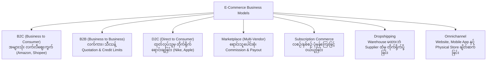
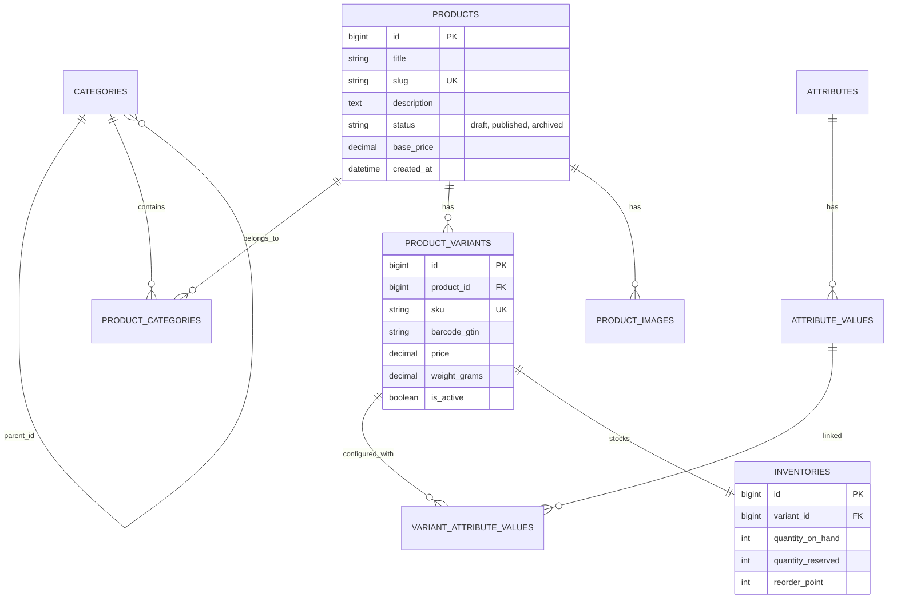
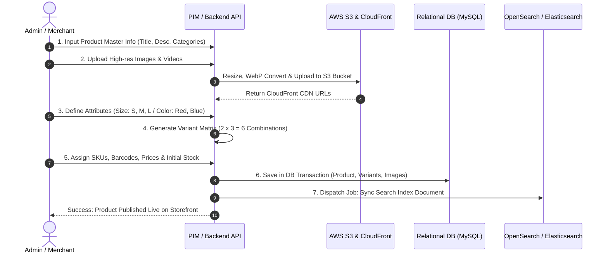

# 🏬 Sector 1: Business Models, Product & Catalog Management

E-Commerce စနစ်တစ်ခုကို စတင်တည်ဆောက်ရာတွင် အဓိက အခြေခံအုတ်မြစ်မှာ **စီးပွားရေးပုံစံ (Business Model)** နှင့် **ကုန်ပစ္စည်းစီမံခန့်ခွဲမှု (Product & Catalog Management)** ဖြစ်ပါသည်။ စီးပွားရေးပုံစံအလိုက် Database Schema၊ Checkout Flow နှင့် Pricing Rules များ သိသိသာသာ ကွဲပြားသွားပါသည်။

---

## 🏢 ၁။ E-Commerce Business Models နှိုင်းယှဉ်ချက်



### Business Models များ၏ နည်းပညာဆိုင်ရာ အဓိက ကွာခြားချက်များ

| Business Model | ပစ်မှတ် Customer | ဈေးနှုန်း သတ်မှတ်ပုံ (Pricing) | ငွေပေးချေမှု (Payment) | အဓိက နည်းပညာ စိန်ခေါ်မှု |
| :--- | :--- | :--- | :--- | :--- |
| **B2C** | တစ်ဦးချင်း စားသုံးသူများ | ပုံသေရောင်းဈေး၊ အရောင်း Promotion | Credit Card, Mobile Wallets, COD | မြင့်မားသော Traffic၊ Cart Abandonment လျှော့ချရေး |
| **B2B** | အခြားကုမ္ပဏီ/လုပ်ငန်းများ | Customer Tier အလိုက် သီးခြားဈေး၊ Volume Discount | Bank Wire, Net 30/60 Credit Term, Purchase Order | Complex Approval Workflows, Custom Invoices |
| **D2C** | Brand ချစ်မြတ်နိုးသူများ | Brand Value အခြေပြု ဈေးနှုန်း | Direct Online Payment, Installment | Personalized UX, Brand Loyalty System |
| **Marketplace** | Buyer + Third-party Sellers | Vendor အလိုက် ဈေးပြိုင်ရောင်းချမှု | Split Payment, Escrow, Seller Payouts | Multi-seller Cart, Commission Calculation, Vendor Isolation |
| **Subscription** | ထပ်တလဲလဲ ဝယ်ယူသူများ | Recurring Billing (လစဉ်/နှစ်စဉ်) | Auto-debit Card Tokenization (Stripe Billing) | Dunning Management (Card သက်တမ်းကုန်/ပျက်ကွက်မှု ကိုင်တွယ်ခြင်း) |
| **Dropshipping** | ကမ္ဘာတစ်ဝှမ်း ဝယ်ယူသူများ | အမြတ်တင်ရောင်းဈေး (Markup) | Online Checkout | Supplier API ချိတ်ဆက်မှု၊ Shipping ကြာမြင့်ချိန် ရှင်းပြခြင်း |

---

## 📦 ၂။ Product & Catalog Data Modeling

ပစ္စည်းတစ်ခုကို Database တွင် သိမ်းဆည်းရာတွင် ရိုးရိုး `products` table တစ်ခုတည်းဖြင့် မလုံလောက်ပါ။ အရောင်၊ Size စသည့် ရွေးချယ်စရာများအတွက် **Product Variants** နှင့် **SKU (Stock Keeping Unit)** စနစ် လိုအပ်ပါသည်။

### Database Schema Architecture (ERD)



### အဓိက အစိတ်အပိုင်းများ ရှင်းလင်းချက်
1. **Product (Master)**: ပစ္စည်း၏ အခြေခံအမည်၊ အကြောင်းအရာ ဖော်ပြချက် (Description)၊ သက်ဆိုင်ရာ Category စသည်တို့ ပါဝင်သည်။
2. **Product Variant (Child)**: အမှန်တကယ် ဝယ်ယူနိုင်သော ပစ္စည်းပုံစံ (ဥပမာ- iPhone 15 Pro, Black, 256GB) ဖြစ်ပြီး သီးသန့် SKU ရှိသည်။
3. **SKU (Stock Keeping Unit)**: ဂိုဒေါင်နှင့် အရောင်းစာရင်းတွင် ပစ္စည်းကို တိကျစွာ ခွဲခြားနိုင်သည့် ကုဒ် (ဥပမာ- `IPH15P-BLK-256G`)။
4. **Barcode / GTIN / JAN Code**: ကမ္ဘာလုံးဆိုင်ရာ အသိအမှတ်ပြု ဘားကုဒ် (ဂျပန်တွင် JAN Code သုံးပြီး အပြည်ပြည်ဆိုင်ရာတွင် EAN-13 သို့မဟုတ် UPC သုံးသည်)။
5. **Product Bundles (ပစ္စည်းအတွဲလိုက်)**: ပစ္စည်း ၂ မျိုး သို့မဟုတ် ၃ မျိုးကို အစုလိုက်ဈေးနှုန်းဖြင့် ပေါင်းရောင်းသော စနစ် (Bundle Item)။

---

## ⚙️ ၃။ Product & Catalog Management ၏ Work Process (အလုပ်လုပ်ပုံ အဆင့်ဆင့်)



---

## ⚠️ ၄။ လက်တွေ့ လုပ်ငန်းခွင် အဖြစ်အများဆုံး ပြဿနာများနှင့် ဖြေရှင်းနည်းများ (Most Found Real-Work Issues)

### ပြဿနာ ၁: Variant Explosion (SKU အဆမတန် များပြားလာခြင်း)
- **အခြေအနေ**: အဝတ်အထည်ရောင်းသည့် Site တွင် Size ၆ မျိုး၊ Color ၁၀ မျိုး၊ Material ၄ မျိုး ရှိပါက Product တစ်ခုတည်းအတွက် Variant Matrix သည် `6 × 10 × 4 = 240 SKUs` ဖြစ်သွားသည်။
- **ဖြစ်ပေါ်သည့် ဆိုးကျိုး**: Database တွင် Row များ သိန်းချီ များပြားလာပြီး Admin Panel တွင် Form submit လုပ်ရာ၌ PHP `max_input_vars` ကန့်သတ်ချက်ကြောင့် Data တချို့ ကျန်ခဲ့ကာ Error တက်ခြင်း။ Storefront တွင် Variant ရှာဖွေမှု အလွန်နှေးကွေးခြင်း။
- **လုပ်ငန်းခွင် ဖြေရှင်းနည်း**:
  1. မရောင်းချသော Option များကို မထုတ်လုပ်ရန် (Matrix Generator တွင် Uncheck လုပ်နိုင်စေရန် ပြုလုပ်ပါ)။
  2. PHP `max_input_vars` ကို အားကိုးမည့်အစား Frontend မှ Variant များအားလုံးကို JSON Payload အဖြစ် Pack လုပ်ပြီး REST API Endpoint သို့ ပို့ဆောင်ပါ။
  3. Variant အချက်အလက်များကို Database တွင် Batch Insert ဖြင့် သိမ်းဆည်းပါ။

### ပြဿနာ ၂: EAV (Entity-Attribute-Value) Anti-Pattern နှင့် N+1 Query Disaster
- **အခြေအနေ**: Product Attribute များကို ပြောင်းလွယ်ပြင်လွယ် ဖြစ်စေရန် EAV Pattern (Tables: `attributes`, `attribute_values`, `product_attribute_values`) ဖြင့် ဒီဇိုင်းဆွဲထားသော်လည်း Product List ပြသသည့်အခါ Eager Loading မလုပ်မိခြင်း။
- **ဖြစ်ပေါ်သည့် ဆိုးကျိုး**: ပစ္စည်း ၅၀ ပြသရန် Database သို့ Query အကြိမ် ၂၀၀ ကျော် ထိခတ်ပြီး Database CPU 100% တက်ကာ Server Down သွားခြင်း။
- **လုပ်ငန်းခွင် ဖြေရှင်းနည်း**:
  ```php
  // ❌ မကောင်းသော နည်းလမ်း (N+1 Query)
  $products = Product::where('status', 'published')->paginate(20);
  // Blade ထဲတွင် foreach ($product->variants as $variant) ခေါ်ယူခြင်း

  // ✅ အကောင်းဆုံး နည်းလမ်း (Eager Loading with Specific Columns)
  $products = Product::with([
      'variants' => fn($q) => $q->where('is_active', true)->select(['id', 'product_id', 'sku', 'price']),
      'images' => fn($q) => $q->orderBy('sort_order')->limit(1),
      'categories:id,name,slug'
  ])->where('status', 'published')->paginate(20);
  ```
  ထို့အပြင် ခေတ်မီ Database များ (MySQL 8.0 / PostgreSQL) တွင် ကွဲပြားသော Dynamic Attributes များကို `JSON` column ဖြင့် သိမ်းဆည်းပြီး `JSON_EXTRACT` သို့မဟုတ် Generated Column + Virtual Index ဖြင့် Query လုပ်နိုင်ပါသည်။

### ပြဿနာ ၃: Bundle Product တွင် Stock မကိုက်ညီခြင်း (Bundle Inventory De-synchronization)
- **အခြေအနေ**: "Camera + Lens + Memory Card" ကို Bundle အဖြစ် စုပေါင်းရောင်းချထားသည်။ Memory Card အပိုပစ္စည်း ဂိုဒေါင်တွင် ကုန်သွားသော်လည်း Bundle Product ၏ Status က "In Stock" အဖြစ် ပြသနေဆဲ ဖြစ်နေခြင်း။
- **ဖြစ်ပေါ်သည့် ဆိုးကျိုး**: Customer က Bundle ကို ဝယ်ယူပြီး ငွေချေပြီးမှ Memory Card မရှိကြောင်း သိရသဖြင့် အော်ဒါကို Cancel လုပ်ကာ ငွေပြန်အမ်းရခြင်း (Customer စိတ်ပျက်ရခြင်း)။
- **လုပ်ငန်းခွင် ဖြေရှင်းနည်း**:
  Bundle Product သည် ကိုယ်ပိုင် သီးသန့် Stock မရှိသင့်ပါ။ ၎င်း၏ ရောင်းချနိုင်သော လက်ကျန် (Virtual Stock) ကို ၎င်းတွင် ပါဝင်သော Sub-SKU များအနက် အနည်းဆုံး လက်ကျန်အရေအတွက်ဖြင့် Real-time တွက်ချက်ရမည်:
  $$\text{Bundle Available Stock} = \min \left( \frac{\text{Stock}_{\text{Camera}}}{1}, \frac{\text{Stock}_{\text{Lens}}}{1}, \frac{\text{Stock}_{\text{Memory}}}{1} \right)$$

### ပြဿနာ ၄: S3 Media Storage တွင် Orphaned Files များ စုပုံကျန်ရစ်ခြင်း
- **အခြေအနေ**: Admin က Product တင်စဉ် ဓာတ်ပုံ ၁၀ ပုံ တင်ပြီးနောက် စိတ်ကြိုက်မတွေ့၍ ၅ ပုံ ပြန်ဖျက်လိုက်ခြင်း သို့မဟုတ် ပစ္စည်းတစ်ခုလုံးကို Database မှ Hard Delete လုပ်လိုက်ခြင်း။
- **ဖြစ်ပေါ်သည့် ဆိုးကျိုး**: AWS S3 Bucket ထဲတွင် Database နှင့် မချိတ်ဆက်တော့သော ပုံအပိုများ (Orphaned Images) Gigabytes များစွာ ကျန်ရစ်ပြီး လစဉ် AWS S3 Storage Cost တဖြည်းဖြည်း မြင့်တက်လာခြင်း။
- **လုပ်ငန်းခွင် ဖြေရှင်းနည်း**:
  1. Laravel Model Observer သို့မဟုတ် Event Listener တွင် Product / Image ဖျက်သည့်အခါ S3 ဖိုင်ကိုပါ အလိုအလျောက် ပယ်ဖျက်ရန် Background Job လွှတ်ပါ:
  ```php
  // ProductImageObserver.php
  public function deleted(ProductImage $image): void
  {
      dispatch(function () use ($image) {
          Storage::disk('s3')->delete($image->file_path);
      })->afterResponse();
  }
  ```
  2. Temporary Uploads အတွက် S3 Lifecycle Rule သတ်မှတ်ပြီး `tmp/` folder ထဲရှိဖိုင်များကို 24 နာရီပြည့်ပါက အလိုအလျောက် Auto-expire လုပ်စေပါ။
