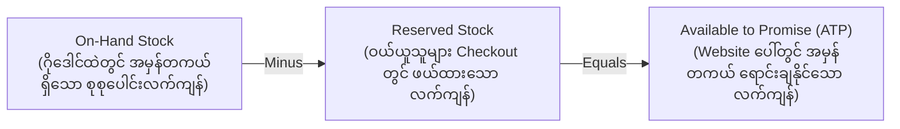
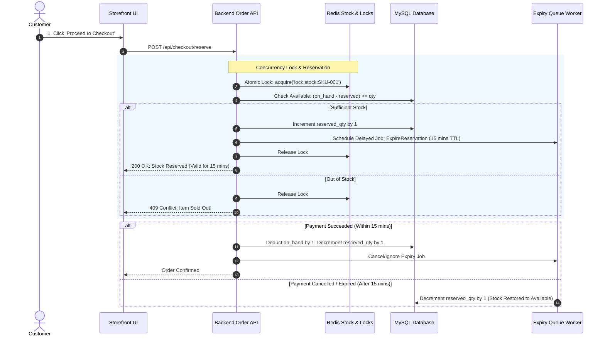

# 📦 Sector 2: Inventory & Stock Management (Concurrency & Flash Sales)

E-Commerce စနစ်တစ်ခု၏ အထိခိုက်မခံဆုံးသော အစိတ်အပိုင်းမှာ **ပစ္စည်းလက်ကျန် စီမံခန့်ခွဲမှု (Inventory & Stock Management)** ဖြစ်ပါသည်။ Stock စာရင်း မှားယွင်းပါက Customer ထံမှ ငွေယူပြီး ပစ္စည်းမပို့နိုင်ခြင်း (Overselling) သို့မဟုတ် ပစ္စည်းရှိပါလျက် ပစ္စည်းကုန်သည်ဟု ပြသမိခြင်း (Underselling) တို့ ဖြစ်ပေါ်စေပါသည်။

---

## 📊 ၁။ Stock Types နှင့် သဘောတရား ၃ ခု

ဂိုဒေါင်ထဲရှိ ပစ္စည်းနှင့် Website ပေါ်တွင် ရောင်းချနိုင်သော ပစ္စည်းအရေအတွက်သည် အမြဲတမ်း တူညီမည်မဟုတ်ပါ။



$$\text{Available Stock (ATP)} = \text{On-Hand Stock} - \text{Reserved Stock}$$

1. **On-Hand Quantity**: ဂိုဒေါင်စင်ပေါ်တွင် လက်ရှိ ရုပ်ပိုင်းဆိုင်ရာအရ ရှိနေသော အရေအတွက်။
2. **Reserved Quantity**: ဝယ်ယူသူများက Checkout တင်ထားပြီး Payment ပြုလုပ်နေဆဲကာလ (သို့မဟုတ် Packing ပြုလုပ်နေဆဲ) အတွက် ယာယီဖယ်ထားသော အရေအတွက်။
3. **Available Quantity (ATP)**: Website ပေါ်တွင် Customer အသစ်များ စိတ်ချလက်ချ ထပ်မံဝယ်ယူနိုင်သည့် တကယ့်လက်ကျန်။
4. **Safety Stock**: ရုတ်တရက် ဝယ်လိုအား မြင့်တက်လာခြင်း သို့မဟုတ် Supplier ပို့ဆောင်မှု ကြန့်ကြာခြင်းကို ကာကွယ်ရန် အမြဲတမ်း အပိုထားရှိသော Stock။
5. **Reorder Point (ROP)**: Supplier ထံ ပစ္စည်းပြန်လည်မှာယူရမည့် အနိမ့်ဆုံး သတ်မှတ်ချက်:
   $$\text{ROP} = (\text{Lead Time (Days)} \times \text{Daily Sales}) + \text{Safety Stock}$$

---

## ⚙️ ၂။ Stock Reservation & Lifecycle Work Process (အလုပ်လုပ်ပုံ အဆင့်ဆင့်)



---

## ⚠️ ၃။ လက်တွေ့ လုပ်ငန်းခွင် အဖြစ်အများဆုံး ပြဿနာများနှင့် ဖြေရှင်းနည်းများ (Most Found Real-Work Issues)

### ပြဿနာ ၁: Flash Sale တွင် Overselling ဖြစ်ခြင်း (Concurrency Race Condition)
- **အခြေအနေ**: iPhone 15 Pro ပစ္စည်း ၁၀ လုံးသာ ကျန်ရှိချိန်တွင် Flash Sale စတင်ရာ ဝယ်ယူသူ ၁,၀၀၀ က တစ်ပြိုင်နက်တည်း "Place Order" နှိပ်လိုက်ခြင်း။
- **ဖြစ်ပေါ်သည့် ဆိုးကျိုး**: Request ပေါင်းများစွာသည် Stock စစ်ဆေးသည့်အဆင့်ကို တပြိုင်တည်း ဖြတ်သွားသဖြင့် `quantity > 0` ဟု မှားယွင်းမြင်တွေ့ပြီး ပစ္စည်း ၁၀ လုံးတည်းကို လူ ၅၀ အထိ အော်ဒါအောင်မြင်သွားခြင်း။ နောက်ဆုံးတွင် အော်ဒါ ၄၀ ကို ဖျက်သိမ်းကာ ငွေပြန်အမ်းရပြီး ကုမ္ပဏီ နာမည်ပျက်ရခြင်း။
- **ဘာကြောင့်ဖြစ်ရသလဲ (Technical Root Cause)**:
  ရိုးရိုး `SELECT` ပြုလုပ်ပြီးမှ `UPDATE` လုပ်သောကြောင့် ဖြစ်သည် (Check-then-Act Race Condition):
  ```sql
  -- Thread 1 & Thread 2 Read at the same millisecond:
  SELECT quantity FROM stocks WHERE product_id = 1; -- Both get 1
  -- Thread 1:
  UPDATE stocks SET quantity = quantity - 1 WHERE product_id = 1; -- sets to 0
  -- Thread 2:
  UPDATE stocks SET quantity = quantity - 1 WHERE product_id = 1; -- sets to -1 (Oversold!)
  ```
- **လုပ်ငန်းခွင် ဖြေရှင်းနည်း (၃ မျိုး)**:

#### နည်းလမ်း (က) Database Pessimistic Locking (`lockForUpdate`)
Transaction စတင်ချိန်တွင် သက်ဆိုင်ရာ Stock Row ကို အခြား Request များ ဖတ်ခွင့်/ပြင်ခွင့် မရအောင် Lock ခတ်ထားခြင်း:
```php
use Illuminate\Support\Facades\DB;

DB::transaction(function () use ($productId, $orderQuantity) {
    // SELECT ... FOR UPDATE (Row-level Lock)
    $stock = DB::table('inventories')
        ->where('variant_id', $productId)
        ->lockForUpdate()
        ->first();

    if (!$stock || ($stock->quantity_on_hand - $stock->quantity_reserved) < $orderQuantity) {
        throw new \Exception("ပစ္စည်းလက်ကျန် မလုံလောက်တော့ပါ!");
    }

    // Atomic Update
    DB::table('inventories')
        ->where('variant_id', $productId)
        ->increment('quantity_reserved', $orderQuantity);
});
```

#### နည်းလမ်း (ခ) Atomic SQL Decrement with Safety Guard
Row Lock မခတ်လိုပါက Database Engine ၏ Single Atomic Query အစွမ်းကို သုံး၍ သုညထက် နည်းသွားပါက Row Update မဖြစ်စေရန် ပြုလုပ်ခြင်း:
```sql
UPDATE inventories 
SET quantity_reserved = quantity_reserved + 1 
WHERE variant_id = 101 
  AND (quantity_on_hand - quantity_reserved) >= 1;
```
Laravel တွင် Affected Rows အရေအတွက်ကို စစ်ဆေးပါ:
```php
$affected = DB::table('inventories')
    ->where('variant_id', $variantId)
    ->whereRaw('(quantity_on_hand - quantity_reserved) >= ?', [$orderQty])
    ->increment('quantity_reserved', $orderQty);

if ($affected === 0) {
    throw new OutOfStockException("ပစ္စည်းကုန်သွားပါပြီ!");
}
```

#### နည်းလမ်း (ဂ) Ultra-High Traffic အတွက် Redis Atomic Decrement (`DECRBY`)
တစ်စက္ကန့်လျှင် Request သောင်းနှင့်ချီ ဝင်ရောက်ပါက MySQL ကို မထိစေဘဲ In-Memory Redis တွင် Stock ကို ဦးစွာ အနုတ်ပြပြီးမှ Database သို့ Queue ဖြင့် Sync ပြုလုပ်ပါ:
```php
$stockKey = "stock:variant:{$variantId}";
$remaining = Redis::decrby($stockKey, $orderQty);

if ($remaining < 0) {
    // Stock ကုန်သွားသဖြင့် ပြန်ပေါင်းထည့်ပြီး Reject လုပ်ခြင်း
    Redis::incrby($stockKey, $orderQty);
    throw new OutOfStockException("လက်ကျန် မလုံလောက်ပါ!");
}

// အောင်မြင်မှသာ Database Write Job ကို Background သို့ ပို့ပါ
```

---

### ပြဿနာ ၂: Ghost Stock Reservation (Cart ထဲ ပစ္စည်းထည့်ပြီး ဝယ်ယူမှု မပြီးဆုံးခြင်း)
- **အခြေအနေ**: Developer က Customer က "Add to Cart" နှိပ်လိုက်သည်နှင့် Stock ကို ချက်ချင်း Reserve လုပ်လိုက်ခြင်း။ သို့သော် Customer များသည် Cart ထဲ ပစ္စည်းထည့်ထားပြီးနောက် ဝယ်ယူမှု မပြုဘဲ Website မှ ထွက်သွားကြခြင်း။
- **ဖြစ်ပေါ်သည့် ဆိုးကျိုး**: အမှန်တကယ် ဝယ်ယူလိုသူများက Website တွင် "Out of Stock" ဟု မြင်တွေ့ရပြီး ဝယ်မရခြင်း။ ကုန်သည်ဘက်တွင် ပစ္စည်းမရောင်းရဘဲ ရောင်းအားကျဆင်းခြင်း (Inventory Hijacking)။
- **လုပ်ငန်းခွင် ဖြေရှင်းနည်း**:
  1. **Add to Cart တွင် Stock မဖယ်ပါနှင့်**: Cart တွင် ပစ္စည်းထည့်ခြင်းသည် ဆန္ဒပြရုံမျှသာ ဖြစ်သည်။ Stock Reservation ကို Customer က "Proceed to Checkout" သို့ ရောက်ရှိပြီး Payment စတင်သည့်အချိန်မှသာ လုပ်ဆောင်ပါ။
  2. **Strict TTL (Time to Live)**: Reservation တစ်ခုစီအတွက် အများဆုံး ၁၀ မိနစ် သို့မဟုတ် ၁၅ မိနစ်သာ သက်တမ်းသတ်မှတ်ပါ။
  3. **Auto-Release Delayed Worker**:
     ```php
     // Checkout စတင်ချိန်တွင်
     ReleaseExpiredStockJob::dispatch($reservationId)->delay(now()->addMinutes(15));
     ```
     အကယ်၍ ၁၅ မိနစ်အတွင်း Payment အောင်မြင်သည့် Status သို့ မရောက်ပါက Background Job က Reserved Stock ကို အလိုအလျောက် ပြန်လည်လွှတ်ပေး (Restore) ရမည်။

---

### ပြဿနာ ၃: Physical Warehouse နှင့် Database Stock ကွဲလွဲမှု (Inventory Drift)
- **အခြေအနေ**: Database ထဲတွင် ပစ္စည်း ၅ ခု လက်ကျန်ပြနေသော်လည်း ဂိုဒေါင်ဝန်ထမ်း ပစ္စည်းလိုက်ကောက် (Pick) သည့်အခါ စင်ပေါ်တွင် ပစ္စည်းတစ်ခုမှ ရှာမတွေ့တော့ခြင်း။
- **အကြောင်းရင်း**: ပစ္စည်းခိုးယူခံရခြင်း (Shrinkage)၊ ပစ္စည်းပုပ်သိုး/ပျက်စီးခြင်း (Damaged Goods)၊ သို့မဟုတ် ဂိုဒေါင်ဝန်ထမ်းက Barcode မှားယွင်း Scan ဖတ်ခြင်း။
- **လုပ်ငန်းခွင် ဖြေရှင်းနည်း**:
  1. **Negative Stock တားမြစ်ခြင်း**: Database Schema တွင် Stock Column ကို `UNSIGNED INT` ထားရှိပြီး အနုတ်ဘက်သို့ မည်သည့်အခါမျှ မရောက်စေရန် Constraint ထည့်ပါ။
  2. **Inventory Adjustment Audit Log**: Stock ပြင်ဆင်မှုတိုင်းတွင် မည်သူက၊ မည်သည့်အကြောင်းကြောင့် ပြင်ဆင်သည်ကို စာရင်းသွင်းရမည့် `inventory_adjustments` Table တည်ဆောက်ပါ:
     - `reason_code`: `damaged`, `lost`, `cycle_count_correction`, `supplier_return`
  3. **Daily / Weekly Cycle Counting**: ဂိုဒေါင်တစ်ခုလုံးကို တစ်ပြိုင်နက် ရေတွက်မည့်အစား Fast-moving SKUs များကို နေ့စဉ် အလှည့်ကျ စစ်ဆေးသည့် စနစ် ထည့်သွင်းပါ။

---

### ပြဿနာ ၄: Multi-Warehouse Split Allocation စိန်ခေါ်မှု
- **အခြေအနေ**: Customer က ပစ္စည်း ၂ မျိုး (A နှင့် B) ဝယ်ယူသည်။ ပစ္စည်း A သည် ရန်ကုန်ဂိုဒေါင်တွင် ရှိပြီး၊ ပစ္စည်း B သည် မန္တလေးဂိုဒေါင်တွင်သာ ရှိနေခြင်း။
- **ဖြစ်ပေါ်သည့် ဆိုးကျိုး**: စနစ်က သတိမထားဘဲ အော်ဒါလက်ခံလိုက်ပါက Delivery ခ ၂ ဆ ကုန်ကျခြင်း၊ ပစ္စည်း ၂ ထုပ် ခွဲပို့ရပြီး Customer က အထုပ်တစ်ခုသာ ရောက်လာသဖြင့် ပစ္စည်းကျန်ခဲ့သည်ဟု ထင်ကာ Support သို့ ဖုန်းဆက် တိုင်ကြားခြင်း။
- **လုပ်ငန်းခွင် ဖြေရှင်းနည်း**:
  Checkout အဆင့်တွင် **Warehouse Routing Engine** ထည့်သွင်းပါ:
  - **Single Warehouse Priority**: ဖြစ်နိုင်ပါက ပစ္စည်းအားလုံး တစ်နေရာတည်း စုံလင်သော ဂိုဒေါင်မှ ဦးစားပေး ရွေးချယ်ခြင်း။
  - **Split Order Notification**: ဂိုဒေါင် ၂ ခုမှ ပို့ရမည်ဆိုပါက Checkout Screen တွင် *"ဤအော်ဒါအား မတူညီသော ဂိုဒေါင်များမှ သီးခြားစီ ခွဲပို့ပါမည်"* ဟု Customer အား ပွင့်လင်းမြင်သာစွာ အသိပေးပြီး ပို့ဆောင်ခကို သင့်တင့်စွာ တွက်ချက်ခြင်း။
