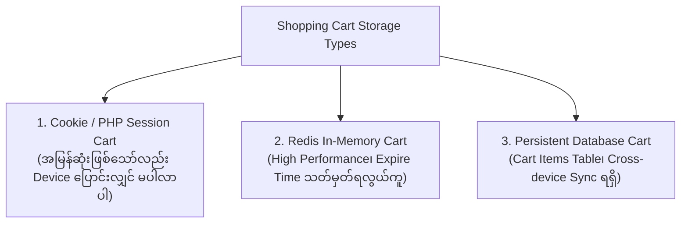
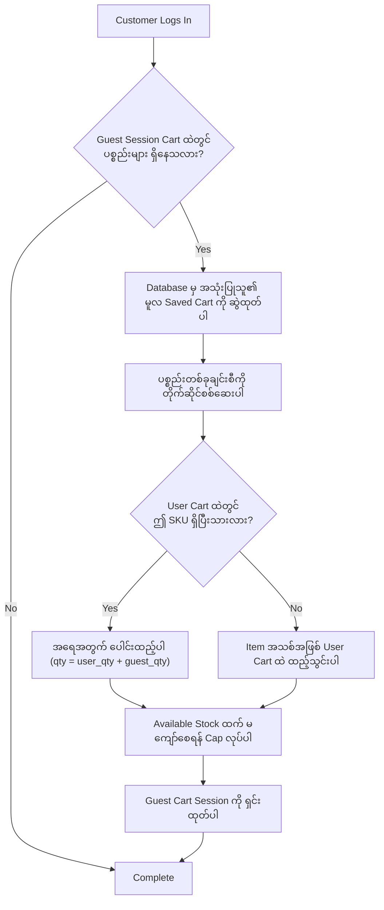
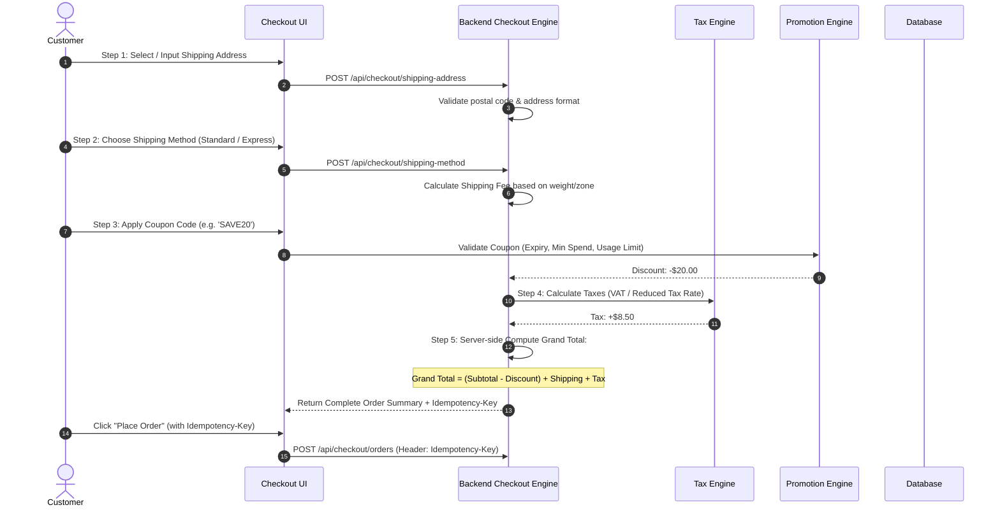

# 🛒 Sector 3: Shopping Cart, Checkout Flow & Idempotency

Shopping Cart နှင့် Checkout Process သည် Customer ၏ ဆန္ဒ (Intent) ကို အမှန်တကယ် အရောင်း (Transaction) အဖြစ်သို့ ပြောင်းလဲပေးသည့် အရေးအကြီးဆုံးသော ကူးပြောင်းမှု အဆင့် (Conversion Funnel) ဖြစ်ပါသည်။

---

## 🏗️ ၁။ Shopping Cart Architecture နှိုင်းယှဉ်ချက်

Cart ဒေတာကို သိမ်းဆည်းရန် အဓိက ဗိသုကာ ၃ မျိုး ရှိပါသည်:



### Guest Cart မှ User Cart သို့ ပေါင်းစည်းခြင်း (Cart Merging Algorithm)

Customer တစ်ဦးသည် Login မဝင်မီ Guest အနေဖြင့် ပစ္စည်းများ Cart ထဲ ထည့်ထားပြီးမှ Login ဝင်လိုက်သည့်အခါ အောက်ပါ Algorithm အတိုင်း ပေါင်းစည်းရပါသည်:



---

## 🔄 ၂။ Checkout Flow အဆင့်ဆင့်နှင့် Work Process

Checkout လုပ်ငန်းစဉ်တွင် စုစုပေါင်း အဆင့် ၅ ဆင့် ပါဝင်ပြီး အဆင့်တိုင်းတွင် Server-side Validation မဖြစ်မနေ လိုအပ်ပါသည်:



---

## ⚠️ ၃။ လက်တွေ့ လုပ်ငန်းခွင် အဖြစ်အများဆုံး ပြဿနာများနှင့် ဖြေရှင်းနည်းများ (Most Found Real-Work Issues)

### ပြဿနာ ၁: "Place Order" ကို Double-Click နှိပ်မိ၍ ငွေနှစ်ခါဖြတ်ခံရခြင်း (Lack of Idempotency)
- **အခြေအနေ**: Customer သည် Checkout နောက်ဆုံးအဆင့်တွင် Internet နှေးနေသဖြင့် "Place Order" ခလုတ်ကို ၂ ခါ ဆက်တိုက် နှိပ်လိုက်ခြင်း သို့မဟုတ် Browser Back ပြန်ထွက်ပြီး ထပ်နှိပ်ခြင်း။
- **ဖြစ်ပေါ်သည့် ဆိုးကျိုး**: Backend သို့ Request ၂ ကြိမ် ရောက်ရှိသွားပြီး Order ID ၂ ခု ထွက်လာကာ Customer ၏ ကတ်ထဲမှ ငွေနှစ်ဆ ဖြတ်တောက်ခံရခြင်း။
- **လုပ်ငန်းခွင် ဖြေရှင်းနည်း: Idempotency Key Pattern**:
  1. Frontend က Checkout စာမျက်နှာ စတင်ဖွင့်ချိန်တွင် Unique UUID တစ်ခု (Idempotency Key) ကို ထုတ်လုပ်ထားပါ။
  2. Request ပို့တိုင်း Header တွင် `Idempotency-Key: e4b281f6-91e8-42f8-b362-d2714c33c2a1` ထည့်ပို့ပါ။
  3. Backend Middleware က ဤ Key ကို Database/Redis တွင် စစ်ဆေးပါ:
  ```php
  // CheckIdempotency.php
  public function handle(Request $request, Closure $next)
  {
      $key = $request->header('Idempotency-Key');
      if (!$key) {
          return response()->json(['error' => 'Idempotency-Key header is required'], 400);
      }

      $cacheKey = "idempotency:order:{$key}";
      
      // Redis တွင် Key ရှိပြီးသားဖြစ်ပါက ယခင် Saved Response ကိုသာ ပြန်ပေးပါ
      if ($previousResponse = Cache::get($cacheKey)) {
          return response()->json(json_decode($previousResponse, true), 200);
      }

      // Concurrency Lock ရယူခြင်း
      $lock = Cache::lock("lock:{$cacheKey}", 10);
      if (!$lock->get()) {
          return response()->json(['error' => 'အော်ဒါအား လုပ်ဆောင်နေဆဲဖြစ်ပါသည်၊ ခေတ္တစောင့်ပါ'], 409);
      }

      $response = $next($request);

      if ($response->isSuccessful()) {
          Cache::put($cacheKey, $response->getContent(), now()->addHours(24));
      }

      $lock->release();
      return $response;
  }
  ```

---

### ပြဿနာ ၂: Client-Side Price Tampering (စျေးနှုန်းကို DevTools မှ ခိုးပြင်ခြင်း)
- **အခြေအနေ**: မသမာသော ဝယ်ယူသူက Browser Inspect Element သို့မဟုတ် Postman သုံး၍ ပစ္စည်းတစ်ခုလျှင် $500 တန်သော ဖုန်းကို `$price: 1.00` ဟု JSON Payload ပြင်ဆင်ပြီး Request ပို့လိုက်ခြင်း။
- **ဖြစ်ပေါ်သည့် ဆိုးကျိုး**: အကယ်၍ Backend Developer က Frontend မှ ပို့လိုက်သော `price` ကို အတည်ယူပြီး တိုက်ရိုက် Order ဆောက်မိပါက $1 တည်းဖြင့် ပစ္စည်းရောင်းလိုက်ရသကဲ့သို့ ဖြစ်သွားခြင်း။
- **လုပ်ငန်းခွင် ဖြေရှင်းနည်း: Zero Trust on Frontend Prices**:
  **Frontend ထံမှ မည်သည့် စျေးနှုန်း (Price) ကိုမျှ လက်မခံရပါ။** Frontend ထံမှ `variant_id` နှင့် `quantity` ကိုသာ လက်ခံရမည်။ စျေးနှုန်းအားလုံးကို Database မှ တိုက်ရိုက်ဆွဲယူပြီး Server-side တွင်သာ အစအဆုံး ပြန်လည်တွက်ချက်ရပါမည်:
  ```php
  // ❌ အလွန်အန္တရာယ်များသော နည်းလမ်း
  $itemTotal = $request->input('price') * $request->input('quantity');

  // ✅ လုံခြုံစိတ်ချရသော နည်းလမ်း
  $variant = ProductVariant::findOrFail($request->input('variant_id'));
  $itemTotal = $variant->price * $request->input('quantity'); // DB မှ တိုက်ရိုက် စျေးနှုန်းသာ သုံးပါ
  ```

---

### ပြဿနာ ၃: Single-Use Coupon အား Browser Tab များစွာဖွင့်၍ ပြိုင်သုံးခြင်း (Coupon Race Condition)
- **အခြေအနေ**: အသစ်ဝင်ရောက်သူများအတွက် ပေးထားသော "$50 Off တစ်ကြိမ်သာ သုံးနိုင်သည့် Coupon" ကို Customer က Browser Tab ၃ ခု ဖွင့်ပြီး တစ်စက္ကန့်တည်းတွင် "Apply Coupon & Checkout" နှိပ်လိုက်ခြင်း။
- **ဖြစ်ပေါ်သည့် ဆိုးကျိုး**: Thread ၃ ခုလုံးက Coupon Usage Count ကို `0` ဟု မြင်သွားပြီး $50 Discount ကို ၃ ခါ (စုစုပေါင်း $150) သုံးသွားနိုင်ခြင်း။
- **လုပ်ငန်းခွင် ဖြေရှင်းနည်း**:
  Coupon Record ကို Database Pessimistic Lock ခတ်၍ စစ်ဆေးပါ သို့မဟုတ် Atomic Condition ထည့်ပါ:
  ```php
  DB::transaction(function () use ($couponCode, $userId) {
      $coupon = Coupon::where('code', $couponCode)->lockForUpdate()->first();
      
      $usedCount = CouponUsage::where('coupon_id', $coupon->id)
          ->where('user_id', $userId)
          ->count();

      if ($usedCount >= $coupon->max_uses_per_user) {
          throw new \Exception("ဤ Coupon အား သုံးစွဲခွင့် ကုန်ဆုံးသွားပါပြီ!");
      }

      // Record Usage
      CouponUsage::create([
          'coupon_id' => $coupon->id,
          'user_id' => $userId,
          'used_at' => now(),
      ]);
  });
  ```

---

### ပြဿနာ ၄: ဒဿမကိန်း တွက်ချက်မှု မှားယွင်းခြင်း (Floating Point Math Inaccuracies)
- **အခြေအနေ**: PHP သို့မဟုတ် JavaScript တွင် ငွေကြေးများကို `float` သို့မဟုတ် `double` ဖြင့် ပေါင်းနှုတ်မြှောက်စား ပြုလုပ်ခြင်း။
- **ဖြစ်ပေါ်သည့် ဆိုးကျိုး**: ကွန်ပျူတာ၏ Binary Floating Point သဘောတရားအရ `0.1 + 0.2 = 0.30000000000000004` ဖြစ်သွားပြီး Tax သို့မဟုတ် Grand Total တွင် 1 Cent ($0.01) ကွာဟသွားသဖြင့် Payment Gateway (Stripe) က ငွေပမာဏ မကိုက်ညီဟုဆိုကာ Request ကို Reject လုပ်ခြင်း။
- **လုပ်ငန်းခွင် ဖြေရှင်းနည်း: Cents Pattern သို့မဟုတ် BCMath**:
  1. ဒေါ်လာဖြင့် တွက်မည့်အစား အသေးငယ်ဆုံး အစိတ်အပိုင်းဖြစ်သော **Cents (သို့မဟုတ် အပြည့်ဂဏန်း)** ဖြင့်သာ အမြဲတမ်း သိမ်းဆည်းတွက်ချက်ပါ ($10.50 ကို `1050` cents အဖြစ် သိမ်းပါ)။
  2. Floating Point မသုံးဘဲ PHP ၏ `bcmath` extension (ဥပမာ- `bcmul()`, `bcadd()`) သို့မဟုတ် `brick/money` library ကို အသုံးပြုပါ:
  ```php
  // Database တွင်:
  // decimal(12, 4) သို့မဟုတ် integer (cents) ဖြင့် သိမ်းဆည်းပါ
  $totalInCents = ($subtotalInCents - $discountInCents) + $shippingInCents + $taxInCents;
  ```

---

### ပြဿနာ ၅: Stale Cart Prices (Cart ထဲ ပစ္စည်းထည့်ထားစဉ် ဈေးနှုန်းတက်သွားခြင်း)
- **အခြေအနေ**: Customer က Cart ထဲတွင် $100 ဖြင့် ပစ္စည်းထည့်ထားပြီး ၅ ရက်ကြာမှ ပြန်လာကာ Checkout တင်ခြင်း။ ထိုအတောအတွင်း Merchant က ထိုပစ္စည်းကို $150 သို့ ဈေးတင်ထားပြီးဖြစ်ခြင်း။
- **လုပ်ငန်းခွင် ဖြေရှင်းနည်း**:
  Checkout Summary စာမျက်နှာသို့ ရောက်တိုင်း Cart ထဲရှိ Items များကို လက်ရှိ Live Database Price ဖြင့် Re-validate လုပ်ပါ။ အကယ်၍ ဈေးနှုန်းပြောင်းလဲသွားပါက အော်ဒါကို ချက်ချင်း မဖြတ်ဘဲ UI တွင် Notification ပြသပါ:
  > *"သတိပြုရန်: သင်၏ Cart ထဲရှိ 'Sony Headphones' ၏ စျေးနှုန်းသည် $100 မှ $150 သို့ ပြောင်းလဲသွားပါသည်။ ကျေးဇူးပြု၍ စျေးနှုန်းအသစ်ကို အတည်ပြုပေးပါ။"*
