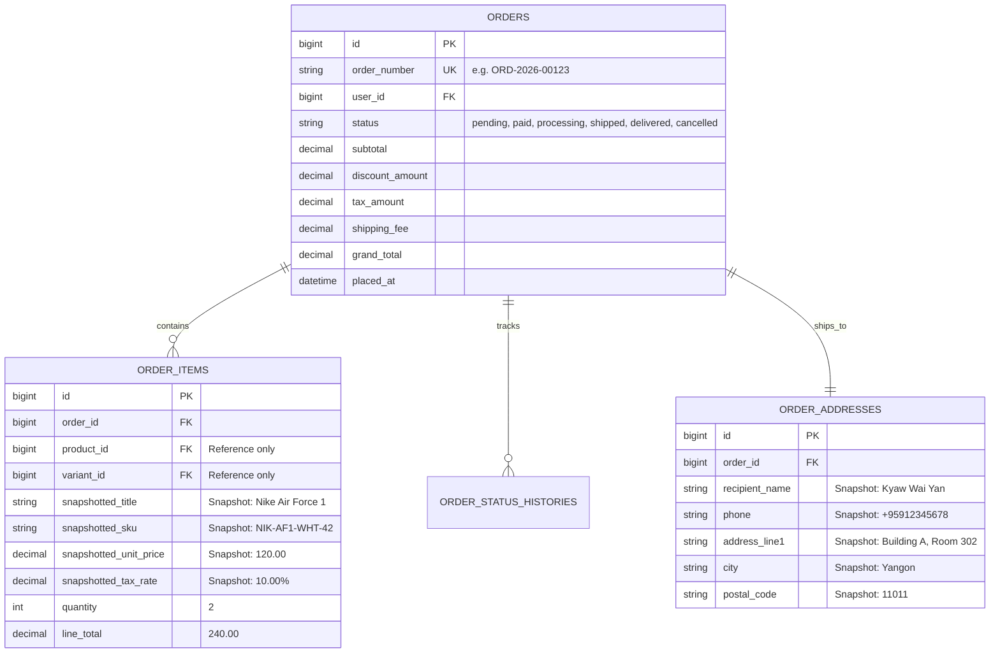
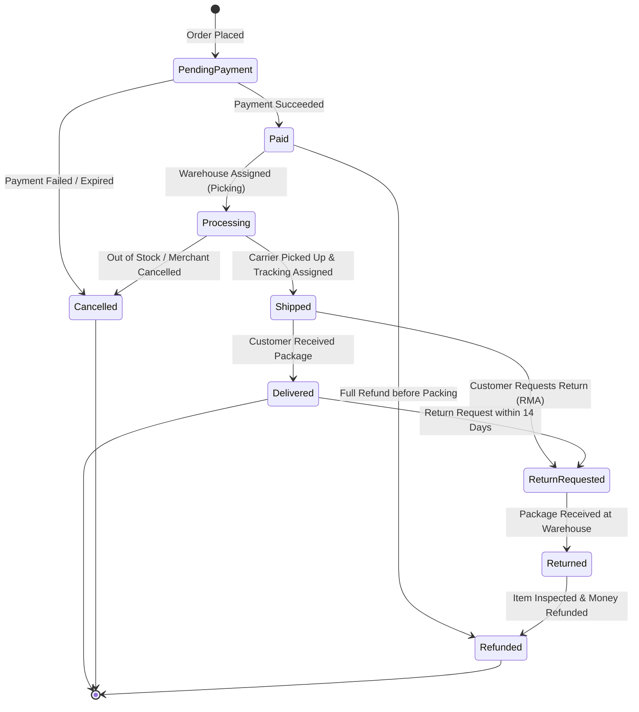

# 📋 Sector 4: Order Management System (OMS) & State Machine

Order Management System (OMS) သည် Customer ဝယ်ယူလိုက်သော ပစ္စည်းများအား ဂိုဒေါင်မှ ထုပ်ပိုးခြင်း၊ ပို့ဆောင်ခြင်းနှင့် အောင်မြင်စွာ ပို့ဆောင်ပြီးစီးကြောင်း အတည်ပြုခြင်းအထိ စီမံခန့်ခွဲပေးသည့် E-Commerce ၏ ဗဟိုအချက်အချာ အင်ဂျင်ဖြစ်ပါသည်။

---

## 🏛️ ၁။ The Immutability & Snapshotting Principle (အရေးအကြီးဆုံး စည်းမျဉ်း)

Developer များ ကျူးလွန်လေ့ရှိသော အကြီးမားဆုံး အမှားတစ်ခုမှာ **Order Items Table တွင် Product Table ကို Foreign Key ချိတ်ရုံမျှဖြင့် ပြီးပြည့်စုံပြီဟု ယူဆခြင်း** ဖြစ်ပါသည်။

> [!CAUTION]
> **အရေးကြီးသော ဥပဒေသ**: Order တစ်ခု ဖန်တီးပြီးသည်နှင့် ထိုအချိန်က ရှိခဲ့သော **Product Title, SKU, Unit Price, Tax Rate, Discount, Customer Name နှင့် Shipping Address** တို့သည် မည်သည့်အခါမျှ မပြောင်းလဲနိုင်သော ကျောက်ထွင်းစာ (**Immutable Snapshot**) ဖြစ်ရပါမည်။



---

## 🔄 ၂။ Order State Machine (အခြေအနေ ပြောင်းလဲမှု စက်ဝန်း)

Order တစ်ခုသည် မည်သည့်အခြေအနေမှ မည်သည့်အခြေအနေသို့ ကူးပြောင်းခွင့်ရှိသည်ကို တိကျသော စည်းမျဉ်း (**Finite State Machine - FSM**) ဖြင့်သာ ထိန်းချုပ်ရမည်:



### ခွင့်ပြုထားသော State Transitions (Matrix)

| လက်ရှိ Status (From) | ပြောင်းလဲခွင့်ရှိသော Status (To) | တားမြစ်ထားသော Status (Illegal) |
| :--- | :--- | :--- |
| **Pending Payment** | `Paid`, `Cancelled` | `Shipped`, `Delivered` |
| **Paid** | `Processing`, `Cancelled`, `Refunded` | `Delivered`, `Pending Payment` |
| **Processing** | `Shipped`, `Cancelled` | `Pending Payment`, `Delivered` |
| **Shipped** | `Delivered`, `ReturnRequested` | `Pending Payment`, `Cancelled` |
| **Delivered** | `ReturnRequested` | `Pending Payment`, `Shipped`, `Cancelled` |

---

## ⚠️ ၃။ လက်တွေ့ လုပ်ငန်းခွင် အဖြစ်အများဆုံး ပြဿနာများနှင့် ဖြေရှင်းနည်းများ (Most Found Real-Work Issues)

### ပြဿနာ ၁: Missing Snapshot ကြောင့် လွန်ခဲ့သော ၆ လက စာရင်းများ လိုက်လံပြောင်းလဲသွားခြင်း
- **အခြေအနေ**: Developer က Order Item ထဲတွင် `product_id` တစ်ခုတည်းသာ သိမ်းပြီး Invoice ပြသသည့်အခါ `$item->product->price` ဖြင့် Join ဆွဲပြသထားခြင်း။
- **ဖြစ်ပေါ်သည့် ဆိုးကျိုး**: ၆ လအကြာတွင် Merchant က Product စျေးနှုန်းကို $100 မှ $150 သို့ တိုးမြှင့်လိုက်သောအခါ လွန်ခဲ့သော ၆ လက ဝယ်ယူခဲ့သည့် Customer ၏ Past Order History နှင့် Accounting PDF ပြေစာများအားလုံးတွင် စျေးနှုန်း $150 အဖြစ် အလိုအလျောက် ပြောင်းလဲသွားပြီး အခွန်စာရင်းများ လုံးဝ မှားယွင်းသွားခြင်း။
- **လုပ်ငန်းခွင် ဖြေရှင်းနည်း**:
  Order ဖန်တီးသည့် Service Class ထဲတွင် အချက်အလက်အားလုံးကို Hard Copy ရိုက်သိမ်းပါ:
  ```php
  // CreateOrderAction.php
  foreach ($cart->items as $cartItem) {
      $order->items()->create([
          'product_id' => $cartItem->product_id,
          'variant_id' => $cartItem->variant_id,
          // Snapshot values from LIVE data at this exact second
          'snapshotted_title' => $cartItem->variant->product->title,
          'snapshotted_sku' => $cartItem->variant->sku,
          'snapshotted_unit_price' => $cartItem->variant->price,
          'snapshotted_tax_rate' => $taxRate,
          'quantity' => $cartItem->quantity,
          'line_total' => $cartItem->quantity * $cartItem->variant->price,
      ]);
  }
  ```

---

### ပြဿနာ ၂: တရားမဝင် Status ပြောင်းလဲမှုကြောင့် ငွေကြေးနှင့် ပစ္စည်းဆုံးရှုံးခြင်း (Illegal State Transitions)
- **အခြေအနေ**: Admin Panel တွင် Status ကို Dropdown ရိုးရိုးဖြင့် ပြထားရာ ဝန်ထမ်းတစ်ဦးက `Shipped` (လမ်းပေါ်ရောက်နေပြီးသား ပစ္စည်း) ကို `Cancelled` ဟု မှားရွေးမိပြီး Customer ထံ ငွေပြန်အမ်းလိုက်ခြင်း။ နောက်ဆုံးတွင် Customer က ငွေလည်းပြန်ရ၊ အိမ်သို့ ပစ္စည်းလည်း ရောက်သွားခြင်း။
- **လုပ်ငန်းခွင် ဖြေရှင်းနည်း: State Pattern သို့မဟုတ် Transition Validator**:
  Status ကို တိုက်ရိုက် Update မလုပ်စေဘဲ State Machine Validator ခံထားပါ:
  ```php
  // Order.php
  public function transitionTo(OrderStatus $newStatus, ?string $reason = null, ?User $actor = null): void
  {
      $allowedTransitions = [
          OrderStatus::PENDING_PAYMENT => [OrderStatus::PAID, OrderStatus::CANCELLED],
          OrderStatus::PAID => [OrderStatus::PROCESSING, OrderStatus::REFUNDED, OrderStatus::CANCELLED],
          OrderStatus::PROCESSING => [OrderStatus::SHIPPED, OrderStatus::CANCELLED],
          OrderStatus::SHIPPED => [OrderStatus::DELIVERED, OrderStatus::RETURN_REQUESTED],
          OrderStatus::DELIVERED => [OrderStatus::RETURN_REQUESTED],
      ];

      if (!in_array($newStatus, $allowedTransitions[$this->status] ?? [])) {
          throw new InvalidStateTransitionException(
              "Status ကို [{$this->status->value}] မှ [{$newStatus->value}] သို့ ပြောင်းလဲခွင့်မရှိပါ!"
          );
      }

      $oldStatus = $this->status;
      $this->status = $newStatus;
      $this->save();

      // Audit Log မှတ်တမ်းတင်ခြင်း
      $this->histories()->create([
          'from_status' => $oldStatus,
          'to_status' => $newStatus,
          'reason' => $reason,
          'changed_by' => $actor?->id,
      ]);
  }
  ```

---

### ပြဿနာ ၃: Cancellation Race Condition with Warehouse Dispatch (ဂိုဒေါင်ပို့ခါနီး ဖျက်သိမ်းမှု)
- **အခြေအနေ**: ဂိုဒေါင်ဝန်ထမ်းက ပစ္စည်းကို ထုပ်ပိုးပြီး Shipping Label ကပ်နေသည့် စက္ကန့်ပိုင်းတွင် Customer က Website ပေါ်မှ "Cancel Order" ကို နှိပ်လိုက်ခြင်း။
- **ဖြစ်ပေါ်သည့် ဆိုးကျိုး**: Website ဘက်တွင် Order Cancelled ဖြစ်သွားပြီး Payment Refund ဖြစ်သွားသော်လည်း ဂိုဒေါင်ဘက်တွင် ထုပ်ပိုးပြီးသားပစ္စည်းကို Delivery ကားပေါ် တင်ပေးလိုက်မိခြင်း။
- **လုပ်ငန်းခွင် ဖြေရှင်းနည်း: Dispatch Cut-off Window**:
  1. Order သည် `Paid` အခြေအနေတွင်သာ Customer အနေဖြင့် တိုက်ရိုက် 1-Click Cancel ပြုလုပ်ခွင့် ပေးပါ။
  2. Order သည် `Processing` (ဂိုဒေါင်သို့ ပစ္စည်းထုတ်စာရင်း ရောက်ရှိပြီးချိန်) သို့ ရောက်သည်နှင့် Direct Cancel ခလုတ်ကို ပိတ်လိုက်ပြီး "Cancel Request to Support" သို့ ပြောင်းလဲကာ ဂိုဒေါင်နှင့် အတည်ပြုပြီးမှသာ ဖျက်သိမ်းခွင့်ပြုပါ။

---

### ပြဿနာ ၄: Audit Trail မရှိခြင်းကြောင့် အငြင်းပွားမှု ဖြစ်ပွားခြင်း
- **အခြေအနေ**: Customer က ပို့ဆောင်ရမည့်လိပ်စာကို ပြောင်းလဲပေးရန် ဖုန်းဆက်တောင်းဆိုသဖြင့် Customer Service ဝန်ထမ်းတစ်ဦးက Database ထဲတွင် လိပ်စာပြင်ပေးလိုက်သည်။ နောက်ပိုင်းတွင် အခြားဝန်ထမ်းတစ်ဦးက ယခင်လိပ်စာဟောင်းသို့ ပို့မိပြီး Customer က လျော်ကြေးတောင်းဆိုခြင်း။
- **လုပ်ငန်းခွင် ဖြေရှင်းနည်း**:
  Order နှင့် ပတ်သက်သော မည်သည့် ပြင်ဆင်မှုမဆို (လိပ်စာပြင်ခြင်း၊ စျေးနှုန်းလျှော့ပေးခြင်း၊ ပစ္စည်းအရေအတွက် ပြင်ခြင်း) မည်သူက၊ မည်သည့်နေ့ရက်တွင်၊ မည်သည့် IP လိပ်စာမှ ပြင်ဆင်ခဲ့သည်ကို `order_audit_logs` Table တွင် သေချာစွာ မှတ်တမ်းတင်ထားရပါမည်။
