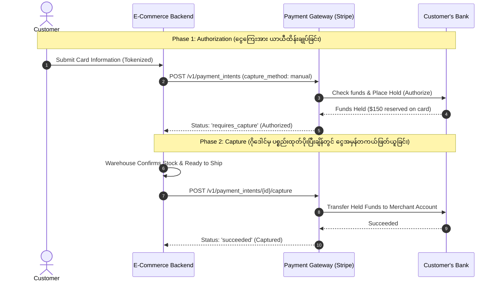
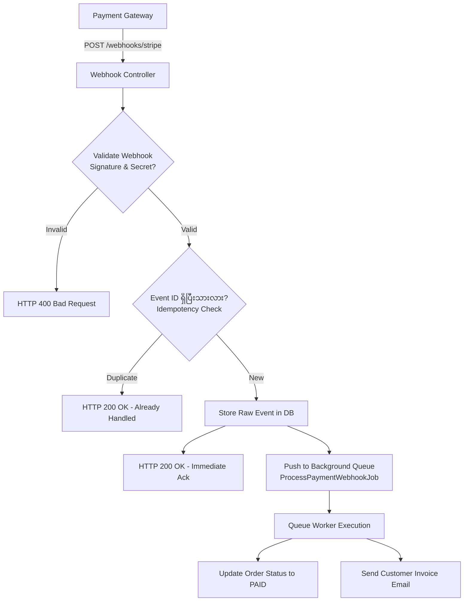

# 💳 Sector 5: Payment Processing, Webhooks & Financial Reconciliation

Payment စနစ်သည် E-Commerce စနစ်တစ်ခု၏ ငွေကြေးအသက်သွေးကြော ဖြစ်ပါသည်။ ဤကဏ္ဍတွင် အမှားအယွင်း တစ်စုံတစ်ရာ ဖြစ်ပေါ်ပါက ကုမ္ပဏီအတွက် တိုက်ရိုက် ငွေကြေးဆုံးရှုံးမှု (Financial Loss) ဖြစ်ပေါ်စေနိုင်ပါသည်။

---

## 🏛️ ၁။ Two-Phase Payments: Authorization vs Capture

ခေတ်မီ E-Commerce စနစ်များတွင် ငွေပေးချေမှုကို အဆင့် ၂ ဆင့်ဖြင့် လုပ်ဆောင်လေ့ရှိပါသည်:



### Authorization vs Capture အဘယ်ကြောင့် အသုံးပြုသနည်း?
- **တိုက်ရိုက် Capture ဖြတ်လိုက်ပါက**: ဂိုဒေါင်တွင် ပစ္စည်းမရှိ၍ Order Cancel လုပ်ရသည့်အခါ Refund ပြန်အမ်းရပြီး Payment Gateway ၏ Transaction Fee (2.9% + 30¢) ဆုံးရှုံးရပါသည်။
- **Authorize လုပ်ထားပါက**: ပစ္စည်းမရှိပါက Authorization ကို Void (ဖျက်သိမ်း) လုပ်လိုက်ရုံဖြင့် Fee မကုန်ဘဲ Customer ၏ ကတ်ပေါ်မှ Hold ကို အလွယ်တကူ ပြန်ဖွင့်ပေးနိုင်ပါသည်။

---

## 🔄 ၂။ Payment Webhook Architecture & Pipeline

Payment Gateway (ဥပမာ- Stripe, PayPal, PayPay) မှ ဖြစ်ရပ်များကို အချိန်နှင့်တစ်ပြေးညီ သိရှိရန် Webhook စနစ်ကို မဖြစ်မနေ သုံးရပါသည်:



---

## ⚠️ ၃။ လက်တွေ့ လုပ်ငန်းခွင် အဖြစ်အများဆုံး ပြဿနာများနှင့် ဖြေရှင်းနည်းများ (Most Found Real-Work Issues)

### ပြဿနာ ၁: Frontend Redirect ကို ငွေရကြောင်း သက်သေအဖြစ် မှားယွင်းယုံကြည်ခြင်း
- **အခြေအနေ**: Developer က Stripe Checkout မှ Website သို့ ပြန်ရောက်လာသည့် `success_url?session_id=cs_123` Redirect ကို အခြေခံပြီး Order ကို "PAID" အဖြစ် သတ်မှတ်လိုက်ခြင်း။
- **ဖြစ်ပေါ်သည့် ဆိုးကျိုး**:
  1. Customer သည် ကတ်ဖြင့် ငွေချေပြီးနောက် Browser Redirect မဖြစ်မီ ဖုန်း Screen ပိတ်လိုက်ခြင်း သို့မဟုတ် Network ပြတ်တောက်သွားခြင်းကြောင့် ငွေဖြတ်သွားသော်လည်း Website ပေါ်တွင် Order က Pending ဖြစ်နေပြီး ပစ္စည်းမပို့ပေးမိခြင်း။
  2. Hacker က URL တွင် `success_url?session_id=fake_123` ဟု Browser တွင် တိုက်ရိုက် ရိုက်ထည့်ပြီး ငွေမချေဘဲ အော်ဒါအောင်မြင်အောင် လှည့်စားခြင်း။
- **လုပ်ငန်းခွင် ဖြေရှင်းနည်း: Webhook is the Single Source of Truth**:
  **Frontend Redirect ကို UI ပြသရန်အတွက်သာ သုံးပါ။ Order Status ပြောင်းလဲခြင်းကို Backend Webhook ရောက်လာမှသာ တရားဝင် အတည်ပြုပါ!**

---

### ပြဿနာ ၂: Duplicate Webhook Events ကြောင့် Order နှစ်ခါဖြစ်ခြင်း (Webhook Idempotency Failure)
- **အခြေအနေ**: Stripe က Webhook ပို့ရာတွင် Merchant Server က 3 စက္ကန့်အတွင်း Response မပေးနိုင်ပါက Timeout ဖြစ်သည်ဟု ယူဆကာ ထို Webhook ကို ၅ ကြိမ်အထိ ထပ်ခါထပ်ခါ ပြန်ပို့ခြင်း (Exponential Backoff Retries)။
- **ဖြစ်ပေါ်သည့် ဆိုးကျိုး**: Order ထဲသို့ Payment Records ၃ ခါ ဝင်သွားခြင်း၊ Customer ထံသို့ Invoice Email ၃ စောင် ရောက်သွားခြင်း သို့မဟုတ် Loyalty Points များ ၃ ဆ ပေးမိခြင်း။
- **လုပ်ငန်းခွင် ဖြေရှင်းနည်း: Processed Events Ledger**:
  Webhook Controller တွင် Signature စစ်ဆေးပြီး Event ID ကို Database Transaction ဖြင့် Lock ခတ်၍ စစ်ဆေးပါ:
  ```php
  // StripeWebhookController.php
  public function handleWebhook(Request $request)
  {
      $payload = $request->getContent();
      $sigHeader = $request->header('Stripe-Signature');
      $webhookSecret = config('services.stripe.webhook_secret');

      try {
          // ၁။ Signature စစ်ဆေးခြင်း (Spoofing ကာကွယ်ရန်)
          $event = \Stripe\Webhook::constructEvent($payload, $sigHeader, $webhookSecret);
      } catch (\Exception $e) {
          return response()->json(['error' => 'Invalid signature'], 400);
      }

      // ၂။ Idempotency Check (Duplicate Event ကာကွယ်ရန်)
      $alreadyProcessed = DB::transaction(function () use ($event) {
          $exists = DB::table('processed_webhook_events')
              ->where('event_id', $event->id)
              ->lockForUpdate()
              ->exists();

          if ($exists) {
              return true;
          }

          DB::table('processed_webhook_events')->insert([
              'event_id' => $event->id,
              'event_type' => $event->type,
              'created_at' => now(),
          ]);

          return false;
      });

      if ($alreadyProcessed) {
          return response()->json(['status' => 'already processed'], 200);
      }

      // ၃။ Background Queue သို့ ပေးပို့ပြီး ချက်ချင်း 200 OK ပြန်ပေးပါ
      ProcessStripeEventJob::dispatch($event->type, $event->data->object->toArray());

      return response()->json(['status' => 'received'], 200);
  }
  ```

---

### ပြဿနာ ၃: Chargeback / Dispute ဖြစ်ပွား၍ ကုမ္ပဏီ ဒဏ်ငွေဆောင်ရခြင်း
- **အခြေအနေ**: ခိုးယူထားသော Credit Card ဖြင့် သူခိုးက ပစ္စည်းဝယ်ယူသွားပြီးနောက် ကတ်အစစ်အမှန် ပိုင်ရှင်က ဘဏ်သို့ "ငါမဝယ်ပါ" ဟု တိုင်ကြားလိုက်ခြင်း (Chargeback Dispute)။
- **ဖြစ်ပေါ်သည့် ဆိုးကျိုး**: ဘဏ်က Merchant ထံမှ ငွေကို အတင်းအဓမ္မ ပြန်လည်နုတ်ယူပြီး Dispute Fee ($15 မှ $25) ပါ ဒဏ်ရိုက်ခြင်း။ ပစ္စည်းလည်း ဆုံးရှုံးရခြင်း။
- **လုပ်ငန်းခွင် ဖြေရှင်းနည်း**:
  1. **3D Secure (3DS / OTP) မဖြစ်မနေ ဖွင့်ထားပါ**: 3DS စစ်ဆေးထားသော Transaction များတွင် Chargeback ဖြစ်ပေါ်ပါက Liability Shift စည်းမျဉ်းအရ ငွေကြေးတာဝန်ယူမှုကို ကတ်ထုတ်ပေးသောဘဏ်က တာဝန်ယူရပြီး Merchant က လျော်ကြေးပေးရန် မလိုပါ။
  2. **Fraud Detection System**: Radar (Stripe) သို့မဟုတ် AWS WAF ဖြင့် သံသယဖြစ်ဖွယ် IP, Proxy, VPN နှင့် ကတ်အကြိမ်ကြိမ် မှားရိုက်သူများကို အလိုအလျောက် Block လုပ်ပါ။

---

### ပြဿနာ ၄: ၃ ဖက် ငွေစာရင်း မကိုက်ညီခြင်း (Reconciliation Discrepancy)
- **အခြေအနေ**: လကုန်သည့်အခါ Internal Database တွင် အရောင်း $100,000 ပြနေသော်လည်း Payment Gateway တွင် $97,000 သာရှိပြီး ဘဏ်စာရင်းထဲသို့ $95,000 သာ ဝင်ရောက်လာခြင်း။
- **ဖြစ်ပေါ်သည့် ဆိုးကျိုး**: ဘဏ္ဍာရေးစာရင်းစစ် (Audit) မအောင်မြင်ဘဲ စာရင်းကိုက်ရန် ရက်သတ္တပတ်ပေါင်းများစွာ အချိန်ကုန်ရခြင်း။
- **အကြောင်းရင်း**:
  - Payment Gateway ၏ Transaction Fee (2.9% + 30¢) နုတ်ယူခံရခြင်း။
  - နိုင်ငံခြားငွေ လဲလှယ်မှုနှုန်း (FX Rate Fluctuation) ကွာဟခြင်း။
  - လကုန်ရက်တွင် ဖြစ်ပေါ်ခဲ့သော Pending Settlements (Payout Delay)။
- **လုပ်ငန်းခွင် ဖြေရှင်းနည်း: 3-Way Reconciliation Ledger**:
  Internal စနစ်တွင် Gross Amount နှင့်အတူ Gateway Fee ကိုပါ သီးခြား မှတ်တမ်းတင်ပါ:
  ```sql
  -- payments table
  amount_gross: 100.00
  amount_fee: 3.20
  amount_net: 96.80
  currency: 'USD'
  gateway_transaction_id: 'ch_3MtwBwLkdIwHu7ix28a3tqPa'
  settlement_batch_id: 'po_1NtwAwLkdIwHu7ix92b1aqZb'
  ```
  နေ့စဉ် ညသန်းခေါင်တွင် Payment Gateway ၏ Settlement CSV Report ကို Download လုပ်ကာ Database စာရင်းများနှင့် အလိုအလျောက် တိုက်ဆိုင်စစ်ဆေးသော Cron Job (Reconciliation Worker) ထည့်သွင်းပါ။
