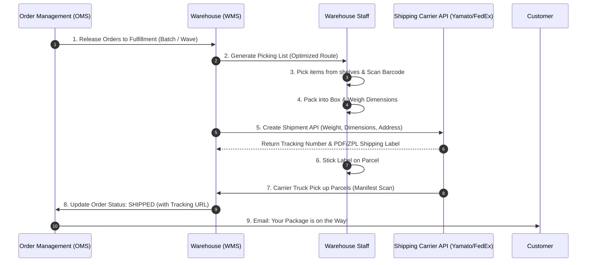
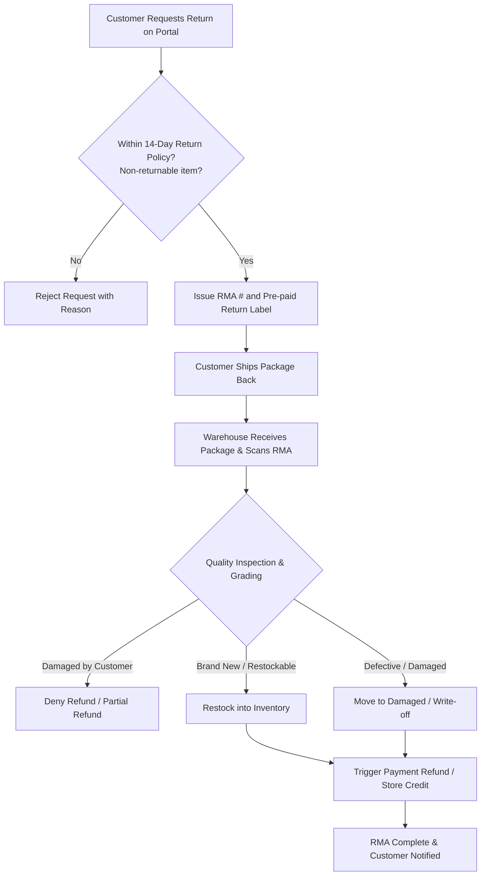

# 🚚 Sector 6: Fulfillment, Logistics, 3PL & Reverse Logistics (Returns)

Customer က Website ပေါ်တွင် ငွေပေးချေပြီးချိန်မှစ၍ ပစ္စည်းကို လက်ဝယ်အရောက် ပို့ဆောင်ပေးခြင်းကို **Fulfillment & Logistics** ဟု ခေါ်ဆိုပါသည်။ ပစ္စည်းမကြိုက်၍ ပြန်လည်ပို့ဆောင်ခြင်းကိုမူ **Reverse Logistics** ဟု ခေါ်ပါသည်။

---

## 🏭 ၁။ Warehouse Fulfillment လုပ်ငန်းစဉ် အဆင့်ဆင့်



---

## 🔄 ၂။ Reverse Logistics & RMA (Return Merchandise Authorization)

Customer က ပစ္စည်းပြန်ပို့လိုသည့်အခါ စနစ်တကျ ကိုင်တွယ်ရမည့် RMA Flow:



---

## ⚠️ ၃။ လက်တွေ့ လုပ်ငန်းခွင် အဖြစ်အများဆုံး ပြဿနာများနှင့် ဖြေရှင်းနည်းများ (Most Found Real-Work Issues)

### ပြဿနာ ၁: Carrier API ၏ လိပ်စာကန့်သတ်ချက်ကြောင့် Label ထုတ်မရဘဲ စနစ်ရပ်တန့်ခြင်း
- **အခြေအနေ**: Customer က လိပ်စာရိုက်ထည့်ရာတွင် စာလုံးရေ ၈၀ ကျော် ရိုက်ထည့်လိုက်ခြင်း သို့မဟုတ် ဂျပန်ဘာသာတွင် Full-width / Half-width ကွာဟခြင်း။
- **ဖြစ်ပေါ်သည့် ဆိုးကျိုး**: Carrier API (Yamato, FedEx, DHL) က Address Line 1 တွင် စာလုံး ၃၅ လုံးသာ ခွင့်ပြုထားသဖြင့် API Error (400 Bad Request) ပြန်လာပြီး ဂိုဒေါင်တွင် Shipping Label ထုတ်မရဘဲ ပစ္စည်းတင်ပို့မှု တစ်ခုလုံး ကြန့်ကြာသွားခြင်း။
- **လုပ်ငန်းခွင် ဖြေရှင်းနည်း: Address Normalizer & Validation Rules**:
  Frontend နှင့် Backend အဆင့်တွင် Carrier ၏ သတ်မှတ်ချက်အတိုင်း ကြိုတင် Validate လုပ်ပါ:
  ```php
  // AddressSanitizer.php
  public static function sanitizeForCarrier(string $addressLine, int $maxLength = 35): array
  {
      // ဂျပန်စာလုံး Full-width သို့မဟုတ် အက္ခရာများ ညီညာစေရန် ပြုပြင်ခြင်း
      $clean = mb_convert_kana($addressLine, 'KVAS');
      
      // စာလုံးရေ ရှည်လွန်းပါက Line 1 နှင့် Line 2 သို့ အလိုအလျောက် ခွဲထုတ်ခြင်း
      if (mb_strlen($clean) > $maxLength) {
          return [
              'line1' => mb_substr($clean, 0, $maxLength),
              'line2' => mb_substr($clean, $maxLength, $maxLength),
          ];
      }

      return ['line1' => $clean, 'line2' => ''];
  }
  ```

---

### ပြဿနာ ၂: Split Shipments ကြောင့် Customer စိတ်ရှုပ်ထွေးပြီး Delivery စရိတ် ၂ ဆ ကုန်ကျခြင်း
- **အခြေအနေ**: Order တစ်ခုတည်းတွင် ပါဝင်သော ပစ္စည်း ၂ ခုကို မတူညီသော ဂိုဒေါင် ၂ ခုမှ ပို့ဆောင်ရာ Tracking Number ၂ ခု ထွက်လာသော်လည်း စနစ်က Email တွင် ပထမ Tracking Number တစ်ခုတည်းသာ ထည့်ပို့မိခြင်း။
- **ဖြစ်ပေါ်သည့် ဆိုးကျိုး**: Customer ထံ ပစ္စည်းတစ်ခုသာ ရောက်လာသည့်အခါ ကျန်ပစ္စည်းတစ်ခု ကျန်ခဲ့သည်ဟု ထင်မှတ်ပြီး Customer Service သို့ ဒေါသတကြီး ဖုန်းဆက်ခြင်း။
- **လုပ်ငန်းခွင် ဖြေရှင်းနည်း: Shipment-Level Tracking Model**:
  Order Table အောက်တွင် `order_shipments` Table ကို သီးခြားခွဲထုတ်ပါ (1 Order has Many Shipments):
  ```sql
  -- order_shipments table
  id: 1, order_id: 101, tracking_number: 'YAMATO-9921', status: 'delivered'
  -- shipment_items
  shipment_id: 1, order_item_id: 501 (T-Shirt)

  -- order_shipments table
  id: 2, order_id: 101, tracking_number: 'SAGAWA-8812', status: 'in_transit'
  -- shipment_items
  shipment_id: 2, order_item_id: 502 (Shoes)
  ```
  Customer UI နှင့် Email တွင် ပစ္စည်းတစ်ခုချင်းစီအလိုက် Tracking နံပါတ်နှင့် ပို့ဆောင်သည့် Courier ကို ခွဲခြားပြသပေးရမည်။

---

### ပြဿနာ ၃: Return Fraud / Wardrobing (ပစ္စည်းဝတ်ပြီးမှ ပြန်ပို့ခြင်း)
- **အခြေအနေ**: Customer က ညပွဲတက်ရန် တန်ဖိုးကြီး ဂါဝန်တစ်ထည်ကို ဝယ်ယူပြီး ပွဲတက်ပြီးနောက် "မကြိုက်ပါ" ဟုဆိုကာ ပြန်ပို့ပြီး ငွေအပြည့် ပြန်တောင်းခြင်း (Wardrobing) သို့မဟုတ် ဖုန်းအစစ်ဝယ်ပြီး သေတ္တာထဲသို့ ဖုန်းအတုထည့်၍ ပြန်ပို့ခြင်း။
- **လုပ်ငန်းခွင် ဖြေရှင်းနည်း**:
  1. **Tamper-Evident Security Tags**: ဖြုတ်လိုက်ပါက ပြန်တပ်၍မရသော ပလတ်စတစ် Security Tag ကို ပစ္စည်းတွင် ချိတ်တွဲထားပြီး *"Security Tag ဖြုတ်ထားပါက Return လက်မခံပါ"* ဟု စည်းမျဉ်းထုတ်ပြန်ထားပါ။
  2. **Photo Proof during RMA Request**: Customer က Return Request တင်သည့်အခါ ပစ္စည်း၏ လက်ရှိဓာတ်ပုံ ၃ ပုံကို မဖြစ်မနေ Upload တင်စေပါ။
  3. **Inspection Grading in Warehouse**: ဂိုဒေါင်တွင် RMA ဝန်ထမ်းက Unboxing ပြုလုပ်သည့် Video မှတ်တမ်းတင်ထားပြီး ပစ္စည်းအခြေအနေ စစ်ဆေးပြီးမှသာ Refund API ကို ခွင့်ပြုပါ။

---

### ပြဿနာ ၄: Carrier API Downtime ဖြစ်ချိန်တွင် ဂိုဒေါင်လုပ်ငန်းများ ရပ်တန့်သွားခြင်း
- **အခြေအနေ**: Peak Season (ဥပမာ- Black Friday သို့မဟုတ် နှစ်ကုန်အရောင်းပွဲ) တွင် Shipping Carrier ၏ Server များ Down သွား၍ Tracking Number နှင့် Label ထုတ်မရတော့ခြင်း။
- **လုပ်ငန်းခွင် ဖြေရှင်းနည်း: Circuit Breaker & Offline Labeling**:
  Carrier API ခေါ်ယူမှုကို Queue Worker တွင် ထည့်သွင်းထားပြီး Circuit Breaker Pattern သုံးပါ။ အကယ်၍ API Down နေပါက တိုက်ရိုက် Crash မဖြစ်စေဘဲ Job ကို Retry Queue ထဲ ထည့်ထားပါ။ အရေးပေါ်အခြေအနေများအတွက် ကြိုတင် Reserve လုပ်ထားသော Offline Tracking Barcodes (Pre-allocated Barcode Range) ဖြင့် Label ထုတ်လုပ်နိုင်သော Fallback စနစ် ပြင်ဆင်ထားပါ။
