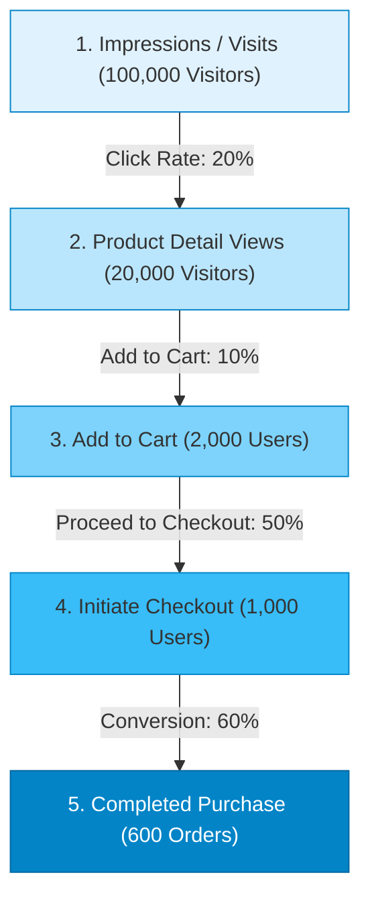

# 📈 Sector 7: Marketing, Analytics & Customer Retention

Customer အသစ်များကို ဆွဲဆောင်ခြင်း (Acquisition) နှင့် မူလ Customer များ ထပ်မံဝယ်ယူစေရန် ထိန်းသိမ်းခြင်း (Retention) သည် E-Commerce လုပ်ငန်းတစ်ခု ရေရှည်အမြတ်အစွန်း ရရှိရန် အဓိက သော့ချက်ဖြစ်ပါသည်။

---

## 🎯 ၁။ Conversion Funnel & Key Analytics Metrics

Customer တစ်ဦးသည် Website သို့ စတင်ရောက်ရှိချိန်မှ ဝယ်ယူပြီးမြောက်သည်အထိ အဆင့်တိုင်းတွင် Customer အရေအတွက် လျော့ကျသွားလေ့ရှိပါသည် (Drop-off Rate):



$$\text{Overall Conversion Rate} = \frac{600 \text{ Completed Orders}}{100,000 \text{ Visitors}} \times 100 = 0.6\%$$

### အဓိက သိထားရမည့် E-Commerce Business Metrics များ

| Metric အမည် | ရှင်းလင်းချက် | တွက်ချက်ပုံ ဖော်မြူလာ |
| :--- | :--- | :--- |
| **GMV** (Gross Merchandise Value) | Platform ပေါ်တွင် အရောင်းအဝယ်ဖြစ်ခဲ့သော စုစုပေါင်း ကုန်ပစ္စည်းတန်ဖိုး | $\sum (\text{Order Items} \times \text{Item Price})$ |
| **AOV** (Average Order Value) | အော်ဒါတစ်ခုလျှင် ပျမ်းမျှ ဝယ်ယူသည့် ပမာဏ | $\frac{\text{Total Revenue}}{\text{Total Orders}}$ |
| **CAC** (Customer Acquisition Cost) | Customer အသစ်တစ်ဦး ရရှိရန် ကုန်ကျသော ကြော်ငြာစရိတ် | $\frac{\text{Total Marketing Cost}}{\text{Number of New Customers}}$ |
| **CLV / LTV** (Customer Lifetime Value) | Customer တစ်ဦးထံမှ တစ်သက်တာ ရရှိနိုင်မည့် အသားတင်တန်ဖိုး | $\text{AOV} \times \text{Purchase Frequency} \times \text{Customer Lifespan}$ |
| **Cart Abandonment Rate** | Cart ထဲ ပစ္စည်းထည့်ပြီး Checkout မဆင်းဘဲ ထွက်သွားသည့်နှုန်း | $1 - \left( \frac{\text{Completed Orders}}{\text{Add to Carts}} \right) \times 100$ |

---

## ⚠️ ၂။ လက်တွေ့ လုပ်ငန်းခွင် အဖြစ်အများဆုံး ပြဿနာများနှင့် ဖြေရှင်းနည်းများ (Most Found Real-Work Issues)

### ပြဿနာ ၁: Google Analytics (GA4) နှင့် Database အရောင်းစာရင်း ၁၅% မှ ၂၅% ကွာဟနေခြင်း
- **အခြေအနေ**: Database ထဲတွင် လစဉ်အရောင်း $100,000 ရှိသော်လည်း GA4 နှင့် Meta Pixel တွင် $75,000 သာ ပြသနေခြင်း။
- **အကြောင်းရင်း**:
  - Customer များသည် Browser တွင် **Ad-blockers (uBlock Origin, Brave Browser)** အသုံးပြုကြခြင်း။
  - Apple ၏ **iOS 14+ ITP (Intelligent Tracking Prevention)** ကြောင့် Third-party Cookies များ ပိတ်ပင်ခံရခြင်း။
  - Client-side JavaScript တင်ရာတွင် Network ကျဆင်း၍ Pixel Event မရောက်ခြင်း။
- **လုပ်ငန်းခွင် ဖြေရှင်းနည်း: Server-Side Tracking (Meta Conversions API & GA4 Measurement Protocol)**:
  Browser JavaScript ကိုသာ အားမကိုးဘဲ Backend PHP က Database ထဲသို့ Order ရောက်သည်နှင့် Server မှ တိုက်ရိုက် HTTP POST ဖြင့် Meta / Google Analytics သို့ Event ပို့ဆောင်ပါ:
  ```php
  // SendServerSidePurchaseEvent.php
  Http::post("https://www.google-analytics.com/mp/collect?api_secret={$secret}&measurement_id={$mid}", [
      'client_id' => $order->ga_client_id,
      'events' => [[
          'name' => 'purchase',
          'params' => [
              'transaction_id' => $order->order_number,
              'value' => $order->grand_total,
              'currency' => 'USD',
              'items' => $orderItemsPayload,
          ]
      ]]
  ]);
  ```

---

### ပြဿနာ ၂: Loyalty Points အလွဲသုံးစားပြုမှု (Negative Balance Loophole)
- **အခြေအနေ**: Customer က $1,000 ဖိုး ပစ္စည်းဝယ်ယူရာ 100 Points ($100 တန်) ရရှိသွားသည်။ Customer က ထိုရရှိသော Points ကို ချက်ချင်း အခြား Order အသစ်တစ်ခုတွင် သုံးလိုက်သည်။ ထို့နောက် ပထမ Order ($1,000) ကို "မကြိုက်ပါ" ဟုဆိုကာ ပစ္စည်းပြန်ပို့ပြီး ငွေ $1,000 အပြည့် ပြန်တောင်းခြင်း။
- **ဖြစ်ပေါ်သည့် ဆိုးကျိုး**: Customer သည် Point သုံးထားသော ပစ္စည်းကို အလကားရသွားပြီး Database တွင် Points Balance က `-100` (အနုတ်) ဖြစ်သွားခြင်း။
- **လုပ်ငန်းခွင် ဖြေရှင်းနည်း: Point Maturity & Holding Period**:
  1. ပစ္စည်းဝယ်ယူပြီးသည်နှင့် Points ကို ချက်ချင်း အသုံးမပြုနိုင်စေပါနှင့် (**Pending Points** အဖြစ်သာ ထားပါ)။
  2. Return Policy သက်တမ်း (ဥပမာ- ၁၄ ရက် သို့မဟုတ် ပစ္စည်းရောက်ရှိပြီးနောက်) ကျော်လွန်ပြီးမှသာ ထို Points ကို အမှန်တကယ် သုံးစွဲနိုင်သော **Active Points** အဖြစ်သို့ Cron Job ဖြင့် အလိုအလျောက် ပြောင်းလဲပေးပါ။
  3. အကယ်၍ ၁၄ ရက်အတွင်း Return ပြုလုပ်ပါက Pending Points ကို Cancel လုပ်လိုက်ပါ။

---

### ပြဿနာ ၃: Referral Program ကို Fake Account များဖြင့် လိမ်လည်အမြတ်ထုတ်ခြင်း (Sybil Attack)
- **အခြေအနေ**: "သူငယ်ချင်းကို ညွှန်းပါက နှစ်ဦးစလုံး $20 စီ ရရှိမည်" ဟု Promotion ပေးထားရာ User တစ်ဦးက ယာယီ Email (10-minute mail) များစွာ ဖွင့်ပြီး မိမိ၏ Referral Link ဖြင့် အကောင့် ၁၀ ခုဖွင့်ကာ $200 Discount Credits များ ရယူသွားခြင်း။
- **လုပ်ငန်းခွင် ဖြေရှင်းနည်း: Fraud Scoring & Purchase-Gated Referral**:
  1. **Account ဖွင့်ရုံဖြင့် Reward မပေးပါနှင့်**: အသစ်ဖိတ်ခေါ်ခံရသူသည် $30 နှင့်အထက် အမှန်တကယ် ပထမဆုံး Order ဝယ်ယူပြီးမှသာ Referrer ကို Credit ပေးပါ။
  2. **Device / IP Fingerprinting**: မတူညီသော အကောင့်များဖြစ်သော်လည်း Device Fingerprint သို့မဟုတ် Credit Card အချက်အလက် တူညီနေပါက Referral ပိတ်ပင်ပါ။

---

### ပြဿနာ ၄: Email Reputation ကျဆင်းပြီး Order Invoice များ Spam ထဲ ရောက်သွားခြင်း
- **အခြေအနေ**: Marketing အဖွဲ့က Promotion သတင်းလွှာ (Newsletter) အစောင်ရေ ၅၀,၀၀၀ ကို စနစ်တစ်ခုတည်းမှ တစ်ပြိုင်နက် ပို့ရာ Spam Complaint များသဖြင့် Gmail/Outlook က ထို Server ၏ IP ကို Blacklist သွင်းလိုက်ခြင်း။
- **ဖြစ်ပေါ်သည့် ဆိုးကျိုး**: Customer က ပစ္စည်းဝယ်ပြီးသော်လည်း Order Confirmation Email နှင့် Password Reset Link များ Spam Folder ထဲသို့ ရောက်သွားကာ Customer Support ဖုန်းများ ပြည့်လျှံသွားခြင်း။
- **လုပ်ငန်းခွင် ဖြေရှင်းနည်း: Subdomain & Provider Isolation**:
  **Transactional Emails** (Order Confirmation, Invoices, OTP) နှင့် **Marketing Emails** (Promotions, Discounts) ကို Subdomain နှင့် Provider လုံးဝ ခွဲခြားထားပါ:
  - Transactional: `notify.yourstore.com` (AWS SES / Postmark ဖြင့် သီးသန့် Fixed Dedicated IP)
  - Marketing: `mail.yourstore.com` (Mailchimp / Klaviyo / SendGrid)
