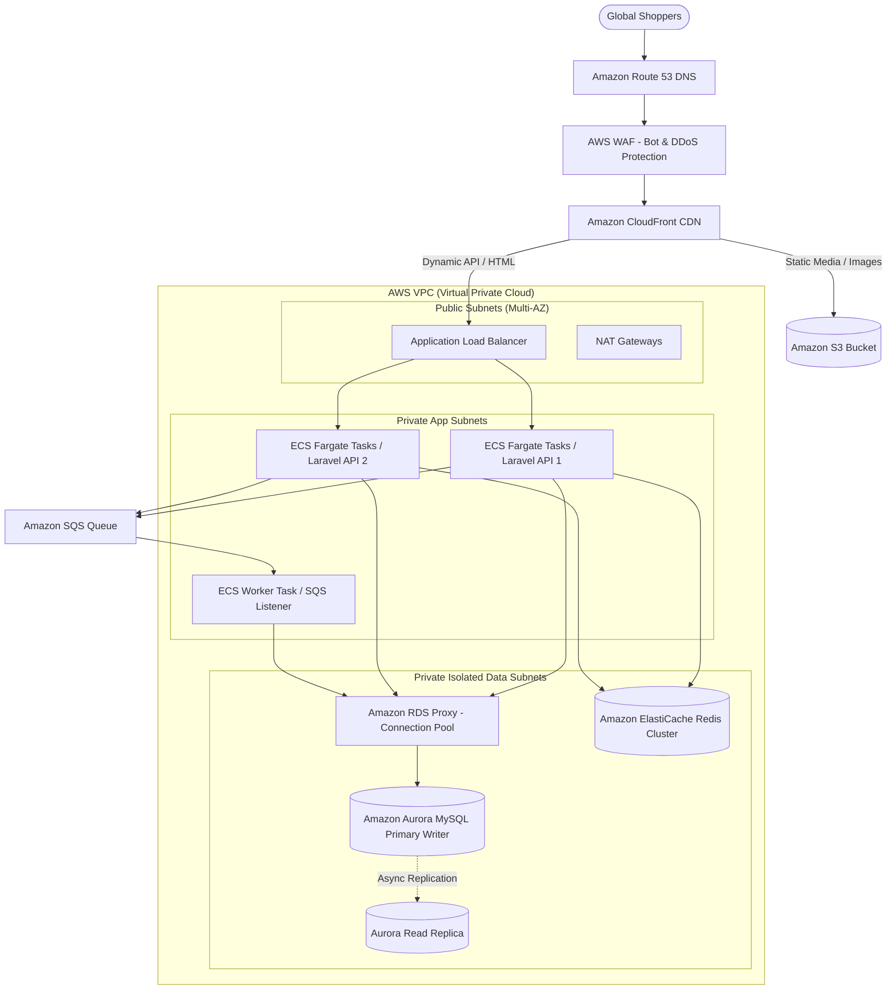
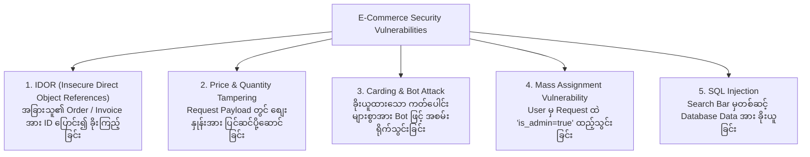

# 🛡️ Sector 8: Technical Architecture, Security & Cloud Infrastructure

စနစ်တစ်ခုသည် လုပ်ငန်းပိုင်းဆိုင်ရာ သဘောတရားများ ပြည့်စုံနေရုံမျှဖြင့် မလုံလောက်ပါ။ High Traffic ဝင်ရောက်လာချိန်တွင် မပြိုလဲစေရန် **AWS Cloud Scalability** နှင့် ငွေကြေးဆိုင်ရာ အချက်အလက်များ မပေါက်ကြားစေရန် **Application Security** ကို မဖြစ်မနေ တည်ဆောက်ရပါမည်။

---

## ☁️ ၁။ Production-Grade AWS Cloud Architecture for E-Commerce



---

## 🔒 ၂။ E-Commerce Security: OWASP Top 10 Protections

E-Commerce စနစ်တစ်ခုတွင် အဓိက တိုက်ခိုက်ခံရလေ့ရှိသော လုံခြုံရေးပေါက်ကြားမှုများနှင့် ကာကွယ်နည်းများ:



---

## ⚠️ ၃။ လက်တွေ့ လုပ်ငန်းခွင် အဖြစ်အများဆုံး ပြဿနာများနှင့် ဖြေရှင်းနည်းများ (Most Found Real-Work Issues)

### ပြဿနာ ၁: IDOR (အခြားသူ၏ Order Invoice အား ID ပြောင်း၍ Download ဆွဲနိုင်ခြင်း)
- **အခြေအနေ**: Customer က မိမိ၏ ပြေစာကို `GET /orders/105/invoice.pdf` ဟု ဒေါင်းလုဒ်ဆွဲသည်။ URL တွင် `105` အစား `104` ဟု ပြောင်းလိုက်ရာ အခြားသူတစ်ဦး၏ နာမည်၊ လိပ်စာ၊ ဖုန်းနံပါတ်နှင့် ဝယ်ယူမှုစာရင်း ပါသော PDF ပွင့်လာခြင်း။
- **ဖြစ်ပေါ်သည့် ဆိုးကျိုး**: ကိုယ်ရေးအချက်အလက် ပေါက်ကြားမှု (Data Breach) ဖြစ်ပွားပြီး ဥရောပတွင် GDPR ဥပဒေအရ ဒဏ်ငွေ ယူရိုသန်းချီ ဒဏ်ရိုက်ခံရနိုင်ခြင်း။
- **လုပ်ငန်းခွင် ဖြေရှင်းနည်း: Laravel Policies / Authorization Gate**:
  Controller တိုင်းတွင် လက်ရှိ Login ဝင်ထားသော User သည် ထို Order ၏ ပိုင်ရှင် ဟုတ်/မဟုတ် စစ်ဆေးပါ:
  ```php
  // OrderPolicy.php
  public function view(User $user, Order $order): bool
  {
      return $user->id === $order->user_id || $user->hasRole('admin');
  }

  // OrderController.php
  public function downloadInvoice(Order $order)
  {
      $this->authorize('view', $order); // 403 Forbidden If Not Owner

      return $this->pdfService->generate($order);
  }
  ```
  ထို့အပြင် Database Auto-increment ID (`104`, `105`) ကို အများပြည်သူမြင်ကွင်းတွင် မသုံးဘဲ **UUID (Universally Unique Identifier)** သို့မဟုတ် **NanoID** (ဥပမာ- `/orders/9b1deb4d-3b7d-4bad-9bdd-2b0d7b3dcb6d/invoice`) ကို အသုံးပြုပါ။

---

### ပြဿနာ ၂: Flash Sale တွင် MySQL "Too Many Connections" တက်၍ Server Down သွားခြင်း
- **အခြေအနေ**: Marketing ပွဲစတင်ချိန်တွင် Request ၁,၀၀၀ ပြိုင်တူဝင်လာပြီး PHP-FPM Workers များက MySQL Connection ၁,၀၀၀ ပြိုင်တူဖွင့်ရန် ကြိုးစားရာ Database ၏ `max_connections` (ဥပမာ- 150) ပြည့်သွားခြင်း။
- **ဖြစ်ပေါ်သည့် ဆိုးကျိုး**: Website တစ်ခုလုံး "SQLSTATE[HY000] [1040] Too many connections" Error တက်ပြီး လုံးဝ ဖွင့်မရတော့ခြင်း။
- **လုပ်ငန်းခွင် ဖြေရှင်းနည်း: Amazon RDS Proxy**:
  ECS/EC2 နှင့် RDS Database ကြားတွင် **Amazon RDS Proxy (Connection Pooler)** ခံထားပါ။ RDS Proxy သည် Database Connections များကို အကြိမ်ကြိမ် ပြန်လည်အသုံးပြု (Connection Pooling) ပေးသဖြင့် PHP Processes ထောင်ပေါင်းများစွာ ဝင်လာသော်လည်း Database ပေါ်သို့ Connection အနည်းငယ်ဖြင့်သာ ချိတ်ဆက်ထိန်းကျောင်းပေးပါသည်။

---

### ပြဿနာ ၃: Synchronous External API Calls ကြောင့် Web Workers များ အကုန် Freeze ဖြစ်သွားခြင်း
- **အခြေအနေ**: Customer က Order တင်သည့် Request ထဲတွင် SMS ပို့ခြင်း၊ Email ပို့ခြင်းနှင့် Shipping Label API ခေါ်ယူခြင်းတို့ကို Synchronous (ရှေ့ဆင့်နောက်ဆင့်) ရေးထားခြင်း။ ထိုအချိန်တွင် SMS Provider API နှေးကွေးပြီး 10 စက္ကန့်ကြာ Timeout ဖြစ်နေခြင်း။
- **ဖြစ်ပေါ်သည့် ဆိုးကျိုး**: PHP-FPM Worker များသည် SMS API အဖြေကို စောင့်ဆိုင်းရင်း Connection များ ပြည့်ကျပ်သွားကာ အခြား Customer များ ဝက်ဘ်ဆိုက်ဖွင့်မရဘဲ တစ်စနစ်လုံး Freeze ဖြစ်သွားခြင်း။
- **လုပ်ငန်းခွင် ဖြေရှင်းနည်း: Asynchronous Background Jobs (Amazon SQS / Redis)**:
  Order ဖန်တီးရာတွင် အရေးကြီးသော DB Transaction ပြီးသည်နှင့် အခြားအလုပ်များအားလုံးကို Background Queue သို့ ပစ်ထည့်ပါ:
  ```php
  // PlaceOrderAction.php
  DB::transaction(function () use ($cart) {
      $order = $this->createOrderRecord($cart);
      $this->deductStock($cart);
      
      // ✅ အပြင် API များအား Queue ဖြင့်သာ အလုပ်လုပ်စေပါ
      SendOrderConfirmationEmailJob::dispatch($order)->onQueue('emails');
      NotifyShippingCarrierJob::dispatch($order)->onQueue('shipments');
      SendSmsAlertJob::dispatch($order)->onQueue('sms');
  });
  ```

---

### ပြဿနာ ၄: Cache Stampede / Thundering Herd Problem
- **အခြေအနေ**: ပင်မစာမျက်နှာတွင် ပြသမည့် "Popular Products" စာရင်းကို Redis တွင် 10 မိနစ် TTL ဖြင့် Cache သိမ်းထားသည်။ Cache သက်တမ်း ကုန်ဆုံးသွားသည့် (Expired) စက္ကန့်ပိုင်းတွင် Request ၅၀၀ တစ်ပြိုင်နက် ရောက်ရှိလာခြင်း။
- **ဖြစ်ပေါ်သည့် ဆိုးကျိုး**: Request ၅၀၀ စလုံးက Cache မရှိတော့ကြောင်း တွေ့ရသဖြင့် Database သို့ Heavy Complex Query ၅၀၀ ပြိုင်တူ သွားဆွဲရာ Database CPU 100% တက်ကာ Crash သွားခြင်း။
- **လုပ်ငန်းခွင် ဖြေရှင်းနည်း: Mutex Lock or Early Expiration**:
  ```php
  $products = Cache::remember('home_popular_products', now()->addMinutes(10), function () {
      // Redis Lock သုံး၍ Query တစ်ခုတည်းသာ Database သို့ ဝင်ရောက်စေခြင်း
      return Cache::lock('lock:home_popular_products', 10)->get(function () {
          return Product::where('is_featured', true)->with('variants')->get();
      });
  });
  ```

---

### ပြဿနာ ၅: သန်းချီသော Orders များကို CSV Export ထုတ်ရာတွင် PHP Memory Limit ပြည့်သွားခြင်း
- **အခြေအနေ**: Admin က လွန်ခဲ့သော ၁ နှစ်စာ အော်ဒါများကို Accounting အတွက် CSV Export ဆွဲထုတ်ရာ `Order::all()` ဖြင့် ဆွဲတင်သဖြင့် `Allowed memory size of 134217728 bytes exhausted` တက်ကာ Server ရပ်တန့်သွားခြင်း။
- **လုပ်ငန်းခွင် ဖြေရှင်းနည်း: Lazy Loading with Cursor / Chunking**:
  ```php
  use Symfony\Component\HttpFoundation\StreamedResponse;

  public function exportOrdersCsv(): StreamedResponse
  {
      return response()->streamDownload(function () {
          $handle = fopen('php://output', 'w');
          fputcsv($handle, ['Order Number', 'Date', 'Customer', 'Total']);

          // Memory မကုန်စေရန် cursor() သုံး၍ Row တစ်ခုချင်း Stream လုပ်ပါ
          Order::with('user')->cursor()->each(function ($order) use ($handle) {
              fputcsv($handle, [
                  $order->order_number,
                  $order->created_at->toDateTimeString(),
                  $order->user->name,
                  $order->grand_total,
              ]);
          });

          fclose($handle);
      }, 'orders_report.csv');
  }
  ```
