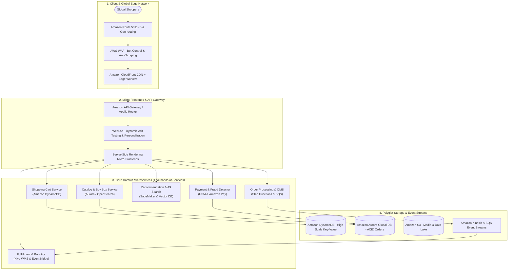
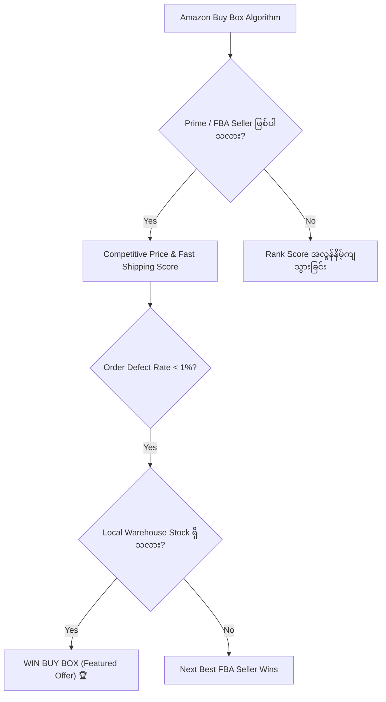
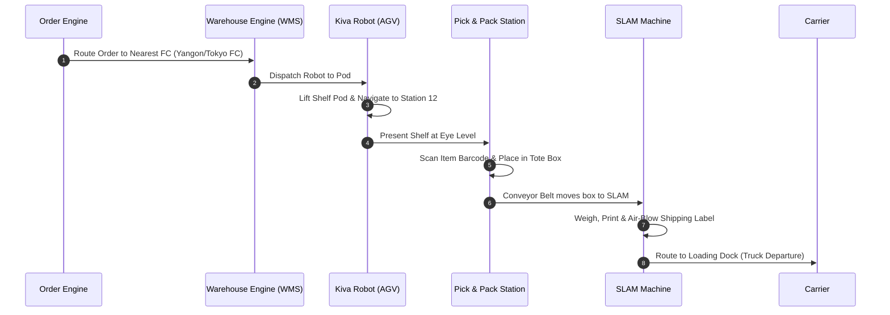

# 🌐 Sector 9: Amazon Online Shop System: Architecture & Engineering Deep Dive

ကမ္ဘာ့အကြီးဆုံး E-Commerce Platform ဖြစ်သော **Amazon.com** သည် ရိုးရိုး Online Shop တစ်ခု မဟုတ်ဘဲ တစ်စက္ကန့်လျှင် ထောင်ပေါင်းများစွာသော Orders များကို တပြိုင်နက် ကိုင်တွယ်နိုင်သည့် ဧရာမ **Distributed Microservices Ecosystem** ကြီး ဖြစ်ပါသည်။

ဤသင်ခန်းစာတွင် Amazon Online Shop System တစ်ခုလုံး နောက်ကွယ်တွင် မည်သို့ အလုပ်လုပ်သည်၊ မည်သည့် နည်းပညာ Stack များကို အသုံးပြုထားသည်နှင့် အဓိက Subsystems တစ်ခုချင်းစီ၏ လုပ်ဆောင်ပုံများကို မြန်မာဘာသာဖြင့် အသေးစိတ် (English Technical Terms များနှင့်အတူ) ရှင်းလင်းတင်ပြထားပါသည်။

---

## 🏛️ ၁။ Amazon စနစ်၏ ဗိသုကာ ဆင့်ကဲပြောင်းလဲမှု (Architecture Evolution)

Amazon သည် အစောပိုင်း (၁၉၉၅ - ၂၀၀၁) တွင် **"Obidos"** ဟုခေါ်သော C/C++ Monolithic Codebase ကြီးတစ်ခုတည်းဖြင့် စတင်ခဲ့သည်။ သို့သော် Traffic များပြားလာသောအခါ Monolith ကြောင့် Deployment များ ကြန့်ကြာပြီး Database Bottleneck ဖြစ်လာခဲ့သည်။

ယနေ့ခေတ် Amazon သည် **"Two-Pizza Teams"** (လူ ၆ ဦးမှ ၁၀ ဦးခန့်သာပါသော အဖွဲ့ငယ်လေးများ) က သီးခြားစီ ပိုင်ဆိုင်သည့် **Microservices ပေါင်း သောင်းနှင့်ချီ** ဖြင့် လည်ပတ်နေပါသည်။

---

## 🧩 ၂။ Amazon ၏ အဓိက လုပ်ဆောင်ချက်စနစ်များ (Core Subsystems & Technologies)

Amazon စနစ်တစ်ခုလုံးကို အောက်ပါ အဓိက Subsystems ၁၁ ခုဖြင့် ဖွဲ့စည်းထားပါသည်:

---

### ၁။ The Amazon Shopping Cart & DynamoDB (Always-Writable Cart)
- **အသုံးပြုသော နည်းပညာ**: Amazon DynamoDB, Consistent Hashing, Vector Clocks, Eventual Consistency.
- **နောက်ခံ သမိုင်းကြောင်း**:
  Amazon CTO ဖြစ်သူ Werner Vogels က *"Shopping Cart သည် Network Split-Brain သို့မဟုတ် Server ပျက်စီးနေချိန်တွင်ပင် Customer ထံမှ Add to Cart ကို မည်သည့်အခါမျှ Reject မလုပ်ရ"* ဟု မူဝါဒချမှတ်ခဲ့သည်။ ဤလိုအပ်ချက်ကြောင့် Amazon ၏ ကျော်ကြားသော **Dynamo Paper (DynamoDB ၏ မူလဘူတ)** ပေါ်ပေါက်လာခဲ့သည်။
- **အလုပ်လုပ်ပုံ Flow**:
  1. Customer က Add to Cart နှိပ်တိုင်း Cart State ကို Distributed DynamoDB Cluster တွင် Partition Key (`user_id`) ဖြင့် Multi-Region ဖြန့်ကျက် သိမ်းဆည်းသည်။
  2. Network ချို့ယွင်းမှုကြောင့် Region နှစ်ခုတွင် Cart Data ကွဲပြားသွားပါက Customer ထံ Error မပြဘဲ နှစ်ဖက်စလုံးကို လက်ခံထားသည်။
  3. Customer က Checkout ပြုလုပ်သည့်အခါ **CRDTs (Conflict-free Replicated Data Types)** Algorithm ဖြင့် ပစ္စည်းစာရင်းများကို အလိုအလျောက် ပေါင်းစည်း (Reconcile) ပေးသည်။

---

### ၂။ The Buy Box Algorithm (Featured Offer Matching)
- **အသုံးပြုသော နည်းပညာ**: Algorithmic Repricing Engine, Real-time Stream Processing, Amazon Aurora.
- **Buy Box ဆိုတာဘာလဲ?**:
  Amazon ပေါ်တွင် ပစ္စည်းတစ်ခုတည်း (ဥပမာ- Sony WH-1000XM5) ကို Sellers ပေါင်း ၁၀ ဦးက ပြိုင်တူရောင်းချနေနိုင်သည်။ Customer က **"Add to Cart" သို့မဟုတ် "Buy Now"** နှိပ်လိုက်သည့်အခါ မည်သည့် Seller ၏ ပစ္စည်းကို ဝယ်ယူသွားမည်နည်းဆိုသည်ကို **Buy Box Algorithm** က ဆုံးဖြတ်ပေးသည်။ (အရောင်းပမာဏ၏ ၈၂% ကျော်သည် Buy Box ရရှိသော Seller ထံမှ ဖြစ်သည်)။
- **Buy Box ရွေးချယ်မှု သတ်မှတ်ချက်များ (Evaluation Metrics)**:
  1. **Fulfillment Method**: FBA (Fulfillment by Amazon / Prime) ရောင်းသူများသည် FBM (Merchant-fulfilled) ထက် အဆမတန် ဦးစားပေးခံရသည်။
  2. **Landed Price (စျေးနှုန်း)**: ပစ္စည်းတန်ဖိုး + ပို့ဆောင်ခ စုစုပေါင်း။
  3. **Shipping Speed**: Prime 1-Day / Same-Day Delivery ပေးနိုင်မှု။
  4. **Seller Feedback & ODR**: Order Defect Rate (ODR) ၁% အောက် ဖြစ်ရမည်။
  5. **Inventory Depth**: ဂိုဒေါင်ထဲတွင် ပစ္စည်းလက်ကျန် အလုံအလောက် ရှိနေရမည်။

---

### ၃။ 1-Click Ordering System (Fast-Track Checkout)
- **အသုံးပြုသော နည်းပညာ**: Amazon-patented 1-Click Protocol, Tokenized Payment Vault, Asynchronous Order Reservation.
- **အလုပ်လုပ်ပုံ လုပ်ငန်းစဉ်**:
  1. Customer သည် Cart ထဲ ထည့်စရာမလိုဘဲ **"Buy Now" (1-Click)** ခလုတ်ကို နှိပ်လိုက်သည်။
  2. စနစ်သည် Customer ၏ Default Payment Token (Credit Card) နှင့် Default 1-Click Shipping Address ကို ဆွဲယူသည်။
  3. **Instant Order Confirmation**: Customer ဘက်တွင် "Order Placed" ဟု ချက်ချင်း ပြသလိုက်သည်။
  4. **The 30-Minute Grace Window**: နောက်ကွယ် Backend တွင် အော်ဒါကို ဂိုဒေါင်သို့ ချက်ချင်း မပို့သေးဘဲ မိနစ် ၃၀ ခေတ္တ စောင့်ဆိုင်းထားသည်။ Customer က အခြားပစ္စည်းတစ်ခုကို ထပ်မံ 1-Click ဝယ်ယူပါက စနစ်က ထိုအော်ဒါနှစ်ခုကို Package တစ်ခုတည်းအဖြစ် အလိုအလျောက် ပေါင်းစည်း (Consolidate) ပေးပြီး Amazon အတွက် ပို့ဆောင်စရိတ် သန်းချီ သက်သာစေပါသည်။

---

### ၄။ Fulfillment Centers (FC) & Chaotic Storage System
- **အသုံးပြုသော နည်းပညာ**: Kiva Robotics / Proteus AGVs, Computer Vision, Barcode & 2D Matrix Scanners, SLAM Automation.
- **Chaotic Storage ဆိုတာဘာလဲ?**:
  ရိုးရိုး ဂိုဒေါင်များတွင် စာအုပ်များကို စာအုပ်စင်တွင်ထားပြီး ဖိနပ်များကို ဖိနပ်စင်တွင် ထားလေ့ရှိသည်။ Amazon ဂိုဒေါင်တွင်မူ **မည်သည့် ပစ္စည်းအမျိုးအစားကိုမဆို လွတ်နေသော မည်သည့် အကွက်ထဲတွင်မဆို ကျပန်း (Random) ထည့်သွင်းသိမ်းဆည်းပါသည်** (ဥပမာ- Lipstick တစ်ခုဘေးတွင် Harry Potter စာအုပ်၊ ၎င်းဘေးတွင် Dog Food)။
- **အဘယ်ကြောင့် Chaotic Storage သုံးသနည်း?**:
  - ဂိုဒေါင်ဝန်ထမ်းတစ်ဦးသည် ပစ္စည်း ၁၀ မျိုး လိုက်ကောက်သည့်အခါ ဂိုဒေါင်တစ်ဖက်စွန်းမှ အခြားတစ်ဖက်စွန်းသို့ မီတာရာချီ လမ်းလျှောက်ရန် မလိုဘဲ အနီးဆုံးစင်တွင် ပစ္စည်းအမျိုးမျိုး ရောနှောတည်ရှိနေစေရန် ဖြစ်သည်။
  - ကွန်ပျူတာစနစ်က မည်သည့်ပစ္စည်းသည် မည်သည့် စင်နံပါတ်၊ အကွက်နံပါတ်တွင် ရှိသည်ကို Barcode Scan ဖြင့် အမြဲတမ်း တိကျစွာ မှတ်သားထားသည်။
- **Kiva Robotics (Drive Units)**:
  Amazon ဂိုဒေါင်များတွင် လူက စင်ဆီသို့ လမ်းလျှောက်သွားခြင်း မဟုတ်ဘဲ လိမ္မော်ရောင် **Kiva / Proteus စက်ရုပ်ငယ်များ** က စင်တစ်ခုလုံး (Pod) ကို မကာ ဝန်ထမ်းရပ်နေသော Picking Station ဆီသို့ အလိုအလျောက် သယ်ဆောင်လာပေးပါသည်။
- **SLAM (Scan, Label, Apply, Manifest)**:
  ပစ္စည်းဘူးကို သယ်ယူစက်ခါးပတ် (Conveyor Belt) ပေါ်တင်လိုက်သည်နှင့် Computer Vision စနစ်က 0.5 စက္ကန့်အတွင်း အလေးချိန်ချိန်ခြင်း၊ Tracking Label ကို လေဖိအားဖြင့် ကပ်ပေးခြင်းတို့ကို လူလက်မပါဘဲ အလိုအလျောက် ဆောင်ရွက်ပေးသည်။

---

### ၅။ Anticipatory Shipping (Predictive Logistics - မမှာမီ ကြိုတင်ပို့ဆောင်ခြင်း)
- **အသုံးပြုသော နည်းပညာ**: Predictive Machine Learning, SageMaker, Big Data Analytics.
- **သဘောတရား**:
  Amazon သည် Customer က "Place Order" မနှိပ်မီကတည်းက Customer ၏ ရှာဖွေမှုမှတ်တမ်း၊ Wishlist နှင့် ဒေသအလိုက် ဝယ်လိုအားတို့ကို ခွဲခြမ်းစိတ်ဖြာပြီး ပစ္စည်းကို ထိုဒေသနှင့် အနီးဆုံး Local Hub သို့ ကြိုတင်တင်ပို့ထားနှင့်ပြီး ဖြစ်သည်။
- ထို့ကြောင့် Customer က အော်ဒါတင်လိုက်သည်နှင့် နာရီပိုင်းအတွင်း အိမ်တံခါးဝသို့ ပို့ဆောင်ပေးနိုင်ခြင်း (Same-Day / Next-Day Delivery) ဖြစ်ပါသည်။

---

### ၆။ A9 / Rufus Search & AI Recommendation Engine
- **အသုံးပြုသော နည်းပညာ**: OpenSearch, Deep Learning, Graph Neural Networks, Amazon Bedrock (Generative AI).
- **A9 Search Algorithm**:
  Google ကဲ့သို့ Information ရှာဖွေခြင်း မဟုတ်ဘဲ **"Customer ဝယ်ယူနိုင်ခြေ အများဆုံး (Conversion-oriented)"** ပစ္စည်းများကို ထိပ်ဆုံးတွင် ပြသပေးသည်။
  - စာလုံးတူညီမှု (Text Match)
  - သမိုင်းကြောင်းအရ ထို Keyword ဖြင့် ရောင်းချခဲ့ရသော အရေအတွက် (Sales Velocity)
  - Customer Reviews & Ratings
- **Item-to-Item Collaborative Filtering**:
  *"Customers who bought this also bought..."* Algorithm သည် User တစ်ဦးချင်းစီ၏ အချက်အလက်အစား **ပစ္စည်းအချင်းချင်း တွဲဖက်ဝယ်ယူလေ့ရှိသော Relationship Matrix** ကို တွက်ချက်ထားသဖြင့် User သန်း ၃၀၀ ကျော်အတွက် Real-time Sub-millisecond Response ဖြင့် ထောက်ခံချက်ပေးနိုင်သည်။
- **Rufus Shopping Assistant**:
  Amazon ၏ GenAI Assistant ဖြစ်ပြီး Customer ၏ မေးခွန်းများကို Customer Reviews ထောင်ပေါင်းများစွာအား အကျဉ်းချုပ်၍ တိုက်ရိုက် အဖြေပေးသည်။

---

### ၇။ Amazon Pay & Fraud Detection Engine
- **အသုံးပြုသော နည်းပညာ**: Amazon Fraud Detector (Machine Learning Models), PCI DSS Level 1 HSMs, Device Fingerprinting.
- **လုံခြုံရေး စစ်ဆေးပုံ**:
  Transaction တစ်ခု ဝင်လာတိုင်း 50 Milliseconds အတွင်း Machine Learning Model က အောက်ပါ အချက်များကို စစ်ဆေးသည်:
  - Customer ၏ လက်ရှိ Mouse Movement နှင့် Typing Speed (Bot Detection)
  - IP Address နှင့် Shipping Address ကွာဝေးမှု
  - စျေးကြီးသော ပစ္စည်းများအား ရုတ်တရက် အများအပြား မှာယူခြင်း
  - လိမ်လည်မှု ဖြစ်နိုင်ခြေ (Risk Score) မြင့်မားပါက 3D Secure (OTP) တောင်းခံခြင်း သို့မဟုတ် ငွေပေးချေမှုကို အလိုအလျောက် ပယ်ဖျက်ခြင်း။

---

### ၈။ Cell-Based Architecture & High Availability (စနစ်မပြိုလဲစေသော နည်းပညာ)
- **အသုံးပြုသော နည်းပညာ**: Cell-based Architecture, Multi-Region Active-Active, AWS Route 53 Application Recovery Controller (ARC).
- **Blast Radius လျှော့ချခြင်း**:
  Amazon သည် သုံးစွဲသူအားလုံးကို Database ကြီးတစ်ခုတည်းပေါ်တွင် မထားပါ။ အသုံးပြုသူများကို သေးငယ်သော **"Cells"** (ဥပမာ- သုံးစွဲသူ ၁ သန်းစီပါသော သီးခြား သီးသန့် mini-environments များ) အဖြစ် ပိုင်းခြားထားသည်။
  - အကယ်၍ Cell တစ်ခုတွင် Software Bug ကြောင့် Crash ဖြစ်သွားပါက ထို Cell ထဲရှိ သုံးစွဲသူ ၁% သာ ထိခိုက်ပြီး ကျန် ၉၉% သော ကမ္ဘာတစ်ဝှမ်း သုံးစွဲသူများသည် ပုံမှန်အတိုင်း ဆက်လက် အသုံးပြုနိုင်ပါသည်။

---

## 📊 ၃။ Amazon Subsystems & Tech Stack အနှစ်ချုပ် နှိုင်းယှဉ်ချက်ဇယား

| Subsystem အမည် | တာဝန်ယူထားသော လုပ်ဆောင်ချက် | အဓိက အသုံးပြုထားသော နည်းပညာ (Tech Stack) | အဓိက အင်ဂျင်နီယာ ရည်မှန်းချက် |
| :--- | :--- | :--- | :--- |
| **Storefront & Edge** | စာမျက်နှာများ မြန်ဆန်စွာ ပြသခြင်း၊ Dynamic A/B Testing | CloudFront, Lambda@Edge, Micro-Frontends, WebLab | Sub-second First Contentful Paint |
| **Shopping Cart** | Customer များ ပစ္စည်းထည့်သွင်းမှု မည်သည့်အခါမျှ မပျက်စီးစေခြင်း | Amazon DynamoDB, Consistent Hashing, CRDTs | 99.999% Availability (Always-Writable) |
| **Buy Box Engine** | အရောင်းရဆုံး နေရာတွင် အကောင်းဆုံး ရောင်းသူကို ရွေးချယ်ပေးခြင်း | In-Memory Caching, Complex Pricing Algorithms | Real-time Multi-seller Fair Evaluation |
| **1-Click Checkout** | စက္ကန့်ပိုင်းအတွင်း အော်ဒါတင်နိုင်ခြင်းနှင့် အော်ဒါပေါင်းစည်းခြင်း | Payment Tokenization, 30-min Hold Window | Frictionless Instant Conversion |
| **OMS & Distributed Saga** | Microservices သောင်းချီကြား အော်ဒါအဆင့်ဆင့် အောင်မြင်စေခြင်း | AWS Step Functions, Amazon SQS, EventBridge | Eventual Consistency, Distributed ACID |
| **Fulfillment (WMS)** | ဂိုဒေါင်ထဲတွင် ပစ္စည်းအမြန်ဆုံး ရှာဖွေ၊ ထုပ်ပိုး၊ ပို့ဆောင်ခြင်း | Kiva Robots, Chaotic Storage, SLAM Automation | Human Walking Time လျှော့ချရေး |
| **Predictive Logistics** | Customer မမှာမီ အနီးဆုံးဂိုဒေါင်သို့ ပစ္စည်းကြိုတင်ပို့ထားခြင်း | Amazon SageMaker, Anticipatory Shipping ML | Same-Day Delivery အောင်မြင်စေရေး |
| **A9 Search & Recommendations** | ဝယ်ယူသူ လိုချင်သော ပစ္စည်းကို မျက်စိရှေ့ ချက်ချင်း ရောက်လာစေခြင်း | OpenSearch, Item-to-Item Collaborative Filtering | High Conversion Rate (CRO) |
| **Fraud Prevention** | ခိုးယူထားသော ကတ်များနှင့် Bot များ တားဆီးခြင်း | Amazon Fraud Detector, Behavioral Biometrics | Chargeback Fraud < 0.01% |
| **Cell Architecture** | စနစ်တစ်ခုလုံး ပြိုင်တူ Down သွားခြင်းမှ ကာကွယ်ခြင်း | AWS Route 53 ARC, Multi-Region Cell Partitioning | Minimize Blast Radius |

---

## 💡 Developer တစ်ယောက်အနေဖြင့် Amazon ထံမှ အတုယူရမည့် Lessons များ

1. **Monolith to Microservices**: စတင်တည်ဆောက်ချိန်တွင် Monolith ဖြင့် စတင်နိုင်သော်လည်း Scaling ဖြစ်လာပါက Domain အလိုက် Microservices သို့ ပြောင်းလဲနိုင်ရန် Code ကို Decoupled ဖြစ်အောင် ရေးသားပါ။
2. **Design for Failure (Werner Vogels' Rule)**: *"Everything fails, all the time"*. Database ပျက်စီးနိုင်သည်၊ Network ပြတ်တောက်နိုင်သည်ဟု ကြိုတင်တွက်ဆပြီး Circuit Breakers, Retry Queues နှင့် Idempotency များကို ထည့်သွင်းပါ။
3. **Decouple Fast-path and Slow-path**: 1-Click ကဲ့သို့ User နှင့် ထိတွေ့သော နေရာများကို Real-time မြန်ဆန်စွာ အတည်ပြုပြီး အချိန်ယူရသော အလုပ်များ (ဂိုဒေါင်စာရင်းပို့ခြင်း၊ Email ပို့ခြင်း) ကို Asynchronous Background Workers များသို့ လွှဲပြောင်းပါ။
4. **Data Immutability**: Order၊ Invoice နှင့် Address များကို မူလ Master Tables ပေါ်တွင် မမှီခိုဘဲ Snapshot ရိုက်သိမ်းဆည်းသော အလေ့အကျင့်ကို မဖြစ်မနေ အသုံးပြုပါ။
