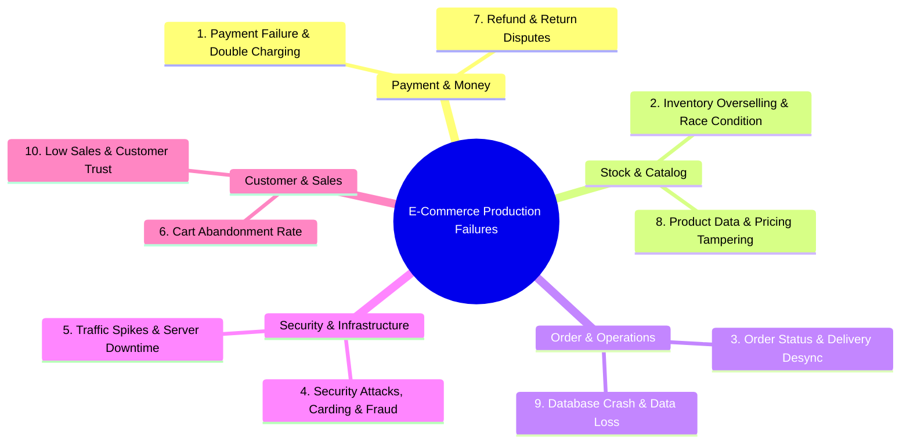
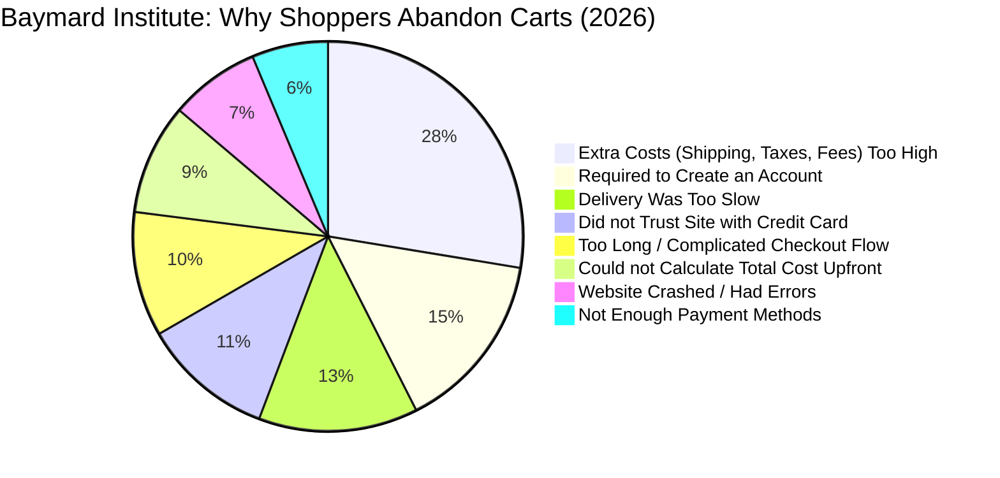

# 🛠️ Sector 10: Production Problems, Baymard Checkout UX & Code Solutions

E-Commerce စနစ်တစ်ခုကို Production သို့ တင်လိုက်သည့်အခါ သာမန် CRUD Application များတွင် မကြုံတွေ့ဖူးသော **ငွေကြေးလိမ်လည်မှု၊ Concurrency Race Condition၊ Webhook ကွဲလွဲမှု၊ အော်ဒါနှစ်ခါဖြစ်မှုနှင့် Cart Abandonment** စသည့် ရှုပ်ထွေးသော ပြဿနာများကို ရင်ဆိုင်ရလေ့ရှိပါသည်။

ဤသင်ခန်းစာတွင် လုပ်ငန်းခွင်၌ အဖြစ်အများဆုံး **Critical Production Problems ၁၀ ခု**၊ ၂၀၂၆ ခုနှစ် **Baymard Institute ၏ Checkout UX Research** နှင့် အဓိက အင်ဂျင်နီယာ အမှား ၆ ခုအတွက် **Laravel & Database လက်တွေ့ ကုဒ်ဖြေရှင်းနည်းများ** ကို အသေးစိတ် ရှင်းလင်းထားပါသည်။

---

## 🚨 အပိုင်း ၁။ လုပ်ငန်းခွင် အဖြစ်အများဆုံး Critical Problems ၁၀ ခုနှင့် ဖြေရှင်းနည်းများ



---

### ၁။ Payment Failure & Duplicate Payment (ငွေဖြတ်သော်လည်း Order မဖြစ်ခြင်း သို့မဟုတ် ငွေနှစ်ခါဖြတ်မိခြင်း)
- **အခြေအနေ (Root Cause)**:
  - Customer က ငွေပေးချေပြီးသော်လည်း Mobile Browser ကို ပိတ်လိုက်ခြင်းကြောင့် Frontend Redirect မရောက်ဘဲ Order က `Pending Payment` တွင် သောင်တင်နေခြင်း။
  - Network Timeout ကြောင့် Payment Gateway က Webhook ကို ၃ ကြိမ် ပြန်ပို့ရာ Backend က Idempotency မစစ်ဘဲ ငွေနှစ်ခါ သို့မဟုတ် Order နှစ်ခါ ဖြစ်သွားခြင်း။
- **လက်တွေ့ ဖြေရှင်းနည်း (Solutions)**:
  1. **Webhook-Driven Source of Truth**: Frontend Redirect ကို မယုံပါနှင့်။ Backend Webhook Event ရောက်ရှိ အတည်ပြုပြီးမှသာ Order ကို `PAID` သို့ ပြောင်းပါ။
  2. **Idempotency Key & Ledger**: Webhook Controller တွင် `event_id` အား `processed_webhook_events` Table တွင် Transaction ခတ်ပြီး စစ်ဆေးပါ။
  3. **Payment Reconciliation Worker**: ညစဉ် ညသန်းခေါင်တွင် Payment Gateway ၏ Settlement API နှင့် Database စာရင်းများကို အလိုအလျောက် တိုက်ဆိုင်စစ်ဆေးသည့် Cron Job ထည့်သွင်းပါ။

---

### ၂။ Inventory Mismatch & Overselling (လက်ကျန်မရှိဘဲ ရောင်းမိခြင်း)
- **အခြေအနေ (Root Cause)**:
  - ပစ္စည်း ၁ ခုသာ ကျန်ရှိချိန်တွင် Customer ၂ ဦးက တစ်စက္ကန့်တည်းတွင် "Place Order" နှိပ်လိုက်ရာ Concurrency Race Condition ကြောင့် ၂ ယောက်စလုံး ဝယ်ယူသွားခြင်း။
- **လက်တွေ့ ဖြေရှင်းနည်း (Solutions)**:
  1. **Pessimistic Locking**: Database Transaction စတင်ချိန်တွင် Row-level Lock ခတ်ပါ (`DB::table('inventories')->lockForUpdate()`)။
  2. **Atomic Stock Decrement**: `UPDATE inventories SET quantity = quantity - 1 WHERE id = 1 AND quantity >= 1;`
  3. **Stock Reservation Pipeline**: Checkout စတင်ချိန်တွင် Stock ကို ၁၅ မိနစ် TTL ဖြင့် Reserve ဖယ်ထားပြီး Payment မပြီးပါက Worker က အလိုအလျောက် ပြန်လွှတ်ပေးခြင်း။

---

### ၃။ Order Processing & Delivery Problems (အော်ဒါပျောက်ဆုံးခြင်း၊ Status မပြောင်းခြင်း)
- **အခြေအနေ (Root Cause)**:
  - ဝန်ထမ်းက ပစ္စည်းပို့ပြီးသော်လည်း Courier API Webhook ကျဆင်းနေ၍ Website တွင် `Processing` အဖြစ် ကျန်နေခြင်း သို့မဟုတ် တရားမဝင် Status သို့ မှားပြောင်းမိခြင်း။
- **လက်တွေ့ ဖြေရှင်းနည်း (Solutions)**:
  1. **Finite State Machine (FSM)**: အခြေအနေတစ်ခုမှ အခြားတစ်ခုသို့ ကူးပြောင်းမှုကို တင်းကျပ်စွာ စစ်ဆေးခြင်း (ဥပမာ- `Shipped` မှ `Cancelled` သို့ တိုက်ရိုက် မပြောင်းရ)။
  2. **Audit Logs & Tracking Webhooks**: မည်သူက မည်သည့်အကြောင်းကြောင့် Status ပြင်သည်ကို `order_status_histories` တွင် မဖြစ်မနေ သိမ်းဆည်းပါ။
  3. **Carrier Polling Fallback**: Carrier API Webhook မလာပါက ၄ နာရီတစ်ကြိမ် Tracking Status ကို အလိုအလျောက် ဆွဲယူစစ်ဆေးသည့် Background Job ထားရှိပါ။

---

### ၄။ Security Attacks & Fraud (အကောင့်ခိုးယူခံရခြင်း၊ Carding Bot တိုက်ခိုက်မှု)
- **အခြေအနေ (Root Cause)**:
  - Hacker များက ခိုးယူထားသော Credit Card နံပါတ်များကို Bot ဖြင့် Checkout တွင် အစမ်းရိုက်သွင်း စမ်းသပ်ခြင်း (Carding Attack) သို့မဟုတ် Admin API ကို ခွင့်ပြုချက်မရှိဘဲ ခေါ်ယူခြင်း။
- **လက်တွေ့ ဖြေရှင်းနည်း (Solutions)**:
  1. **AWS WAF & Cloudflare**: Bot Traffic နှင့် Credential Stuffing များကို Application မရောက်မီ Edge Layer တွင် ပိတ်ပင်ပါ။
  2. **Rate Limiting**: Checkout နှင့် Login Endpoint များတွင် IP နှင့် User အလိုက် Request အကြိမ်ရေ ကန့်သတ်ပါ (`throttle:5,1`)။
  3. **Role-Based Access Control (RBAC) & MFA**: Admin Panel တွင် Multi-Factor Authentication (OTP) မဖြစ်မနေ သုံးစွဲစေပြီး Least Privilege မူဝါဒ ချမှတ်ပါ။

---

### ၅။ Website Slowdown & Downtime (Flash Sale တွင် Server Down သွားခြင်း)
- **အခြေအနေ (Root Cause)**:
  - Promotion စတင်ချိန်တွင် လူသောင်းချီ ဝင်ရောက်လာရာ MySQL Database သို့ Connection များ ပြည့်ကျပ်သွားပြီး "Too Many Connections" တက်ကာ Crash ခြင်း။
- **လက်တွေ့ ဖြေရှင်းနည်း (Solutions)**:
  1. **Amazon RDS Proxy**: Connection Pooler ခံထားခြင်းဖြင့် Database Connection ပြည့်ကျပ်မှုကို ကာကွယ်ပါ။
  2. **Static Media Caching on CloudFront CDN**: ပုံများ၊ CSS၊ JS များကို CDN တွင် Cache ထားပြီး Web Server ပေါ်သို့ ဝန်မပိစေရန် ပြုလုပ်ပါ။
  3. **Asynchronous Background Processing**: Email ပို့ခြင်း၊ SMS ပို့ခြင်း၊ PDF ပြေစာထုတ်ခြင်းများကို Amazon SQS / Redis Queue သို့ ပစ်ထည့်ပါ။

---

### ၆။ Cart Abandonment (ပစ္စည်းရွေးပြီး Checkout မဆင်းဘဲ ထွက်သွားခြင်း)
- **အခြေအနေ (Root Cause)**:
  - Checkout အဆင့်တွင် မထင်မှတ်ထားသော ပို့ဆောင်ခ အပိုများ ပေါ်လာခြင်း သို့မဟုတ် Account မဖြစ်မနေ ဖွင့်ခိုင်းခြင်းကြောင့် ဝယ်ယူသူ ၇၀% ခန့် လက်လျှော့ထွက်သွားခြင်း။
- **လက်တွေ့ ဖြေရှင်းနည်း (Solutions)**:
  1. **Guest Checkout**: Account မဖွင့်လိုသူများအတွက် Email နှင့် လိပ်စာရိုက်ရုံဖြင့် တိုက်ရိုက် ဝယ်ယူခွင့်ပေးပါ။
  2. **Upfront Transparent Pricing**: ပို့ဆောင်ခနှင့် အခွန်ကို Product Detail Page သို့မဟုတ် Cart အဆင့်ကတည်းက ကြိုတင် ခန့်မှန်းပြသပေးပါ။
  3. **Automated Abandoned Cart Recovery**: Cart ထားခဲ့ပြီး ၂ နာရီအကြာတွင် *"သင့် Cart ထဲတွင် ပစ္စည်းများ ကျန်ရှိနေပါသည်"* ဟု သတိပေး Email / SMS ပို့ဆောင်ပါ။

---

### ၇။ Refund & Return Disputes (ငွေပြန်မရောက်ခြင်း၊ ပစ္စည်းပြန်ရောက်သော်လည်း Stock မတက်ခြင်း)
- **အခြေအနေ (Root Cause)**:
  - Customer Service က ငွေပြန်အမ်းလိုက်သော်လည်း ဂိုဒေါင်တွင် ပစ္စည်းပြန်မရောက်သေးခြင်း သို့မဟုတ် ပစ္စည်းရောက်သော်လည်း Database တွင် Stock ပြန်မပေါင်းထည့်မိခြင်း။
- **လက်တွေ့ ဖြေရှင်းနည်း (Solutions)**:
  1. **RMA (Return Merchandise Authorization) Workflow**: ပစ္စည်းကို ဂိုဒေါင်ဝန်ထမ်းက လက်ခံရရှိပြီး အရည်အသွေး စစ်ဆေး (Inspect) ပြီးမှသာ Refund API ကို အလိုအလျောက် Trigger လုပ်စေပါ။
  2. **Inventory Reconciliation**: Return ဝင်လာသော ပစ္စည်းသည် အသစ်အတိုင်း ရောင်းချနိုင်ပါက `inventories` ထဲ ပေါင်းထည့်ပြီး ချို့ယွင်းနေပါက `damaged_stock` ထဲသို့ သီးခြား ခွဲထုတ်ပါ။

---

### ၈။ Product Data & Pricing Errors (စျေးနှုန်းမှားယွင်းခြင်း၊ ပစ္စည်းမှားပို့ခြင်း)
- **အခြေအနေ (Root Cause)**:
  - ဝန်ထမ်းက $1,000 တန် ဖုန်းကို မှားယွင်းပြီး $10 ဟု စျေးနှုန်းရိုက်ထည့်မိခြင်း သို့မဟုတ် Variant SKU မကိုက်ညီဘဲ ပစ္စည်းအနက်ရောင်အစား အဖြူရောင် ရောက်သွားခြင်း။
- **လက်တွေ့ ဖြေရှင်းနည်း (Solutions)**:
  1. **Price Change Sanity Check**: မူလ စျေးနှုန်းထက် ၅၀% ကျော် ရုတ်တရက် လျှော့ချပါက Admin Manager ထံမှ Confirmation တောင်းခံသည့် Approval စနစ် ထည့်သွင်းပါ။
  2. **Barcode Scanning during Packing**: ဂိုဒေါင်တွင် ထုပ်ပိုးသည့်အခါ ပစ္စည်းပေါ်ရှိ Barcode ကို Scan ဖတ်ပြီးမှ Shipping Box ထဲ ထည့်ခွင့်ပြုပါ (Scan မကိုက်ပါက Error Alarm မြည်စေပါ)။

---

### ၉။ Database Crash & Data Loss (ဒေတာပျောက်ဆုံးခြင်း၊ Backup မရှိခြင်း)
- **အခြေအနေ (Root Cause)**:
  - Server Hard Disk ပျက်စီးသွားချိန်တွင် Backup မရှိခြင်း သို့မဟုတ် Backup ဖိုင် ရှိသော်လည်း Restore ပြန်လုပ်မရခြင်း။
- **လက်တွေ့ ဖြေရှင်းနည်း (Solutions)**:
  1. **AWS Aurora Multi-AZ Replication**: Data ကို Availability Zones ၃ ခုတွင် အလိုအလျောက် ၆ မိတ္တူ ကူးယူထားသော Managed Database သုံးပါ။
  2. **Automated Point-in-Time Recovery (PITR)**: လွန်ခဲ့သော ၃၅ ရက်အတွင်း မည်သည့် မိနစ်၊ စက္ကန့်သို့မဆို Database ကို ပြန်လည် Revert လုပ်နိုင်သောစနစ် ဖွင့်ထားပါ။
  3. **Disaster Recovery Drill**: ၆ လတစ်ကြိမ် Backup မှ ဒေတာအမှန်တကယ် ပြန်တက်/မတက် လက်တွေ့ စမ်းသပ်ပါ။

---

### ၁၀။ Low Sales & Customer Trust Deficit (ဝက်ဘ်ဆိုက်ကို မယုံကြည်၍ မဝယ်ခြင်း)
- **အခြေအနေ (Root Cause)**:
  - Website တွင် Customer Reviews မရှိခြင်း၊ ဆက်သွယ်ရန် လိပ်စာ မရှင်းလင်းခြင်း၊ ပစ္စည်းရောက်မည့်ရက် မဖော်ပြနိုင်ခြင်းကြောင့် ဝယ်ယူသူများ စိုးရိမ်ထွက်ခွာသွားခြင်း။
- **လက်တွေ့ ဖြေရှင်းနည်း (Solutions)**:
  1. **Trust Badges & Social Proof**: စစ်မှန်သော Verified Purchase Reviews များ ပြသပါ။
  2. **Accurate Delivery Date (EDD)**: *"ယနေ့ မှာယူပါက သောကြာနေ့အရောက် ပို့ပေးပါမည်"* ဟု တိကျသော ခန့်မှန်းရက် ပြသပါ။
  3. **Clear Return & Refund Policies**: "ရက် ၃၀ အတွင်း အကြောင်းပြချက်မလိုဘဲ ငွေအပြည့်ပြန်အမ်းသည်" ဟူသော မူဝါဒဖြင့် ယုံကြည်မှု တည်ဆောက်ပါ။

---

## 📊 အပိုင်း ၂။ Baymard Institute 2026 Checkout Research (ဝယ်ယူမှု မပြီးဆုံးရသည့် အဓိက အကြောင်းရင်းများ)

ကမ္ဘာကျော် E-Commerce UX သုတေသနအဖွဲ့ **Baymard Institute** ၏ ၂၀၂၆ ခုနှစ် လေ့လာချက်အရ Online စျေးဝယ်သူများ၏ **၆၉.၉၉% (ပျမ်းမျှ ၇၀%)** သည် Cart ထဲ ပစ္စည်းထည့်ပြီးမှ Checkout မဆင်းဘဲ ထွက်သွားကြသည် (Cart Abandonment)။



### Baymard သုတေသနမှ တွေ့ရှိချက်များနှင့် Developer များ ပြင်ဆင်ရမည့်အချက်များ

| ပြဿနာ (Reason) | အကျိုးသက်ရောက်မှု | အင်ဂျင်နီယာနှင့် UX ဖြေရှင်းနည်း |
| :--- | :--- | :--- |
| **High Extra Costs (48%)** | ပို့ဆောင်ခ၊ အခွန်များ နောက်ဆုံးမှ ပေါ်လာ၍ မဝယ်တော့ခြင်း | Cart အဆင့်ကတည်းက Location အလိုက် Estimated Shipping Fee ကို တွက်ပြပါ |
| **Mandatory Registration (26%)** | အကောင့်ဖွင့်ရတာ ပျင်း၍ ထွက်သွားခြင်း | **Guest Checkout Button** ပေးပါ (အော်ဒါပြီးမှ Password သတ်မှတ်ခိုင်းပါ) |
| **Slow Delivery (23%)** | ပစ္စည်းရောက်မည့်ရက် ကြာမြင့်လွန်းခြင်း | Express Delivery Options နှင့် တိကျသော EDD (Estimated Delivery Date) ပေးပါ |
| **Lack of Trust (19%)** | ကတ်အချက်အလက် ပေးရမှာ ကြောက်ခြင်း | SSL/HTTPS, Trusted Payment Badges (Stripe, Visa, Mastercard) ပြသပါ |
| **Complex Checkout (18%)** | Form အကွက်များ ရှုပ်ထွေးလွန်းခြင်း | 1-Page Checkout သို့မဟုတ် Accordion Steps သုံးပါ (လိပ်စာ Autofill ထည့်ပါ) |
| **Website Errors/Crashes (13%)** | Checkout နှိပ်စဉ် Error တက်ခြင်း | Sentry Error Tracking, Automated E2E Tests (Playwright/Cypress) သုံးပါ |
| **Limited Payment Methods (11%)** | မိမိသုံးလိုသော Wallet မပါဝင်ခြင်း | Digital Wallets (Apple Pay, Google Pay, Local Wallets) ထည့်သွင်းပေးပါ |

---

## 💻 အပိုင်း ၃။ အဓိက အင်ဂျင်နီယာ ပြဿနာ ၆ ခုနှင့် Laravel Production Code ဖြေရှင်းနည်းများ

အောက်ပါတို့သည် E-Commerce Developer တိုင်း လက်တွေ့ ရင်ဆိုင်ရမည့် နာမည်ကျော် Coding & Architecture ပြဿနာ ၆ ခုနှင့် အဆင့်မြင့် Production-grade ဖြေရှင်းနည်းများ ဖြစ်ပါသည်:

---

### Problem 1 — Double Order Creation (ခလုတ် ၂ ခါနှိပ်၍ အော်ဒါ ၂ ခု ဖြစ်သွားခြင်း)
- **အကြောင်းရင်း**: Customer က "Place Order" ခလုတ်ကို ၂ ချက် ဆက်တိုက် နှိပ်မိခြင်း။
- **Laravel Solution: Idempotency Middleware & DB Unique Constraint**:
```php
namespace App\Http\Middleware;

use Closure;
use Illuminate\Http\Request;
use Illuminate\Support\Facades\Cache;

class EnsureIdempotency
{
    public function handle(Request $request, Closure $next)
    {
        $idempotencyKey = $request->header('Idempotency-Key');

        if (!$idempotencyKey) {
            return response()->json(['error' => 'Idempotency-Key header is missing.'], 400);
        }

        $cacheKey = "idempotency:{$idempotencyKey}";

        // ၁။ ယခင်က တပြေးညီ ရလဒ် သိမ်းဆည်းထားပြီးဖြစ်ပါက ချက်ချင်း ပြန်ထုတ်ပေးပါ
        if ($cachedResponse = Cache::get($cacheKey)) {
            return response()->json(json_decode($cachedResponse, true), 200);
        }

        // ၂။ Atomic Lock ယူ၍ Request ၂ ခု ပြိုင်မပြေးစေရန် တားဆီးပါ
        $lock = Cache::lock("lock:{$cacheKey}", 15);

        if (!$lock->get()) {
            return response()->json(['error' => 'အော်ဒါအား လုပ်ဆောင်နေဆဲဖြစ်ပါသည်၊ ခေတ္တစောင့်ပါ။'], 409);
        }

        $response = $next($request);

        // အောင်မြင်ပါက Response ကို ၂၄ နာရီ သိမ်းထားပါ
        if ($response->isSuccessful()) {
            Cache::put($cacheKey, $response->getContent(), now()->addHours(24));
        }

        $lock->release();
        return $response;
    }
}
```

---

### Problem 2 — Race Condition in Flash Sale (Stock ၁ ခုကို လူ ၂ ယောက် ဝယ်သွားခြင်း)
- **အကြောင်းရင်း**: Multi-threading Concurrency ကြောင့် Check-then-act Race ဖြစ်သွားခြင်း။
- **Laravel Solution: Database Pessimistic Locking (`lockForUpdate`)**:
```php
use Illuminate\Support\Facades\DB;
use App\Exceptions\OutOfStockException;

public function reserveStock(int $variantId, int $quantity): void
{
    DB::transaction(function () use ($variantId, $quantity) {
        // SELECT ... FOR UPDATE ဖြင့် Row ကို Lock ခတ်ပါ
        $inventory = DB::table('inventories')
            ->where('variant_id', $variantId)
            ->lockForUpdate()
            ->first();

        $availableStock = $inventory->quantity_on_hand - $inventory->quantity_reserved;

        if ($availableStock < $quantity) {
            throw new OutOfStockException("ဝမ်းနည်းပါသည်၊ ပစ္စည်းလက်ကျန် ကုန်သွားပါပြီ!");
        }

        // Atomic Reservation
        DB::table('inventories')
            ->where('variant_id', $variantId)
            ->increment('quantity_reserved', $quantity);
    });
}
```

---

### Problem 3 — Incorrect Price Calculation (Client-side မှ ဈေးနှုန်းခိုးပြင်ခြင်း)
- **အကြောင်းရင်း**: Frontend မှ ပို့လိုက်သော `$request->price` ကို Backend က မျက်စိမှိတ် ယုံကြည်လိုက်ခြင်း။
- **Laravel Solution: Server-side Strict Price Re-evaluation**:
```php
public function calculateOrderTotals(array $items, ?string $couponCode): OrderCalculation
{
    $subtotal = 0;
    $snapshottedItems = [];

    foreach ($items as $item) {
        // ❌ Frontend မှ စျေးနှုန်းကို လုံးဝ မယူပါ
        // ✅ Live Database မှ တရားဝင် စျေးနှုန်းကိုသာ ဆွဲယူပါ
        $variant = ProductVariant::with('product')->findOrFail($item['variant_id']);
        
        $unitPrice = $variant->price; // e.g. 150.00
        $lineTotal = bcmul($unitPrice, $item['quantity'], 2);
        $subtotal = bcadd($subtotal, $lineTotal, 2);

        $snapshottedItems[] = [
            'variant_id' => $variant->id,
            'title' => $variant->product->title,
            'sku' => $variant->sku,
            'unit_price' => $unitPrice,
            'quantity' => $item['quantity'],
            'line_total' => $lineTotal,
        ];
    }

    $discount = $this->couponService->apply($couponCode, $subtotal);
    $tax = bcmul(bcsub($subtotal, $discount, 2), '0.10', 2); // 10% Tax
    $grandTotal = bcadd(bcsub($subtotal, $discount, 2), $tax, 2);

    return new OrderCalculation($subtotal, $discount, $tax, $grandTotal, $snapshottedItems);
}
```

---

### Problem 4 — Payment Webhook Duplication (Webhook ထပ်ခါထပ်ခါ ရောက်လာခြင်း)
- **အကြောင်းရင်း**: Network Timeout ကြောင့် Payment Gateway က Webhook ကို Retry ပြန်လုပ်ခြင်း။
- **Laravel Solution: Event Deduplication Ledger**:
```php
public function handleStripeWebhook(Request $request)
{
    $payload = $request->getContent();
    $sigHeader = $request->header('Stripe-Signature');
    
    // ၁။ Signature စစ်ဆေးခြင်း
    $event = \Stripe\Webhook::constructEvent($payload, $sigHeader, config('services.stripe.webhook_secret'));

    // ၂။ Event ID ရှိပြီးသားလား Transaction ဖြင့် စစ်ဆေးခြင်း
    $isDuplicate = DB::transaction(function () use ($event) {
        $exists = DB::table('processed_webhook_events')
            ->where('event_id', $event->id)
            ->lockForUpdate()
            ->exists();

        if ($exists) {
            return true;
        }

        DB::table('processed_webhook_events')->insert([
            'event_id' => $event->id,
            'event_type' => $event->type,
            'processed_at' => now(),
        ]);

        return false;
    });

    if ($isDuplicate) {
        return response()->json(['message' => 'Event already processed.'], 200);
    }

    // ၃။ Background Queue သို့ ပေးပို့ပြီး ချက်ချင်း 200 OK ပြန်ပါ
    ProcessStripePaymentJob::dispatch($event->data->object);

    return response()->json(['status' => 'success'], 200);
}
```

---

### Problem 5 — Inconsistent Order Status (ငွေမရဘဲ Paid ဖြစ်နေခြင်း)
- **အကြောင်းရင်း**: Status ကူးပြောင်းမှုများကို စည်းမျဉ်းမပါဘဲ လက်ခံလိုက်ခြင်း။
- **Laravel Solution: Finite State Machine Pattern (FSM)**:
```php
enum OrderStatus: string
{
    case PENDING_PAYMENT = 'pending_payment';
    case PAID = 'paid';
    case PROCESSING = 'processing';
    case SHIPPED = 'shipped';
    case CANCELLED = 'cancelled';
}

class Order extends Model
{
    public function markAsPaid(string $transactionId): void
    {
        // State Machine Rule: PENDING_PAYMENT မှသာ PAID သို့ ပြောင်းခွင့်ရှိသည်
        if ($this->status !== OrderStatus::PENDING_PAYMENT) {
            throw new InvalidOrderStateException(
                "အော်ဒါအား [{$this->status->value}] မှ PAID သို့ ပြောင်းလဲခွင့် မရှိပါ!"
            );
        }

        DB::transaction(function () use ($transactionId) {
            $this->update([
                'status' => OrderStatus::PAID,
                'payment_transaction_id' => $transactionId,
                'paid_at' => now(),
            ]);

            $this->histories()->create([
                'from_status' => OrderStatus::PENDING_PAYMENT,
                'to_status' => OrderStatus::PAID,
                'note' => "Payment succeeded with Transaction ID: {$transactionId}",
            ]);
        });
    }
}
```

---

### Problem 6 — Unauthorized API Access / IDOR (သူများ အော်ဒါကို ID ပြောင်းခိုးကြည့်ခြင်း)
- **အကြောင်းရင်း**: `/api/orders/{id}` တွင် Login User ၏ ပိုင်ဆိုင်မှုကို မစစ်ဘဲ ဒေတာထုတ်ပေးမိခြင်း။
- **Laravel Solution: Laravel Policy & UUID**:
```php
// OrderPolicy.php
namespace App\Policies;

use App\Models\User;
use App\Models\Order;

class OrderPolicy
{
    public function view(User $user, Order $order): bool
    {
        // အော်ဒါပိုင်ရှင် သို့မဟုတ် Admin သာလျှင် ကြည့်ခွင့်ရှိသည်
        return $user->id === $order->user_id || $user->hasRole('admin');
    }
}

// OrderController.php
public function show(Order $order)
{
    // Authorization မအောင်မြင်ပါက အလိုအလျောက် 403 Forbidden ပြန်မည်
    $this->authorize('view', $order);

    return new OrderResource($order->load('items'));
}
```
*(အကြံပြုချက်: URL တွင် Auto-increment ID `105`, `106` အစား UUID `c6d8e202-b43e-4d43-9831-7b02db73b134` ကို အသုံးပြုပါ)*
