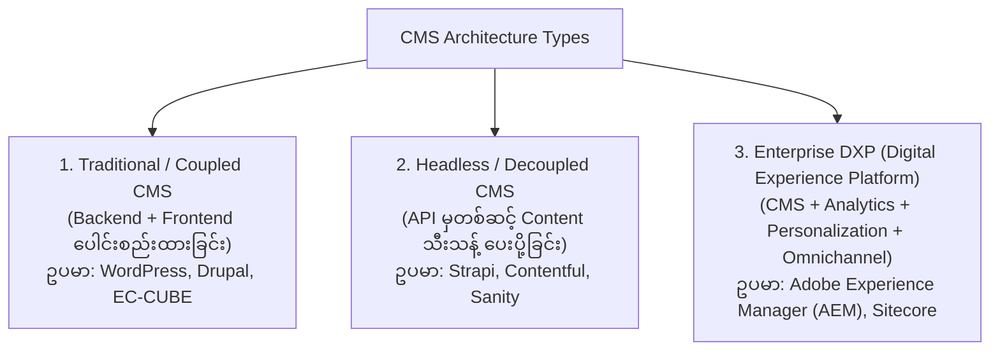
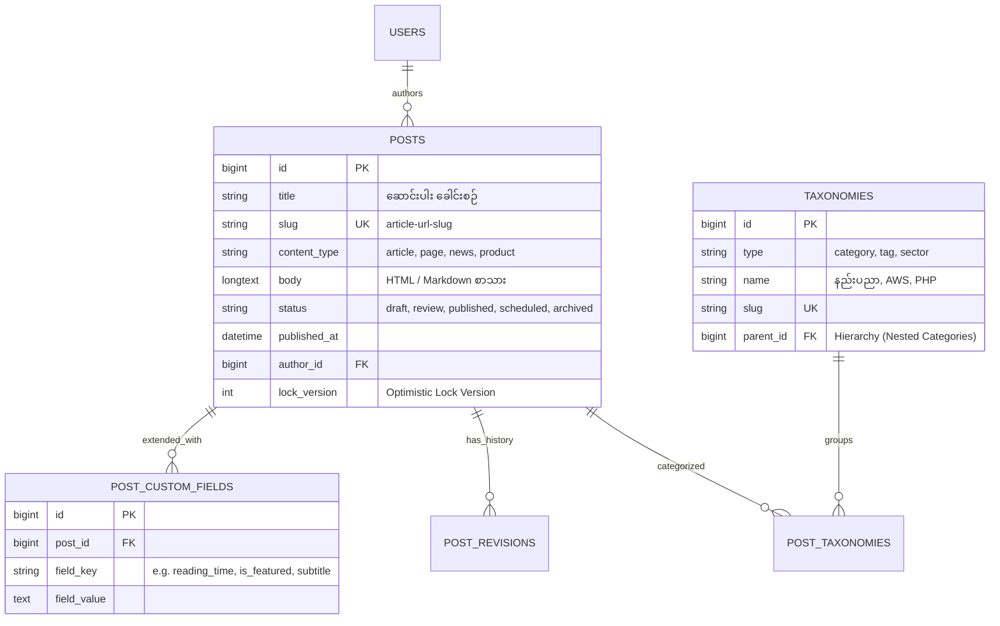
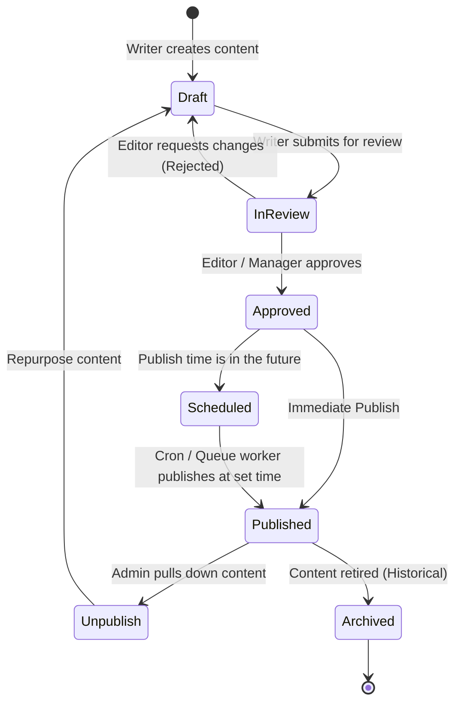
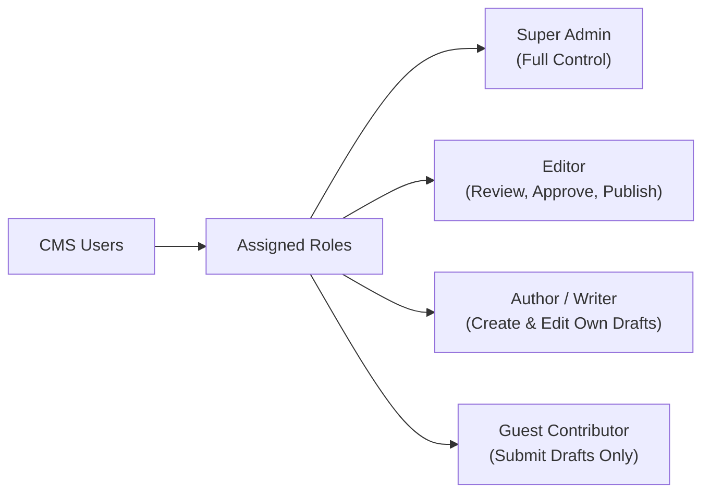

# 📝 Sector 11: CMS Architecture, Content Types & Editorial Workflow

Content Management System (CMS) ဆိုတာ နည်းပညာ သို့မဟုတ် Coding အထူးပြု မကျွမ်းကျင်သော အယ်ဒီတာများ၊ စာရေးဆရာများ (Non-technical Content Creators) အနေဖြင့် ဝက်ဘ်ဆိုက်ပေါ်ရှိ အကြောင်းအရာများ (Digital Content) ကို လွယ်ကူစွာ ဖန်တီးခြင်း၊ စစ်ဆေးခြင်း၊ ပြင်ဆင်ခြင်းနှင့် ထုတ်ဝေခြင်း (Create, Review, Edit, Publish) တို့ကို ဆောင်ရွက်နိုင်သည့် စနစ်ဖြစ်ပါသည်။

---

## 🏛️ ၁။ CMS အမျိုးအစား ၃ မျိုး နှိုင်းယှဉ်ချက် (CMS Architecture Types)



| CMS အမျိုးအစား | Frontend & Backend ချိတ်ဆက်ပုံ | အားသာချက်များ (Pros) | အားနည်းချက်များ (Cons) | သင့်တော်သော Project |
| :--- | :--- | :--- | :--- | :--- |
| **Traditional (Coupled)** | Monolith တစ်ခုတည်း (PHP + Blade/Twig Templates) | စတင်ရလွယ်ကူခြင်း၊ Plugin များပေါများခြင်း၊ WYSIWYG တိုက်ရိုက်မြင်ရခြင်း | Performance နှေးကွေးနိုင်ခြင်း၊ Mobile App များသို့ ချိတ်ဆက်ရခက်ခဲခြင်း | Corporate Websites, Blogs, Standard E-Commerce |
| **Headless CMS** | API-First (REST / GraphQL) $\rightarrow$ Next.js / React / Mobile App | အလွန်မြန်ဆန်ခြင်း၊ Frontend Developer လွတ်လပ်စွာ ဖန်တီးနိုင်ခြင်း၊ Multi-platform ပံ့ပိုးနိုင်ခြင်း | Non-technical အယ်ဒီတာများအတွက် Live Preview ဖန်တီးရ ခက်ခဲခြင်း | Modern Web Apps, Mobile Apps, Omnichannel Brand Sites |
| **Enterprise DXP** | Microservices, Cloud-native, AI-driven Personalization | အကြီးစား လုပ်ငန်းကြီးများအတွက် လုံခြုံရေးမြင့်မားခြင်း၊ A/B Testing နှင့် Customer Journey ပေါင်းစပ်ထားခြင်း | ကုန်ကျစရိတ် အလွန်ကြီးမားခြင်း၊ Setup ပြုလုပ်ရ ရှုပ်ထွေးခြင်း | Fortune 500 ကုမ္ပဏီကြီးများ၊ ကမ္ဘာလုံးဆိုင်ရာ အဖွဲ့အစည်းများ |

---

## 📑 ၂။ Content Types & Data Modeling (ဒေတာဖွဲ့စည်းပုံ)

CMS တစ်ခုတွင် အချက်အလက်များကို ပရိုဂရမ်မာဘက်မှ သေချာစွာ Structure ကျကျ ဒီဇိုင်းဆွဲထားရပါသည်:



### အဓိက အစိတ်အပိုင်းများ ရှင်းလင်းချက်
1. **Pages vs Posts**:
   - **Pages**: အချိန်နှင့် တိုက်ရိုက်မသက်ဆိုင်သော Static Content များ (ဥပမာ- `About Us`, `Contact`, `Privacy Policy`)။ Categories/Tags သိပ်မလိုဘဲ Hierarchical Parent-Child Structure သုံးလေ့ရှိသည်။
   - **Posts / Articles**: နေ့စွဲအလိုက် ထုတ်ဝေသော Content များ (ဥပမာ- `Tech News`, `Daily Blogs`)။ Categories နှင့် Tags (Taxonomy) ဖြင့် စုစည်းရသည်။
2. **Taxonomy (Categories & Tags)**:
   - **Categories**: အထက်အောက် အဆင့်ဆင့်ရှိသော စနစ်တကျ အုပ်စုခွဲခြင်း (Hierarchical: Tech $\rightarrow$ Cloud $\rightarrow$ AWS)။
   - **Tags**: ပစ္စည်း သို့မဟုတ် ဆောင်းပါးနှင့် သက်ဆိုင်သော Keyword ပြန့်ကျဲမှုများ (Non-hierarchical: `#laravel`, `#docker`)။
3. **Custom Fields & Structured Content**: သာမန် Title နှင့် Body အပြင် ဆောင်းပါးအတွက် လိုအပ်သော အပိုဒေတာများ (ဥပမာ- `video_url`, `event_date`, `download_link`) ကို သီးသန့် Key-Value ဖြင့် သိမ်းဆည်းခြင်း။
4. **Slugs & Permalinks**: URL တွင် အသုံးပြုမည့် လူဖတ်လွယ်၊ SEO အထောက်အကူပြု စာသား (ဥပမာ- `/posts/how-laravel-works-under-the-hood`)။
5. **Localization (i18n)**: ဆောင်းပါးတစ်ခုတည်းကို မြန်မာ၊ အင်္ဂလိပ်၊ ဂျပန် ဘာသာစကား အမျိုးမျိုးဖြင့် တစ်ပြိုင်နက် သိမ်းဆည်းနိုင်သော ဒေတာဖွဲ့စည်းပုံ။

---

## 🔄 ၃။ Editorial Workflow & Content Lifecycle (ထုတ်ဝေမှု သံသရာ)

Content တစ်ခုသည် စတင်ရေးသားချိန်မှ ထုတ်ဝေပြီးစီးသည်အထိ အဆင့်ဆင့်သော **Editorial Workflow** ကို ဖြတ်သန်းရပါသည်:



### အဆင့်တစ်ခုချင်းစီ၏ တာဝန်များ (Workflow Stages)
1. **Draft**: စာရေးသူ (Writer) က စတင်ရေးသားနေဆဲဖြစ်ပြီး အများပြည်သူ (Public) မမြင်နိုင်သေးသော အခြေအနေ။
2. **Review & Approval**: အယ်ဒီတာ (Editor) က အကြောင်းအရာ၊ သတ်ပုံ၊ ဥပဒေနှင့် ကိုက်ညီမှု ရှိ/မရှိ စစ်ဆေးပြီး ထုတ်ဝေခွင့် အတည်ပြုခြင်း။
3. **Scheduled Publishing**: အလိုအလျောက် သတ်မှတ်ရက်စွဲ (ဥပမာ- မနက်ဖြန် နံနက် ၈:၀၀ နာရီ) တွင် ထုတ်ဝေရန် အချိန်ကိုက်သတ်မှတ်ခြင်း။
4. **Revision History & Content Diff**: စာသားကို ပြင်ဆင်တိုင်း Version အသစ်အဖြစ် သိမ်းဆည်းပြီး ယခင်ဗားရှင်းနှင့် လက်ရှိဗားရှင်းကြား မည်သည့်စာလုံးများ ပြောင်းလဲသွားသည်ကို နှိုင်းယှဉ် (Diff) ကြည့်ရှုနိုင်ခြင်း။
5. **Rollback / Restore**: အမှားအယွင်း တစ်စုံတစ်ရာ ဖြစ်ပေါ်ပါက လွန်ခဲ့သော မနေ့က Version သို့ 1-Click ဖြင့် ပြန်လည် Revert လုပ်နိုင်ခြင်း။

---

## 🔐 ၄။ User, Roles & Permissions (RBAC Matrix)

CMS တွင် မည်သူက မည်သည့်အရာကို ဖတ်ခွင့်၊ ရေးခွင့်၊ အတည်ပြုခွင့် ရှိသည်ကို **Role-Based Access Control (RBAC)** ဖြင့် ထိန်းချုပ်ရပါသည်:



### Production Permission Matrix ဇယား

| Permissions (လုပ်ပိုင်ခွင့်များ) | Super Admin | Chief Editor | Author / Writer | Contributor |
| :--- | :---: | :---: | :---: | :---: |
| **System & User Settings** | ✅ | ❌ | ❌ | ❌ |
| **Publish / Unpublish Content** | ✅ | ✅ | ❌ | ❌ |
| **Approve Content for Publishing** | ✅ | ✅ | ❌ | ❌ |
| **Edit Others' Articles** | ✅ | ✅ | ❌ | ❌ |
| **Create & Edit Own Articles** | ✅ | ✅ | ✅ | ✅ |
| **Delete Articles** | ✅ | ✅ (Soft Delete) | ❌ | ❌ |
| **View Audit Logs** | ✅ | ❌ | ❌ | ❌ |

---

## 💻 ၅။ Laravel တွင် CMS Workflow State Machine တည်ဆောက်ပုံ

Laravel တွင် Content အခြေအနေ ပြောင်းလဲမှုများကို စည်းကမ်းမဲ့ မဖြစ်စေရန် Model State Transition ဖြင့် ထိန်းကျောင်းပါ:

```php
namespace App\Models;

use Illuminate\Database\Eloquent\Model;
use App\Exceptions\InvalidWorkflowTransitionException;

class Post extends Model
{
    protected $casts = [
        'published_at' => 'datetime',
    ];

    // Status Constants
    public const STATUS_DRAFT = 'draft';
    public const STATUS_IN_REVIEW = 'in_review';
    public const STATUS_APPROVED = 'approved';
    public const STATUS_PUBLISHED = 'published';
    public const STATUS_ARCHIVED = 'archived';

    public function transitionTo(string $targetStatus, User $actor): void
    {
        $allowed = [
            self::STATUS_DRAFT => [self::STATUS_IN_REVIEW],
            self::STATUS_IN_REVIEW => [self::STATUS_DRAFT, self::STATUS_APPROVED],
            self::STATUS_APPROVED => [self::STATUS_PUBLISHED, self::STATUS_DRAFT],
            self::STATUS_PUBLISHED => [self::STATUS_ARCHIVED, self::STATUS_DRAFT],
            self::STATUS_ARCHIVED => [self::STATUS_DRAFT],
        ];

        if (!in_array($targetStatus, $allowed[$this->status] ?? [])) {
            throw new InvalidWorkflowTransitionException(
                "Content အား [{$this->status}] မှ [{$targetStatus}] သို့ တိုက်ရိုက် ပြောင်းလဲခွင့်မရှိပါ!"
            );
        }

        $oldStatus = $this->status;
        $this->status = $targetStatus;

        if ($targetStatus === self::STATUS_PUBLISHED && !$this->published_at) {
            $this->published_at = now();
        }

        $this->save();

        // Audit Trail မှတ်တမ်းတင်ခြင်း
        $this->histories()->create([
            'from_status' => $oldStatus,
            'to_status' => $targetStatus,
            'changed_by' => $actor->id,
            'created_at' => now(),
        ]);
    }
}
```
