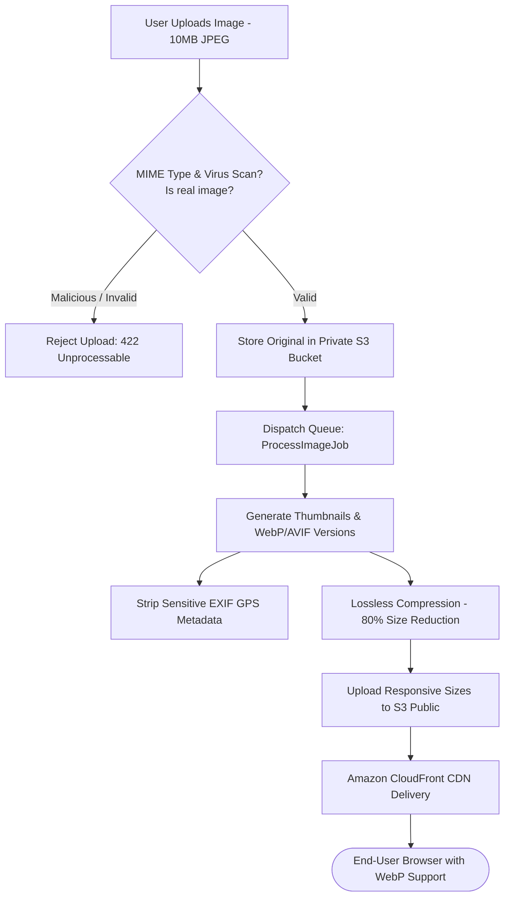
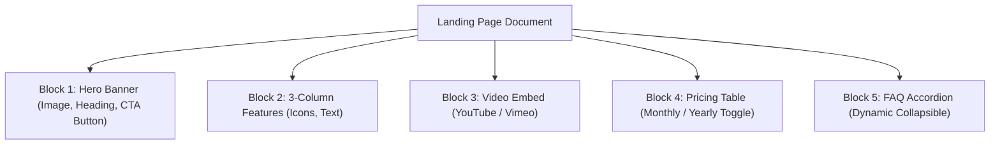
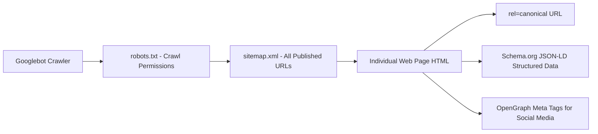

# 🎨 Sector 12: Media Assets, Page Builders & SEO Governance

ခေတ်မီ CMS တစ်ခု၏ တန်ဖိုးသည် သာမန် စာသား (Text) သက်သက် ရေးသားနိုင်ရုံသာမက **ဓာတ်ပုံ/ဗီဒီယို မီဒီယာများ စနစ်တကျ စီမံခန့်ခွဲနိုင်မှု (Digital Asset Management)**၊ Developer မလိုဘဲ စာမျက်နှာများ ဖွဲ့စည်းနိုင်သော **Page Builders** နှင့် Google Search တွင် ထိပ်ဆုံးသို့ ရောက်ရှိစေမည့် **SEO Governance** တို့အပေါ်တွင် တည်ရှိပါသည်။

---

## 🖼️ ၁။ Media & Digital Asset Management (DAM) Architecture

CMS ပေါ်သို့ တင်လိုက်သော ဓာတ်ပုံများသည် မူရင်းဖိုင်အတိုင်း တိုက်ရိုက် ပြသမနေဘဲ အလိုအလျောက် သန့်စင်၊ ချုံ့ချဲ့၊ Optimize ပြုလုပ်သည့် Pipeline ကို ဖြတ်သန်းရပါသည်:



### Digital Asset Management (DAM) ၏ အဓိက လုပ်ဆောင်ချက်များ
1. **File Upload Security & MIME Spoofing ကာကွယ်ခြင်း**: File Extension က `.jpg` ဖြစ်သော်လည်း အတွင်း၌ PHP Web Shell ပါဝင်နေနိုင်သဖြင့် `finfo_file` (MIME sniff) ဖြင့် Magic Bytes ကို စစ်ဆေးရမည်။
2. **SVG Sanitization**: SVG ဖိုင်များသည် XML အခြေပြုဖြစ်သဖြင့် အတွင်း၌ `<script>` tag ပါဝင်ပြီး Stored XSS ဖြစ်ပေါ်နိုင်သောကြောင့် SVG Sanitizer ဖြင့် Script များကို ရှင်းထုတ်ရမည်။
3. **Responsive Images (Thumbnail Generation)**:
   - `thumbnail`: $150 \times 150$ px (Admin list ပြသရန်)
   - `medium`: $600 \times 400$ px (Mobile တွင် ပြသရန်)
   - `large`: $1920 \times 1080$ px (Desktop Banner ပြသရန်)
   - ခေတ်မီပြီး ဖိုင်ဆိုဒ်သေးငယ်သော **WebP** သို့မဟုတ် **AVIF** သို့ အလိုအလျောက် ပြောင်းလဲပေးခြင်း။
4. **Alt Text & Metadata**: မသန်စွမ်းသူများ Screen Reader ဖြင့် နားဆင်နိုင်စေရန်နှင့် Google Image Search တွင် ပေါ်စေရန် `alt_text` မဖြစ်မနေ ထည့်သွင်းခြင်း။
5. **Orphaned Media Cleanup**: ဆောင်းပါးကို ဖျက်လိုက်သော်လည်း S3 ထဲတွင် မလိုအပ်ဘဲ ကျန်ခဲ့သော ပုံများကို ပုံမှန် စစ်ဆေးရှင်းထုတ်သည့် Cron Job ထားရှိခြင်း။

---

## 🧱 ၂။ Page Builder, Templates & Block-Based Editing

Developer အား အမြဲအားကိုးစရာမလိုဘဲ Marketing အဖွဲ့က Landing Page များကို လွတ်လပ်စွာ တည်ဆောက်နိုင်စေရန် **Block-Based Editing** စနစ်ကို အသုံးပြုပါသည်:



### Page Builder ၏ အဓိက အစိတ်အပိုင်းများ
1. **Block-Based Architecture**: စာမျက်နှာတစ်ခုကို Paragraph, Heading, Image, Video, Card, Testimonial စသည့် သီးခြား JSON Blocks များဖြင့် ဖွဲ့စည်းပြီး Database တွင် JSON Array အဖြစ် သိမ်းဆည်းခြင်း:
   ```json
   [
     { "type": "hero", "data": { "title": "LearnStack Pro", "cta_url": "/signup" } },
     { "type": "paragraph", "data": { "text": "Start your journey today..." } }
   ]
   ```
2. **Preview Mode with Signed URLs**: ဆောင်းပါးကို အများပြည်သူသို့ Publish မလုပ်မီ Editor များက တကယ့် Website ဒီဇိုင်းအတိုင်း စမ်းသပ်ကြည့်ရှုနိုင်ရန် ယာယီ Token ပါဝင်သော Preview URL ထုတ်ပေးခြင်း:
   `https://yourstore.com/preview/post-slug?token=9f8a7b6c5d&expires=1730000000`
3. **Design System & Global Styles**: Editor များက အရောင်နှင့် စာလုံးဒီဇိုင်းများကို စိတ်ကြိုက်ပြင်ဆင်ရာတွင် Brand Guidelines မပျက်စီးစေရန် သတ်မှတ်ထားသော Color Palette, Typography နှင့် Spacing Tokens များကိုသာ ရွေးချယ်ခွင့် ပေးထားခြင်း။

---

## 🔍 ၃။ SEO & Content Governance (ရှာဖွေရေး အင်ဂျင်များအတွက် အဆင့်မြှင့်တင်ခြင်း)

Search Engine (Google) က ဝက်ဘ်ဆိုက်ကို အလွယ်တကူ ရှာဖွေနားလည်နိုင်စေရန် အောက်ပါ SEO အချက်အလက်များကို CMS က အလိုအလျောက် ပံ့ပိုးပေးရပါမည်:



### မဖြစ်မနေ ပါဝင်ရမည့် SEO Features များ
1. **Canonical URLs (မိတ္တူပွား ကာကွယ်ခြင်း)**:
   URL Parameter များ (`?source=facebook`, `?page=1`) ကြောင့် Google က Content ထပ်နေသည်ဟု မထင်မှတ်စေရန် မူလတရားဝင် URL ကို ညွှန်းဆိုပြသပေးခြင်း:
   ```html
   <link rel="canonical" href="https://yourstore.com/articles/how-to-scale-laravel" />
   ```
2. **Dynamic XML Sitemap (`/sitemap.xml`)**:
   ဆောင်းပါး အသစ်တစ်ခု ထုတ်ဝေလိုက်သည်နှင့် Sitemap ထဲသို့ အလိုအလျောက် ဝင်ရောက်သွားစေပြီး Google Search Console ထံ Ping သွားရောက်စေခြင်း။
3. **301 Redirect History (URL ပြောင်းလဲမှု စီမံခြင်း)**:
   အယ်ဒီတာတစ်ဦးက ဆောင်းပါး၏ Slug ကို `/old-slug` မှ `/new-slug` သို့ ပြောင်းလိုက်ပါက ယခင် Link အဟောင်းကို နှိပ်သူများ 404 Not Found မဖြစ်စေရန် `301 Permanent Redirect` အလိုအလျောက် ခံပေးရမည်။
4. **Structured Data (Schema.org / JSON-LD)**:
   Google Search Result တွင် ကြယ်ပွင့်များ၊ စျေးနှုန်းများနှင့် ဆောင်းပါးအချက်အလက်များ လှပစွာ ပေါ်စေရန် JSON-LD ထည့်သွင်းခြင်း:
   ```html
   <script type="application/ld+json">
   {
     "@context": "https://schema.org",
     "@type": "Article",
     "headline": "How to Build a Scalable Laravel CMS",
     "author": { "@type": "Person", "name": "Kyaw Wai Yan" },
     "datePublished": "2026-10-24"
   }
   </script>
   ```
5. **OpenGraph & Twitter Cards**:
   Facebook, Telegram, LinkedIn ပေါ်တွင် Link Share လုပ်သည့်အခါ လှပသော ပုံကြီး၊ Title နှင့် အကျဉ်းချုပ်တို့ ပေါ်လာစေရန် `<meta property="og:image">` တပ်ဆင်ပေးခြင်း။
