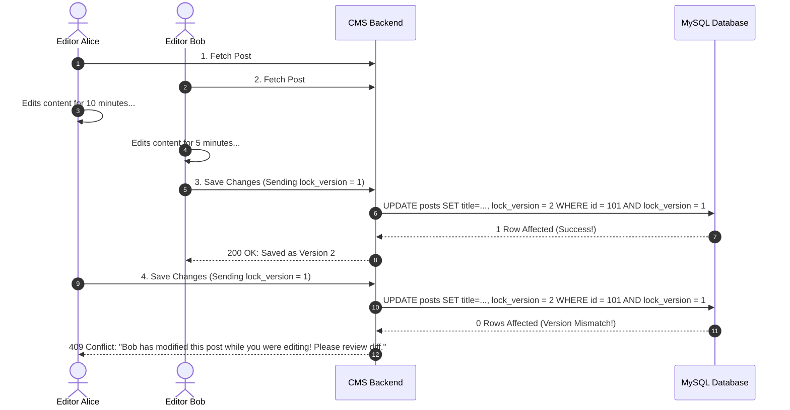
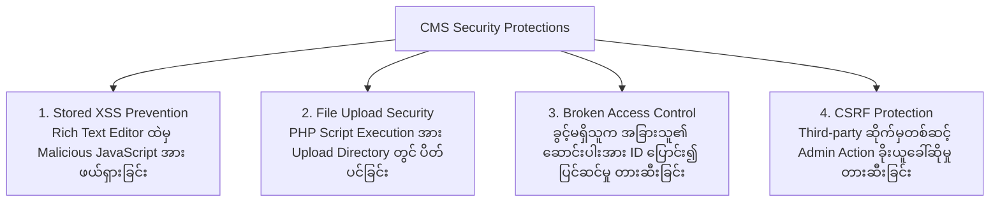

# ⚡ Sector 13: Content Versioning, Headless CMS & Security

အဆင့်မြင့် Enterprise CMS စနစ်များတွင် အယ်ဒီတာများစွာ တစ်ပြိုင်နက် လုပ်ကိုင်နိုင်ရန် **Content Versioning & Optimistic Locking**၊ Frontend ကို လွတ်လပ်စွာ ဖန်တီးနိုင်သော **Headless CMS Architecture** နှင့် လုံခြုံရေးပေါက်ကြားမှု မရှိစေရန် **OWASP Security Hardening** တို့ကို မဖြစ်မနေ ထည့်သွင်းရပါမည်။

---

## 🕒 ၁။ Content Versioning, Optimistic Locking & Draft Separation

အယ်ဒီတာ ၂ ဦးက ဆောင်းပါးတစ်ခုတည်းကို တစ်ချိန်တည်း ဖွင့်ပြင်မိပါက တစ်ဦး၏ ပြင်ဆင်မှုကို အခြားတစ်ဦးက မတော်တဆ အစားထိုး ဖျက်ဆီးမိခြင်း (Data Overwrite) မဖြစ်စေရန် **Optimistic Locking** ကို သုံးရပါသည်:



### Draft vs Published Version Separation (Live Content ကို မထိခိုက်စေခြင်း)
Customer များသည် ဝက်ဘ်ဆိုက်ပေါ်တွင် Live Published Version ကို ဖတ်ရှုနေချိန်တွင် Editor က ထိုဆောင်းပါးကိုပင် နောက်ထပ် အချက်အလက်များ ထပ်မံဖြည့်စွက်နေနိုင်ပါသည်။ Live Content ပေါ်သို့ Draft မရောက်ရှိစေရန်:
- Database တွင် **Draft Records** နှင့် **Published Records** ကို ခွဲခြားထားခြင်း သို့မဟုတ် Revision Table တွင် သီးသန့် အလုပ်လုပ်ပြီး Manager က Approve နှိပ်မှသာ Live Record ကို Swap ပြုလုပ်ခြင်း။

---

## 🌐 ၂။ Headless CMS & API Architecture (REST vs GraphQL)

ခေတ်မီ Web Architecture တွင် Backend (Laravel CMS) နှင့် Frontend (Next.js / Nuxt / Mobile App) ကို API ဖြင့် သီးခြားခွဲထုတ်ထားပါသည်:

```mermaid
flowchart TB
    Admin[Editorial Staff] --> CMSApp[CMS Admin Panel UI]
    CMSApp --> CMA[Content Management API - CMA<br/>(Write / Secure Auth / RBAC)]
    
    CMA --> Engine[Laravel CMS Core Engine]
    Engine --> DB[(PostgreSQL / MySQL)]
    
    Engine --> CDA[Content Delivery API - CDA<br/>(Read-Only / Redis / CloudFront Edge Cached)]
    
    CDA --> NextJS[Next.js Storefront / Corporate Site]
    CDA --> iOSApp[iOS / Android Mobile App]
    CDA --> SmartScreen[Smart TV / IoT Screens]
```

### Content Delivery API (CDA) vs Content Management API (CMA)
1. **CDA (Content Delivery API)**:
   - သာမန် ဖတ်ရှုသူများ (End-users) အတွက် Read-only API ဖြစ်သည်။
   - CloudFront CDN နှင့် Redis Cache ဖြင့် ထိန်းကျောင်းထားသဖြင့် Response Time သည် **Sub-50ms** အထိ မြန်ဆန်သည်။
2. **CMA (Content Management API)**:
   - အယ်ဒီတာများ Content ဖန်တီး၊ ပြင်ဆင်ရန် Write API ဖြစ်သည်။
   - Strict Authentication (Bearer Tokens / Sanctum), Role Permissions (RBAC) နှင့် Validation များ ပါဝင်သည်။

---

## ⚡ ၃။ Search, Caching & Cache Invalidation

ဆောင်းပါးပေါင်း သိန်းနှင့်ချီ ရှိလာချိန်တွင် Database ကို တိုက်ရိုက် မထိစေရန် **Tag-based Caching** နှင့် **Event-driven Invalidation** ကို အသုံးပြုပါသည်:

```php
// PostService.php (Caching with Tags)
public function getPostBySlug(string $slug): Post
{
    return Cache::tags(['posts', "post:slug:{$slug}"])
        ->remember("post_content_{$slug}", now()->addHours(24), function () use ($slug) {
            return Post::where('slug', $slug)
                ->where('status', Post::STATUS_PUBLISHED)
                ->with(['author', 'categories', 'tags'])
                ->firstOrFail();
        });
}

// PostObserver.php (Event-Driven Cache Invalidation)
public function updated(Post $post): void
{
    // ဆောင်းပါးကို ပြင်လိုက်သည်နှင့် ထို Post ၏ Cache ကို ချက်ချင်း Flush လုပ်ခြင်း
    Cache::tags(["post:slug:{$post->slug}"])->flush();
    
    // Static Site Generation (SSG) သုံးထားပါက Next.js On-Demand Revalidation ကို Webhook ခေါ်ယူပါ
    Http::post('https://your-frontend.com/api/revalidate', [
        'secret' => config('services.frontend.revalidate_secret'),
        'path' => "/articles/{$post->slug}",
    ]);
}
```

---

## 🛡️ ၄။ CMS Security & OWASP Top 10 Hardening

CMS စနစ်များသည် အများပြည်သူ တင်သွင်းသော သို့မဟုတ် အယ်ဒီတာများ ရိုက်ထည့်သော HTML Rich Text များကို ကိုင်တွယ်ရသဖြင့် လုံခြုံရေး အလွန်အရေးကြီးပါသည်:



### ၁။ Stored XSS ကာကွယ်ခြင်း (HTML Purifier)
အယ်ဒီတာက WYSIWYG Editor တွင် စာသားထည့်ရာ၌ Hacker က `<script>stealCookie()</script>` သို့မဟုတ် `` ထည့်သွင်းတိုက်ခိုက်နိုင်ပါသည်။ ထို့ကြောင့် HTML Output မပြသမီ မဖြစ်မနေ **Sanitize** လုပ်ရပါမည်:
```php
use Mews\Purifier\Facades\Purifier;

// Controller သို့မဟုတ် Model Mutator တွင်:
public function setBodyAttribute($value)
{
    $this->attributes['body'] = Purifier::clean($value, [
        'HTML.Allowed' => 'p,b,strong,i,em,u,a[href|title],ul,ol,li,img[src|alt|width|height],h1,h2,h3,blockquote,pre,code',
    ]);
}
```

### ၂။ File Upload Directory တွင် PHP Code Run ခွင့် ပိတ်ပင်ခြင်း
Upload ဖိုင်များ သိမ်းဆည်းရာ `public/uploads` folder ထဲသို့ Hacker က `.php` ဖိုင် ခိုးတင်နိုင်သော်လည်း Web Server ပေါ်တွင် PHP အဖြစ် မပြေးစေရန် Nginx တွင် Block လုပ်ထားပါ:
```nginx
# Nginx Configuration
location /uploads/ {
    location ~ \.php$ {
        deny all; # Upload folder ထဲရှိ မည်သည့် PHP ဖိုင်ကိုမျှ Run ခွင့်မပြုပါ
    }
}
```
*(အကောင်းဆုံး နည်းလမ်းမှာ Uploads အားလုံးကို Local Server ပေါ်တွင် မသိမ်းဘဲ **Amazon S3 Bucket (Private/Public Separation)** တွင်သာ သိမ်းဆည်းခြင်း ဖြစ်ပါသည်)*
