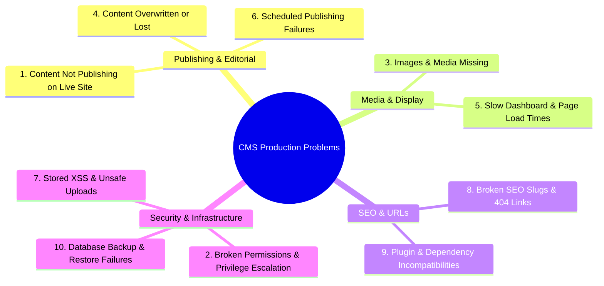
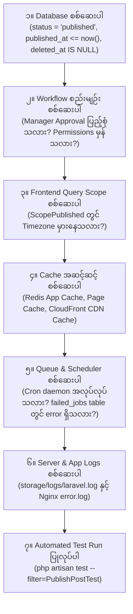

# 🛠️ Sector 14: Top 10 CMS Production Problems & Laravel Troubleshooting Guide

CMS စနစ်တစ်ခုကို ထိန်းသိမ်းစောင့်ရှောက်ရာတွင် (CMS Maintenance & Operations) Developer များ ရင်ဆိုင်ရလေ့ရှိသော အဓိက ပြဿနာများကို **Business/Functional Issues** နှင့် **Technical/Security Issues** ဟူ၍ ၂ မျိုး ခွဲခြားနိုင်ပါသည်။

ဤသင်ခန်းစာတွင် လုပ်ငန်းခွင်၌ နေ့စဉ် ကြုံတွေ့ရသည့် **CMS ပြဿနာကြီး ၁၀ ခု**၊ အဆင့် ၇ ဆင့်ပါ **Laravel Troubleshooting Checklist** နှင့် လက်တွေ့ အသုံးပြုနိုင်သော **Production Code Implementations** များကို စနစ်တကျ စုစည်းဖော်ပြထားပါသည်။

---

## 🚨 အပိုင်း ၁။ CMS တွင် အရေးအကြီးဆုံး ပြဿနာ ၁၀ ခုနှင့် ဖြေရှင်းနည်းများ



---

### ၁။ Content Not Publishing (Publish လုပ်ထားသော်လည်း Website တွင် မပေါ်ခြင်း)
- **ဖြစ်ရသည့် အကြောင်းရင်း**:
  - စာရေးသူက Publish နှိပ်လိုက်သော်လည်း Editorial Workflow အရ Manager Approval မပြီးသေးဘဲ `status = in_review` တွင် ရပ်နေခြင်း။
  - Frontend Database Query တွင် `where('status', 'published')->where('published_at', '<=', now())` စစ်ဆေးရာ၌ Server Timezone ကွဲလွဲနေခြင်း။
  - Application Cache သို့မဟုတ် CDN Cache ဟောင်းနေပြီး Flush မဖြစ်ခြင်း။
- **ဖြေရှင်းနည်း**:
  1. Database ထဲတွင် `status`, `published_at` နှင့် `deleted_at` တန်ဖိုးများကို စစ်ဆေးပါ။
  2. Cache Tag Invalidation မှန်/မမှန် စစ်ဆေးပါ (`Cache::tags(['posts'])->flush()`)။

---

### ၂။ Permission & Access Control Errors (Writer က Publish လုပ်ခွင့်ရနေခြင်း)
- **ဖြစ်ရသည့် အကြောင်းရင်း**:
  - UI တွင် Publish ခလုတ်ကို ဝှက်ထားသော်လည်း API Endpoint (`POST /api/posts/{id}/publish`) တွင် Server-side Policy မစစ်ဆေးဘဲ ထားမိခြင်း။
- **ဖြေရှင်းနည်း: Laravel Policies**:
  API Endpoint တိုင်းတွင် `$this->authorize('publish', $post);` ခံထားပြီး Controller တိုင်းကို Feature Tests ဖြင့် စစ်ဆေးပါ။

---

### ၃။ Images & Media Not Displaying (Upload တင်ပြီးသော်လည်း ပုံမပေါ်ခြင်း)
- **ဖြစ်ရသည့် အကြောင်းရင်း**:
  - Local Storage သုံးထားပါက `php artisan storage:link` မလုပ်ရသေးခြင်း သို့မဟုတ် Nginx User (`www-data`) တွင် Permission မရှိခြင်း။
  - S3 သုံးထားပါက Private Bucket သို့ သွားရောက်တင်မိပြီး Pre-signed URL မပါဘဲ 403 Access Denied ဖြစ်နေခြင်း။
  - Background Queue Worker ရပ်တန့်နေသဖြင့် Thumbnail Processing မပြီးသေးခြင်း။
- **ဖြေရှင်းနည်း**:
  Public Media များအတွက် S3 Bucket Policy ကို သေချာစစ်ဆေးပါ သို့မဟုတ် Amazon CloudFront CDN Custom Domain ကို အသုံးပြုပါ။

---

### ၄။ Content Lost or Overwritten (တစ်ယောက်ပြင်ထားသည်ကို အခြားတစ်ယောက်က ဖျက်မိခြင်း)
- **ဖြစ်ရသည့် အကြောင်းရင်း**:
  - User ၂ ယောက်က တစ်ချိန်တည်း ဆောင်းပါးတစ်ခုကို ဖွင့်ပြင်ရာ နောက်မှ Save နှိပ်သူ၏ Data က အရင်လူ၏ Data ပေါ်သို့ အစားထိုး အုပ်မိုးသွားခြင်း (Lack of Concurrency Control)။
- **ဖြေရှင်းနည်း**:
  **Optimistic Locking** (`lock_version` column) ထည့်သွင်းထားပါ။ နောက်ကျမှ Save လုပ်သူအား Version Mismatch ဖြစ်ကြောင်း အသိပေးပြီး Diff ပြသပေးပါ။

---

### ၅။ Slow CMS & Website Performance (Admin နှေးခြင်း၊ Page ဖွင့်မရခြင်း)
- **ဖြစ်ရသည့် အကြောင်းရင်း**:
  - Post List ဆွဲရာတွင် Author, Categories, Tags များကို Eager Loading မလုပ်ဘဲ N+1 Query ဖြစ်နေခြင်း။
  - အယ်ဒီတာများက 10MB JPEG ပုံကြီးများကို မချုံ့ဘဲ တင်ထားသဖြင့် စာမျက်နှာ Load Time 15 စက္ကန့် ကြာမြင့်နေခြင်း။
- **ဖြေရှင်းနည်း**:
  1. `Post::with(['author', 'categories'])->paginate(20);` သုံးပါ။
  2. Upload တင်ချိန်တွင် Spatie MediaLibrary သို့မဟုတ် Intervention Image သုံး၍ WebP/AVIF သို့ အလိုအလျောက် Compress လုပ်ပါ။

---

### ၆။ Scheduled Publishing Failure (သတ်မှတ်ချိန်တွင် Publish မဖြစ်ခြင်း)
- **ဖြစ်ရသည့် အကြောင်းရင်း**:
  - Linux Server တွင် `cron` daemon ရပ်တန့်နေခြင်း သို့မဟုတ် `* * * * * php /path/to/artisan schedule:run` မထည့်ရသေးခြင်း။
  - App Timezone သည် `UTC` ဖြစ်နေပြီး အယ်ဒီတာက `Asia/Yangon` အချိန်ဖြင့် ရိုက်ထည့်လိုက်ခြင်း။
- **ဖြေရှင်းနည်း**:
  Database တွင် အချိန်အားလုံးကို **UTC** ဖြင့်သာ သိမ်းဆည်းပါ။ Scheduler Run မပြေးပါက စောင့်ကြည့်နိုင်ရန် AWS CloudWatch သို့မဟုတ် Sentry Cron Monitoring တပ်ဆင်ပါ။

---

### ၇။ Security Vulnerabilities: Stored XSS & Unsafe Uploads
- **ဖြစ်ရသည့် အကြောင်းရင်း**:
  - WYSIWYG Editor က ထုတ်ပေးသော HTML ကို `htmlspecialchars` မပါဘဲ `{!! $post->body !!}` ဖြင့် တိုက်ရိုက် Render လုပ်မိခြင်း။
- **ဖြေရှင်းနည်း**:
  HTML Output မပြသမီ **HTMLPurifier** library ဖြင့် Malicious Scripts များကို မဖြစ်မနေ Clean ပြုလုပ်ပါ။

---

### ၈။ SEO & URL Problems (Slug ပြောင်းလိုက်၍ Link ပျက်ပြီး 404 ဖြစ်ခြင်း)
- **ဖြစ်ရသည့် အကြောင်းရင်း**:
  - အယ်ဒီတာက ခေါင်းစဉ်ပြင်လိုက်ရာ Slug က `/news-2025` မှ `/news-2026` သို့ ပြောင်းသွားပြီး Google တွင် အဆင့်တက်နေသော Link အဟောင်းများ အကုန် 404 ဖြစ်သွားခြင်း။
- **ဖြေရှင်းနည်း: Reversible Slug History**:
  ဆောင်းပါးတစ်ခု၏ Slug အဟောင်းများကို `slug_histories` Table တွင် သိမ်းထားပြီး Link အဟောင်းဖြင့် ဝင်လာသူများကို `301 Moved Permanently` ဖြင့် အသစ်ဆီသို့ Auto-redirect ပေးပါ။

---

### ၉။ Plugin, Theme & Dependency Update Breakage
- **ဖြစ်ရသည့် အကြောင်းရင်း**:
  - Production Server ပေါ်တွင် `composer update` တိုက်ရိုက် run မိသဖြင့် အသစ်ထွက်သော Library Version က CMS Code အဟောင်းနှင့် မကိုက်ညီဘဲ White Screen of Death (500 Error) တက်ခြင်း။
- **ဖြေရှင်းနည်း**:
  Production ပေါ်တွင် `composer update` လုံးဝ မ run ပါနှင့် (`composer install --no-dev` သာ သုံးပါ)။ ပြင်ဆင်မှုများကို Staging Server တွင် ဦးစွာ စမ်းသပ်ပြီးမှသာ CI/CD Pipeline ဖြင့် တင်ပါ။

---

### ၁၀။ Database, Backup & Recovery Issues (Data ပျောက်ဆုံးခြင်း)
- **ဖြစ်ရသည့် အကြောင်းရင်း**:
  - ဒေတာဘေ့စ် Backup မရှိခြင်း သို့မဟုတ် Database Migration မှားယွင်းစွာ Rollback လုပ်မိခြင်း။
- **ဖြေရှင်းနည်း**:
  AWS Aurora Automated Backups (Point-in-Time Recovery) ကို ဖွင့်ထားပြီး ၆ လတစ်ကြိမ် Backup ဖိုင်ကို Local သို့မဟုတ် Staging တွင် အမှန်တကယ် ပြန်တင်ကြည့်သည့် Restore Drill စမ်းသပ်ပါ။

---

## 🔍 အပိုင်း ၂။ Laravel CMS ၇ ဆင့် Troubleshooting Checklist

အကယ်၍ စနစ်တွင် အမှားအယွင်း တစ်စုံတစ်ရာ ဖြစ်ပေါ်ပါက (ဥပမာ- Article ကို Publish လုပ်ထားသော်လည်း Website တွင် မပေါ်ခြင်း) အောက်ပါ အဆင့် ၇ ဆင့်အတိုင်း စနစ်တကျ လိုက်လံစစ်ဆေးပါ:



---

## 💻 အပိုင်း ၃။ Production-Grade Laravel CMS Code Implementations

### ၁။ Scheduled Publishing Command (`php artisan cms:publish-scheduled`)

သတ်မှတ်ချိန် ရောက်ရှိလာသော အော်ဒါနှင့် ဆောင်းပါးများကို အလိုအလျောက် Live ထုတ်လွှင့်ပေးသော Artisan Console Command:

```php
namespace App\Console\Commands;

use Illuminate\Console\Command;
use App\Models\Post;
use Illuminate\Support\Facades\Cache;
use Illuminate\Support\Facades\Log;

class PublishScheduledPosts extends Command
{
    protected $signature = 'cms:publish-scheduled';
    protected $description = 'သတ်မှတ်ရက်စွဲ ရောက်ရှိလာသော Scheduled Posts များကို Publish ပြုလုပ်ပေးသည်';

    public function handle(): int
    {
        $nowUtc = now()->utc();

        // Status သည် scheduled ဖြစ်ပြီး published_at သက်တမ်းစေ့သော ဆောင်းပါးများကို ရှာဖွေပါ
        $postsToPublish = Post::where('status', Post::STATUS_SCHEDULED)
            ->where('published_at', '<=', $nowUtc)
            ->get();

        if ($postsToPublish->isEmpty()) {
            return self::SUCCESS;
        }

        foreach ($postsToPublish as $post) {
            $post->update([
                'status' => Post::STATUS_PUBLISHED,
            ]);

            // Cache Invalidation
            Cache::tags(['posts', "post:{$post->id}"])->flush();

            Log::info("CMS Scheduler: Post #{$post->id} ({$post->title}) was published successfully.");
        }

        $this->info("Published {$postsToPublish->count()} scheduled post(s).");
        return self::SUCCESS;
    }
}
```

---

### ၂။ Reversible Slug History & 301 Auto-Redirect Middleware

ဆောင်းပါး ခေါင်းစဉ်နှင့် Slug ပြောင်းသွားသော်လည်း SEO Ranking မကျဆင်းစေရန် ကာကွယ်ပေးသော စနစ်:

```php
namespace App\Http\Middleware;

use Closure;
use Illuminate\Http\Request;
use App\Models\PostSlugHistory;

class HandleLegacySlugRedirects
{
    public function handle(Request $request, Closure $next)
    {
        $slug = $request->route('slug');

        if ($slug) {
            // Slug အဟောင်းဖြစ်နေပါက လက်ရှိ Active Slug ဆီသို့ 301 Permanent Redirect ပေးပါ
            $history = PostSlugHistory::with('post')
                ->where('old_slug', $slug)
                ->first();

            if ($history && $history->post) {
                return redirect()->to(route('posts.show', $history->post->slug), 301);
            }
        }

        return $next($request);
    }
}
```

---

### ၃။ Optimistic Locking Implementation (Concurrent Overwrite Prevention)

အယ်ဒီတာ ၂ ယောက် တစ်ပြိုင်နက် ပြင်ဆင်မှုကို တားဆီးပေးသော Controller Code:

```php
public function update(Request $request, Post $post)
{
    $this->authorize('update', $post);

    $validated = $request->validate([
        'title' => 'required|string|max:255',
        'body' => 'required|string',
        'lock_version' => 'required|integer', // Frontend မှ ပို့ပေးသော လက်ရှိ version
    ]);

    // Atomic Update with Version Check
    $updated = Post::where('id', $post->id)
        ->where('lock_version', $validated['lock_version'])
        ->update([
            'title' => $validated['title'],
            'body' => Purifier::clean($validated['body']), // XSS Sanitize
            'lock_version' => $validated['lock_version'] + 1, // Version တိုးမြှင့်ခြင်း
            'updated_at' => now(),
        ]);

    if (!$updated) {
        // Version မကိုက်ညီပါက အခြားသူတစ်ဦးက ပြင်ဆင်ပြီးသွားပြီဟု အသိပေးပါ
        return response()->json([
            'error' => 'Conflict',
            'message' => 'အခြား အယ်ဒီတာတစ်ဦးက ဤဆောင်းပါးအား မကြာမီက ပြင်ဆင်သွားပါပြီ! ကျေးဇူးပြု၍ စာမျက်နှာအား Refresh လုပ်ပြီးမှ ထပ်မံပြင်ဆင်ပါ။',
        ], 409);
    }

    return response()->json(['message' => 'အောင်မြင်စွာ သိမ်းဆည်းပြီးပါပြီ!'], 200);
}
```

---

## 🗺️ အပိုင်း ၄။ သင့်အတွက် CMS Developer Learning Roadmap

Laravel နှင့် CMS Development / Maintenance အတွေ့အကြုံရှိပြီးသား Developer တစ်ယောက်အနေဖြင့် အောက်ပါ အဆင့် ၅ ဆင့်အတိုင်း ဆက်လက် လေ့လာသင့်ပါသည်:

1. **Step 1: Editorial Workflow & RBAC** — Content Lifecycle (Draft, Review, Publish), Role & Permissions Matrix, Approval Gates.
2. **Step 2: Database Models & Versioning** — Revisions, Optimistic Locking, Soft Deletes, Slug History, Polymorphic Taxonomy.
3. **Step 3: Media, SEO & Caching** — Amazon S3, CloudFront CDN, Image Compression, Cache Tag Invalidation, Canonical URLs.
4. **Step 4: API & Headless CMS Architecture** — Content Delivery API (CDA) vs Management API (CMA), Next.js / React Integration.
5. **Step 5: Testing, Security & Reliability** — Stored XSS Prevention, Unsafe Upload Hardening, Sentry Logging, Backup & Recovery Drills.
