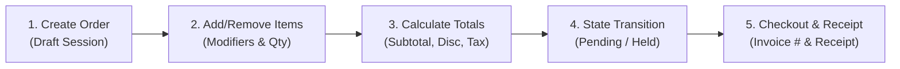
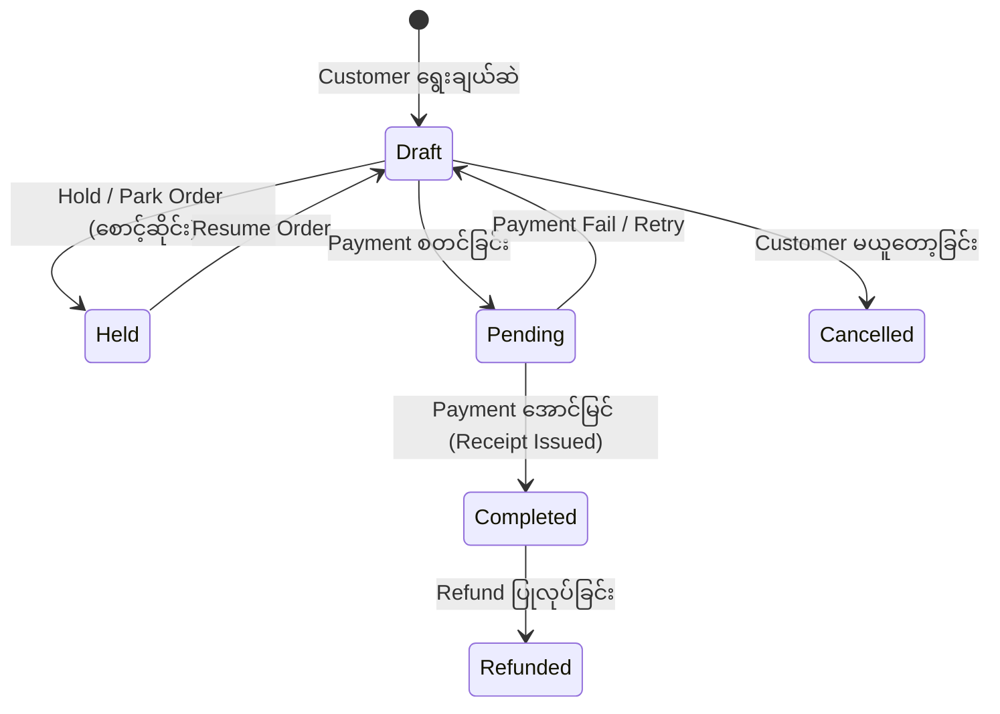

# 🧾 Sector 15: POS Sales & Order Management (အရောင်းနှင့် Order စီမံခန့်ခွဲမှု)

Point of Sale (POS) စနစ်တစ်ခု၏ အခြေခံအကျဆုံးနှင့် အရေးကြီးဆုံး လုပ်ငန်းစဉ်မှာ **Sales & Order Management (အရောင်းနှင့် အော်ဒါ စီမံခန့်ခွဲမှု)** ဖြစ်ပါသည်။ ကောင်တာတွင် Cashier သို့မဟုတ် စားသောက်ဆိုင်တွင် Waiter က Customer ထံမှ အော်ဒါလက်ခံခြင်း၊ ပစ္စည်းရွေးချယ်ခြင်း၊ စုစုပေါင်း ငွေပမာဏတွက်ချက်ခြင်းနှင့် ဘောက်ချာထုတ်ပေးခြင်းအထိ ပါဝင်ပါသည်။

---

## ၁။ Sales & Order Management အဓိက လုပ်ငန်းစဉ်များ (Core Workflows)



### (၁) Create Order & Line Items (Add / Remove / Update)
- **Create Order**: အရောင်းတစ်ခု စတင်တိုင်း Unique Order ID (ဥပမာ - `ORD-20261025-0042`) နှင့် သက်ဆိုင်ရာ Branch ID, Cashier ID, Counter ID တို့ ပါဝင်သော Order Session တစ်ခု ဖွင့်လှစ်ခြင်း။
- **Add Items**: Barcode Scanner ဖြင့် Scan ဖတ်၍သော်လည်းကောင်း၊ Touch UI Menu မှ ရွေးချယ်၍သော်လည်းကောင်း Line Item ထည့်သွင်းခြင်း။
- **Quantity & Unit Price**: ပစ္စည်းအရေအတွက် တိုး/လျှော့ ပြုလုပ်ခြင်း။ ပစ္စည်းတစ်ခုချင်းစီ၏ မူရင်းရောင်းဈေး (`unit_price`) ကို ထည့်သွင်းခြင်း။
- **Remove Items**: မှားရိုက်မိသော ပစ္စည်းများကို Order မပိတ်မီ ဖျက်ပစ်ခြင်း။ (လုပ်ငန်းခွင် စည်းမျဉ်းအရ အချို့ဆိုင်များတွင် Item ဖျက်ခွင့်ကို Manager PIN ဖြင့်သာ ခွင့်ပြုပါသည်)။

---

## ၂။ Pricing Calculation Flow (ဈေးနှုန်းနှင့် အခွန် တွက်ချက်မှု)

POS တွင် ငွေပမာဏ တွက်ချက်မှုသည် အဆင့်ဆင့် တိကျရန် လိုအပ်ပါသည်။

$$\text{Line Item Total} = (\text{Unit Price} \times \text{Quantity}) - \text{Item Discount}$$

$$\text{Subtotal} = \sum (\text{Line Item Totals})$$

$$\text{Taxable Amount} = \text{Subtotal} - \text{Order Level Discount}$$

$$\text{Total Amount} = \text{Taxable Amount} + \text{Tax} + \text{Service Charge}$$

### အရေးကြီးသော သဘောတရားများ:
1. **Tax-Inclusive vs Tax-Exclusive**:
   - **Tax-Exclusive (အခွန်မပါ ဈေးနှုန်း)**: ပစ္စည်းတန်ဖိုး ¥1,000 + 10% Tax = Total ¥1,100။
   - **Tax-Inclusive (အခွန်ပါပြီး ဈေးနှုန်း)**: ပစ္စည်းတန်ဖိုး ¥1,100 ထဲတွင် Tax ¥100 ပါဝင်ပြီးသားဖြစ်ခြင်း။
2. **Item-level Discount vs Order-level Discount**:
   - **Item Discount**: ဥပမာ - "နို့ဘူး ၁ ဘူးလျှင် ¥50 လျှော့"။
   - **Order Discount**: ဥပမာ - "ဘောက်ချာတစ်ခုလုံး စုစုပေါင်းအပေါ် 10% VIP Discount ပေးခြင်း"။

---

## ၃။ POS Order Statuses & Lifecycle (အော်ဒါ အခြေအနေ စက်ဝန်း)

Order တစ်ခုသည် အချိန်နှင့်အမျှ အောက်ပါ State Transitions အတိုင်းသာ ပြောင်းလဲခွင့် ရှိရပါမည်:



| Order Status | ရှင်းလင်းချက် | Database Actions |
|---|---|---|
| **`draft`** | Cashier က ပစ္စည်းများ ရိုက်ထည့်နေဆဲ အခြေအနေ | Stock မနုတ်သေး၊ Payment မတောင်းသေး |
| **`held` (Parked)** | Customer က ပိုက်ဆံအိတ်မေ့ကျန်၍ နောက်လူကို အရင်ရှင်းပေးရန် အော်ဒါကို ခေတ္တဆိုင်းငံ့ထားခြင်း | Cart snapshot သိမ်းဆည်း၊ အခြား Cashier များ ဖွင့်မရအောင် Lock လုပ်ခြင်း |
| **`pending`** | Payment Terminal (Card/QR) သို့ ငွေတောင်းခံလွှာ ပို့ထားဆဲ | Stock ယာယီ Reserve လုပ်ထားခြင်း |
| **`completed`** | ငွေအပြည့်အဝ ရရှိပြီး ဘောက်ချာ Print ထုတ်ပြီးစီး | Stock အပြီးနုတ်၊ Cash Drawer စာရင်းသွင်း၊ Sales Report Update |
| **`cancelled`** | ငွေမချေမီ အော်ဒါ ဖျက်သိမ်းခြင်း | Void record မှတ်တမ်းတင်၊ Reserved stock ပြန်လွှတ် |

---

## ၄။ Order History, Receipt & Invoice Management

- **Receipt (အရောင်းပြေစာ)**: POS Thermal Printer (ESC/POS) ဖြင့် ချက်ချင်း Print ထုတ်ပေးသော စာရွက်တို။ ဆိုင်လိပ်စာ၊ Order နံပါတ်၊ ပစ္စည်းစာရင်း၊ Subtotal၊ Tax၊ Cashier နာမည် နှင့် Return Policy ပါဝင်သည်။
- **Invoice (တရားဝင် ငွေတောင်းခံလွှာ)**: B2B သို့မဟုတ် Corporate Customer များအတွက် ကုမ္ပဏီ Tax ID, Company Name နှင့် တရားဝင် စာရွက်စာတမ်း ထုတ်ပေးခြင်း။
- **Reprint Receipt**: Customer က ပြေစာပျောက်ဆုံး၍ ပြန်တောင်းပါက ထုတ်ပေးခြင်း။ အလွဲသုံးစားလုပ်ခြင်းမှ ကာကွယ်ရန် ပြေစာပေါ်တွင် `*** DUPLICATE / REPRINT ***` ဟု ရေတွက်ဖော်ပြရပါမည်။

---

## ၅။ Sales & Order မှာ အဖြစ်အများဆုံး Production ပြဿနာများနှင့် ဖြေရှင်းနည်း

### ပြဿနာ ၁: Duplicate Order ဖြစ်ခြင်း (Double Click / Network Retry)
- **ပြဿနာ**: Cashier က "Complete Order" ခလုတ်ကို Network နှေးနေသဖြင့် ၂ ကြိမ် ဆက်တိုက်နှိပ်လိုက်ရာ Order ၂ ခါ ဖြစ်သွားပြီး Stock ၂ ဆ နုတ်မိခြင်း။
- **Root Cause**: Backend API တွင် Idempotency Check မပါဝင်ခြင်း။
- **ဖြေရှင်းနည်း**: Frontend မှ Client Request တိုင်းတွင် Unique `idempotency_key` (UUID) ပို့ပေးရမည်ဖြစ်ပြီး Backend က Cache Lock ဖြင့် တူညီသော Request ကို ပယ်ချရပါမည်။

```php
// Laravel Order Store Idempotency Handling
public function store(CreateOrderRequest $request)
{
    $idempotencyKey = $request->header('X-Idempotency-Key');

    return Cache::lock("order_lock:{$idempotencyKey}", 10)->get(function () use ($request) {
        if ($existing = Order::where('idempotency_key', $request->idempotency_key)->first()) {
            return response()->json($existing, 200);
        }

        return DB::transaction(function () use ($request) {
            // Create Order Logic...
        });
    });
}
```

### ပြဿနာ ၂: Price Tampering (Client က ဈေးနှုန်းပြင်ပို့ခြင်း)
- **ပြဿနာ**: Web-based POS တွင် မသမာသော Cashier က Browser DevTools သုံး၍ ပစ္စည်းတန်ဖိုး ¥5,000 ကို ¥500 ပြင်ပို့ပြီး ငွေကွာဟချက်ကို ကိုယ်ကျိုးရှာခြင်း။
- **ဖြေရှင်းနည်း**: **Server-side Price Calculation**။ Frontend Client ထံမှ `product_id` နှင့် `quantity` ကိုသာ လက်ခံရမည်။ Line item ၏ `unit_price`, `subtotal`, `tax` နှင့် `grand_total` များကို Server ဘက်ရှိ Database မှ စစ်မှန်သော ဈေးနှုန်းဖြင့်သာ တွက်ချက်ရပါမည်။

### ပြဿနာ ၃: Price Drift on Historical Orders
- **ပြဿနာ**: လွန်ခဲ့သော ၁ လက ရောင်းခဲ့သော Order ထဲမှ ပစ္စည်းသည် ယခုအခါ ဈေးတက်သွားရာ လွန်ခဲ့သောလ၏ အရောင်း Report များပါ လိုက်လံပြောင်းလဲသွားခြင်း။
- **Root Cause**: `order_items` table တွင် ရောင်းချချိန်က ဈေးနှုန်းကို သိမ်းမထားဘဲ `products.price` သို့ ညွှန်းဆိုထားမိခြင်း။
- **ဖြေရှင်းနည်း**: `order_items.unit_price` တွင် အရောင်းဖြစ်ပွားခဲ့သည့် အချိန်က ဈေးနှုန်းကို **Immutable Snapshot** အဖြစ် သီးသန့် ကူးယူသိမ်းဆည်းရပါမည်။
