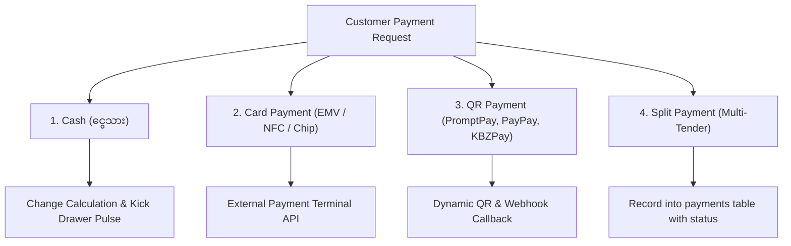
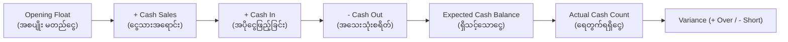

# 💳 Sector 16: POS Payment & Cash Management (ငွေပေးချေမှုနှင့် ငွေစာရင်း စီမံခန့်ခွဲမှု)

Point of Sale စနစ်တွင် ငွေကြေးစီးဆင်းမှု တိကျမှန်ကန်ရေးသည် အသက်တမျှ အရေးကြီးပါသည်။ စနစ်သည် ကောင်တာတွင် လက်ခံရရှိသော **ငွေသား (Cash)**၊ **ကတ် (Credit/Debit Card)** နှင့် **ဒီဂျစ်တယ် ပိုက်ဆံအိတ်များ (QR / Wallet)** တို့ကို စနစ်တကျ မှတ်တမ်းတင်ရပြီး ငွေသေတ္တာ (Cash Drawer) အတွင်းရှိ လက်တွေ့ငွေသားနှင့် စာရင်းကိုက်ညီစေရပါမည်။

---

## ၁။ ငွေပေးချေမှု နည်းလမ်းများ (Payment Methods)



1. **Cash Payment (ငွေသား)**:
   - Customer ပေးသော ငွေပမာဏ (`tendered_amount`) ကို ရိုက်ထည့်ခြင်း။
   - စနစ်က အကြွေပြန်အမ်းငွေ (`change_amount = tendered - total`) ကို အလိုအလျောက် တွက်ချက်ပြသခြင်း။
   - ငွေသေတ္တာ ဖွင့်ရန် Receipt Printer သို့ RJ11 Electronic Pulse ပို့လွှတ်ခြင်း။
2. **Card Payment (Credit / Debit Card)**:
   - External Card Terminal (PAX, Verifone, Square) နှင့် Serial/LAN/Bluetooth ဖြင့် ချိတ်ဆက်ခြင်း။
   - Terminal က ငွေဖြတ်ပြီးစီးကြောင်း Approval Code / Authorization ID ပြန်ပို့မှသာ POS တွင် Paid ဟု မှတ်ယူခြင်း။
3. **QR / E-Wallet Payment**:
   - Customer Scan ဖတ်ရန် Customer Facing Screen (CFD) ပေါ်တွင် Dynamic QR ထုတ်ပေးခြင်း။
   - Payment Gateway မှ Asynchronous Webhook သို့မဟုတ် Polling ဖြင့် အတည်ပြုချက် စစ်ဆေးခြင်း။

---

## ၂။ Split Payment & Partial Payment (ခွဲဝေပေးချေမှု)

လက်တွေ့ စားသောက်ဆိုင်နှင့် လက်လီဆိုင်များတွင် Customer က ငွေပေးချေမှု ပုံစံ အမျိုးမျိုး ရောနှော၍ ပေးချေလေ့ရှိပါသည် (ဥပမာ - ဘေလ်စုစုပေါင်း ¥10,000 တွင် Cash ¥6,000 + Credit Card ¥4,000)။

$$\text{Order Grand Total} = \sum (\text{Successful Payments})$$

```php
// Laravel: Split Payment Validation Rule
public function validateSplitPayment(Order $order, array $payments)
{
    $totalPaid = collect($payments)->sum('amount');

    if (bccomp($totalPaid, $order->total_amount, 2) !== 0) {
        throw new PaymentMismatchException(
            "ပေးချေသည့် စုစုပေါင်းငွေ ({$totalPaid}) သည် Order ကျသင့်ငွေ ({$order->total_amount}) နှင့် မကိုက်ညီပါ!"
        );
    }
}
```

---

## ၃။ Cash Drawer Management (ငွေသေတ္တာ စီမံခန့်ခွဲမှု)

နေ့စဉ် ကောင်တာရောင်းချရာတွင် Cash Drawer ထဲရှိ ငွေသားကို အောက်ပါအတိုင်း ခြေရာခံရပါမည်:



- **Opening Float (အစပျိုး မတည်ငွေ)**: Shift စတင်ချိန်တွင် အကြွေအမ်းရန် ထည့်ထားသော ငွေသား (ဥပမာ - ¥30,000)။
- **Cash In (ငွေသွင်း)**: အကြွေမလုံလောက်၍ မန်နေဂျာထံမှ အကြွေများ ထပ်မံလဲလှယ် ထည့်သွင်းခြင်း။
- **Cash Out / Petty Cash (ငွေထုတ်)**: သန့်ရှင်းရေးပစ္စည်းဝယ်ရန် သို့မဟုတ် ပို့ဆောင်ခပေးရန် ငွေသေတ္တာထဲမှ ထုတ်ယူသုံးစွဲခြင်း (အကြောင်းပြချက် မဖြစ်မနေ ထည့်ရမည်)။
- **Closing Cash Count (စာရင်းပိတ် ရေတွက်ငွေ)**: Shift ပြီးဆုံးချိန်တွင် Cashier က လက်တွေ့ ရေတွက်ရရှိသော ငွေပမာဏ။
- **Variance (ပိုငွေ/လိုငွေ)**: $\text{Variance} = \text{Actual Count} - \text{Expected Balance}$။

---

## ၄။ Refund vs Void (ငွေပြန်အမ်းခြင်းနှင့် အော်ဒါဖျက်သိမ်းခြင်း)

| အချက် | Void (အော်ဒါ ပယ်ဖျက်ခြင်း) | Refund (ငွေပြန်အမ်းခြင်း) |
|---|---|---|
| **အချိန်** | နေ့စဉ် စာရင်းမပိတ်မီ (Batch Settlement မတိုင်မီ) | အရောင်းပြီးဆုံးပြီး နောက်ရက် သို့မဟုတ် သီးခြားအချိန် |
| **ငွေလွှဲပြောင်းမှု** | ငွေအမှန်တကယ် မဖြတ်ဘဲ Authorize ကို Cancel လုပ်လိုက်ခြင်း | မူလဖြတ်ပြီးသား ငွေကို Reverse ပြန်သွင်းပေးခြင်း |
| **Merchant Fee** | Gateway Fee မကုန်ကျပါ | Refund Transaction Fee ကုန်ကျနိုင်ပါသည် |
| **Stock ပြန်တိုးခြင်း** | ပစ္စည်း မထွက်ခွာသေးသဖြင့် အလိုအလျောက် Stock ပြန်တိုး | ပစ္စည်း စစ်ဆေးပြီး ပျက်စီးမနေမှသာ Stock ပြန်တိုး |

---

## ၅။ Payment မှာ အဖြစ်အများဆုံး Production ပြဿနာများနှင့် ဖြေရှင်းနည်း

### ပြဿနာ ၁: Double Payment / Double Charge (ငွေနှစ်ခါဖြတ်မိခြင်း)
- **ပြဿနာ**: Customer ၏ Card မှ ငွေဖြတ်သွားသော်လည်း POS တွင် Timeout ဖြစ်သွားသဖြင့် Cashier က Pay ခလုတ် ထပ်နှိပ်ရာ ငွေနှစ်ခါ ဖြတ်မိခြင်း။
- **ဖြေရှင်းနည်း**: Terminal Request တိုင်းတွင် POS Order ID ကို `reference_id` အဖြစ် ထည့်သွင်းပြီး Terminal ဘက်တွင် Duplicate Transaction ပိတ်ပင်ထားရပါမည်။

### ပြဿနာ ၂: Webhook Retry Duplication
- **ပြဿနာ**: QR Payment Provider က ကွန်ရက်နှေး၍ Webhook ကို ၂ ကြိမ် ပို့လာရာ Database တွင် `payments` record ၂ ခု ဝင်သွားပြီး Order Total ထက် ကျော်လွန်သွားခြင်း။
- **ဖြေရှင်းနည်း**: `payments` table ရှိ `provider_transaction_id` ကို **Unique Constraint** သတ်မှတ်ပြီး Idempotency စစ်ဆေးရပါမည်။

```php
// Prevent Duplicate Webhook Recording
$payment = Payment::firstOrCreate(
    ['provider_transaction_id' => $webhookData['transaction_id']],
    [
        'order_id' => $webhookData['order_id'],
        'amount' => $webhookData['amount'],
        'payment_method' => 'qr',
        'status' => 'completed'
    ]
);
```

### ပြဿနာ ၃: Cash Drawer Discrepancy (ငွေသေတ္တာ ငွေမကိုက်ခြင်း)
- **ပြဿနာ**: Shift ပိတ်ချိန်တွင် System ပေါ်၌ ငွေ ¥150,000 ရှိရမည်ဟု ပြသနေသော်လည်း တကယ်ရေတွက်ရာတွင် ¥142,000 သာ ရှိနေခြင်း။
- **Root Cause**: Shift အတွင်း ကုန်ကြမ်းဝယ်ရန် ငွေထုတ်ယူခြင်း (Cash Out) ကို စာရင်းမသွင်းဘဲ သုံးစွဲမိခြင်း။
- **ဖြေရှင်းနည်း**: Cash Drawer ပွင့်တိုင်း (Drawer Open Sensor Trigger) System တွင် အကြောင်းပြချက် မရွေးမချင်း နောက်ထပ် Sale ရောင်းခွင့်ကို ခေတ္တ Block လုပ်ထားခြင်း။
