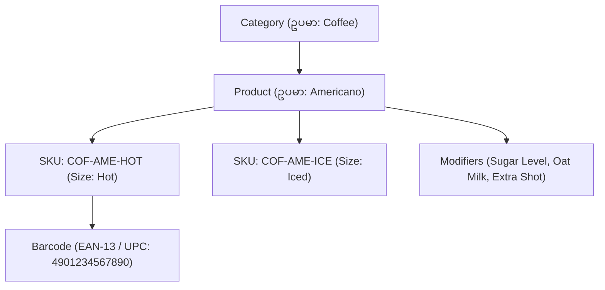
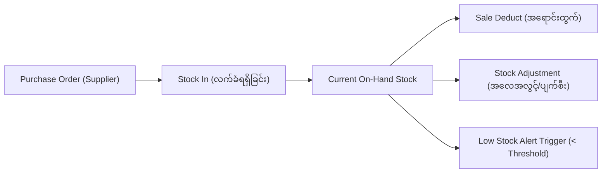

# 📦 Sector 17: POS Product, Inventory & Recipe Management (ကုန်ပစ္စည်း၊ Stock နှင့် ဟင်းချက်ကုန်ကြမ်း စီမံခန့်ခွဲမှု)

Retail POS နှင့် Restaurant POS စနစ်များ၏ အဓိက အသက်သွေးကြောမှာ **Inventory (ကုန်ပစ္စည်းလက်ကျန်)** တိကျမှုဖြစ်ပါသည်။ Retail ဆိုင်များတွင် ရောင်းကုန်ပစ္စည်း (Finished Goods) များကို ခြေရာခံသကဲ့သို့ Restaurant POS တွင် အစားအသောက် ၁ ပွဲ ရောင်းတိုင်း အသုံးပြုလိုက်သော ကုန်ကြမ်း (Ingredients) များကို **Recipe BOM (Bill of Materials)** စနစ်ဖြင့် နုတ်ယူရပါသည်။

---

## ၁။ Product & Catalog Structure (ကုန်ပစ္စည်းဖွဲ့စည်းပုံ)



- **SKU (Stock Keeping Unit)**: အရွယ်အစား၊ အရောင်၊ အမျိုးအစားအလိုက် ထူးခြားသော အတွင်းပိုင်း ကုဒ်နံပါတ်။
- **Barcode / UPC / EAN**: ကောင်တာတွင် Barcode Scanner ဖြင့် 0.1 စက္ကန့်အတွင်း ဖတ်ရှုနိုင်သော နံပါတ်။
- **Product Modifiers**: ပစ္စည်းတစ်ခုအပေါ်တွင် Customer စိတ်ကြိုက် ရွေးချယ်နိုင်သော အပိုအချက်များ (ဥပမာ - Extra Cheese +¥100၊ Less Sweet ¥0)။

---

## ၂။ Stock Movements & Lifecycle (Stock စီးဆင်းမှု လုပ်ငန်းစဉ်)

Stock လက်ကျန်ကို တိုက်ရိုက် update မလုပ်ဘဲ Audit Trail ရရှိစေရန် **Inventory Movements Ledger** အဖြစ် အမြဲတမ်း မှတ်တမ်းတင်ရပါမည်။



1. **Stock In**: ကုန်ပစ္စည်းပေးသွင်းသူ (Supplier) ထံမှ ပစ္စည်းရောက်ရှိလာ၍ ဂိုဒေါင်ထဲ သွင်းခြင်း။
2. **Stock Out (Sales)**: POS ကောင်တာမှ ရောင်းချလိုက်သဖြင့် ပစ္စည်းအရေအတွက် နုတ်ယူခြင်း။
3. **Stock Adjustment (ချိန်ညှိခြင်း)**: ပျက်စီးသွားခြင်း (Damage)၊ သက်တမ်းကုန်ဆုံးခြင်း (Expired) သို့မဟုတ် ရေတွက်ရာတွင် လိုအပ်နေခြင်းများအတွက် အကြောင်းပြချက်ဖြင့် Stock ချိန်ညှိခြင်း။
4. **Low Stock Alert**: ပစ္စည်းလက်ကျန်သည် သတ်မှတ်ထားသော Safety Stock (ဥပမာ - ၅ ခုအောက်) ရောက်ပါက Manager ထံ အလိုအလျောက် သတိပေးချက် (Alert) ပို့ခြင်း။

---

## ၃။ Restaurant Recipe Management & Ingredient Deduction (BOM)

စားသောက်ဆိုင်များတွင် Menu Item "Burger" ရောင်းချရာတွင် Burger ဟူသော ကုန်ချော မရှိဘဲ ကုန်ကြမ်းများ ပါဝင်ပါသည်။

```
Menu Item: Classic Cheeseburger
├── Burger Bun (ပေါင်မုန့်) : 1 piece
├── Beef Patty (အမဲသားပြား) : 150 grams
├── Cheddar Cheese (ဒိန်ခဲ) : 1 slice
├── Lettuce (ဆလတ်ရွက်) : 20 grams
└── Sauce (ဆော့စ်) : 15 ml
```

Customer က Classic Cheeseburger ၂ ပွဲ မှာယူလိုက်ပါက POS Backend သည်:
- Beef Patty လက်ကျန်မှ $150 \times 2 = 300\text{g}$ နုတ်ရပါမည်။
- Cheddar Cheese မှ $1 \times 2 = 2\text{ slices}$ နုတ်ရပါမည်။

### Cost of Goods Sold (COGS) တွက်ချက်မှု:
$$\text{Recipe Cost} = \sum (\text{Ingredient Unit Cost} \times \text{Ingredient Quantity})$$
$$\text{Gross Profit} = \text{Selling Price} - \text{Recipe Cost}$$

---

## ၄။ Inventory မှာ အဖြစ်အများဆုံး Production ပြဿနာများနှင့် ဖြေရှင်းနည်း

### ပြဿနာ ၁: Race Condition & Negative Stock (Stock အနုတ်ပြသွားခြင်း)
- **ပြဿနာ**: စတိုးဆိုင်တွင် ပစ္စည်း ၁ ခုသာ ကျန်တော့ချိန် Cashier နှစ်ဦးက ကောင်တာ ၂ ခုမှ တပြိုင်နက်တည်း Scan ဖတ်ပြီး Checkout ဝင်ရာ Stock က -1 ဖြစ်သွားခြင်း။
- **Root Cause**: Database Concurrency Lock မသုံးဘဲ ရိုးရိုး Update လုပ်မိခြင်း။
- **ဖြေရှင်းနည်း**: Laravel Database Transaction တွင် **`lockForUpdate()` (Pessimistic Row Locking)** ကို မဖြစ်မနေ အသုံးပြုရပါမည်။

```php
// Safe Atomic Stock Deduction
DB::transaction(function () use ($productId, $quantitySold) {
    // Row ကို အခြား Transaction များ ပြင်မရအောင် Lock ခတ်ခြင်း
    $inventory = DB::table('inventories')
        ->where('product_id', $productId)
        ->lockForUpdate()
        ->first();

    if ($inventory->quantity < $quantitySold) {
        throw new InsufficientStockException("ပစ္စည်းလက်ကျန် မလုံလောက်ပါ!");
    }

    // Atomic Deduct
    DB::table('inventories')
        ->where('product_id', $productId)
        ->decrement('quantity', $quantitySold);

    // Movement History သိမ်းဆည်းခြင်း
    DB::table('inventory_movements')->insert([
        'product_id' => $productId,
        'type' => 'sale',
        'quantity' => -$quantitySold,
        'created_at' => now(),
    ]);
});
```

### ပြဿနာ ၂: Recipe Ingredient Desync (ကုန်ကြမ်း အနုတ်လွဲခြင်း)
- **ပြဿနာ**: စားသောက်ဆိုင်တွင် Customer က "No Cheese" ဟု Special Instruction ပေးသော်လည်း စနစ်က Recipe အတိုင်း Cheese ကို နုတ်မိခြင်း။
- **ဖြေရှင်းနည်း**: Modifier Level Recipe Overrides။ Modifier ရွေးချယ်မှုတွင် Ingredient Deduction Exclusion Rules ထည့်သွင်းထားရပါမည်။
