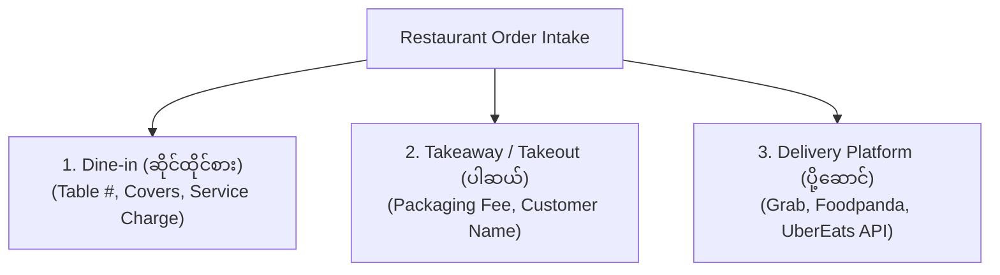
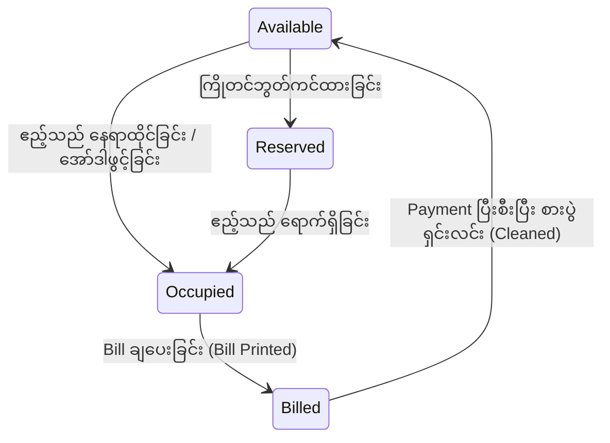
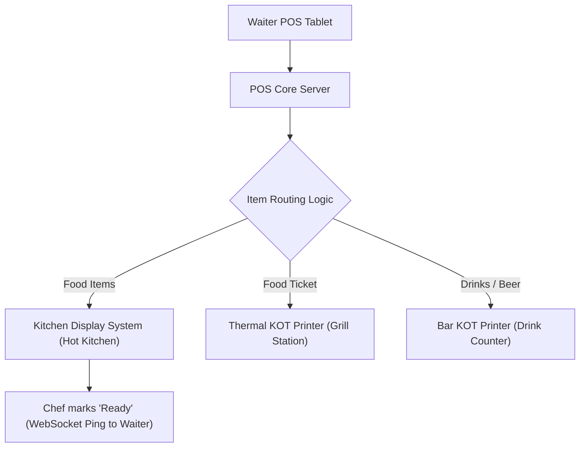

# 🍽️ Sector 18: POS Restaurant Operations & Hardware Integration (စားသောက်ဆိုင် လုပ်ငန်းစဉ်နှင့် စက်ပစ္စည်းများ)

Restaurant POS သည် သာမန် Retail စနစ်များနှင့် မတူဘဲ အစားအသောက် ပြင်ဆင်ချက်ပြုတ်ချိန်၊ စားပွဲဝိုင်း စီမံမှု၊ စားပွဲထိုးနှင့် မီးဖိုချောင်ကြား Real-time ဆက်သွယ်မှုများနှင့် ဟာ့ဒ်ဝဲစက်ပစ္စည်း (Hardware Peripherals) များနှင့် နီးကပ်စွာ ချိတ်ဆက်လည်ပတ်ရပါသည်။

---

## ၁။ Dining Channels & Order Types (စားသုံးမှု ပုံစံများ)



1. **Dine-in (ဆိုင်ထိုင်စား)**: Table Number နှင့် ဧည့်သည်အရေအတွက် (Guest Covers) သတ်မှတ်ရသည်။ Service Charge (ဥပမာ 10%) ထည့်သွင်းတွက်ချက်လေ့ရှိသည်။
2. **Takeaway (ပါဆယ်ထုတ်)**: စားပွဲဝိုင်း မလိုဘဲ အော်ဒါအမည်နှင့် ဖုန်းနံပါတ်ဖြင့် ခေါ်ဆိုပေးရသည်။ Packaging Fee ကောက်ခံနိုင်သည်။
3. **Delivery Integration**: Delivery Aggregator APIs (GrabFood, Foodpanda, UberEats) မှ အော်ဒါများကို POS တွင် Direct Inject ပြုလုပ်ပြီး မီးဖိုချောင်သို့ တိုက်ရိုက် ပို့လွှတ်ခြင်း။

---

## ၂။ Table Management (စားပွဲဝိုင်း စီမံခန့်ခွဲမှု)

POS တွင် စားသောက်ဆိုင်၏ Floor Plan အတိုင်း စားပွဲဝိုင်းများကို အချိန်နှင့်အမျှ Status ပြသပေးရပါမည်:



- **Move Table (ဝိုင်းပြောင်းခြင်း)**: Customer က စားပွဲနံပါတ် ၄ မှ နံပါတ် ၁၂ သို့ ပြောင်းထိုင်ပါက Order Items အားလုံးကို Table 12 သို့ လွှဲပြောင်းပေးခြင်း။
- **Merge Tables (ဝိုင်းပေါင်းခြင်း)**: အဖွဲ့လိုက် လူများလာ၍ စားပွဲ ၂ ခု (Table 5 + Table 6) ကို ဘေလ်တစ်ခုတည်းအဖြစ် ပေါင်းစည်းခြင်း။
- **Split Bill (ဘေလ်ခွဲရှင်းခြင်း)**: စားပွဲဝိုင်းတစ်ခုတည်းမှ သူငယ်ချင်းများက ပစ္စည်းအလိုက် သို့မဟုတ် လူဦးရေအလိုက် ခွဲခြားရှင်းခြင်း။

---

## ၃။ Kitchen Order Routing (KOT vs KDS)

မီးဖိုချောင်သို့ အော်ဒါရောက်ရှိစေရန် နည်းလမ်း ၂ မျိုး ရှိပါသည်:



### (၁) Kitchen Order Ticket (KOT)
မီးဖိုချောင်တွင် ထားရှိသော မီးခံ/ရေစိုခံ Thermal Printer ဖြင့် စက္ကူလက်မှတ် ထုတ်ပေးခြင်း။
- **Split Station Routing**: အော်ဒါတစ်ခုတည်းတွင် Steak နှင့် Red Wine ပါဝင်ပါက POS က Steak ကို မီးဖိုချောင် Printer သို့ လည်းကောင်း၊ Red Wine ကို ဘားကောင်တာ Printer သို့လည်းကောင်း သီးခြားစီ ခွဲထုတ်ပေးရပါမည်။

### (၂) Kitchen Display System (KDS)
စက္ကူမသုံးဘဲ မီးဖိုချောင်တွင် တပ်ဆင်ထားသော Touch Screen ပေါ်တွင် အော်ဒါများကို အချိန်နှင့်အမျှ အရောင်ဖြင့် ပြသခြင်း:
- **Green**: ၁၀ မိနစ်အတွင်း အော်ဒါအသစ်။
- **Yellow**: ၁၅ မိနစ် ကျော်လွန်နေပြီဖြစ်သော အော်ဒါ။
- **Red (Blinking)**: မိနစ် ၂၀ ကျော် ကြန့်ကြာနေသော အော်ဒါ (Urgent Escalation)။

---

## ၄။ Hardware Peripherals ချိတ်ဆက်မှုများ

```
┌────────────────────────────────────────────────────────┐
│               POS Counter Hardware Stack               │
├───────────────────────┬────────────────────────────────┤
│ 1. Thermal Printer    │ ESC/POS commands over TCP/LAN  │
│ 2. Cash Drawer        │ RJ11 Solenoid Kick Pulse (24V) │
│ 3. Barcode Scanner    │ HID Keyboard Emulation (USB)   │
│ 4. Payment Terminal   │ Serial RS232 / TCP Socket API  │
│ 5. Customer Display   │ Secondary Dual Screen (HDMI)   │
└───────────────────────┴────────────────────────────────┘
```

---

## ၅။ Restaurant Operations မှာ အဖြစ်အများဆုံး ပြဿနာများနှင့် ဖြေရှင်းနည်း

### ပြဿနာ ၁: Kitchen Ticket မထွက်ခြင်း (Paper Out / LAN Cut)
- **ပြဿနာ**: မီးဖိုချောင် Printer တွင် စက္ကူကုန်သွားသဖြင့် အော်ဒါစာရွက် မထွက်ဘဲ Chef က ဟင်းမချက်မိသဖြင့် Customer နာရီဝက်ကြာ စောင့်ဆိုင်းရခြင်း။
- **ဖြေရှင်းနည်း**: Queue Retry & Fallback Alert။ Printer မှ ACK (Acknowledgement) signal ပြန်မရပါက Cashier Screen တွင် အနီရောင် Warning Popup ပေါ်လာစေပြီး KDS Screen တွင် အလိုအလျောက် Fallback ပြသပေးရပါမည်။

### ပြဿနာ ၂: Table Transfer Order Loss
- **ပြဿနာ**: စားပွဲဝိုင်း ပြောင်းရွှေ့ချိန်တွင် စားပွဲဟောင်းရှိ ပစ္စည်းတစ်ဝက်ကျန်ရစ်ပြီး ဘေလ်ရှင်းချိန်တွင် အငြင်းပွားမှု ဖြစ်ပွားခြင်း။
- **ဖြေရှင်းနည်း**: Database Atomic Table Reassignment။ `orders.table_id` ကို Foreign Key Lock ခတ်ပြီးမှ ပြောင်းလဲရပါမည်။

### ပြဿနာ ၃: Menu Item 86ing Desync (ဟင်းပွဲကုန်သွားခြင်း)
- **ပြဿနာ**: မီးဖိုချောင်တွင် ငါးကုန်သွားသော်လည်း Waiter POS Tablet တွင် ဆက်လက်မှာယူနိုင်နေခြင်း။
- **ဖြေရှင်းနည်း**: Real-time Item 86ing (WebSocket Event)။ မီးဖိုချောင် KDS မှ "86 Item" (Sold Out) ခလုတ် နှိပ်လိုက်သည်နှင့် ဆိုင်တွင်းရှိ Waiter Tablets အားလုံးတွင် ထို Menu Item သည် ချက်ချင်း မွဲခြောက်သွား (Disabled) ရပါမည်။
