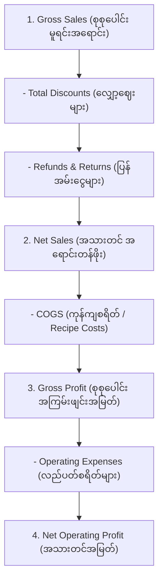

# 📊 Sector 19: POS Reporting & Business Analytics (အရောင်းနှင့် ဘဏ္ဍာရေး အစီရင်ခံစာများ)

Point of Sale စနစ်တွင် မှတ်တမ်းတင်ထားသော Transaction ဒေတာများသည် ဆိုင်ပိုင်ရှင်နှင့် စီမံခန့်ခွဲသူများအတွက် လုပ်ငန်းအမြတ်/အရှုံး၊ ရောင်းအားကောင်းသော ပစ္စည်းများနှင့် ကုန်ကျစရိတ်များကို ဆုံးဖြတ်ပေးသော **Business Intelligence & Financial Analytics** ၏ မူရင်းအရင်းအမြစ် ဖြစ်ပါသည်။

---

## ၁။ အဓိက ဘဏ္ဍာရေး ညီမျှခြင်းများ (Core Financial Metrics)

စီးပွားရေး အစီရင်ခံစာများ ထုတ်ပြန်ရာတွင် အောက်ပါ စံသတ်မှတ်ချက်များအတိုင်း တိကျစွာ ခွဲခြားတွက်ချက်ရပါမည်:



$$\text{Net Sales} = \text{Gross Sales} - \text{Discounts} - \text{Refunds}$$

$$\text{Gross Profit} = \text{Net Sales} - \text{Cost of Goods Sold (COGS)}$$

$$\text{Gross Margin \%} = \left(\frac{\text{Gross Profit}}{\text{Net Sales}}\right) \times 100$$

> [!WARNING]
> အခွန် (Tax / VAT) သည် ဆိုင်၏ ဝင်ငွေမဟုတ်ဘဲ အစိုးရကိုယ်စား ကောက်ခံပေးရသောကြောင့် Gross Sales သို့မဟုတ် Net Sales တွင် ရောနှောမထည့်သင့်ဘဲ သီးခြား **Tax Collected** အဖြစ် စာရင်းပြရပါမည်။

---

## ၂။ X-Report vs Z-Report (နေ့စဉ် စာရင်းပိတ် အစီရင်ခံစာများ)

POS စနစ်တိုင်းတွင် စာရင်းစစ်ဆေးခြင်းအတွက် X နှင့် Z ဟူ၍ အစီရင်ခံစာ ၂ မျိုး ရှိပါသည်:

| အချက် | X-Report (Mid-day Reading) | Z-Report (End-of-Day Closing) |
|---|---|---|
| **ထုတ်ယူချိန်** | နေ့လယ်ပိုင်း သို့မဟုတ် Shift အလယ်တွင် စစ်ဆေးလိုချိန် | ဆိုင်ပိတ်ချိန် ညနေတွင် တစ်ရက်တာအတွက် အပြီးသတ် စာရင်းပိတ်ချိန် |
| **ကောင်တာ Reset** | စာရင်းကို Reset မလုပ်ပါ (Current snapshot သာ ပြသ) | **Daily Sales Counter ကို Reset (0) လုပ်သည်** |
| **Consecutive Z #** | နံပါတ် မတိုးပါ | Z-Counter နံပါတ် အစဉ်လိုက် တိုးသွားသည် (Z-001, Z-002) |
| **တရားဝင်မှု** | စစ်ဆေးရန် ခေတ္တကြည့်ရှုခြင်း | အခွန်ဌာနနှင့် စာရင်းကိုင်အတွက် တရားဝင် နေ့စဉ် စာရွက်စာတမ်း |

---

## ၃။ Payment Method Breakdown & ABC Product Analysis

### (၁) Payment Method Breakdown Report
တစ်ရက်တာ ရောင်းရငွေများကို နည်းလမ်းအလိုက် ခွဲခြားပြသခြင်း:
- **Cash Sales**: ¥120,000 (ငွေသား)
- **Credit Card Sales**: ¥250,000 (ကတ်)
- **QR / Mobile Pay**: ¥80,000 (ဒစ်ဂျစ်တယ်)
- **Total Settlement**: ¥450,000

### (၂) ABC Product Analysis (Pareto 80/20 Rule)
- **Class A (Top 20% items)**: ဆိုင်ရောင်းရငွေ၏ 80% ကို ရှာဖွေပေးသော အဓိက အရောင်းရဆုံး ပစ္စည်းများ (Best Sellers)။
- **Class B (Next 30% items)**: ပုံမှန်ရောင်းအားရှိသော ပစ္စည်းများ (ရောင်းအား၏ 15%)။
- **Class C (Bottom 50% items)**: ရောင်းအားနည်းပြီး သိုလှောင်ရုံနေရာယူသော ပစ္စည်းများ (ရောင်းအား၏ 5%)။

---

## ၄။ Reporting မှာ အဖြစ်အများဆုံး Production ပြဿနာများနှင့် ဖြေရှင်းနည်း

### ပြဿနာ ၁: Refund Order များကို Report တွင် မှားယွင်းပေါင်းမိခြင်း
- **ပြဿနာ**: ဧည့်သည်က ¥5,000 တန် ပစ္စည်းကို ဝယ်ယူပြီး နောက် ၃ နာရီအကြာတွင် Refund လာလုပ်ရာ Daily Gross Sales တွင် ¥5,000 တိုးသွားပြီး Report ကွာဟသွားခြင်း။
- **ဖြေရှင်းနည်း**: Completed Sales နှင့် Refunded Transactions များကို အမြဲ သီးခြား Ledger Entries အဖြစ် သိမ်းပြီး Report Query တွင် Status ကို တိကျစွာ Filter ပြုလုပ်ရပါမည်:

```sql
-- Accurate Net Sales Query
SELECT 
    DATE(created_at) as sale_date,
    SUM(CASE WHEN type = 'sale' THEN total_amount ELSE 0 END) as gross_sales,
    SUM(CASE WHEN type = 'refund' THEN total_amount ELSE 0 END) as total_refunds,
    SUM(discount_amount) as total_discounts,
    SUM(tax_amount) as total_taxes,
    (SUM(CASE WHEN type = 'sale' THEN total_amount ELSE 0 END) 
     - SUM(CASE WHEN type = 'refund' THEN total_amount ELSE 0 END) 
     - SUM(discount_amount)) as net_sales
FROM orders
WHERE status = 'completed' AND branch_id = 1
GROUP BY DATE(created_at);
```

### ပြဿနာ ၂: Timezone Cut-off Error (ည ၁၂ နာရီ စာရင်းလွဲခြင်း)
- **ပြဿနာ**: ည ၁၂ နာရီအထိ ဖွင့်သော ဘား/စားသောက်ဆိုင်များတွင် ည ၁၁:၅၅ အော်ဒါသည် ယနေ့ထဲဝင်ပြီး ၁၂:၀၅ အော်ဒါသည် နောက်ရက်ထဲ ရောက်သွားသဖြင့် Shift Report မကိုက်ခြင်း။
- **ဖြေရှင်းနည်း**: **Business Day vs Calendar Day**။ Report များကို Calendar Date အစား Cashier ၏ `shift_id` သို့မဟုတ် ဆိုင်ပိတ်ချိန် Business Date (ဥပမာ - နံနက် ၆:၀၀ နာရီအထိကို ယခင်ရက် Business Day အဖြစ် သတ်မှတ်ခြင်း) ဖြင့် Group ဖွဲ့ တွက်ချက်ရပါမည်။
