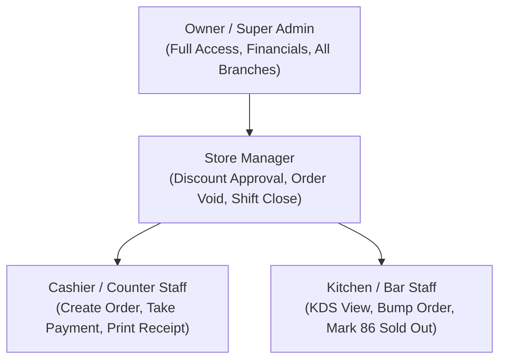
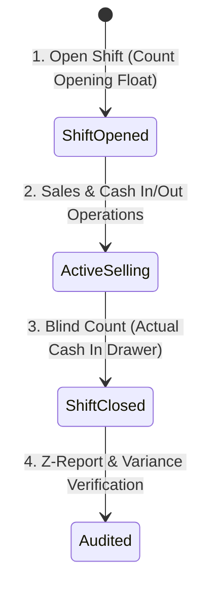

# 👥 Sector 20: POS Employee, Shift & Store Management (ဝန်ထမ်း၊ Shift နှင့် ဆိုင်ခွဲများ စီမံခန့်ခွဲမှု)

Point of Sale စနစ်တွင် ငွေကြေးနှင့် ကုန်ပစ္စည်းများ ပါဝင်နေသောကြောင့် **ဝန်ထမ်းတစ်ဦးချင်းစီ၏ လုပ်ပိုင်ခွင့် (RBAC)**၊ **အလုပ်ချိန်ဂျူတီ (Shift Management)** နှင့် **ဆိုင်ခွဲများအလိုက် ဒေတာခွဲခြားမှု (Multi-Branch Isolation)** တို့ကို တင်းကျပ်သော လုံခြုံရေးစည်းမျဉ်းများဖြင့် တည်ဆောက်ရပါသည်။

---

## ၁။ Role-Based Access Control (RBAC) & Permissions

POS တွင် မတူညီသော ဝန်ထမ်းအဆင့်များအတွက် ခွင့်ပြုချက်များကို သေချာခွဲခြားထားရပါမည်:



| ခွင့်ပြုချက် လုပ်ပိုင်ခွင့်များ | Cashier | Manager | Store Owner |
|---|:---:|:---:|:---:|
| **Create Order & Add Items** | ✅ | ✅ | ✅ |
| **Accept Cash / Card Payment** | ✅ | ✅ | ✅ |
| **Apply Small Item Discount (< 5%)** | ✅ | ✅ | ✅ |
| **Apply VIP / Custom Discount (> 10%)** | ❌ (Need PIN) | ✅ | ✅ |
| **Void / Cancel Completed Order** | ❌ (Need PIN) | ✅ | ✅ |
| **Open Cash Drawer manually (No Sale)** | ❌ (Need PIN) | ✅ | ✅ |
| **View Store Profit & COGS Reports** | ❌ | ❌ | ✅ |
| **Change Product Master Selling Prices** | ❌ | ❌ | ✅ |

---

## ၂။ Cashier Shift Management Lifecycle (အလုပ်ချိန် စက်ဝန်း)

Cashier တစ်ဦး အလုပ်စတင်ချိန်မှ ပြီးဆုံးချိန်အထိ ငွေစာရင်းလွှဲပြောင်းမှုကို အဆင့် ၄ ဆင့်ဖြင့် ထိန်းချုပ်ပါသည်:



### (၁) Shift Opening (စတင်ခြင်း)
- Cashier သည် ကောင်တာသို့ ရောက်ရှိချိန်တွင် မိမိ၏ PIN ဖြင့် Login ဝင်ရသည်။
- မတည်ငွေသား (Opening Float) ကို ရေတွက်ပြီး System တွင် စတင်စာရင်းသွင်းရသည်။

### (၂) Mid-shift Transactions
- Shift အတွင်း ဖြစ်ပွားသော Cash Sales, Card Sales, Cash-in နှင့် Cash-out များကို စနစ်က နောက်ကွယ်မှ စဉ်ဆက်မပြတ် ပေါင်းစပ်တွက်ချက်နေသည်။

### (၃) Blind Cash Count (စနစ်မကြည့်ဘဲ ရေတွက်ခြင်း)
- စာရင်းပိတ်ချိန်တွင် Cashier အား System ပေါ်ရှိ စုစုပေါင်းငွေကို ကြိုတင်မပြဘဲ (Blind Count) လက်ထဲရှိ အကြွေနှင့် ငွေစက္ကူများကို ကိုယ်တိုင် ရေတွက်ရိုက်ထည့်စေသည်။
- ဤနည်းဖြင့် ဝန်ထမ်းက စနစ်ပေါ်ရှိ ငွေနှင့် တိုက်ဆိုင်၍ အပိုငွေကို ခိုးယူခြင်းမှ ကာကွယ်နိုင်သည်။

### (၄) Variance Reconciliation (လိုငွေ/ပိုငွေ စစ်ဆေးခြင်း)
- Manager က Cashier ၏ Counted Cash နှင့် System Expected Cash ကို နှိုင်းယှဉ်၍ အတည်ပြု လက်မှတ်ရေးထိုးသည်။

---

## ၃။ Multi-Branch Store Management (ဆိုင်ခွဲများ စီမံခန့်ခွဲမှု)

လုပ်ငန်းတစ်ခုတွင် ဆိုင်ခွဲများစွာ (Branch 1: Downtown, Branch 2: Mall, Branch 3: Airport) ရှိနိုင်ပါသည်။

```
Centralized Cloud Database
├── Branch 1: Downtown  -> Scoped Products, Stock, Cashiers, Orders
├── Branch 2: Shopping Mall -> Scoped Products, Stock, Cashiers, Orders
└── Branch 3: Airport Terminal -> Scoped Products, Stock, Cashiers, Orders
```

- **Branch-level Scoping**: Cashier တစ်ဦးသည် မိမိတာဝန်ကျရာ Branch ၏ Stock နှင့် Sales ဒေတာများကိုသာ မြင်တွေ့ခွင့်ရှိရပါမည်။
- **Centralized Master Catalog**: ပစ္စည်းအမည်နှင့် SKU ကို ဗဟိုရုံးချုပ်မှ ဖန်တီးပေးပြီး ဆိုင်ခွဲအလိုက် ဈေးနှုန်းနှင့် Stock ကို သီးခြားစီ သတ်မှတ်နိုင်သည်။

---

## ၄။ Staff & Store Management မှာ အဖြစ်အများဆုံး ပြဿနာများနှင့် ဖြေရှင်းနည်း

### ပြဿနာ ၁: Unauthorized Void Overrides (ခွင့်ပြုချက်မဲ့ ဖျက်သိမ်းခြင်း)
- **ပြဿနာ**: Cashier က Customer ထံမှ ငွေသားလက်ခံပြီးနောက် Customer ထွက်သွားချိန်တွင် Order ကို "Void" လုပ်ပြီး ငွေသားကို အလွဲသုံးစားလုပ်ခြင်း။
- **ဖြေရှင်းနည်း**: **Manager Override Requirement & Immutable Audit Log**။ Order Void လုပ်ရန် Manager PIN မဖြစ်မနေ လိုအပ်စေပြီး Void ဖြစ်သွားသော Order တိုင်းကို အချိန်၊ Cashier ID နှင့် Manager ID တို့ဖြင့် Audit Trail တွင် အပြီးတိုင် မှတ်တမ်းတင်ရပါမည်။

```php
// Laravel Policy Check for Order Void
public function void(User $user, Order $order)
{
    if (!$user->hasPermission('orders.void')) {
        throw new AuthorizationException("Order ပယ်ဖျက်ရန် Manager ခွင့်ပြုချက် PIN လိုအပ်ပါသည်!");
    }

    AuditLog::create([
        'user_id' => $user->id,
        'action' => 'order_voided',
        'target_id' => $order->id,
        'reason' => request('void_reason'),
        'ip_address' => request()->ip(),
    ]);
}
```

### ပြဿနာ ၂: Cross-Branch Data Leak (ဆိုင်ခွဲဒေတာ ရောထွေးခြင်း)
- **ပြဿနာ**: Branch A ရှိ Cashier က Branch B ၏ အရောင်း Report သို့မဟုတ် Stock များကို လှမ်းမြင်ရခြင်း သို့မဟုတ် မှားယွင်းရောင်းချမိခြင်း။
- **ဖြေရှင်းနည်း**: Laravel Global Scope ဖြင့် User ၏ `branch_id` ကို အလိုအလျောက် Filter ပြုလုပ်ရပါမည်:

```php
// Automatic Branch Scoping
class BranchScope implements Scope
{
    public function apply(Builder $builder, Model $model)
    {
        if (auth()->check() && !auth()->user()->is_super_admin) {
            $builder->where('branch_id', auth()->user()->branch_id);
        }
    }
}
```
