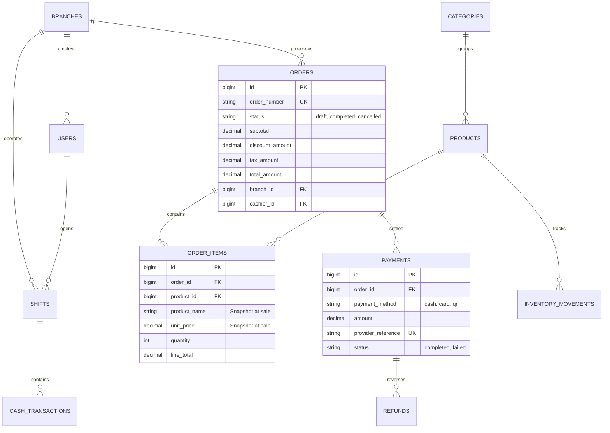
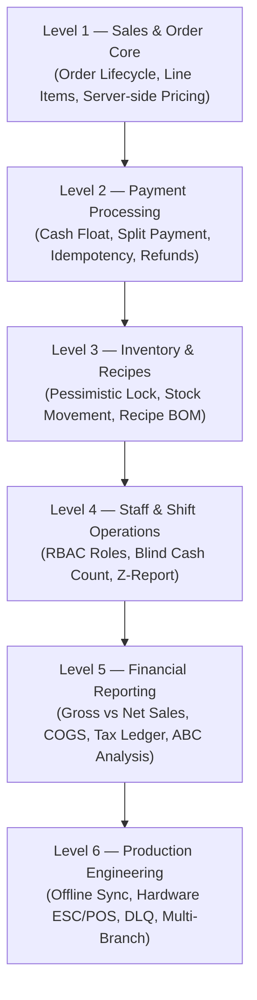

# 📐 Sector 21: POS Business Rules, Database Architecture & ERD (စီးပွားရေး စည်းမျဉ်းများနှင့် ဒေတာဘေ့စ် ဒီဇိုင်း)

POS Backend စနစ်တစ်ခု တည်ဆောက်ရာတွင် CRUD API ရေးတတ်ရုံဖြင့် မလုံလောက်ပါ။ စနစ်၏ **Business Rules (လုပ်ငန်းစည်းမျဉ်းများ)** နှင့် **Database Schema Design** မှန်ကန်မှသာ အော်ဒါ၊ ငွေပေးချေမှု၊ ကုန်လက်ကျန်နှင့် ဘဏ္ဍာရေး အစီရင်ခံစာများ အချိန်တိုင်း တသမတ်တည်း တိကျနေမည် ဖြစ်ပါသည်။

---

## ၁။ POS မှာ မဖြစ်မနေ လိုက်နာရမည့် Business Rules ၇ မျိုး

| စည်းမျဉ်း အမည် | နည်းပညာ ရှင်းလင်းချက် |
|---|---|
| **1. Price Integrity** | Client-side App မှ ပို့လာသော ဈေးနှုန်းကို တိုက်ရိုက်မယုံရ။ Server က Database ထဲရှိ Master Price ဖြင့်သာ တွက်ချက်ရမည်။ |
| **2. Stock Integrity** | Stock မလုံလောက်ပါက Negative ဖြစ်မသွားစေရန် Pessimistic Locking သုံး၍ သတ်မှတ်စည်းမျဉ်းအတိုင်းသာ ရောင်းခွင့်ပေးရမည်။ |
| **3. Payment Integrity** | Webhook Retry ဖြစ်စေ၊ Double Click ဖြစ်စေ Payment တစ်ခုတည်းကို နှစ်ကြိမ် Process မဖြစ်စေရ (Idempotency Key)။ |
| **4. Order Integrity** | Order Total သည် ပေးချေထားသော Successful Payments စုစုပေါင်းနှင့် ဒဿမ ၂ နေရာအထိ အမြဲ ကိုက်ညီနေရမည်။ |
| **5. Refund Integrity** | Refund ပေးမည့် ပမာဏသည် မူလပေးချေခဲ့သော Paid Amount ထက် မည်သည့်အခါမျှ ကျော်လွန်ခွင့် မရှိစေရ။ |
| **6. Permission Integrity** | Cashier က Owner/Manager-only Settings သို့မဟုတ် အကန့်အသတ်မဲ့ လျှော့ဈေးများကို Override လုပ်ခွင့် မရှိစေရ။ |
| **7. Auditability** | ဘယ်သူက၊ ဘယ်အချိန်မှာ၊ ဘယ်စက်ကနေ၊ ဘာဒေတာကို ပြောင်းလဲခဲ့သလဲဆိုတာကို Immutable Audit Logs ဖြင့် အမြဲ ပြန်လည်စစ်ဆေးနိုင်ရမည်။ |

---

## ၂။ POS Database Entities ဆက်နွယ်မှု (Database Architecture)

Laravel POS Backend ရေးဆွဲရာတွင် အောက်ပါ Core Entities များ၏ ဆက်နွယ်မှုကို နားလည်ထားရပါမည်:

> [!IMPORTANT]
> **Snapshot Unit Price Principle**:
> `order_items.unit_price` နှင့် `order_items.product_name` တို့တွင် အရောင်းဖြစ်ပွားချိန်က ဈေးနှုန်းနှင့် အမည်ကို Snapshot အဖြစ် သီးခြား သိမ်းဆည်းရပါမည်။ နောင်တစ်ချိန် `products` table တွင် ဈေးနှုန်းတက်သွားသော်လည်း ယခင်ရောင်းချခဲ့သော Order များနှင့် Sales Reports များ လုံးဝ မပြောင်းလဲစေရန် ဖြစ်ပါသည်။

---

## ၃။ POS Engineering Learning Roadmap (၆ ဆင့် လေ့လာမှု လမ်းညွှန်)

သင့်အနေဖြင့် Production-ready POS Backend တစ်ခုကို ရေးဆွဲရာတွင် အောက်ပါ အဆင့် ၆ ဆင့်အတိုင်း လေ့လာ တည်ဆောက်သင့်ပါသည်:

---

## ၄။ Database Architecture မှာ အဖြစ်အများဆုံး အမှားများနှင့် ကာကွယ်နည်း

### အမှား ၁: Foreign Key Cascade Delete Trap
- **ပြဿနာ**: Admin က ကုန်ပစ္စည်းအဟောင်းတစ်ခုကို Delete လုပ်လိုက်ရာ Database က Foreign Key `ON DELETE CASCADE` ကြောင့် လွန်ခဲ့သော ၃ နှစ်က ထိုပစ္စည်းပါဝင်ခဲ့သည့် Order Items များပါ အကုန်ပျက်စီးသွားခြင်း။
- **ကာကွယ်နည်း**: **Never Hard Delete!** အရောင်းဒေတာများနှင့် ချိတ်ဆက်နေသော Products, Categories, Users များကို `SoftDeletes` သာ အသုံးပြုရမည်ဖြစ်ပြီး Foreign Key တွင် `ON DELETE RESTRICT` သတ်မှတ်ထားရပါမည်။

### အမှား ၂: Floating-Point Rounding Error on Decimals
- **ပြဿနာ**: ဈေးနှုန်းနှင့် အခွန်တွက်ရာတွင် `FLOAT` သို့မဟုတ် `DOUBLE` သုံးမိသဖြင့် ဒဿမအမှားဖြစ်ပြီး ¥1,000.00 တွင် ¥999.999999 ဖြစ်ကာ Order Total နှင့် Payment မကိုက်တော့ခြင်း။
- **ကာကွယ်နည်း**: Database Column များတွင် `DECIMAL(12, 2)` သို့မဟုတ် `DECIMAL(14, 4)` သာ သုံးရမည်ဖြစ်ပြီး PHP ဘက်တွင် `bcmath` functions (`bcmul`, `bcadd`, `bccomp`) ဖြင့် တွက်ချက်ရပါမည်။
