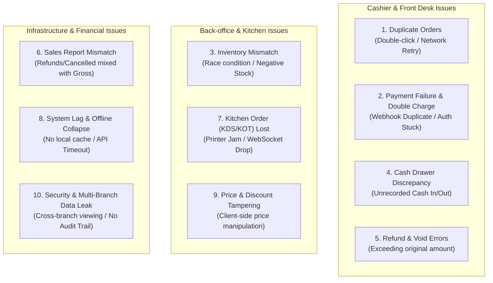
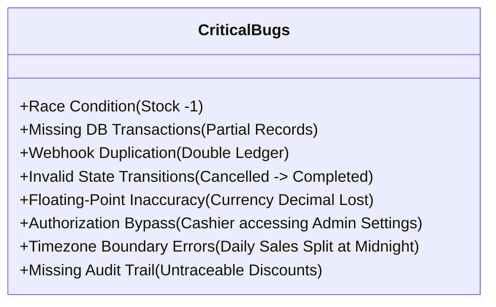

# 🛠️ Sector 22: Top 10 POS Production Failures & Laravel Engineering Solutions

Point of Sale (POS) စနစ်တစ်ခုသည် လက်တွေ့ Production သို့ တင်လိုက်သည့်အခါ **လူစည်ကားသော နေ့လယ်စာ/ညစာ Peak Hours များတွင် Checkout နှေးကွေးခြင်း၊ Cashier က Pay ခလုတ်ကို အလျင်စလို ၂ ချက်နှိပ်မိ၍ အော်ဒါနှစ်ခါဖြစ်ခြင်း၊ Network ပြတ်တောက်သွားချိန်တွင် Cash ဖြတ်ပြီး Order ပျောက်သွားခြင်း** စသည့် ပြဿနာများနှင့် မလွဲမသွေ ရင်ဆိုင်ရလေ့ရှိပါသည်။

ဤသင်ခန်းစာတွင် POS လုပ်ငန်းခွင်၌ အဖြစ်အများဆုံး **Critical Production Problems ၁၀ ခု**၊ Laravel Backend တွင် တွေ့ရလေ့ရှိသော **အန္တရာယ်အများဆုံး Technical Bugs ၈ ခု**၊ **ထုတ်လုပ်မှုအဆင့်မီ Laravel Code Implementations ၄ ခု**၊ **Priority Triage Matrix** နှင့် **Automated QA Testing Checklist** များကို ပြည့်စုံစွာ စုစည်းဖော်ပြထားပါသည်။

---

## 🚨 ၁။ POS တွင် အဖြစ်အများဆုံး Production ပြဿနာ ၁၀ ခု



| စဉ် | ပြဿနာ (Problem) | ဖြစ်နိုင်သော အကြောင်းရင်း | အင်ဂျင်နီယာ ဖြေရှင်းနည်း (Engineering Solution) |
| :---: | :--- | :--- | :--- |
| **01** | **Duplicate Orders (Order နှစ်ခါဖြစ်ခြင်း)** | Cashier က Pay ခလုတ်ကို မကြာခဏ ၂ ခါနှိပ်မိခြင်း၊ Network နှေး၍ တူညီသော Request ကို အလိုအလျောက် Retry ပြုလုပ်ခြင်း။ | **Client-side UUID Idempotency Key** ထည့်သွင်းပြီး Database ထဲတွင် Unique Index စစ်ဆေးခြင်း။ |
| **02** | **Payment Failure / Double Payment** | Customer ကတ်မှ ငွေဖြတ်သွားသော်လည်း POS စနစ်သို့ Confirm မရောက်ဘဲ Unpaid ဖြစ်နေခြင်း သို့မဟုတ် ငွေနှစ်ခါဖြတ်မိခြင်း။ | Payment Status State Machine၊ External Reference Verification နှင့် Payment Idempotency Handler။ |
| **03** | **Inventory Mismatch (Stock မကိုက်ခြင်း)** | Cashier ၂ ယောက်က လက်ကျန် ၁ ခုတည်းရှိသော ပစ္စည်းကို တပြိုင်နက် ရောင်းချလိုက်ခြင်းကြောင့် Stock အနုတ်လက္ခဏာပြခြင်း။ | **Database Row Locking (`lockForUpdate`)** သို့မဟုတ် Redis Distributed Locks ဖြင့် Atomic Stock Update လုပ်ခြင်း။ |
| **04** | **Cash Drawer မကိုက်ခြင်း (Cash Discrepancy)** | Shift အတွင်း ငွေအမ်းရန် ငွေထပ်ဖြည့်ခြင်း (Cash In) သို့မဟုတ် ဈေးဝယ်ရန် ထုတ်ယူခြင်း (Cash Out) ကို စာရင်းမသွင်းခြင်း။ | **Strict Cash Float Management**၊ Cash In/Out မဖြစ်မနေ မှတ်တမ်းတင်စေခြင်းနှင့် Shift Closing Z-Report Reconciliation။ |
| **05** | **Refund / Void Errors (ငွေပြန်အမ်းမှု မှားယွင်းခြင်း)** | Order ဖျက်သိမ်းသော်လည်း ငွေပြန်မအမ်းမိခြင်း၊ မူလဝယ်ယူငွေထက် ပိုအမ်းမိခြင်း သို့မဟုတ် ပျက်စီးသွားသော ပစ္စည်းကို Stock ပြန်တိုးမိခြင်း။ | **Refund Limit Validation**၊ Manager Approval Gate နှင့် Audit Trail Logs။ |
| **06** | **Sales Report မကိုက်ခြင်း** | Cancelled Orders နှင့် Refunded Amounts များကို Gross Sales စာရင်းထဲတွင် ပေါင်းတွက်မိခြင်း။ | **Centralized Financial Formulas** (Gross, Discounts, Refunds, Net Sales သီးခြား ခွဲထုတ်တွက်ချက်ခြင်း)။ |
| **07** | **Kitchen Order မရောက်ခြင်း (KDS / KOT Lost)** | Cashier က အော်ဒါတင်ပြီးသော်လည်း Thermal Printer စက္ကူကုန်နေခြင်း သို့မဟုတ် မီးဖိုချောင် KDS WebSocket ပြတ်တောက်သွားခြင်း။ | **Queue Retry Mechanism**၊ Printer Status Polling နှင့် KDS Acknowledgment (ACK) Ping။ |
| **08** | **POS နှေးကွေးခြင်း / Network ပြတ်တောက်ခြင်း** | ဆိုင်စည်ကားချိန်တွင် Database Query များ နှေးကွေးလာခြင်း သို့မဟုတ် အင်တာနက်ပြတ်သွားပါက အရောင်းရပ်တန့်သွားခြင်း။ | **Indexed Queries**, In-Memory Caching (Redis), နှင့် IndexedDB ပါဝင်သော **Offline-First Synchronization**။ |
| **09** | **Price / Discount Tampering** | Client App က ပို့လာသော စျေးနှုန်းကို Server က မစစ်ဘဲ လက်ခံမိခြင်း သို့မဟုတ် ခွင့်ပြုချက်မရှိဘဲ 50% လျှော့စျေးပေးခြင်း။ | **Server-side Price Calculation Only** (Client စျေးနှုန်းကို ဘယ်တော့မှ မယုံရ) နှင့် Discount RBAC Checks။ |
| **10** | **Security & Multi-Branch Leak** | ဆိုင်ခွဲ A မှ ဝန်ထမ်းက ဆိုင်ခွဲ B ၏ နေ့စဉ်အရောင်းစာရင်းနှင့် ဖောက်သည်ဖုန်းနံပါတ်များကို ဝင်ရောက်ကြည့်ရှုနိုင်ခြင်း။ | **Tenant/Branch Scoped Eloquent Queries** နှင့် Strict Role-Based Access Control (RBAC)။ |

---

## ⚠️ ၂။ Laravel POS တွင် အန္တရာယ်အများဆုံး Technical Bugs ၈ ခု



1. **Race Condition Trap**: Stock 1 ခုသာ ကျန်တော့ချိန် Cashier ၂ ယောက်က တစ်စက္ကန့်တည်းတွင် Checkout လုပ်ပါက Stock -1 ဖြစ်သွားခြင်း။
2. **Missing DB Transaction**: Order Items သိမ်းပြီး Payment API ခေါ်ချိန် Error တက်ပါက Order ကျန်ခဲ့ပြီး Payment မပါဝင်သော Broken Data ဖြစ်ကျန်ခဲ့ခြင်း။
3. **Floating-Point Precision Error**: PHP တွင် `0.1 + 0.2 != 0.3` ဖြစ်သကဲ့သို့ စျေးနှုန်းနှင့် Tax များကို `float` ဖြင့် တွက်မိပါက 0.01 Cent ကွာဟပြီး Audit မကိုက်တော့ခြင်း (မဖြစ်မနေ `bcmath` သို့မဟုတ် Integer Cents သုံးရမည်)။
4. **Invalid State Transition**: ဖျက်သိမ်းပြီးသား (Cancelled) အော်ဒါကို ငွေပေးချေပြီး (Completed) အဖြစ် ပြောင်းလဲခွင့် ပြုမိခြင်း။

---

## 💻 ၃။ ထုတ်လုပ်မှုအဆင့်မီ Laravel Code Solutions ၄ ခု

### Solution 1: Race Condition ကာကွယ်သော Atomic Stock & Recipe Deduction
```php
namespace App\Services\Pos;

use App\Models\Order;
use App\Models\Product;
use App\Models\Ingredient;
use Illuminate\Support\Facades\DB;
use Exception;

class PosCheckoutService
{
    public function processSale(array $orderData, array $items): Order
    {
        return DB::transaction(function () use ($orderData, $items) {
            $totalAmount = 0;
            $itemsToInsert = [];

            foreach ($items as $item) {
                // 1. Pessimistic Row Lock (အခြား Cashier ဝင်မနုတ်နိုင်ရန် Lock ချခြင်း)
                $product = Product::where('id', $item['product_id'])
                    ->lockForUpdate()
                    ->firstOrFail();

                // 2. Retail Finished Good Stock စစ်ဆေးခြင်း
                if ($product->is_retail && $product->stock_quantity < $item['quantity']) {
                    throw new Exception("ပစ္စည်းလက်ကျန်မလုံလောက်ပါ: {$product->name} (ကျန်: {$product->stock_quantity})");
                }

                // 3. Restaurant Recipe Ingredients လက်ကျန် စစ်ဆေးခြင်း
                if ($product->is_restaurant_menu) {
                    foreach ($product->recipes as $recipe) {
                        $requiredQty = $recipe->quantity_needed * $item['quantity'];
                        $ingredient = Ingredient::where('id', $recipe->ingredient_id)
                            ->lockForUpdate()
                            ->firstOrFail();

                        if ($ingredient->stock_quantity < $requiredQty) {
                            throw new Exception("ကုန်ကြမ်းမလုံလောက်ပါ: {$ingredient->name}");
                        }

                        // နုတ်ယူခြင်း
                        $ingredient->decrement('stock_quantity', $requiredQty);
                    }
                } else {
                    $product->decrement('stock_quantity', $item['quantity']);
                }

                // Server-side Price အမှန်ဖြင့်သာ တွက်ချက်ခြင်း
                $unitPrice = $product->price;
                $lineSubtotal = bcmul($unitPrice, $item['quantity'], 2);
                $totalAmount = bcadd($totalAmount, $lineSubtotal, 2);

                $itemsToInsert[] = [
                    'product_id'   => $product->id,
                    'product_name' => $product->name, // Snapshot
                    'unit_price'   => $unitPrice,      // Snapshot
                    'quantity'     => $item['quantity'],
                    'subtotal'     => $lineSubtotal,
                ];
            }

            // 4. Order ဖန်တီးခြင်း
            $order = Order::create([
                'order_number' => 'ORD-' . strtoupper(uniqid()),
                'branch_id'    => $orderData['branch_id'],
                'user_id'      => auth()->id(),
                'shift_id'     => $orderData['shift_id'],
                'grand_total'  => $totalAmount,
                'status'       => 'completed',
            ]);

            $order->items()->createMany($itemsToInsert);

            return $order;
        });
    }
}
```

---

### Solution 2: Idempotent Payment Handler (Duplicate Requests ကာကွယ်ခြင်း)
```php
namespace App\Services\Pos;

use App\Models\Payment;
use App\Models\ProcessedTransaction;
use Illuminate\Support\Facades\DB;
use Exception;

class IdempotentPaymentService
{
    public function recordPayment(string $idempotencyKey, array $paymentData): Payment
    {
        return DB::transaction(function () use ($idempotencyKey, $paymentData) {
            // 1. အရင် Process လုပ်ပြီးသား Key ဟုတ်မဟုတ် စစ်ဆေးခြင်း
            $existing = ProcessedTransaction::where('idempotency_key', $idempotencyKey)->first();
            if ($existing) {
                // Duplicate request ဖြစ်ပါက မူလ Payment ကို ပြန်ပေး၍ ထပ်မဖြတ်စေပါ
                return Payment::findOrFail($existing->payment_id);
            }

            // 2. Payment သစ် မှတ်တမ်းတင်ခြင်း
            $payment = Payment::create([
                'order_id'              => $paymentData['order_id'],
                'shift_id'              => $paymentData['shift_id'],
                'amount'                => $paymentData['amount'],
                'payment_method'        => $paymentData['payment_method'],
                'transaction_reference' => $paymentData['transaction_reference'] ?? null,
                'status'                => 'successful',
            ]);

            // 3. Key ကို Registry တွင် Lock မှတ်တမ်းတင်ခြင်း
            ProcessedTransaction::create([
                'idempotency_key' => $idempotencyKey,
                'payment_id'      => $payment->id,
            ]);

            return $payment;
        });
    }
}
```

---

### Solution 3: Split Payment Atomic Validator
```php
namespace App\Http\Requests\Pos;

use Illuminate\Foundation\Http\FormRequest;

class CompleteSplitPaymentRequest extends FormRequest
{
    public function authorize(): bool
    {
        return true;
    }

    public function rules(): array
    {
        return [
            'order_id'           => 'required|exists:orders,id',
            'payments'           => 'required|array|min:1',
            'payments.*.method'  => 'required|in:cash,credit_card,qr_code,loyalty_points',
            'payments.*.amount'  => 'required|numeric|min:0.01',
        ];
    }

    public function withValidator($validator)
    {
        $validator->after(function ($v) {
            $order = \App\Models\Order::find($this->order_id);
            if (!$order) return;

            $totalPaid = 0;
            foreach ($this->payments as $payment) {
                $totalPaid = bcadd($totalPaid, $payment['amount'], 2);
            }

            // စုစုပေါင်း ပေးငွေသည် Order Total နှင့် တိကျစွာ ကိုက်ညီရမည်
            if (bccomp($totalPaid, $order->grand_total, 2) !== 0) {
                $v->errors()->add('payments', "ပေးချေငွေ စုစုပေါင်း ({$totalPaid}) သည် အော်ဒါကျသင့်ငွေ ({$order->grand_total}) နှင့် မကိုက်ညီပါ!");
            }
        });
    }
}
```

---

### Solution 4: Cash Drawer Shift Reconciliation (Z-Report Calculator)
```php
namespace App\Services\Pos;

use App\Models\Shift;
use App\Models\CashTransaction;
use App\Models\Payment;

class ShiftReconciliationService
{
    public function closeShift(Shift $shift, float $actualCashInDrawer): Shift
    {
        // 1. Shift စတင်ချိန် အဖွင့်ငွေ
        $openingFloat = $shift->opening_cash;

        // 2. အရောင်းမှ ရရှိသော ငွေသား စုစုပေါင်း (Sales Cash Only)
        $cashSales = Payment::where('shift_id', $shift->id)
            ->where('payment_method', 'cash')
            ->where('status', 'successful')
            ->sum('amount');

        // 3. Shift အတွင်း အပိုထည့်ငွေ (Cash In)
        $cashIn = CashTransaction::where('shift_id', $shift->id)
            ->where('type', 'cash_in')
            ->sum('amount');

        // 4. အသေးသုံး စရိတ်ထုတ်ငွေ (Cash Out)
        $cashOut = CashTransaction::where('shift_id', $shift->id)
            ->where('type', 'cash_out')
            ->sum('amount');

        // Expected Cash = (Opening + Sales + CashIn) - CashOut
        $expectedCash = ($openingFloat + $cashSales + $cashIn) - $cashOut;
        $difference = $actualCashInDrawer - $expectedCash; // ပိုငွေ (+) သို့မဟုတ် လိုငွေ (-)

        $shift->update([
            'closing_cash_actual'   => $actualCashInDrawer,
            'closing_cash_expected' => $expectedCash,
            'cash_difference'       => $difference,
            'closed_at'             => now(),
            'status'                => 'closed',
        ]);

        return $shift;
    }
}
```

---

## 🎯 ၄။ Production Incident Priority Triage Matrix

လုပ်ငန်းခွင်၌ ပြဿနာဖြစ်ပေါ်လာပါက အောက်ပါ Matrix အတိုင်း ဦးစားပေး ဖြေရှင်းရပါမည်:

```
┌───────────────────────────────────────────────────────────────────────────────┐
│ 🔴 P0 (Critical - ချက်ချင်းရပ်တန့်ဖြေရှင်းရမည့် ပြဿနာများ)                     │
│    • Double Payment / Unauthorized Card Charges                              │
│    • Database Data Corruption / Unhandled Exception on Checkout              │
│    • Cashier အဆင့်မှ မသမာသောနည်းဖြင့် Refund အကန့်အသတ်မရှိ ပြုလုပ်နိုင်ခြင်း   │
├───────────────────────────────────────────────────────────────────────────────┤
│ 🟠 P1 (High - အရောင်းလည်ပတ်မှုကို အဓိက ထိခိုက်စေခြင်း)                          │
│    • Stock Mismatch (Overselling / Stock အနုတ်လက္ခဏာပြခြင်း)                 │
│    • Pay ခလုတ်နှိပ်မရခြင်း / API Timeout                                     │
│    • Cash Drawer စာရင်းမကိုက်ညီခြင်း                                         │
├───────────────────────────────────────────────────────────────────────────────┤
│ 🟡 P2 (Medium - စီမံခန့်ခွဲမှုနှင့် အစီရင်ခံစာများ မှားယွင်းခြင်း)               │
│    • Daily Z-Report တွင် အခွန်/လျှော့စျေး မကိုက်ခြင်း                          │
│    • Kitchen Printer မထွက်ခြင်း (သို့သော် KDS တွင် မြင်နေရခြင်း)              │
│    • Dashboard အစီရင်ခံစာ Loading နှေးကွေးခြင်း                              │
├───────────────────────────────────────────────────────────────────────────────┤
│ 🟢 P3 (Low - အသုံးပြုရ လွယ်ကူမှုဆိုင်ရာ အသေးစားကိစ္စများ)                       │
│    • Receipt ပုံစံ Font Alignment အနည်းငယ် စောင်းနေခြင်း                      │
│    • Search/Filter တွင် UI အခက်အခဲ ဖြစ်ခြင်း                                  │
└───────────────────────────────────────────────────────────────────────────────┘
```

---

## ✅ ၅။ POS Developer များအတွက် Automated Testing Checklist

သင်၏ Laravel POS Project ကို Production သို့ မတင်မီ အောက်ပါ Automated Tests (Pest / PHPUnit) များကို အောင်မြင်စွာ Pass ဖြစ်အောင် ရေးသားထားသင့်ပါသည်:

- [ ] **Duplicate Request Test**: တူညီသော Checkout Request ကို ၁ စက္ကန့်အတွင်း ၂ ကြိမ် ပို့ပါက Order အသစ် ၂ ခု မဖြစ်ဘဲ မူလ Order သာ ပြန်ရရမည်။
- [ ] **Concurrency Race Condition Test**: Stock ၁ ခုသာ ကျန်ချိန် တပြိုင်နက်တည်း Sales Process ၂ ခု ခေါ်ပါက တစ်ခုသာ အောင်မြင်ပြီး နောက်တစ်ခုမှာ `StockException` တက်ရမည်။
- [ ] **Price Tampering Guard Test**: Client မှ `unit_price: 0.01` ဟု ပြင်ဆင်ပို့လာသော်လည်း DB ရှိ မူလဈေးနှုန်းဖြင့်သာ အော်ဒါတွက်ချက်ရမည်။
- [ ] **Split Payment Sum Test**: Split Payment ပေးချေငွေ ပေါင်းလဒ်သည် Order Total နှင့် ဒဿမ ၂ နေရာအထိ မကိုက်ညီပါက Validation Error ပြရမည်။
- [ ] **Refund Limit Guard Test**: Refund လုပ်သော ပမာဏသည် မူလပေးချေငွေထက် ၁ ကျပ် ပိုများနေပါက ငြင်းပယ်ရမည်။
- [ ] **RBAC Isolation Test**: `role: cashier` ဖြစ်သော User သည် Manager-only Endpoints (`/api/v1/admin/settings`, `/api/v1/shifts/audit`) ကို ခေါ်ယူခွင့် မရှိရ (403 Forbidden)။
- [ ] **Multi-Branch Data Scoping Test**: ဆိုင်ခွဲ ၁ မှ Cashier သည် ဆိုင်ခွဲ ၂ ၏ Orders စာရင်းကို Query လုပ်ခွင့် မရှိရ။
- [ ] **Backup Restoration Test**: နေ့စဉ် Database Backup Dump မှ စမ်းသပ် Restore လုပ်ပြီး Data အပြည့်အစုံ ပြန်လည်ရရှိကြောင်း အတည်ပြုပြီးဖြစ်ရမည်။
